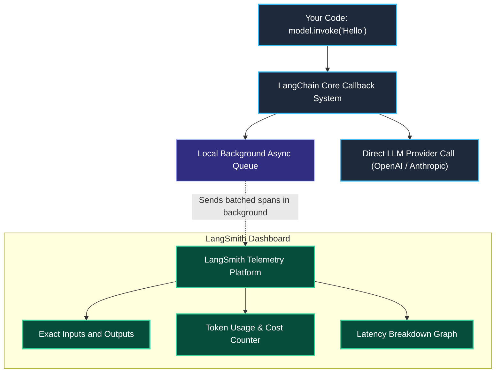
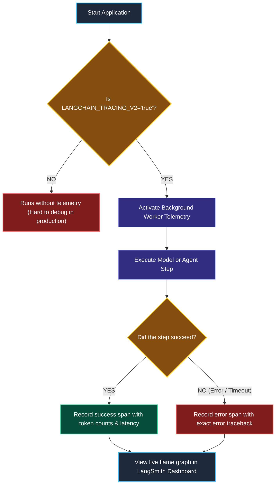

# Modern LangChain Ecosystem — The 4-Tier Stack

> "Building an AI application without tracing is like shipping backend code without logs or error monitors. You only find out something broke when a customer complains."

---

### Step 1: Why Do We Need This?

#### The Real Problem

When developers start building with AI, they usually install one giant library and write raw API calls. In small test scripts, this works fine. But in production, three painful problems happen:

1. **The Black Box Problem:** An AI agent fails on step 4 of a 6-step task. Did the model return bad text? Did the user prompt get cut off? Did an external database time out? Without tracing, you have to guess.
2. **Surprise Bills and Slow Latency:** You suddenly receive a massive model API bill, and your app takes 8 seconds to respond. You have no idea which function or prompt burned all those tokens.
3. **The Outdated Tutorial Trap:** Many tutorials on the internet still use old pre-1.0 LangChain code (`LLMChain`, `initialize_agent`, `RetrievalQA`). These were moved to a separate legacy package called `langchain-classic`. If you copy old code into a modern project, your app will crash.

We need a clean, modular stack where every piece has one clear job, and every single model call is automatically recorded and measured.

---

### Step 2: What Is It?

#### Simple Explanation

Think of the modern AI engineering ecosystem like a **modern Formula 1 racing team**:

- You have the **driver controls** (steering wheel and pedals) that the driver touches.
- You have the **engine and transmission** underneath that actually runs the car.
- You have the **pit-wall telemetry screen** that watches tire temperature, fuel, and engine speed in real time.

In the 2026 AI stack, we split these jobs across **4 distinct layers**:


#### The 4 Layers Explained

| Layer | Tool | What it does in simple English |
| :--- | :--- | :--- |
| **Tier 1: Harness** | **Deep Agents** | Ready-made tools for complex agents (task planning, file storage, subagents). |
| **Tier 2: Interface** | **LangChain 1.x** | The basic building blocks: model connections, prompt templates, and `create_agent()`. |
| **Tier 3: Engine** | **LangGraph** | The durable engine underneath: handles state, loops, saving progress, and human approvals. |
| **Tier 4: Telemetry** | **LangSmith** | The monitoring dashboard: records flame graphs, token costs, latency, and test scores. |

> [!NOTE]
> **Key Rule to Remember:** In LangChain 1.x, `create_agent()` does not run its own custom loop. It builds directly on top of **LangGraph**.

---

### Step 3: Real-World Example

#### Finding a Slow Step in Production

Imagine you run an AI customer support bot for an online store. A customer asks: *"Where is my order #5821?"*

The request takes **25 seconds** and then fails with a gateway timeout:

```
WITHOUT TRACING (Blind Guessing):
[User Query] ───> [ 25-Second Black Box ] ───> Gateway Timeout 504
Did the model hang? Did the database fail? Nobody knows.

WITH LANGSMITH TRACING (Instant Clarity):
[Support Request] ────────────────────────── (Total: 25.1s)
  ├── 1. ChatModel: gpt-4o-mini ──────────── [0.8s  | 180 tokens]  (Success)
  ├── 2. Tool: search_order_db ───────────── [0.2s  | Found order] (Success)
  └── 3. Tool: legacy_shipping_carrier_api ─ [24.1s | TIMEOUT]     <-- Bug spotted in 5 seconds!
```

**What the system receives:** A user question and an automatic trace session ID.  
**What decision it makes:** Runs the workflow while sending lightweight background telemetry spans to LangSmith.  
**What it returns:** The final answer to the user, plus an exact step-by-step breakdown of time and tokens spent on every action.

---

### Step 4: How Does It Work?

#### The Telemetry Flow

Tracing is completely decoupled from your main application thread. It will never slow down your user's response:



- When you turn on tracing, `langchain-core` captures every function start, end, and error.
- Telemetry data is pushed to a background memory queue and sent asynchronously.
- Your user gets their answer immediately without waiting for the logging server.

---

### Step 5: Code Example

#### Setting Up Your First Traced Call

This is a complete, working Python script. Notice how we do not wrap our code in messy logging statements. Turning on two environment variables is all it takes.

```python
import os
from langchain.chat_models import init_chat_model

# 1. Turn on tracing using standard environment variables
os.environ["LANGCHAIN_TRACING_V2"] = "true"
os.environ["LANGCHAIN_API_KEY"] = "your_langsmith_key_here"
os.environ["LANGCHAIN_PROJECT"] = "learning-sandbox"

# Make sure your Grok / xAI provider key is set (export XAI_API_KEY="xai-...")
# os.environ["XAI_API_KEY"] = "xai-..."

# 2. Initialize Grok using the standard 1.x factory (or ChatXAI)
model = init_chat_model("grok-2-latest", model_provider="xai", temperature=0.0)

# Alternatively, import ChatXAI directly:
# from langchain_xai import ChatXAI
# model = ChatXAI(model="grok-2-latest", temperature=0.0)

# 3. Invoke the model
# Behind the scenes, LangChain sends the full trace to LangSmith
response = model.invoke("Explain why tracing matters in 10 simple words.")

print("Model Answer:")
print(response.content)

print("\nToken Accounting:")
print(f"Input tokens:  {response.usage_metadata.get('input_tokens')}")
print(f"Output tokens: {response.usage_metadata.get('output_tokens')}")
print(f"Total tokens:  {response.usage_metadata.get('total_tokens')}")
```

#### What Happens When You Run This:
1. `init_chat_model` connects to xAI's Grok API cleanly using `XAI_API_KEY`.
2. The prompt and the generated response are displayed in your terminal.
3. If you open your LangSmith dashboard, you will see a new run showing the exact prompt, the latency in milliseconds, and the exact token count.

---

### Step 6: How Is It Used in Production?

#### Real-World Engineering Rules

| Mistake | Why it hurts | How to fix it |
| :--- | :--- | :--- |
| **Leaking Customer Passwords or PII to Logs** | User passwords, credit cards, or medical data get stored in plain text inside your tracing dashboard. | Use LangSmith client-side masking (`hide_inputs=True`) or add a privacy cleaning middleware (Module 5) before sending prompts. |
| **Tracing 100% of Massive Production Traffic** | If your service handles 500,000 requests an hour, logging every single successful run costs unnecessary money and storage. | Use **trace sampling**: record 100% of errors and slow requests, but only 5% of normal successful requests. |
| **Importing Deprecated Chains** | Copying `from langchain.chains import LLMChain` from older websites breaks with modern modular packages. | Always use clean LCEL pipelines (`prompt | model | parser`) or modern `create_agent()`. |

---

### Step 7: Quick Revision

- **The 4 Tiers:** LangChain is the interface (primitives); LangGraph is the engine (state and loops); LangSmith is the telemetry screen (tracing and evaluation); Deep Agents is the high-level harness.
- **`create_agent` Runs on LangGraph:** In LangChain 1.x, agents are compiled directly into LangGraph state machines.
- **Zero-Boilerplate Tracing:** You do not write manual log statements for every step. Setting `LANGCHAIN_TRACING_V2=true` captures every step automatically.
- **Legacy Code Lives in Classic:** If a tutorial uses `RetrievalQA` or `initialize_agent`, that code has been moved to `langchain-classic` and should be avoided in new projects.

#### Short Interview Answer

> *"In the modern AI stack, LangChain provides the universal interface and building blocks, while LangGraph serves as the durable runtime engine underneath. Even `create_agent` compiles into a LangGraph graph. To ensure complete production visibility, we enable LangSmith tracing from day one. Because telemetry is dispatched asynchronously in background workers, we get full visibility into latency, token costs, and failed tool calls without slowing down user responses."*

---

### Step 8: Final Flow Diagram



---

### Step 9: Quiz

Test your understanding of the modern AI stack and tracing. Submit your answers as (1-A, 2-B, etc.) and we will review the explanations together!

#### Question 1
Why does modern LangChain 1.x run `create_agent()` on top of LangGraph instead of having its own separate agent execution engine?
- A. Because Python 3.10 removed support for standard `while` loops.
- B. To take advantage of LangGraph's durable execution, checkpointing, and human-in-the-loop features without duplicating the code.
- C. To force developers to use a paid cloud hosting account.
- D. Because LangChain's original core code was deleted accidentally.

#### Question 2
You are debugging an agent that gave a completely wrong answer to a customer. In your LangSmith dashboard, where should you look to see the exact text prompt that the model saw?
- A. Inside the top-level project settings tab.
- B. In your local operating system's terminal history.
- C. Inside the specific `ChatModel` child span under the `inputs` view.
- D. In the `langchain-classic` error report folder.

#### Question 3
An engineer is worried that turning on LangSmith tracing in production will add 100 milliseconds of delay to every customer chat response. Why is this fear incorrect?
- A. Because LangSmith replaces the model provider's servers with faster hardware.
- B. Because `langchain-core` batches and sends trace spans asynchronously using background worker threads, keeping user requests fast.
- C. Because tracing only turns on after the user closes their browser window.
- D. Because LangSmith runs only on the user's mobile device.

#### Question 4
A developer is looking at an old blog post and tries to run `from langchain.chains import RetrievalQA`, but Python returns an `ImportError`. What is the correct modern solution?
- A. Downgrade to Python 3.8 and reinstall older packages.
- B. Understand that `RetrievalQA` is a deprecated legacy chain moved to `langchain-classic`, and build a modern LCEL pipeline or RAG agent instead.
- C. Manually write a custom C++ extension to restore the chain.
- D. Turn off tracing by setting `LANGCHAIN_TRACING_V2=false`.
