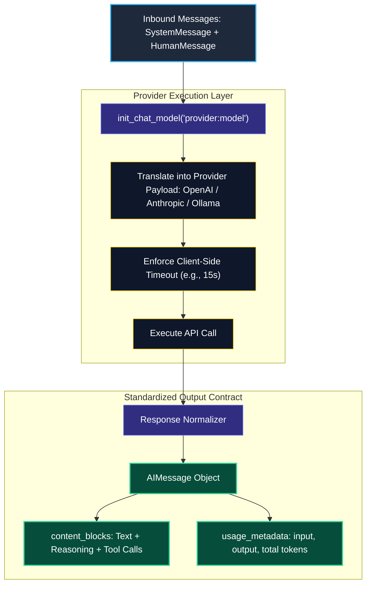
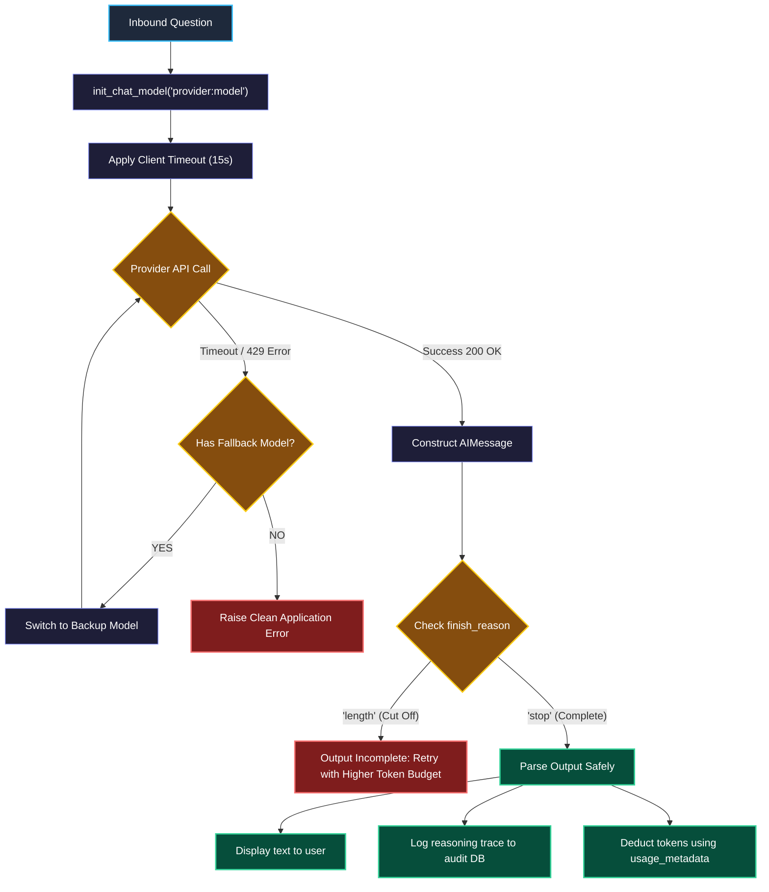

# Chat Models, Messages, and Standard Content Blocks

> "If you buy electrical appliances from different countries, you don't rebuild your house's electrical wiring. You use a universal power adapter."

---

### Step 1: Why Do We Need This?

#### The Real Problem

When you build an AI application using raw provider SDKs (like importing `openai` or `anthropic` directly), you lock your code to one vendor:

```
THE MESSY VENDOR-LOCK TRAP:
If OpenAI:    response.choices[0].message.content  (plus custom token counting)
If Anthropic: response.content[0].text             (plus custom 'thinking' parser)
If Gemini:    response.candidates[0].content.parts (different keys again!)
```

This creates three big engineering problems:
1. **Switching Models Breaks Everything:** If you want to switch from Claude to GPT-4o or a local Ollama model to cut costs, you have to rewrite your parsing code, your error handling, and your billing logic.
2. **Messy String Parsers for Reasoning:** Modern models do not just output plain text; they output a mixture of *internal reasoning (thinking)*, *tool calls*, and *final text*. Searching for `<think>` tags with regex breaks whenever the provider changes their formatting.
3. **Different Token Names:** Every provider names token metrics differently (`prompt_tokens` vs `input_tokens` vs `prompt_token_count`). This makes multi-tenant billing tables messy and error-prone.

We need a universal interface that takes standard messages in, calls any provider, and returns a clean, standard response object.

---

### Step 2: What Is It?

#### Simple Explanation

Think of LangChain’s chat model abstraction like a **Universal Travel Power Adapter**:

You plug any standard plug into the adapter, and the adapter handles the different wall voltages underneath. In your code, you pass a clean list of messages into `init_chat_model()`, and you always get back a single, standardized `AIMessage`.


#### The 5 Standard Content Blocks

Instead of parsing raw strings with regex, modern LangChain 1.x unpacks model responses into a clean list called `content_blocks`:

| Block Type | What it contains | Why it matters |
| :--- | :--- | :--- |
| `text` | The final plain text answer. | Send this directly to the user's screen. |
| `reasoning` | The model's internal thinking process. | Store this in your audit logs without showing it to the customer. |
| `tool_call` | Structured function name and arguments. | Your server runs this tool safely. |
| `citation` | Source document links and references. | Shows proof of where the answer came from. |
| `usage_metadata` | Standard token counts (`input_tokens`, `output_tokens`, `total_tokens`). | Deduct credits from user accounts accurately across all models. |

---

### Step 3: Real-World Example

#### The Healthcare vs Standard Privacy Router

You run an enterprise customer service platform:
- **Banking / Healthcare Clients:** Their legal rules forbid sending data to external cloud APIs. Their requests must route to a local **Ollama** server running `llama3.2` on their own hardware.
- **Standard Clients:** Can route to **Claude 3.5 Sonnet** or **GPT-4o-mini** in the cloud for faster, cheaper responses.

```
[Inbound Client Request]
           │
           ▼
[Check Customer Privacy Tier]
     │                      │
     ▼                      ▼
[Local Ollama Node]    [Cloud OpenAI API]
     │                      │
     └──────────┬───────────┘
                ▼
      [init_chat_model Hub]
                │
   [Canonical AIMessage Output]
                │
    ┌───────────┴───────────┐
    ▼                       ▼
[User UI: Text Block]   [Billing DB: usage_metadata]
```

**What the system receives:** A user prompt and their privacy setting.  
**What decision it makes:** Picks the right model string (e.g., `"openai:gpt-4o-mini"` vs `"ollama:llama3.2"`) without changing any other code.  
**What it returns:** An identical `AIMessage` with standard text and token usage.

---

### Step 4: How Does It Work?

#### The 4-Stage Execution Flow



1. **Message Setup:** You put messages into standard typed classes (`SystemMessage`, `HumanMessage`).
2. **Provider Translation:** `init_chat_model` automatically converts your messages into the exact JSON format that OpenAI, Anthropic, or Ollama expects.
3. **Execution & Timeout:** The request runs with strict client-side timeout limits to prevent hung connections.
4. **Output Normalization:** The raw vendor response is packaged into a clean `AIMessage` with `content_blocks` and `usage_metadata`.

---

### Step 5: Code Example

#### A Universal Multi-Vendor Call

This complete Python script works across hosted cloud providers and local models. Notice how switching models only requires changing one string.

```python
import os
from typing import Any
from langchain.chat_models import init_chat_model
from langchain_core.messages import HumanMessage, SystemMessage

def ask_ai_service(model_name: str, user_question: str) -> dict[str, Any]:
    """
    Universal model invocation. Works with:
      - 'openai:gpt-4o-mini'
      - 'anthropic:claude-3-5-sonnet-20241022'
      - 'ollama:llama3.2'
    """
    # 1. Initialize through the universal factory
    model = init_chat_model(
        model=model_name,
        temperature=0.0,
        timeout=15.0,  # Never let a request hang forever!
        max_tokens=800
    )

    # 2. Structure conversation using typed message classes
    messages = [
        SystemMessage(content="You are a helpful software engineer. Be clear and direct."),
        HumanMessage(content=user_question)
    ]

    print(f"\n--- Calling {model_name} ---")
    
    # 3. Invoke the model to get a canonical AIMessage
    response = model.invoke(messages)

    # 4. Standard token accounting across all providers
    usage = response.usage_metadata or {}
    
    # 5. Extract content blocks cleanly
    clean_text = []
    reasoning_trace = []

    for block in response.content_blocks:
        if block.get("type") == "text":
            clean_text.append(block.get("text", ""))
        elif block.get("type") == "reasoning":
            reasoning_trace.append(block.get("reasoning", ""))

    return {
        "model": model_name,
        "answer": "".join(clean_text),
        "reasoning": "".join(reasoning_trace),
        "tokens_used": usage.get("total_tokens", 0),
        "finish_reason": response.response_metadata.get("finish_reason")
    }

if __name__ == "__main__":
    prompt = "Why do distributed systems require client-side timeouts in two sentences?"
    
    # Example call using xAI / Grok (Make sure XAI_API_KEY is set)
    if os.getenv("XAI_API_KEY"):
        result = ask_ai_service("xai:grok-2-latest", prompt)
        print("Answer:\n", result["answer"])
        print("Total Tokens:", result["tokens_used"])
        print("Finish Reason:", result["finish_reason"])
    else:
        print("Please set your XAI_API_KEY environment variable to test live with Grok.")
```

---

### Step 6: How Is It Used in Production?

#### Real-World Engineering Rules

```
           MODEL CALL RETURNS HTTP 200 OK
                         │
                         ▼
           Is finish_reason == 'length'?
                     ╱       ╲
                  YES         NO
                  ╱             ╲
   ┌──────────────────────┐   ┌──────────────────────┐
   │ SILENT CUTOFF BUG!   │   │ NORMAL HEALTHY RUN   │
   │ Model hit max_tokens │   │ - Display text       │
   │ Output is incomplete │   │ - Bill user tokens   │
   │ Action: Retry with   │   └──────────────────────┘
   │ larger token budget  │
   └──────────────────────┘
```

| Failure Mode | What goes wrong | How to fix it |
| :--- | :--- | :--- |
| **Silent Output Truncation** | The model runs out of output tokens in the middle of a sentence. Downstream parsers crash. | Check `response.response_metadata["finish_reason"]`. If it equals `"length"` (or `"max_tokens"`), treat the response as incomplete and trigger a retry. |
| **Unprotected API Calls** | When an upstream provider suffers an outage, your server worker threads hang for 60+ seconds. | Always pass `timeout=15.0` to `init_chat_model()`, and attach a backup fallback model using `.with_fallbacks([backup_model])`. |
| **Parsing Reasoning with Regex** | Searching for `<think>` tags fails when Anthropic or Google changes their formatting. | Never use regex. Always iterate over `response.content_blocks` and filter for `block["type"] == "reasoning"`. |

---

### Step 7: Quick Revision

- **The Universal Adapter:** `init_chat_model("provider:model")` gives you one entry point for any model. Changing vendors is a one-string change.
- **Message Types:** Always use `SystemMessage`, `HumanMessage`, and `AIMessage` instead of pasting raw strings together.
- **Content Blocks:** `AIMessage.content_blocks` neatly separates final text, reasoning thoughts, and tool calls into standard typed objects.
- **Finish Reason:** An HTTP 200 code does not mean the answer is finished. Always verify `finish_reason` is `"stop"`.

#### Short Interview Answer

> *"In production, we never hardcode vendor-specific SDKs because changing models breaks parsing and billing code. Instead, we use LangChain's universal `init_chat_model` abstraction. We send canonical `SystemMessage` and `HumanMessage` objects, and read responses through standard `content_blocks` and `usage_metadata`. This allows us to switch seamlessly between cloud models and on-premise Ollama instances with zero changes to our downstream application logic."*

---

### Step 8: Final Flow Diagram



---

### Step 9: Quiz

Test your understanding of chat models and content blocks. Submit your answers as (1-A, 2-B, etc.) and we will review the explanations together!

#### Question 1
Your production system calls Claude 3.5 Sonnet with reasoning enabled, allocating a `max_tokens` limit of 1,000. The API call returns HTTP 200 and records 1,000 tokens used, but the final text output is completely empty. What is the most likely cause?
- A. Anthropic's servers had an outage and dropped the text output.
- B. The model used all 1,000 tokens on internal thinking (`reasoning`), hitting the limit before it could start generating the user-facing text block.
- C. The `init_chat_model` function does not work with Anthropic models.
- D. Python automatically deleted the text because it detected sensitive information.

#### Question 2
You want to make sure your AI service automatically switches to a backup model if your primary provider is slow or down. What is the cleanest, production-recommended way to do this in LangChain?
- A. Write an infinite `while` loop that changes the model name string whenever an exception occurs.
- B. Chain the primary model with `.with_fallbacks([backup_model])`, and make sure both models have explicit `timeout` limits set.
- C. Increase your web server's gateway timeout to 5 minutes so requests never fail.
- D. Run both models at the exact same time on every request and discard the slower one.

#### Question 3
You need to save the model's internal thinking process into an audit database for compliance, while showing only the final answer to the customer. What is the recommended way to get the thinking process?
- A. Run a regular expression search on `response.content` looking for `<think>` tags.
- B. Look inside `response.content_blocks` and find blocks where `block.get("type") == "reasoning"`.
- C. Ask the user in the prompt to copy and paste their thoughts.
- D. Read the prompt template's internal system variables.

#### Question 4
An enterprise customer demands that their data never leave their internal data center. You need to switch your pipeline from `openai:gpt-4o` to a locally hosted `ollama:llama3.2` instance. How much of your message handling and parsing code do you need to rewrite?
- A. None. You only change the model identifier string in `init_chat_model`; all message types, content blocks, and token parsing code remain identical.
- B. You must rewrite everything into raw strings because local models cannot use `SystemMessage`.
- C. You must replace the pipeline with an old `langchain-classic` chain.
- D. You must install a completely different web server framework.
