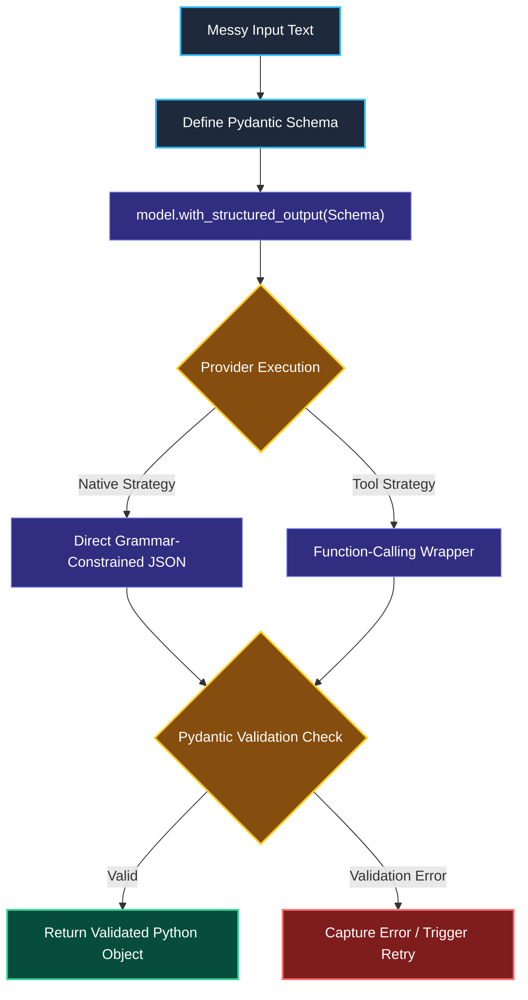
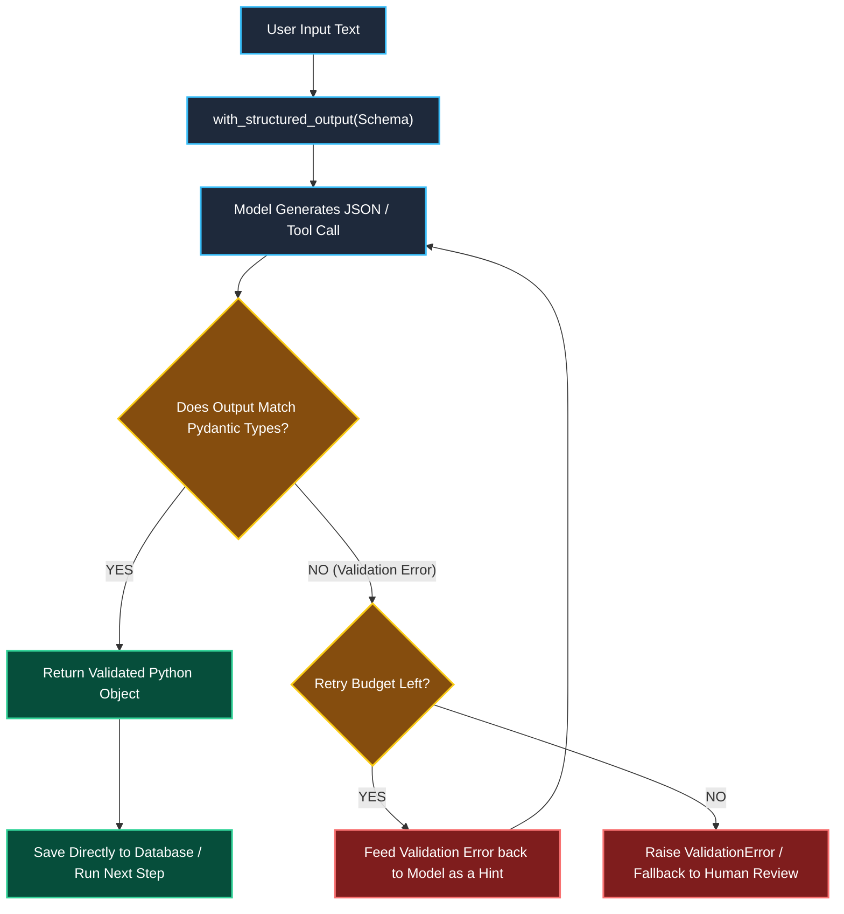

# Structured Output with Pydantic and Schemas

> "Your database cannot save an English paragraph. Your code needs clean, validated objects with exact types."

---

### Step 1: Why Do We Need This?

#### The Real Problem

If you tell an AI model in plain English: *"Please return the answer as JSON"*, your downstream Python application will frequently crash in production:

```
THE PLAIN TEXT BREAKDOWN:
Model output: "Sure! Here is the JSON you asked for:
```json
{ 'user_age': 28, 'status': 'active' }
```
Hope this helps!"

→ json.loads() CRASHES because of the markdown fences and intro text.
→ Single quotes break standard JSON decoders.
→ The key might be named "user_age" today, and "age" or "userAge" tomorrow.
```

This causes three critical production failures:
1. **Markdown & Chatter Formatting Bugs:** Models frequently wrap output in ```json ... ``` or add conversational pleasantries that break standard JSON parsers.
2. **Missing or Renamed Keys:** One time the model returns `{"customer_id": 10}`, and the next time it returns `{"id": "ten"}`. Your downstream API throws a `KeyError`.
3. **No Type Safety:** You ask for a number (like an urgency score from 1 to 5), but the model returns `"high"` or `null`.

We need a way to guarantee that the model behaves like a typed API, returning validated data objects directly.

---

### Step 2: What Is It?

#### Simple Explanation

Think of structured output like **giving the model an official printed form with exact boxes to fill in**, instead of giving it a blank sheet of paper.

Behind the scenes, modern AI frameworks use **two main strategies** to enforce this form:


#### The Two Strategies Compared

| Feature | Strategy 1: Provider-Native | Strategy 2: Tool-Calling |
| :--- | :--- | :--- |
| **How it works** | The model provider forces the vocabulary at the token level, making invalid JSON physically impossible. | The system tricks the model into thinking it is calling a function named `RecordData(schema)`. |
| **Schema Guarantee** | 100% strictly matches the schema. | Very high, but occasionally the model might pick wrong arguments. |
| **Reasoning Support** | The model must generate JSON immediately; it cannot think out loud first. | Great for reasoning: the model can output thoughts before calling the schema tool. |
| **Model Support** | Supported on newer OpenAI and Gemini models. | Works across almost all models (Claude, OpenAI, Mistral, Ollama). |

---

### Step 3: Real-World Example

#### Automated Customer Support Ticket Triage

A customer service team receives hundreds of messy emails every day. You must turn each email into a clean database ticket:
- `category`: Must be one of `Billing`, `Bug`, `Security`, or `Feature`.
- `urgency_score`: A number between 1 and 5.
- `summary`: One clear sentence.

**What the system receives:**  
*"Hey! Someone broke into our admin account and changed all passwords! Fix this right now!"*

**What decision the system makes:**  
The model is constrained by a Pydantic schema. It is forced to choose `Security` (not `Urgent Security Issue` or any other made-up label), assigns urgency `5`, and writes a clean summary.

**What it returns:**  
A validated Python Pydantic object that saves directly into your SQL database without any manual string parsing.

---

### Step 4: How Does It Work?

#### The Validation Lifecycle



1. **Define the Schema:** You write a simple Pydantic class with descriptions for each field.
2. **Bind to the Model:** You call `model.with_structured_output(MySchema)`.
3. **Execution & Parsing:** LangChain translates the schema, calls the model, runs Pydantic validators on the returned fields, and hands you the clean object.

---

### Step 5: Code Example

#### A Production-Grade Pydantic Extractor

Here is a complete, working script in LangChain 1.x:

```python
from typing import Literal, Optional
from pydantic import BaseModel, Field
from langchain.chat_models import init_chat_model

# 1. Define your exact schema
class SupportTicket(BaseModel):
    category: Literal["Billing", "Bug", "Security", "Feature"] = Field(
        description="Pick the exact matching department."
    )
    urgency_score: int = Field(
        description="Rating from 1 (lowest) to 5 (highest critical emergency)."
    )
    summary: str = Field(
        description="Brief one-sentence summary of the customer's problem."
    )
    account_id: Optional[str] = Field(
        default=None,
        description="Customer account ID if mentioned in the message, else None."
    )

# 2. Initialize the model (Grok supports native tool/structured output)
model = init_chat_model("grok-2-latest", model_provider="xai", temperature=0.0)

# 3. Bind the schema
# Set include_raw=True if you need to debug the raw model output
structured_model = model.with_structured_output(SupportTicket, include_raw=False)

# 4. Run the extractor
raw_email = "Our billing credit card failed and our database shut down this morning! Account: ACC-9921"
ticket = structured_model.invoke(raw_email)

# Output is a real Python object with dot notation!
print("Type:", type(ticket))
print("Category:", ticket.category)
print("Urgency:", ticket.urgency_score)
print("Summary:", ticket.summary)
print("Account ID:", ticket.account_id)
```

> **Pro Tip on `include_raw=True`:**  
> If you set `include_raw=True`, `invoke()` returns a dictionary: `{"raw": AIMessage, "parsed": SupportTicket, "parsing_error": None}`. This allows you to inspect what the model actually generated if validation fails.

---

### Step 6: How Is It Used in Production?

#### Real-World Engineering Rules

| Common Mistake | Why it hurts | How to fix it |
| :--- | :--- | :--- |
| **Deep, Nested Schemas** | Models get confused when a schema has 4 levels of nested lists and objects. | Keep schemas **shallow** (1–2 levels max). Flatten objects where possible. |
| **Vague Field Descriptions** | The model has to guess what a field means from just its variable name. | Always write a clear `Field(description="...")` to guide the model. |
| **Using Open Strings instead of `Literal`** | The model invents labels like `"high priority"` instead of `"P1"`. | Use `Literal["P1", "P2", "P3"]` to force exact choices. |
| **Forgetting Optional Fields** | If a field is not always present in the text, the model makes up fake data to satisfy the required field. | Use `Optional[str] = None` for any information that might be missing. |

---

### Step 7: Quick Revision

- **Schemas are API Contracts:** Never parse JSON with regex. Structured output guarantees your model behaves like a typed backend service.
- **Native vs Tool Strategy:** Use **Provider-Native** when you need strict, guaranteed JSON formatting. Use **Tool-Calling** when you need the model to think out loud before outputting the data.
- **Pydantic is the Standard:** Pydantic is not just for input validation—it is the universal standard for model outputs in modern AI engineering.

#### Short Interview Answer

> *"In production, we never ask the model for raw JSON strings because markdown formatting and schema drift break downstream services. Instead, we use `model.with_structured_output()` backed by Pydantic schemas. Depending on the model, this uses either Provider-Native constrained decoding for strict formatting or Tool-Calling when the model needs to reason before emitting data. This gives our application full type-safety, automatic validation, and clean error handling."*

---

### Step 8: Final Flow Diagram



---

### Step 9: Quiz

Test your understanding of structured output. Submit your answers as (1-A, 2-B, etc.) and we will review the explanations together!

#### Question 1
You ask a model to extract invoice data into a Pydantic model. Sometimes the invoice does not list a "tax ID". What is the best way to design the schema so the model does not invent a fake number?
- A. Leave the field as a required `tax_id: str` and instruct the model in the prompt to never lie.
- B. Define the field as `tax_id: Optional[str] = None` with a description saying it should be `None` if missing.
- C. Delete the field completely and run a second prompt to search for the tax ID.
- D. Change the type to `tax_id: int` so text values trigger a database warning.

#### Question 2
When should an engineer prefer the **Tool-Calling strategy** over the **Provider-Native strategy** for structured output?
- A. When you want the cheapest possible cost with zero token overhead.
- B. When the model needs to generate reasoning steps before filling out the final structured fields.
- C. When using a model that has no internet connection.
- D. When you want to store the output as raw HTML instead of JSON.

#### Question 3
You set up `structured_model = model.with_structured_output(MySchema, include_raw=True)`. What does `invoke()` return?
- A. Just a raw unparsed text string.
- B. A boolean `True` or `False` showing whether the model succeeded.
- C. A dictionary containing the raw model message, the parsed Pydantic object, and any parsing error that occurred.
- D. An error message warning that `include_raw` is deprecated in LangChain 1.x.

#### Question 4
You have a customer review classification task where the output must only be one of three values: `Positive`, `Neutral`, or `Negative`. How do you enforce this in your Pydantic schema?
- A. Use `status: str` and write a regex check in your Python code after the model finishes.
- B. Use `status: Literal["Positive", "Neutral", "Negative"]`.
- C. Use `status: list[str]`.
- D. Use `status: Any` to let the model choose the best descriptive word.
