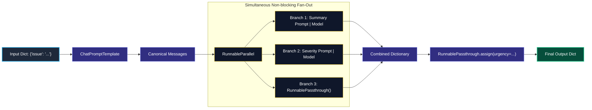
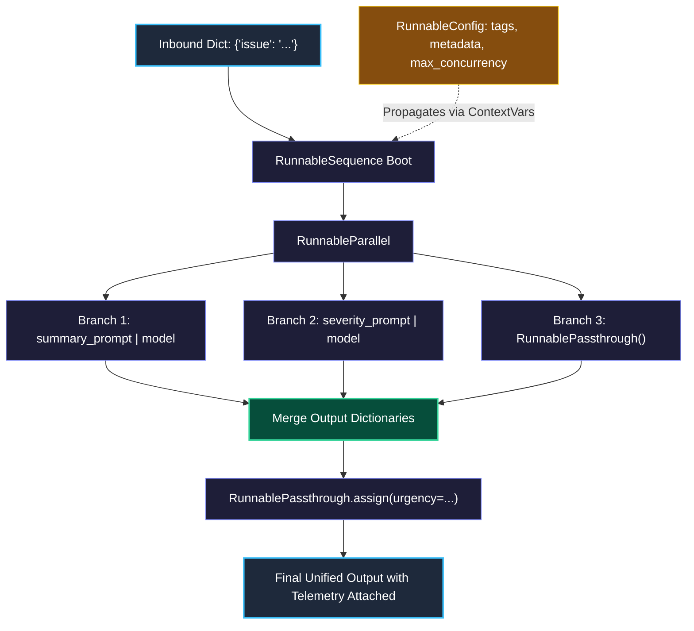

# Prompts, Runnables, and Composition (LCEL)

> "Unix command-line tools can be chained together because every tool reads standard input and writes standard output. LCEL brings the exact same power to AI applications."

---

### Step 1: Why Do We Need This?

#### The Real Problem

When building multi-step AI pipelines in plain Python, developers usually write manual, step-by-step glue code:

```python
# The Fragile Manual Pattern
def triage_ticket(user_text):
    formatted_prompt = f"Summarize this issue: {user_text}"
    response = model.call(formatted_prompt)
    summary = response.text
    # Then we call a second model sequentially...
    category = category_model.call(summary)
    return {"summary": summary, "category": category}
```

This manual chaining breaks in production for four critical reasons:
1. **Broken Streaming:** You cannot easily stream tokens from the first model to the user's screen while simultaneously running the second step in the background.
2. **Lost Telemetry Context:** Tracing tags, customer tenant IDs, and user metadata are lost across functions unless you manually pass them to every single function argument.
3. **Double Latency (Sequential Tax):** Steps that could run at the same time (like summarizing an alert and categorizing its severity) run one after the other, doubling the time the user has to wait.
4. **Duplicate Sync and Async Code:** To support both synchronous batch scripts and asynchronous FastAPI web apps, you have to write two separate versions of your pipeline.

We need a unified way to compose functions, prompts, models, and parsers into clean, parallel-ready pipelines.

---

### Step 2: What Is It?

#### Simple Explanation

Think of **LCEL (LangChain Expression Language)** like a **Unix Pipeline**:

```bash
cat server.log | grep "500" | sort | uniq -c
```

In Unix, the pipe operator (`|`) passes text between different programs without needing temporary files. In LCEL, the pipe operator passes structured data between **Runnables**.


#### The Core Primitives

- **The `Runnable` Protocol:** Every component (prompt, model, parser, custom function) implements the same standard methods:
  - `.invoke()` (sync single input) / `.ainvoke()` (async single input)
  - `.batch()` (concurrent list processing) / `.abatch()` (async batch)
  - `.stream()` (token-by-token streaming) / `.astream()` (async stream)
- **`ChatPromptTemplate`:** Replaces raw f-strings. Handles roles (`system`, `human`), variable injection, and `MessagesPlaceholder` for chat history.
- **`RunnableParallel`:** Runs multiple branches at the exact same time and merges their outputs into a single dictionary.
- **`RunnablePassthrough`:** Forwards the original input data untouched alongside newly computed values.
- **`RunnableLambda`:** Turns any regular Python function into a fully traceable, stream-compatible Runnable.
- **`RunnableConfig`:** A context object carrying `tags`, `metadata`, and `max_concurrency` through the entire pipeline without cluttering your code.

---

### Step 3: Real-World Example

#### Parallel Incident Triage Engine

An on-call DevOps engineer receives an unformatted PagerDuty alert. Before sending it to the human team, your system must:
1. Keep the raw alert text untouched for audit logs.
2. Generate an executive summary of the failure.
3. Classify the severity level (`P1` to `P3`) in parallel.
4. Calculate an urgency score using custom business logic.
5. Combine everything into an actionable Slack notification.

```
[Raw Incident Alert]
         │
         ├──> (Branch 1) RunnablePassthrough ───────────────> raw_alert
         ├──> (Branch 2) Alert -> Summary Prompt -> LLM ────> summary
         └──> (Branch 3) Alert -> Severity Prompt -> LLM ───> severity
         │
         ▼ (RunnableParallel Merges Into Single Dictionary)
[Actionable Slack Alert with Urgency Score]
```

**What the system receives:** `{"issue": "Database connection pool exhausted on /checkout"}`  
**What decision it makes:** Runs the summary and severity checks concurrently to cut waiting time in half, passing the `tenant_id` inside `RunnableConfig`.  
**What it returns:** A unified dictionary with summary, severity, and audit trail.

---

### Step 4: How Does It Work?

#### The Pipeline Flow

When you write `chain = prompt | model | parser`:



1. **The Pipe Operator:** Under the hood, Python calls `__or__` on the Runnable, creating an optimized execution sequence.
2. **Context Propagation:** `RunnableConfig` travels alongside the data using Python context variables, ensuring tracing tags appear on every child span in LangSmith.
3. **Streaming Support:** Tokens yield immediately from the model to the client without waiting for the full pipeline to finish.

---

### Step 5: Code Example

#### A Complete, Composable Incident Triage Pipeline

Here is a complete, runnable script using LCEL primitives in LangChain 1.x:

```python
from typing import Any
from langchain_core.prompts import ChatPromptTemplate
from langchain_core.output_parsers import StrOutputParser
from langchain_core.runnables import (
    RunnableParallel,
    RunnablePassthrough,
    RunnableLambda,
    RunnableConfig
)
from langchain.chat_models import init_chat_model

# 1. Initialize Model
model = init_chat_model("openai:gpt-4o-mini", temperature=0.0)

# 2. Reusable Prompt Templates
summary_prompt = ChatPromptTemplate.from_messages([
    ("system", "Summarize this operational issue in exactly one sentence."),
    ("human", "{issue}")
])

severity_prompt = ChatPromptTemplate.from_messages([
    ("system", "Categorize the severity as P1, P2, or P3 based on user impact."),
    ("human", "{issue}")
])

# 3. Custom Python Logic wrapped in RunnableLambda
def calculate_urgency(inputs: dict[str, Any]) -> str:
    """Pure Python function lifted into the pipeline."""
    issue_text = inputs.get("raw_data", {}).get("issue", "").lower()
    return "PAGE_ON_CALL_NOW" if "checkout" in issue_text else "STANDARD_QUEUE"

# 4. Assembling the Pipeline with Parallel Fan-Out
# Both model calls execute concurrently
parallel_step = RunnableParallel(
    summary=summary_prompt | model | StrOutputParser(),
    severity=severity_prompt | model | StrOutputParser(),
    raw_data=RunnablePassthrough()
)

# Attach the urgency score to the combined dictionary
full_pipeline = (
    parallel_step 
    | RunnablePassthrough.assign(urgency=RunnableLambda(calculate_urgency))
)

# 5. Running with Telemetry Context
if __name__ == "__main__":
    test_alert = {"issue": "Database connection pool exhausted causing 502 errors on /checkout"}

    # Attach production metadata without modifying function arguments
    config = RunnableConfig(
        tags=["production", "pagerduty-triage"],
        metadata={"tenant_id": "client_enterprise_99"},
        max_concurrency=5
    )

    result = full_pipeline.invoke(test_alert, config=config)

    print("\n--- TRIAGE RESULT ---")
    print(f"Summary:  {result['summary']}")
    print(f"Severity: {result['severity']}")
    print(f"Urgency:  {result['urgency']}")
    print(f"Original: {result['raw_data']['issue']}")
```

---

### Step 6: How Is It Used in Production?

#### Real-World Engineering Rules

```
                 RUNNABLEPARALLEL EXECUTION
                             │
            ┌────────────────┴────────────────┐
            ▼                                 ▼
    [Branch 1: Fast]                  [Branch 2: Slow / Fails]
    Returns in 0.4s                   Throws Timeout Error
            │                                 │
            └────────────────┬────────────────┘
                             ▼
            What happens to the entire run?
                             │
    ┌────────────────────────┴────────────────────────┐
    ▼                                                 ▼
DEFAULT BEHAVIOR:                         PRODUCTION DEFENSE:
Entire pipeline crashes;                  Wrap vulnerable branches with
Branch 1's computation is wasted          .with_retry() or .with_fallbacks()
```

| Failure Mode | What goes wrong | How to fix it |
| :--- | :--- | :--- |
| **One Branch Crashes the Parallel Step** | In `RunnableParallel`, if one branch fails or times out, the entire pipeline crashes, throwing away successful results from sibling branches. | Wrap risky branches with `.with_retry(stop_after_attempt=3)` or `.with_fallbacks([backup_runnable])`. |
| **Socket Starvation during `.batch()`** | Running `.batch()` on 500 records opens 500 simultaneous network requests, getting your IP blocked by provider rate limits. | Always pass `RunnableConfig(max_concurrency=10)` to cap the maximum simultaneous connections. |
| **Global State Mutation in Lambdas** | Modifying global variables inside a `RunnableLambda` creates race conditions when multiple users make requests at once. | Keep all functions inside `RunnableLambda` pure and stateless. |

---

### Step 7: Quick Revision

- **The Runnable Protocol:** Everything implements `invoke`, `batch`, and `stream`. Once a component follows this rule, it can be piped into any other component.
- **LCEL is Declarative:** Writing `a | b` does not run code immediately; it compiles a clean pipeline graph ready for streaming, parallelism, and tracing.
- **When to Use LCEL vs Agents vs LangGraph:**
  - **LCEL (`|`):** Fixed, predictable pipelines (input -> prompt -> model -> parse).
  - **`create_agent`:** Flexible loops where the model decides which tools to pick (Module 5).
  - **LangGraph:** Explicit cycles, branch memory, human approval, and durable restarts (Module 8).

#### Short Interview Answer

> *"LangChain Expression Language (LCEL) is a declarative standard for chaining AI components. By adhering to the `Runnable` protocol, any chain created with LCEL automatically supports synchronous calls, async events, streaming, and batching without extra code. Runtime parameters like tracing tags, customer IDs, and concurrency limits are passed through a unified `RunnableConfig` without cluttering business logic. We use LCEL for deterministic, fixed pipelines and save LangGraph for stateful workflows with loops."*

---

### Step 8: Final Flow Diagram



---

### Step 9: Quiz

Test your understanding of LCEL and Runnables. Submit your answers as (1-A, 2-B, etc.) and we will review the explanations together!

#### Question 1
An engineer writes an LCEL pipeline: `chain = prompt | model | parser`. They need to ensure that every execution of this chain records the customer's tenant ID in LangSmith traces, without modifying the input schema or prompt variables. How should this be implemented?
- A. Add a `{tenant_id}` variable to the `prompt` template and instruct the model to ignore it.
- B. Pass `config={"metadata": {"tenant_id": "tenant_123"}}` as the second argument to `chain.invoke()`.
- C. Store the tenant ID in a global Python variable before executing the chain.
- D. Subclass `StrOutputParser` and manually append the tenant ID to the string output.

#### Question 2
You are building an API that needs to run 100 translation requests concurrently through an LCEL chain. Calling `.batch()` causes downstream provider 429 rate-limit errors because it fires all 100 requests simultaneously. What is the most idiomatic fix?
- A. Write a custom `for` loop with `time.sleep(1)` between every single invocation.
- B. Pass `RunnableConfig(max_concurrency=5)` into the `.batch()` invocation.
- C. Reinstall `langchain-classic` and execute the requests using legacy `MapReduceChain`.
- D. Wrap the prompt template inside a `RunnableLambda` that catches HTTP 429 exceptions.

#### Question 3
In a production pipeline, an engineer uses `RunnablePassthrough.assign(sentiment=sentiment_chain)`. What does `.assign()` accomplish compared to plain `RunnableParallel`?
- A. It clears all previous dictionary keys and returns only the newly calculated `sentiment`.
- B. It converts the synchronous model call into an asynchronous background task that runs after the response returns.
- C. It preserves all existing keys in the input dictionary while appending or updating the calculated `sentiment` key.
- D. It assigns the model output directly to the operating system's environment variables.

#### Question 4
A pipeline contains a custom data cleaning function `def clean_text(text: str) -> str: ...`. What is the correct way to include this function inside an LCEL pipeline `prompt | model | parser`?
- A. `prompt | model | parser | RunnableLambda(clean_text)`
- B. `prompt | model | parser | clean_text()`
- C. `prompt | model | parser.apply(clean_text)`
- D. `prompt | model | parser | init_chat_model(clean_text)`
