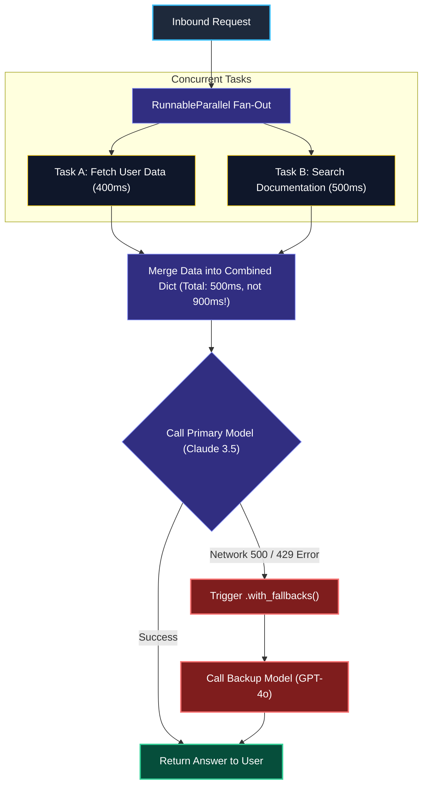
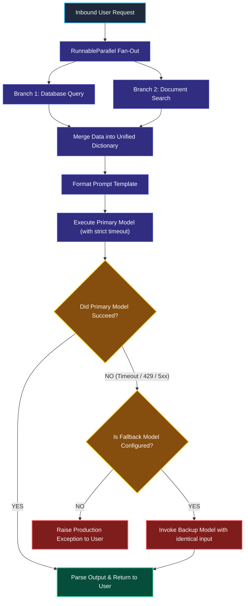

# Chaining, Parallelism, and Fallbacks in LCEL

> "A hospital never relies on a single power line. If the city power fails, a backup diesel generator switches on within milliseconds. Your AI pipelines need the exact same safety net."

---

### Step 1: Why Do We Need This?

#### The Real Problem

In real applications, an AI feature rarely does just one thing. It usually needs to:
1. Look up user history from a database (takes 400ms).
2. Fetch related company documents (takes 600ms).
3. Check the user's permission level (takes 200ms).

If you run these steps one after the other in sequence, your user has to wait **1,200ms** before the model even starts thinking:

```
SEQUENTIAL (Slow & Fragile):
Fetch DB (400ms) ──▶ Fetch Docs (600ms) ──▶ Check Auth (200ms) = 1,200ms delay!
And if the primary model throws a 503 error or hits a rate limit ──▶ The entire request crashes!
```

Two major problems happen:
- **The Latency Tax:** Waiting sequentially for tasks that have nothing to do with each other makes your app feel slow.
- **Single Point of Failure:** If your primary AI model provider (like OpenAI or Anthropic) suffers a temporary outage, your entire application goes down.

We need a way to run independent tasks **at the exact same time** and automatically switch to a **backup model** if the main one fails.

---

### Step 2: What Is It?

#### Simple Explanation

Think of **Parallelism and Fallbacks** like a **Modern Airport Runway System**:

- **Parallelism (`RunnableParallel`):** Multiple planes take off on parallel runways at the same time, instead of making every plane wait in one single long line.
- **Fallbacks (`with_fallbacks`):** If a runway gets blocked by snow, the control tower instantly redirects incoming planes to an open secondary runway.

In LangChain LCEL:
- **`RunnableParallel`** executes multiple branches concurrently and merges their results into a clean dictionary.
- **`.with_fallbacks([backup_runnable])`** catches errors from the primary component and immediately tries the backup without crashing your application.
- **`.with_retry(stop_after_attempt=3)`** automatically retries temporary network blips before giving up.

---

### Step 3: Real-World Example

#### The Resilient Customer Support Assistant

A user asks: *"Why was my credit card charged twice yesterday?"*

Before the AI can answer, the system needs two independent pieces of evidence:
- Branch 1: Recent payment transactions from the SQL database.
- Branch 2: The company's refund policy from the knowledge base.

```
                  [User Request]
                        │
         ┌──────────────┴──────────────┐
         ▼                             ▼
[Branch 1: Fetch Billing]    [Branch 2: Fetch Policy]
         │                             │
         └──────────────┬──────────────┘
                        ▼ (Merged into one context)
           [Primary Model: Claude 3.5]
                        │ (Fails with HTTP 503 Overloaded)
                        ▼
           [Backup Model: GPT-4o-mini]
                        │ (Succeeds!)
                        ▼
                  [Final Answer]
```

**What the system receives:** A user ID and question.  
**What decision it makes:** Fetches billing and policy records in parallel. Sends both to Claude 3.5 Sonnet. If Anthropic returns an overload error, it immediately calls GPT-4o-mini as a fallback.  
**What it returns:** An accurate, helpful answer in under 2 seconds, completely hiding the upstream provider outage from the customer.

---

### Step 4: How Does It Work?

#### The Execution Lifecycle



1. **Fan-Out:** `RunnableParallel` distributes independent tasks across worker threads or async tasks. The total wait time is just the time of the *slowest* branch, not the sum of all branches.
2. **Combine:** The branches finish and their return values are packed into a single Python dictionary.
3. **Safety Fallback:** If the primary step raises an exception, the fallback catches it, logs the warning, and invokes the backup component with the exact same input data.

---

### Step 5: Code Example

#### A Resilient Parallel Pipeline with Fallbacks

This complete Python script demonstrates running parallel lookups and protecting against provider outages:

```python
import time
from typing import Any
from langchain_core.prompts import ChatPromptTemplate
from langchain_core.output_parsers import StrOutputParser
from langchain_core.runnables import RunnableParallel, RunnableLambda
from langchain.chat_models import init_chat_model

# 1. Define two fast lookup functions (simulating database & policy lookups)
def get_user_billing(inputs: dict[str, Any]) -> str:
    # Simulates a quick DB lookup
    return "User had a duplicate pending charge of $49.99 on Oct 18."

def get_refund_policy(inputs: dict[str, Any]) -> str:
    # Simulates a policy search
    return "Duplicate charges are automatically refunded within 3 to 5 business days."

# 2. Setup Primary and Fallback Models (Using Grok-2 with Grok-Beta as backup)
# We set strict timeouts so the primary fails fast if the provider hangs
primary_model = init_chat_model("grok-2-latest", model_provider="xai", timeout=5.0)
backup_model = init_chat_model("grok-beta", model_provider="xai", timeout=5.0)

# Attach the fallback: if Grok-2 times out or errors, Grok-Beta takes over immediately!
reliable_model = primary_model.with_fallbacks([backup_model])

# 3. Prompt Template that combines both pieces of evidence
prompt = ChatPromptTemplate.from_template(
    """You are a helpful customer support agent.
User Billing Data: {billing_info}
Company Policy: {policy_info}

Customer Question: {question}
Explain what happened and what will be done clearly."""
)

# 4. Construct the Parallel Pipeline
chain = (
    RunnableParallel(
        billing_info=RunnableLambda(get_user_billing),
        policy_info=RunnableLambda(get_refund_policy),
        question=RunnableLambda(lambda x: x["question"])
    )
    | prompt
    | reliable_model
    | StrOutputParser()
)

# 5. Run the chain
if __name__ == "__main__":
    result = chain.invoke({"question": "Why do I see two identical charges on my card?"})
    print("\n--- Final Customer Answer ---")
    print(result)
```

---

### Step 6: How Is It Used in Production?

#### Real-World Engineering Rules

| Production Mistake | Why it hurts | How to fix it |
| :--- | :--- | :--- |
| **No Timeouts on Primary Model** | If your primary model hangs during a provider slowdown, the fallback never triggers because the code is still waiting. | Always configure explicit client-side `timeout=5.0` or `10.0` seconds on the primary model. |
| **Silent Failures in Parallel Branches** | If one branch in `RunnableParallel` crashes with an unhandled exception, it destroys the entire pipeline. | Wrap fragile branches with `.with_retry(stop_after_attempt=2)` or return safe default fallback dictionaries. |
| **Fallback Storms** | If 10,000 requests/sec failover to your backup provider at once, they crash your backup provider too. | Ensure your backup model has equal or higher rate-limit quotas, and alert your on-call team whenever fallbacks trigger. |
| **Different Output Formats** | Primary returns JSON, but fallback model returns plain text. | Ensure both models in a fallback chain use identical prompts and output parsers. |

---

### Step 7: Quick Revision

- **Parallel Fan-Out:** Use `RunnableParallel` to execute independent tasks at the same time. It cuts down overall latency.
- **Declarative Fallbacks:** `.with_fallbacks([backup])` provides automatic failover without messy `try/except` blocks scattered across your code.
- **Fail Fast:** Fallbacks only work well if you configure explicit timeouts. Never let a primary call hang indefinitely.
- **Retry vs Fallback:** Use `.with_retry()` for temporary network glitches on the same model. Use `.with_fallbacks()` to switch to a different model or provider.

#### Short Interview Answer

> *"In production AI architectures, we eliminate single points of failure by combining `RunnableParallel` for concurrent data fetching with declarative fallbacks using `.with_fallbacks()`. By fetching documents and database records in parallel, we reduce P95 latency to the duration of the slowest branch. When paired with strict client-side timeouts on primary models, fallbacks guarantee seamless failover to secondary providers during upstream outages without user disruption."*

---

### Step 8: Final Flow Diagram



---

### Step 9: Quiz

Test your understanding of chaining, parallelism, and fallbacks. Submit your answers as (1-A, 2-B, etc.) and we will review the explanations together!

#### Question 1
An application has a pipeline that queries a SQL database (300ms) and searches an internal knowledge base (400ms) sequentially before calling the model. What is the expected time savings if both queries are rewritten using `RunnableParallel`?
- A. The total lookup time will drop from 700ms down to approximately 400ms (the duration of the slowest branch).
- B. The total lookup time will drop to exactly 0ms because parallel branches bypass the CPU.
- C. There will be no time savings because Python cannot run network requests at the same time.
- D. It will double the time to 1,400ms because of thread locking.

#### Question 2
You configure a primary model with `.with_fallbacks([backup_model])`. During a regional provider outage, the primary model endpoint hangs without responding. However, the backup model is never triggered, and your user requests time out after 60 seconds. What did the engineering team forget to configure?
- A. They forgot to write the prompt in uppercase letters.
- B. They forgot to configure an explicit client-side `timeout` parameter on the primary model.
- C. They forgot to install `langchain-classic`.
- D. Fallbacks only work for math errors, not network outages.

#### Question 3
What is the key architectural difference between `.with_retry()` and `.with_fallbacks()` in LangChain?
- A. `.with_retry()` switches to an alternate model provider, while `.with_fallbacks()` deletes the prompt.
- B. `.with_retry()` repeats the exact same call to the same component hoping a temporary glitch clears, while `.with_fallbacks()` routes the request to an alternative secondary component.
- C. `.with_retry()` is only used for databases, while `.with_fallbacks()` is only used for text models.
- D. There is no difference; they are exact aliases for the same function.

#### Question 4
An engineer sets up a `RunnableParallel` step with three branches. Branch 1 and Branch 2 succeed in 200ms, but Branch 3 throws an unhandled database `ConnectionRefusedError`. What happens to the overall pipeline by default?
- A. The pipeline automatically ignores Branch 3 and returns results for Branches 1 and 2.
- B. The entire pipeline execution halts and raises the exception, discarding the results of Branches 1 and 2.
- C. Python restarts the operating system.
- D. The pipeline waits for 24 hours before continuing.
