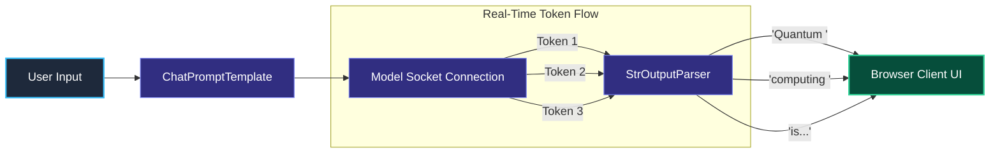
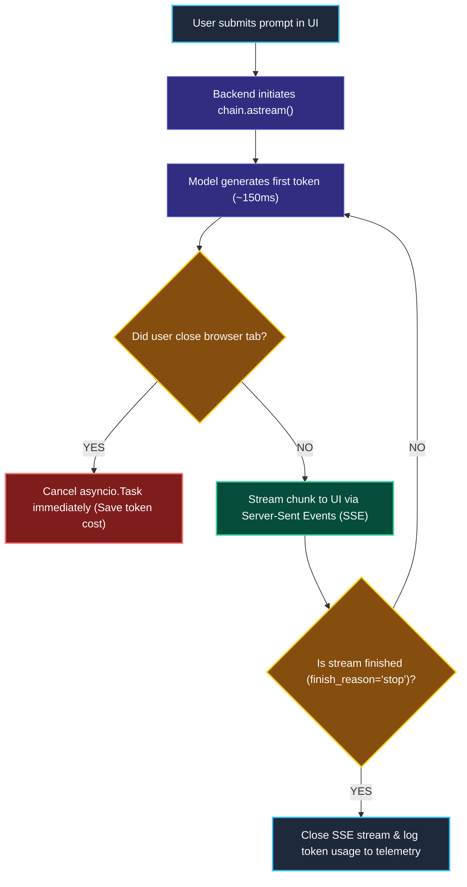

# Streaming and Async Execution in LCEL

> "When you are thirsty, you press the drinking fountain pedal and water flows immediately. You don't wait for a 5-gallon jug to fill up before taking your first sip."

---

### Step 1: Why Do We Need This?

#### The Real Problem

Large language models generate text word by word (token by token). A long explanation takes **4 to 6 seconds** to complete.

If you use standard blocking calls (`.invoke()`), your user sees a frozen loading spinner for 5 seconds:

```
BLOCKING REQUEST (Bad User Experience):
User clicks "Send" ──▶ ⏳ [5.0s Frozen Spinner] ──▶ Entire response dumps on screen at once.
The user thinks your app crashed or disconnected!

STREAMING REQUEST (Great User Experience):
User clicks "Send" ──▶ 🚀 [150ms First Token] ──▶ Words flow in real-time.
The user starts reading immediately while the model is still thinking!
```

Two major problems happen without streaming:
1. **High Perceived Latency (Time to First Token - TTFT):** Even if both requests take 5 seconds total, the streaming version *feels* instant because the user reads the first sentence in 150 milliseconds.
2. **Web Server Thread Blocking:** Synchronous requests tie up web server worker threads. If 100 users make blocking requests at once, your server runs out of workers and crashes.

We need a standard way to stream tokens chunk-by-chunk and handle thousands of concurrent requests using Python's `async`/`await`.

---

### Step 2: What Is It?

#### Simple Explanation

Think of streaming like **watching a video on Netflix vs. downloading a video file**:

- **Blocking (`.invoke()`):** You must wait for the entire 2-hour movie to download to your hard drive before you can watch the first second.
- **Streaming (`.stream()` / `.astream()`):** The video starts playing the moment the first few seconds arrive, and keeps downloading in the background.

In LangChain LCEL:
- **`.stream(input)`:** Synchronous generator yielding small chunks (`AIMessageChunk`) one by one.
- **`.astream(input)`:** Asynchronous generator for modern web frameworks like FastAPI and Next.js.
- **`.astream_events(input, version="v2")`:** Emits fine-grained events not just for the model, but for every tool, prompt, and step in the chain.

---

### Step 3: Real-World Example

#### Real-Time Chatbot in FastAPI

A user types: *"Write a 3-paragraph summary of quantum computing."*

```
[User Browser]
      │ (Opens Server-Sent Events / SSE connection)
      ▼
[FastAPI / Next.js Server]
      │
      ▼
[LCEL Chain: prompt | model | parser]
      │
      ├── (0.15s) Yields chunk: "Quantum "
      ├── (0.20s) Yields chunk: "computing "
      ├── (0.25s) Yields chunk: "is "
      ├── ...
      └── (4.50s) Yields final chunk: "."
```

**What the system receives:** A prompt and an active HTTP response connection.  
**What decision it makes:** Runs the chain with `.astream()`, forwarding each text chunk to the user's browser over Server-Sent Events (SSE).  
**What it returns:** An instant, typing-like experience where the user starts reading in 150ms.

---

### Step 4: How Does It Work?

#### The Streaming Chunk Pipeline



1. **Connection Opens:** The model provider opens an HTTP chunked transfer connection.
2. **Delta Yields:** Each token emitted by the model is wrapped in an `AIMessageChunk`.
3. **Pass-Through Parsers:** `StrOutputParser` immediately yields the string delta without waiting for the closing sentence.
4. **Completion:** When the model finishes, a final empty chunk arrives with `finish_reason="stop"`.

---

### Step 5: Code Example

#### Asynchronous Streaming with LCEL

Here is a complete, working script demonstrating how to stream tokens in real-time using `asyncio` and LangChain 1.x:

```python
import asyncio
from langchain_core.prompts import ChatPromptTemplate
from langchain_core.output_parsers import StrOutputParser
from langchain.chat_models import init_chat_model

# 1. Initialize modern model
model = init_chat_model("openai:gpt-4o-mini", temperature=0.0)

# 2. Prompt Template
prompt = ChatPromptTemplate.from_template("Explain {topic} in three short bullet points.")

# 3. Assemble LCEL chain
chain = prompt | model | StrOutputParser()

# 4. Async Streaming Loop
async def run_streaming_demo():
    print("User: Explain black holes.\nAI: ", end="", flush=True)

    # Use .astream() to consume chunks asynchronously
    async for chunk in chain.astream({"topic": "black holes"}):
        # Print each word chunk as soon as it arrives!
        print(chunk, end="", flush=True)

    print("\n\n[Stream Finished Successfully]")

if __name__ == "__main__":
    asyncio.run(run_streaming_demo())
```

#### What Happens When You Run This:
Instead of waiting 3 seconds for the whole text to appear, the words start printing to your terminal immediately, giving an instant, flowing reading experience.

---

### Step 6: How Is It Used in Production?

#### Real-World Engineering Rules

```
                      LCEL STREAMING CHAIN
                               │
            ┌──────────────────┴──────────────────┐
            ▼                                     ▼
   STREAMING STEP                        BLOCKING STEP (TRAP!)
   StrOutputParser()                     Custom Python function that
   Yields chunks immediately             waits for all text before returning
   (Smooth user experience)              (Completely destroys streaming!)
```

| Production Mistake | Why it hurts | How to fix it |
| :--- | :--- | :--- |
| **Placing a Blocking Step in the Middle** | If you place a function that expects the whole string (like a standard JSON parser or length counter) after the model, streaming stops working. | Ensure all intermediate components in the stream path support generators or place them before the model. |
| **Client Disconnect Zombie Requests** | A user closes their browser tab, but your backend keeps streaming tokens and paying API costs for nothing. | Monitor the HTTP socket disconnect event and cancel the underlying `asyncio.Task` immediately. |
| **Buffering Reverse Proxies** | Nginx or AWS CloudFront buffers small HTTP packets, holding tokens until 4KB of data builds up, ruining the real-time feel. | Set `X-Accel-Buffering: no` in your HTTP response headers to force Nginx to forward tokens instantly. |

---

### Step 7: Quick Revision

- **Perceived Latency is Everything:** Streaming does not reduce total token generation time, but it drops Time to First Token (TTFT) from 4 seconds down to 150 milliseconds.
- **Async for Scale:** Always use `.astream()` and `async def` in web endpoints so server threads are never blocked waiting on LLM sockets.
- **The Pipeline Must Support Streaming:** Every component in `prompt | model | parser` must support yielding chunks, or streaming will break.
- **Disable Buffering:** Ensure proxies (Nginx, CloudFront) have response buffering disabled so tokens flow directly to users.

#### Short Interview Answer

> *"In production AI applications, we implement token streaming using `.astream()` over Server-Sent Events (SSE) to minimize perceived latency. While total generation duration remains unchanged, Time to First Token (TTFT) drops to ~150ms, giving users immediate interactive feedback. In our web servers, we use asynchronous generators to avoid thread pool exhaustion, configure `X-Accel-Buffering: no` to prevent proxy buffering, and listen to client disconnect signals to cancel model tasks and conserve token budgets."*

---

### Step 8: Final Flow Diagram



---

### Step 9: Quiz

Test your understanding of streaming and async LCEL. Submit your answers as (1-A, 2-B, etc.) and we will review the explanations together!

#### Question 1
What is the primary user experience (UX) benefit of using `.astream()` instead of `.ainvoke()` in a conversational web application?
- A. It reduces the total dollar cost of the tokens by 50%.
- B. It dramatically lowers the Time to First Token (TTFT), allowing users to read the response immediately rather than staring at a frozen loading spinner for 5 seconds.
- C. It guarantees that the model will never make a factual mistake.
- D. It allows the model to run without needing an internet connection.

#### Question 2
An engineer builds an LCEL pipeline: `chain = prompt | model | custom_cleaner | StrOutputParser()`. The `custom_cleaner` function is a regular Python function: `def custom_cleaner(text: str) -> str: return text.strip()`. When testing in the browser, streaming completely stops working, and the whole response appears all at once after 4 seconds. Why?
- A. Because `custom_cleaner` is expecting a single complete `str` input, forcing LangChain to wait for all model tokens to finish before passing the data to the cleaner.
- B. Because Python 3.10 disabled string manipulation.
- C. Because `StrOutputParser` cannot parse cleaned strings.
- D. Because the model detected that the prompt was too short.

#### Question 3
You deploy a FastAPI streaming endpoint behind an Nginx reverse proxy. On your local laptop, tokens stream smoothly word-by-word, but on the production website, text chunks only appear in large delayed bursts of 200 words every few seconds. What is the most likely cause?
- A. The production database is out of storage space.
- B. Nginx proxy buffering is enabled by default, holding small response chunks until its buffer reaches 4KB before sending them to the client.
- C. The user's browser does not support JavaScript.
- D. Production models are automatically 10 times slower than development models.

#### Question 4
A user asks a question, but closes their browser tab after receiving the first two words. What happens in a naive, unprotected backend implementation that does not check for client disconnects?
- A. The model provider automatically refunds the user's money.
- B. The backend continues streaming the remaining 500 tokens in the background until completion, wasting server resources and API token costs for an abandoned request.
- C. The server's hard drive gets erased.
- D. The web server crashes immediately with an `Out Of Memory` error.
