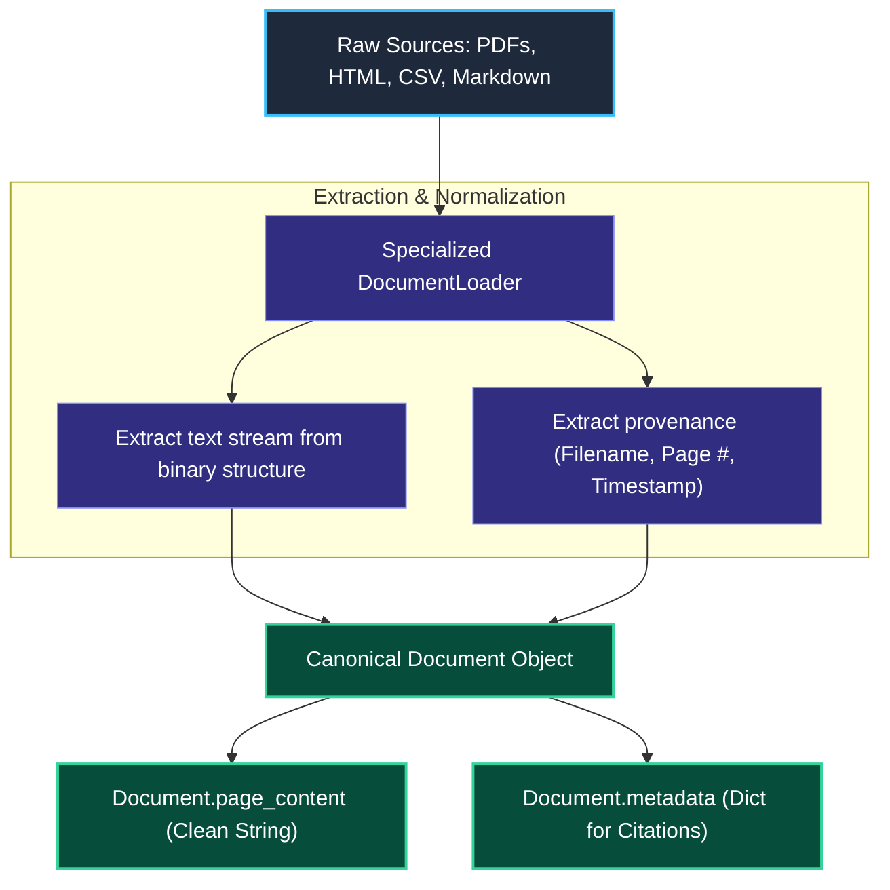
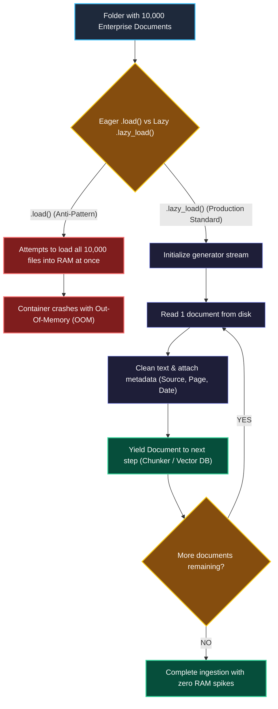

# Document Loaders and Parsers in LangChain

> "A city library does not store microfilms, audio cassettes, and old manuscripts in random piles. An intake scanner transcribes each item into standard text and stamps it with an index card."

---

### Step 1: Why Do We Need This?

#### The Real Problem

Real enterprise knowledge is almost never stored as clean text variables in Python. It is scattered across dozens of different file formats:
- Company policies in multi-page **PDFs**.
- Product catalogs in messy **CSV** files.
- Internal wikis in **HTML** pages with menus, sidebars, and navigation buttons.

```
RAW FILE CHAOS:
annual_report.pdf ──▶ Binary file with headers, footers, columns, and images
employee_wiki.html──▶ Cluttered DOM with JavaScript scripts and CSS styles
sales_data.csv    ──▶ Comma-separated tables

If you try to load 10,000 PDFs into memory at once with standard read():
Your server RAM instantly spikes to 100% and crashes with an Out-of-Memory (OOM) error!
```

Two major problems happen:
1. **Format Fragmentation:** Writing custom parsing scripts for 20+ file formats is unmaintainable and full of edge-case bugs.
2. **Memory Crashes:** Loading thousands of enterprise files completely into memory at once crashes backend servers.

We need a unified intake system that extracts clean text from any file type, preserves vital metadata (like page numbers and filenames), and streams documents safely without crashing memory.

---

### Step 2: What Is It?

#### Simple Explanation

Think of a Document Loader like a **Universal Document Scanner**:

No matter what physical item you place on the scanner bed (a passport, a 300-page book, or a receipt), the scanner always outputs two standard things:
1. **`page_content`:** The extracted plain text.
2. **`metadata`:** A dictionary holding the source information (filename, page number, author, creation date).

In LangChain, this standard output is the **`Document` object**:

```python
Document(
    page_content="Our standard employee travel allowance is $150 per day.",
    metadata={"source": "travel_policy.pdf", "page": 4, "author": "HR"}
)
```

#### Eager Loading vs. Lazy Loading

- **Eager (`.load()`):** Reads all 1,000 documents into server memory immediately. Good only for small scripts.
- **Lazy (`.lazy_load()`):** Returns a Python generator that reads and yields one document at a time. Essential for production so you never run out of RAM.

---

### Step 3: Real-World Example

#### The Enterprise HR Policy Search Engine

An employee asks: *"Does our health insurance cover dental surgery?"*

To answer, your system needs to ingest the 150-page company benefits manual:
1. The **`PyPDFLoader`** opens `benefits_2026.pdf`.
2. It parses each page individually, stripping away PDF headers and footers.
3. It creates a `Document` for each page with `metadata={"source": "benefits_2026.pdf", "page": 42}`.
4. When the AI answers the user, it can cite the exact page: *"Yes, dental surgery is covered up to 80% (Source: benefits_2026.pdf, Page 42)."*

---

### Step 4: How Does It Work?

#### The Document Ingestion Pipeline



1. **Parser Selection:** You pick the right loader (`PyPDFLoader` for PDFs, `CSVLoader` for spreadsheets, `UnstructuredHTMLLoader` for web pages).
2. **Extraction:** The parser removes binary noise, formatting tags, and boilerplate.
3. **Packaging:** The loader yields standard `Document` instances with clean text and metadata dictionaries attached.

---

### Step 5: Code Example

#### Safe Production Loading with `.lazy_load()`

Here is a complete, working script demonstrating how to ingest documents without running out of memory:

```python
import os
from langchain_community.document_loaders import PyPDFLoader, TextLoader
from langchain_core.documents import Document

# 1. Simulate saving a local text file for this demonstration
sample_path = "sample_company_handbook.txt"
with open(sample_path, "w") as f:
    f.write("Section 1: Work Hours\nStandard working hours are 9:00 AM to 5:00 PM.\n\n"
            "Section 2: Remote Work Policy\nEmployees may work remotely up to two days per week.")

# 2. Initialize the Loader
loader = TextLoader(sample_path)

# 3. Production Best Practice: Use .lazy_load() instead of .load()!
# .lazy_load() yields documents one by one to keep memory usage near zero
print("--- Streaming Documents via lazy_load() ---")
document_generator = loader.lazy_load()

for doc_index, doc in enumerate(document_generator, start=1):
    print(f"\n[Document Chunk {doc_index}]")
    print(f"Source File: {doc.metadata['source']}")
    print(f"Content:\n{doc.page_content}")

# Clean up local sample file
if os.path.exists(sample_path):
    os.remove(sample_path)
```

#### What Happens When You Run This:
1. The loader reads the file in chunks.
2. It outputs standard `Document` objects with `page_content` and `metadata`.
3. Even if your file contains 50,000 pages, the Python process uses a tiny fraction of memory because it processes one item at a time.

---

### Step 6: How Is It Used in Production?

#### Real-World Engineering Rules

| Production Mistake | Why it hurts | How to fix it |
| :--- | :--- | :--- |
| **Using `.load()` on Massive Folders** | Calling `DirectoryLoader.load()` on a folder with 5,000 PDFs loads all pages into memory at once, crashing your worker container with an OOM error. | Always use `loader.lazy_load()` in production data ingestion workers. |
| **Ingesting Dirty Web HTML** | Loading web pages with headers, sidebars, and cookie banners wastes 60% of your vector storage on junk text. | Use HTML extractors (like BeautifulSoup or Playwright) that extract only the `<main>` or `<article>` tags. |
| **Stripping Metadata During Extraction** | If your parser drops the filename or page number, your AI will never be able to cite sources or prove where its facts came from. | Always ensure `metadata` contains `source`, `page`, and access permission tags. |
| **Ignoring Password-Protected PDFs** | Ingestion worker crashes silently when it hits an encrypted PDF file. | Wrap loaders in error-handling logic that logs unreadable files and continues processing the rest of the batch. |

---

### Step 7: Quick Revision

- **The Standard Currency:** Every ingestion pipeline in LangChain outputs `Document` objects containing `page_content` and `metadata`.
- **Always Lazy Load in Production:** Never call `.load()` on large datasets. Use `.lazy_load()` to stream documents and keep RAM usage flat.
- **Metadata Powers Citations:** The metadata dictionary is what allows your RAG system to say *"Found on Page 12 of Policy.pdf"*.
- **Garbage In, Garbage Out:** Clean text before saving it to a vector database. Strip navigation menus, repetitive footers, and scripts.

#### Short Interview Answer

> *"In production RAG systems, Document Loaders normalize heterogeneous data sources into uniform `Document` objects with clean text and structured metadata. To prevent Out-Of-Memory (OOM) failures when ingesting thousands of enterprise documents, we mandate `.lazy_load()` generators rather than eager `.load()` arrays. We also filter boilerplate like navigation headers and cookie banners at the loader level to maximize vector retrieval precision."*

---

### Step 8: Final Flow Diagram



---

### Step 9: Quiz

Test your understanding of Document Loaders and Parsers. Submit your answers as (1-A, 2-B, etc.) and we will review the explanations together!

#### Question 1
An ingestion job processing 15,000 PDF documents suddenly crashes with a container `Out Of Memory (OOM)` killed error. The code uses `loader.load()`. What is the best architectural fix?
- A. Buy a server with 10 times more RAM and run the exact same script.
- B. Replace `loader.load()` with `loader.lazy_load()` to process documents one by one as a memory-efficient generator.
- C. Convert all PDF files into JPEG images before loading.
- D. Delete half of the company documents so the file count is lower.

#### Question 2
What is the primary purpose of the `metadata` dictionary on a LangChain `Document` object?
- A. To store the credit card billing details of the user.
- B. To preserve important file context—such as the source filename, page number, and author—so downstream systems can cite sources and filter results.
- C. To compile Python code into C++ binaries.
- D. To encrypt the text so only administrators can read it.

#### Question 3
An engineer uses a basic web loader to ingest an internal wiki page. When testing searches, the AI frequently cites the company's footer menu ("Terms of Service | Privacy Policy | Copyright 2026") instead of the actual policy content. What loader-level step was missed?
- A. The engineer forgot to turn on LangSmith tracing.
- B. The engineer did not filter or clean the HTML tags to target only the main body content (`<main>` or `<article>`), allowing noisy navigation boilerplate into the index.
- C. Web pages cannot be indexed in vector databases.
- D. The model temperature was set to 0.0 instead of 1.0.

#### Question 4
What happens if you delete the `metadata` dictionary from your documents during ingestion?
- A. The documents will take 10 times longer to load.
- B. The vector database will fail to store the text completely.
- C. The RAG system will still answer questions, but it will lose the ability to tell users which document or page number the answer came from.
- D. Python will throw a syntax error because dictionaries cannot be empty.
