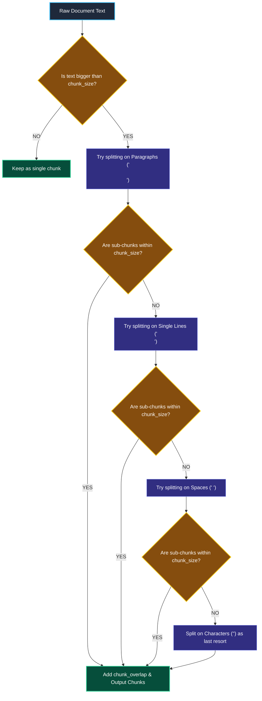
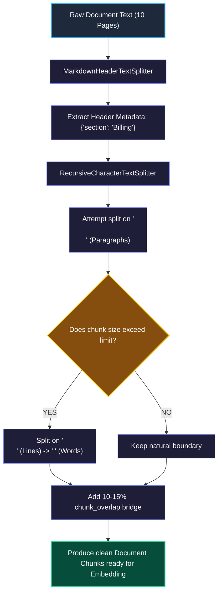

# Text Splitters and Chunking in LangChain

> "A bookbinder dividing an encyclopedia into volumes cuts carefully at the ends of chapters and paragraphs. They never slice a page in half with a blind paper guillotine."

---

### Step 1: Why Do We Need This?

#### The Real Problem

You cannot pass a complete 100-page employee handbook into an embedding model at once. Embedding models have strict token limits, and giant walls of text create weak, fuzzy search vectors.

You must break large documents into smaller pieces called **chunks**.

If you split text blindly by character counts (like cutting every 500 characters), catastrophic errors occur:

```
THE BLIND CUTTING DISASTER:
Chunk 1: "...The administrator master password for the production database is"
Chunk 2: " Secret123! Do not share this with unauthorized users..."

→ A critical fact is sliced in half!
→ Chunk 1 has the subject but no password.
→ Chunk 2 has the password but no subject.
→ When a user searches for "production database password", vector search finds neither!
```

Two major problems happen without smart chunking:
1. **Broken Ideas (Semantic Destruction):** Sentences, code blocks, and markdown tables get sliced in half, destroying their meaning.
2. **Lost Context Across Boundaries:** The end of one chunk has no memory of the start of the next chunk.

We need chunking strategies that respect natural language boundaries (paragraphs, sentences) and carry a small **overlap** between chunks so ideas stay connected.

---

### Step 2: What Is It?

#### Simple Explanation

Think of chunking like **dividing a long highway journey into rest stops**:

- Instead of stopping at random mile markers (like stopping in the middle of a bridge), you stop at natural exits and towns.
- Each chunk should hold **one complete thought or topic**.

#### The Two Golden Settings

Every text splitter uses two main numbers:
1. **`chunk_size`:** The maximum size of each piece (e.g., 500 characters or tokens).
2. **`chunk_overlap`:** How many characters are duplicated between adjacent chunks (e.g., 50 characters).

```
[--- CHUNK 1: characters 0 to 500 ---]
                     [--- CHUNK 2: characters 450 to 950 ---]  <-- 50-char overlap!
```

The overlap acts as a safety bridge. If a sentence falls near the border, both chunks have enough context so search never misses it.

---

### Step 3: Real-World Example

#### The Technical API Documentation Indexer

A software engineer asks: *"How do I authenticate with the Stripe API using Python?"*

If your splitter blindly slices the documentation:
- The `import stripe` line goes into Chunk 1.
- The `stripe.api_key = "..."` line gets cut into Chunk 2.
- The model retrieves Chunk 2, but hallucinating variables because the import was lost.

With `RecursiveCharacterTextSplitter`:
- The splitter looks for double line breaks (`\n\n`) to keep whole code examples together.
- It attaches header metadata (`{"section": "Authentication"}`).
- The user retrieves the complete, working code block in a single chunk.

---

### Step 4: How Does It Work?

#### The Recursive Splitting Hierarchy

The most popular splitter in LangChain is the **`RecursiveCharacterTextSplitter`**. It tries to split on the largest natural boundary first, only moving to smaller separators if a piece is still too big:



1. **Paragraphs (`\n\n`):** Keeps related sentences and arguments together.
2. **Lines (`\n`):** Keeps individual lists, headers, and bullet points intact.
3. **Words (` `):** Ensures whole words are never cut in half.
4. **Characters (`""`):** The last resort if an unbroken string (like a long URL) exceeds the limit.

---

### Step 5: Code Example

#### Header-Aware Recursive Chunking

Here is a complete, runnable script using LangChain's standard splitters:

```python
from langchain_text_splitters import RecursiveCharacterTextSplitter, MarkdownHeaderTextSplitter

# 1. Sample Markdown text with sections and bullet points
sample_markdown = """# Employee Travel Policy

## Section 1: Daily Meal Allowance
Employees are allowed up to $75 per day for meals during official domestic travel.
All receipts must be submitted within 14 calendar days of returning from the trip.

## Section 2: Hotel Bookings
All hotel reservations must be booked through the corporate travel portal.
The standard hotel room rate ceiling is $200 per night excluding taxes.
"""

# 2. Step A: Split on Markdown Headers to preserve section context in metadata!
headers_to_split_on = [
    ("#", "Header_1"),
    ("##", "Header_2"),
]
markdown_splitter = MarkdownHeaderTextSplitter(headers_to_split_on=headers_to_split_on)
section_docs = markdown_splitter.split_text(sample_markdown)

# 3. Step B: Apply RecursiveCharacterTextSplitter for size control
text_splitter = RecursiveCharacterTextSplitter(
    chunk_size=150,     # Maximum characters per chunk
    chunk_overlap=30,   # Character overlap bridge
    separators=["\n\n", "\n", " ", ""]
)

final_chunks = text_splitter.split_documents(section_docs)

print(f"Total Chunks Generated: {len(final_chunks)}")
for idx, chunk in enumerate(final_chunks, start=1):
    print(f"\n--- Chunk {idx} ---")
    print(f"Metadata: {chunk.metadata}")
    print(f"Content:\n{chunk.page_content}")
```

#### What Happens When You Run This:
1. Every chunk inherits the section header in its `metadata` dictionary (`Header_2: Section 1: Daily Meal Allowance`).
2. The text is broken into small, clean pieces without cutting any words in half.
3. The overlap ensures continuity between chunks.

---

### Step 6: How Is It Used in Production?

#### Real-World Engineering Rules

| Mistake | Why it hurts | How to fix it |
| :--- | :--- | :--- |
| **Chunks Too Small (e.g., 50 characters)** | Individual chunks have no context. Vector search matches single words without understanding the topic. | Use standard chunk sizes between **500 and 1,500 characters** for general knowledge. |
| **Chunks Too Large (e.g., 10,000 characters)** | Large chunks contain 5 different topics at once. The vector embedding becomes fuzzy and irrelevant. | Keep chunks focused on a single topic or sub-section. |
| **Zero Overlap (`chunk_overlap=0`)** | Facts that sit near chunk boundaries get sliced in half and lost forever. | Always use **10% to 15% overlap** (e.g., 100 characters overlap for a 1,000-character chunk). |
| **Splitting Markdown Tables with Character Splitters** | Character splitters cut through table rows and columns, turning structured data into unreadable text garbage. | Use `MarkdownHeaderTextSplitter` or custom table loaders to preserve complete tables as single chunks. |

---

### Step 7: Quick Revision

- **Why Chunking Matters:** Embedding models cannot take giant documents, and whole documents create fuzzy, imprecise search vectors.
- **Recursive Character Splitter is the Standard:** It tries paragraph splits (`\n\n`) first, then line splits (`\n`), and only cuts on spaces as needed.
- **Overlap Protects Boundaries:** Overlap (10-15%) ensures ideas near the edges of chunks are never sliced and lost.
- **Header-Aware Splitting:** Splitting on markdown headers preserves section names in the chunk's metadata for higher search accuracy.

#### Short Interview Answer

> *"In production RAG pipelines, we use `RecursiveCharacterTextSplitter` to divide long documents into semantically coherent chunks while preserving paragraph and sentence boundaries. We configure chunk sizes around 500 to 1,500 characters to balance specificity with context, and include a 10-15% overlap to prevent critical facts from being split across boundaries. For structured documentation, we pair this with `MarkdownHeaderTextSplitter` so that section titles are automatically embedded into metadata for source filtering."*

---

### Step 8: Final Flow Diagram



---

### Step 9: Quiz

Test your understanding of text splitters and chunking. Submit your answers as (1-A, 2-B, etc.) and we will review the explanations together!

#### Question 1
Why does setting `chunk_overlap=0` in a text splitter frequently cause poor retrieval in production RAG systems?
- A. Because vector databases automatically reject documents that have no overlap.
- B. Because facts that land near the cut boundary get split across two separate chunks, causing both chunks to lose the complete context of the statement.
- C. Because zero overlap increases the cost of the embedding model by 50%.
- D. Because Python text splitters throw a `ZeroDivisionError` when overlap is zero.

#### Question 2
An engineer uses a fixed character splitter that cuts text every 800 characters blindly. When searching for API endpoints, queries fail because the code snippet `auth_token = "secret"` was sliced right through the middle. What is the recommended fix?
- A. Switch to `RecursiveCharacterTextSplitter`, which respects natural separators like paragraphs (`\n\n`) and lines (`\n`) before cutting characters.
- B. Increase the model temperature to 1.0 so it guesses the rest of the code.
- C. Stop using text splitters and send the entire 200-page book in every user prompt.
- D. Remove all code examples from the documentation.

#### Question 3
What is the primary advantage of using `MarkdownHeaderTextSplitter` before applying a character splitter on technical documentation?
- A. It makes the text run twice as fast on the GPU.
- B. It removes all headers to save storage space.
- C. It captures the title of each chapter and section and attaches it to the chunk's `metadata`, keeping valuable context even if the chunk itself only has a few sentences.
- D. It converts all markdown text into binary PDF format.

#### Question 4
An engineer sets `chunk_size=50` characters for a customer support knowledge base. What negative side-effect will happen during vector retrieval?
- A. The chunks will be so small that they lack enough context to form meaningful vector embeddings, leading to noisy and irrelevant search results.
- B. The server will run out of disk space in 30 seconds.
- C. The embedding model will refuse to generate vectors for texts shorter than 500 words.
- D. The user will be banned from the chat application.
