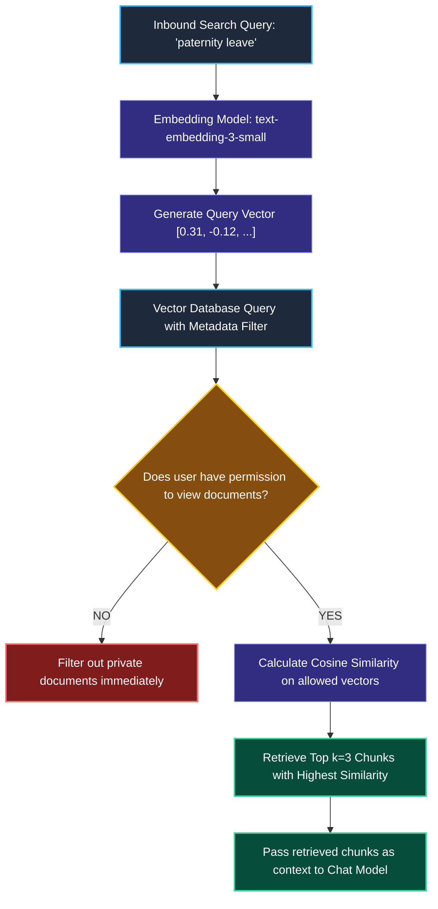

# Embeddings and Vector Stores in LangChain

> "A GPS navigation app does not find a restaurant by matching spelling. It converts locations into numerical coordinates (latitude and longitude) and calculates which restaurant is physically closest to you."

---

### Step 1: Why Do We Need This?

#### The Real Problem

Traditional SQL databases search text using exact keyword matching (like `WHERE text LIKE '%dog%'`).

In real-world applications, keyword search breaks constantly because humans describe the same idea using completely different words:

```
THE KEYWORD MATCHING FAILURE:
User searches: "automobile insurance policy"

Traditional Search:
  Document A: "car coverage contract" ──▶ NO MATCH (Zero matching words!)
  Document B: "history of the automobile" ──▶ FALSE MATCH (Matches the word, but completely wrong topic!)

Semantic Vector Search:
  The model understands that "automobile insurance" means the same thing as "car coverage".
  Matches Document A with a 92% similarity score!
```

Two major problems happen without embeddings:
1. **The Synonym Gap:** Users fail to find documents because they didn't use the exact technical jargon stored in your database.
2. **Keyword Clutter:** Documents that repeat a keyword multiple times rank at the top even when they don't answer the user's question.

We need a system that converts the **meaning** of sentences into mathematical coordinates so we can find relevant answers based on concept, not spelling.

---

### Step 2: What Is It?

#### Simple Explanation

Think of an embedding like a **GPS Coordinate Pin for Meaning**:

- The White House and 1600 Pennsylvania Avenue are two completely different strings of text.
- But on a GPS map, both point to the exact same physical coordinates: `[38.8977° N, 77.0365° W]`. The physical distance between them is zero.

An **Embedding Model** reads a piece of text and turns it into a list of hundreds or thousands of numbers called a **Vector** (e.g., `[0.12, -0.45, 0.88, ...]`).
- Sentences with similar meanings get placed close together in vector space.
- Sentences with completely different meanings get placed far apart.

A **Vector Store** (like Chroma, pgvector, or Qdrant) is a specialized database built to store these lists of numbers and instantly calculate which stored chunks are closest to the user's question.

---

### Step 3: Real-World Example

#### The Employee Benefits Search

An employee asks: *"How much time off do new fathers get?"*

The company policy document never uses the word "father" or "time off". The document states:
> *"The parental bonding leave program provides up to twelve weeks of fully paid leave for eligible secondary caregivers following birth or adoption."*

```
User Query:   "How much time off do new fathers get?"
                     │ (Embedding Model converts to Vector A)
                     ▼
             Vector A: [0.31, -0.12, 0.89, ...]
                     │
                     ▼ (Vector Store calculates distance)
             Vector B: [0.33, -0.10, 0.87, ...]
                     ▲
                     │ (Embedding Model converted Document B)
Document:    "Parental bonding leave provides 12 weeks..."
```

Even though the question and the policy share almost zero identical words, their vector distance is extremely close. The vector store retrieves the exact policy in 20 milliseconds!

---

### Step 4: How Does It Work?

#### The Ingestion and Retrieval Pipeline


1. **Text to Vector:** During ingestion, every document chunk is sent to an embedding model, which returns an array of floating-point numbers.
2. **Indexing:** The vector database indexes these vectors using algorithms like HNSW (Hierarchical Navigable Small World) so searches are blazing fast.
3. **Similarity Comparison:** When a user asks a question, their question is converted into a vector using the *exact same model*. The database calculates cosine similarity and returns the top `k` closest chunks.

---

### Step 5: Code Example

#### Ingesting Chunks and Running Vector Search

Here is a complete, runnable script using LangChain and an in-memory vector store:

```python
from langchain_core.documents import Document
from langchain_core.vectorstores import InMemoryVectorStore
from langchain_openai import OpenAIEmbeddings

# 1. Define sample chunks with metadata
sample_documents = [
    Document(
        page_content="Our parental bonding program provides twelve weeks of paid time off.",
        metadata={"category": "HR", "source": "benefits_handbook.pdf"}
    ),
    Document(
        page_content="The WiFi password for office visitors is GuestConnect2026.",
        metadata={"category": "IT", "source": "office_guide.pdf"}
    ),
    Document(
        page_content="Production database backups run every night at 2:00 AM UTC.",
        metadata={"category": "DevOps", "source": "sre_manual.pdf"}
    )
]

# 2. Initialize the Embedding Model
# Notice: You can test with OpenAIEmbeddings (or local HuggingFace embeddings)
embeddings = OpenAIEmbeddings(model="text-embedding-3-small")

# 3. Create the Vector Store and index our documents
print("Indexing documents into Vector Store...")
vector_store = InMemoryVectorStore.from_documents(
    documents=sample_documents,
    embedding=embeddings
)

# 4. Search using Semantic Meaning (No exact keywords!)
user_query = "What leave is available for a new dad?"
print(f"\nUser Query: '{user_query}'")

# similarity_search_with_score returns the top matches along with their distance score
results = vector_store.similarity_search_with_score(user_query, k=1)

top_doc, score = results[0]
print(f"\n[Top Match Found - Score: {score:.4f}]")
print(f"Source:  {top_doc.metadata['source']}")
print(f"Content: {top_doc.page_content}")
```

#### What Happens When You Run This:
1. The embedding model translates both the documents and the question into mathematical vectors.
2. The vector store matches the query to the parental bonding policy, completely ignoring the IT and DevOps documents.

---

### Step 6: How Is It Used in Production?

#### Real-World Engineering Rules

| Production Mistake | Why it hurts | How to fix it |
| :--- | :--- | :--- |
| **Mixing Different Embedding Models** | If you index documents with model A (e.g., OpenAI 1536-dim) and query with model B (e.g., HuggingFace 384-dim), all searches fail completely. | Always use the **exact same embedding model** for both document ingestion and runtime user queries. |
| **Re-Embedding Unchanged Documents** | Running embedding models over 100,000 documents on every app restart burns thousands of dollars in unnecessary API costs. | Use persistent vector databases (like pgvector or Qdrant) and implement deduplication checks to only embed new or changed files. |
| **High Similarity Score != True Fact** | A document can have a 95% similarity score because it talks about the topic, but still not contain the specific fact needed to answer the question. | Never treat vector similarity as an answer guarantee. Always use an evidence assessment check (Module 7). |
| **Forgetting Metadata Filters** | Running vector search across all company documents might leak confidential executive salaries to regular employees. | Apply **metadata filters** (`filter={"department": "sales"}`) during vector queries to enforce access control. |

---

### Step 7: Quick Revision

- **Meaning Over Spelling:** Embeddings convert the conceptual meaning of sentences into numerical vectors, solving the synonym problem.
- **The Distance Metric:** Vector databases use cosine similarity or dot product to measure how close two thoughts are in mathematical space.
- **Single Model Rule:** You must never mix embedding models. The model used to build the index must be the same model used to query it.
- **Metadata Filtering:** Always attach tags (department, public/private, date) during ingestion so you can filter results securely at runtime.

#### Short Interview Answer

> *"In modern RAG architectures, embedding models map natural language into high-dimensional vector spaces where semantic proximity correlates with conceptual similarity. Vector databases index these embeddings using approximate nearest neighbor (ANN) structures like HNSW for low-latency retrieval. In production, we ensure the query embedding model strictly matches the ingestion model, store document provenance in metadata to support access-control filtering, and avoid re-indexing unchanged corpora to minimize costs."*

---

### Step 8: Final Flow Diagram



---

### Step 9: Quiz

Test your understanding of embeddings and vector stores. Submit your answers as (1-A, 2-B, etc.) and we will review the explanations together!

#### Question 1
An engineering team indexes 50,000 internal documents using `text-embedding-3-small` (1,536 dimensions). A month later, a developer writes a search query script that mistakenly uses `all-MiniLM-L6-v2` (384 dimensions) to generate query vectors. What will happen when a user runs a search?
- A. The search will succeed, but the results will be slightly less accurate.
- B. The vector database will throw a dimension mismatch error because a 384-dimensional vector cannot be compared against a 1,536-dimensional index.
- C. The vector database will automatically convert the text into English.
- D. The query will run 4 times faster because the vector is smaller.

#### Question 2
Why is semantic vector search superior to traditional SQL keyword search (`LIKE '%...%'`) for customer service chatbots?
- A. Because vector search is 100% free and requires no database storage.
- B. Because vector search understands semantic synonyms and concepts (matching "car insurance" to "auto coverage") even when the user does not type the exact keywords found in the document.
- C. Because keyword search is only supported on Linux operating systems.
- D. Because vector search guarantees that the LLM will never hallucinate.

#### Question 3
A multi-tenant SaaS application stores documents for 500 different corporate clients inside a single shared vector database. How should the engineering team prevent Client A from accidentally retrieving documents belonging to Client B?
- A. Tell the model in the system prompt: "Please do not look at Client B's documents."
- B. Attach `metadata={"tenant_id": "client_A"}` to every document during ingestion, and pass an exact metadata filter in every vector query.
- C. Use a different character splitter for each client.
- D. Delete and rebuild the vector database after every search.

#### Question 4
An engineer notices that a retrieved document chunk has a high cosine similarity score (0.89) to the user's question, but does not actually contain the specific number requested. What should the application conclude?
- A. High vector similarity proves that the document contains the correct answer.
- B. Vector similarity measures topical closeness in vector space, not whether the document contains the required evidence to answer the question.
- C. The embedding model is broken and should be reinstalled.
- D. The user should be banned from making queries.
