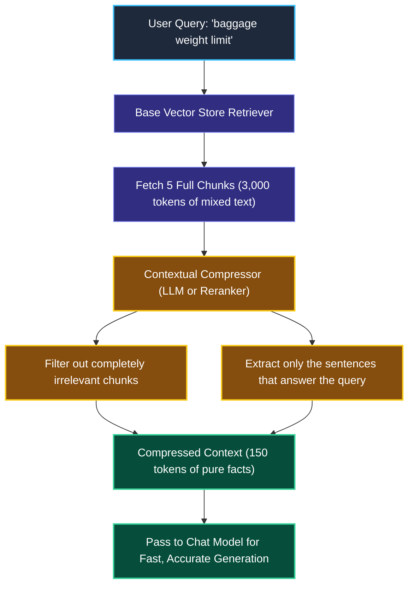
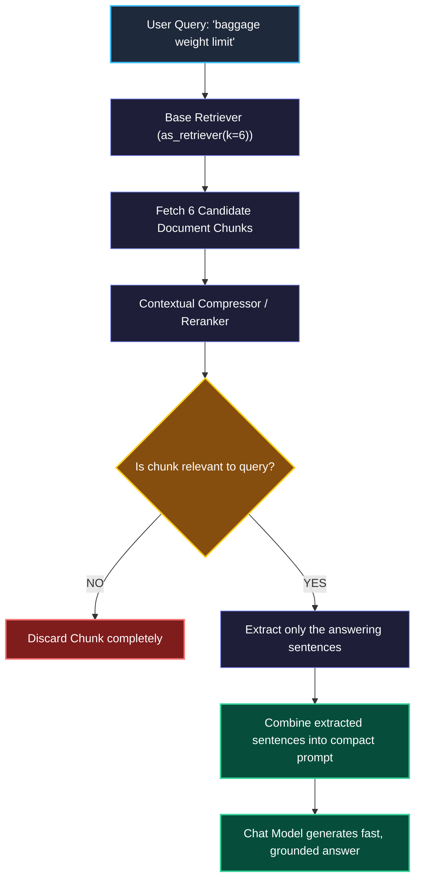

# Retrievers and Contextual Compression in LangChain

> "A legal researcher does not dump five 800-page binders on the judge's desk. They pull out the binders, highlight the exact three relevant sentences, and hand the judge a clean one-page memo."

---

### Step 1: Why Do We Need This?

#### The Real Problem

When you perform standard vector search, the vector database returns **entire chunks** of text (e.g., 3 chunks of 1,000 tokens each).

In real applications, this causes **Context Stuffing**:

```
THE CONTEXT STUFFING PROBLEM:
User asks: "What is the maximum baggage weight for international flights?"

Retrieved Chunks:
  Chunk 1 (800 words): Pet travel rules, musical instruments, infant seats... (Only 1 sentence relevant!)
  Chunk 2 (900 words): Domestic dimensions, sports equipment... (Zero sentences relevant!)
  Chunk 3 (850 words): Excess baggage fees, payment methods... (1 sentence relevant!)

Total Tokens Sent to LLM: ~3,000 tokens ($$$ and slow!)
Result: The model gets distracted by all the irrelevant pet and instrument rules
and misses the actual baggage weight sentence ("Lost in the Middle" bug).
```

Two major problems happen:
1. **Wasted Token Costs & High Latency:** You pay to send thousands of irrelevant words into the LLM context window on every single search.
2. **Context Distraction ("Lost in the Middle"):** LLMs struggle to spot small facts buried in the middle of giant blocks of irrelevant text.

We need a way to retrieve candidate documents and then **compress** them—extracting only the relevant sentences before sending them to the model.

---

### Step 2: What Is It?

#### Simple Explanation

Think of Contextual Compression like a **Smart Yellow Highlighter**:

1. First, you pull the top 5 books from the shelf (Base Retrieval).
2. Then, your smart highlighter reads those books, highlights only the 3 sentences that directly answer the user's question, and discards all the other pages (Compression).
3. You only hand the highlighted sentences to the AI model.

#### Retriever vs. Vector Store

- **Vector Store:** A storage database (like Chroma or pgvector) that stores embeddings and runs distance math.
- **Retriever:** A clean LangChain `Runnable` interface. You convert any vector store into a retriever by calling `vector_store.as_retriever()`. It takes a string question in and outputs a list of `Document` objects.
- **Contextual Compression Retriever:** A wrapper that sits around a base retriever, passing retrieved chunks through a filter or reranker before returning them.

---

### Step 3: Real-World Example

#### The Airline Luggage Policy Assistant

A passenger asks: *"What is the maximum weight for international checked luggage?"*

1. **Base Retrieval:** The vector store retrieves 3 full chunks about airline policies (total 2,500 words).
2. **Contextual Compression:** The compression layer scans the 2,500 words against the query *"maximum weight international luggage"*.
3. **Extraction:** It extracts only the two relevant sentences:
   > *"For international flights, economy passengers are permitted one checked bag with a maximum weight of 23 kg (50 lbs). Any bag exceeding 32 kg (70 lbs) will not be accepted."*
4. **Final Model Call:** The chat model receives just 40 words instead of 2,500 words. It answers in 0.5 seconds with zero hallucinations.

---

### Step 4: How Does It Work?

#### The Compression Pipeline



1. **Candidate Retrieval:** The base retriever performs broad search to avoid missing anything (e.g. `k=5` or `k=10`).
2. **Document Compression:** The compressor examines each chunk in context with the user's specific query.
3. **Filtering & Slicing:** Irrelevant chunks are dropped, and long chunks are trimmed down to their essential sentences.
4. **Generation:** The chat model receives a clean, compact prompt.

---

### Step 5: Code Example

#### Compressing Context Using LangChain

Here is a complete, working example showing how to build a `ContextualCompressionRetriever`:

```python
from langchain_core.documents import Document
from langchain_core.vectorstores import InMemoryVectorStore
from langchain_openai import OpenAIEmbeddings
from langchain.chat_models import init_chat_model
from langchain.retrievers import ContextualCompressionRetriever
from langchain.retrievers.document_compressors import LLMChainExtractor

# 1. Setup sample document chunks (representing long policy texts)
docs = [
    Document(
        page_content="Airline Baggage Policy: Standard international checked bags must weigh under 23 kg (50 lbs). "
                     "Musical instruments require a separate seat booking. "
                     "Pets under 10 lbs are permitted in the cabin with a $125 pet fee.",
        metadata={"source": "baggage_rules.pdf"}
    ),
    Document(
        page_content="Frequent Flyer Tiers: Gold members receive priority boarding and complimentary lounge access. "
                     "Points expire after 24 months of account inactivity.",
        metadata={"source": "loyalty_program.pdf"}
    )
]

# 2. Build Base Vector Store & Retriever
embeddings = OpenAIEmbeddings(model="text-embedding-3-small")
vector_store = InMemoryVectorStore.from_documents(docs, embeddings)
base_retriever = vector_store.as_retriever(search_kwargs={"k": 2})

# 3. Setup Compressor using a fast model
llm = init_chat_model("openai:gpt-4o-mini", temperature=0.0)
compressor = LLMChainExtractor.from_llm(llm)

# 4. Wrap the base retriever with the compression engine
compression_retriever = ContextualCompressionRetriever(
    base_compressor=compressor,
    base_retriever=base_retriever
)

# 5. Execute search
query = "What is the weight limit for international luggage?"
print(f"Searching for: '{query}'\n")

compressed_results = compression_retriever.invoke(query)

for idx, doc in enumerate(compressed_results, start=1):
    print(f"--- Compressed Result {idx} ---")
    print(f"Source: {doc.metadata['source']}")
    print(f"Extracted Content:\n{doc.page_content}\n")
```

#### What Happens When You Run This:
Notice that the pet fees, musical instruments, and frequent flyer rules are completely stripped out! The model only receives the exact sentence regarding the 23 kg limit.

---

### Step 6: How Is It Used in Production?

#### Real-World Engineering Rules

| Production Mistake | Why it hurts | How to fix it |
| :--- | :--- | :--- |
| **Using Slow LLMs for Compression** | Using GPT-4o to compress every single chunk doubles your latency (adds 2+ seconds). | Use fast cross-encoders (like Cohere Rerank) or small fast models (`gpt-4o-mini`) for compression. |
| **Over-Compressing and Cutting Context** | An aggressive compressor might cut away the subject of the sentence, leaving an ambiguous pronoun like *"It must be done tomorrow"*. | Ensure compressor prompts instruct the model to preserve noun entities and condition boundaries. |
| **Retrieving Duplicate Chunks with Simple Similarity** | If your vector store has 3 slightly different versions of the same policy, `k=3` returns 3 copies of the same text. | Use **MMR (Maximal Marginal Relevance)** search (`search_type="mmr"`) to force diversity among retrieved results. |

---

### Step 7: Quick Revision

- **The Problem:** Plain vector search returns full, noisy chunks, causing high token costs and "lost in the middle" attention bugs.
- **The Solution:** Contextual compression pulls a broad set of candidates and extracts only the relevant sentences before generation.
- **`as_retriever()` Standard:** Turning a vector store into a retriever gives it the standard `invoke()` interface.
- **MMR for Diversity:** Maximal Marginal Relevance selects chunks that are both relevant to the query and diverse from each other to prevent duplicates.

#### Short Interview Answer

> *"In production RAG systems, standard vector retrieval often introduces context noise by returning full chunks where only a fraction of the text is relevant. We implement `ContextualCompressionRetriever` to extract query-specific snippets and filter out irrelevant passages before feeding context to the generator. This reduces prompt token consumption, eliminates 'lost-in-the-middle' attention degradation, and prevents duplicate chunks through diversity algorithms like MMR."*

---

### Step 8: Final Flow Diagram



---

### Step 9: Quiz

Test your understanding of retrievers and contextual compression. Submit your answers as (1-A, 2-B, etc.) and we will review the explanations together!

#### Question 1
What is the "lost in the middle" phenomenon in production LLM applications?
- A. When a model forgets the user's password mid-conversation.
- B. When an LLM struggles to notice and use relevant facts that are buried in the middle of long, crowded context prompts.
- C. When a vector database drops network packets during retrieval.
- D. When a Python text splitter chops a sentence in half.

#### Question 2
How does **MMR (Maximal Marginal Relevance)** improve retrieval compared to standard similarity search?
- A. It automatically translates non-English text to English.
- B. It optimizes for both relevance to the user's query AND diversity among the retrieved documents, preventing the system from retrieving 3 identical chunks.
- C. It reduces vector embedding dimensions by 50%.
- D. It turns off model safety guardrails.

#### Question 3
An engineering team implements an `LLMChainExtractor` compressor using an expensive, high-latency model. Users complain that searches take 5 seconds longer than before. What is the most practical engineering fix?
- A. Remove search completely and let the model invent answers.
- B. Replace the heavy LLM compressor with a fast, dedicated cross-encoder reranker (such as Cohere Rerank or BGE Reranker) or a lightweight small model.
- C. Tell users to type shorter questions.
- D. Run the database on a mobile phone.

#### Question 4
What is the primary difference between a LangChain `VectorStore` and a `Retriever`?
- A. A VectorStore is a storage and indexing database, while a Retriever is a standardized `Runnable` execution component that accepts a query string and returns a list of `Document` objects.
- B. A Retriever can only store images, while a VectorStore only stores text.
- C. A VectorStore is written in Java, while a Retriever is written in C++.
- D. There is no difference; they are exact aliases.
