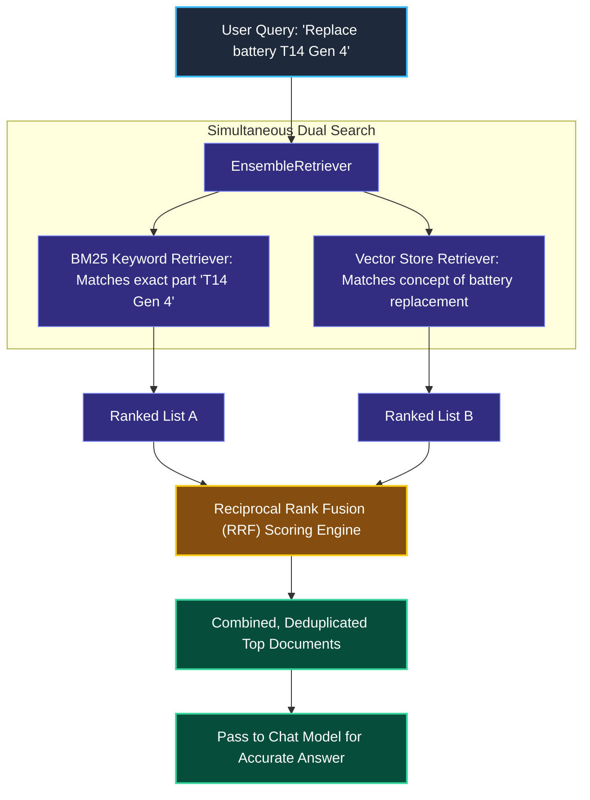
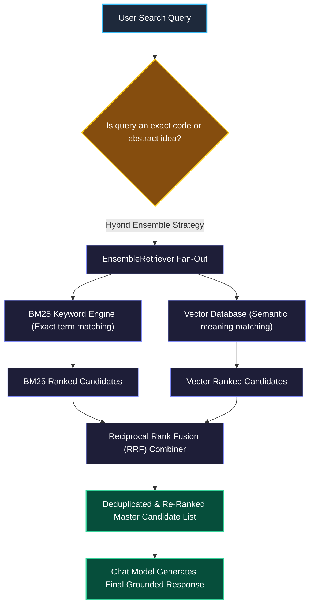

# Ensemble and MultiQuery Retrieval in LangChain

> "A search and rescue team does not rely solely on aerial drones or solely on tracking dogs. They dispatch both: the drone covers wide open fields, while the dog tracks scents through dense woods."

---

### Step 1: Why Do We Need This?

#### The Real Problem

Developers often assume that modern vector search solves all search problems. In production, vector search has a massive blind spot: **exact keywords, codes, and model numbers**.

```
SCENARIO A: Exact Product or Error Code
User searches: "How to resolve error ERR_AUTH_8829_TOKEN_EXPIRED"
  Dense Vector Search ──▶ Retrieves generic articles about HTTP errors (Misses the exact code!)
  BM25 Keyword Search ──▶ Directly hits the exact troubleshooting guide!

SCENARIO B: Abstract Conceptual Question
User searches: "How do we prevent our server from falling over when traffic spikes?"
  BM25 Keyword Search ──▶ Fails completely because documents use the words "rate limiting" and "load shedding".
  Dense Vector Search ──▶ Easily connects the conceptual meaning and finds the right guide!
```

Two major problems happen if you only use one search method:
1. **The Exact-Match Blind Spot:** Vector search misses specific part numbers, legal clause numbers, and error codes.
2. **The Synonym Blind Spot:** Keyword search misses documents that explain the right concept using different vocabulary.

We need a **Hybrid Ensemble System** that runs both searches at the same time and combines their results into a single, ranked list.

---

### Step 2: What Is It?

#### Simple Explanation

Think of Hybrid Ensemble Retrieval like **asking two different detectives to solve a case**:

1. **The Keyword Detective (BM25):** Great at spotting exact names, license plates, and phone numbers.
2. **The Semantic Detective (Vector Search):** Great at understanding motivations, themes, and big-picture meaning.

You run both searches, and an algorithm called **Reciprocal Rank Fusion (RRF)** combines their findings:
- If a document is ranked #1 by the keyword search AND #2 by the vector search, it gets pushed to the very top of the final list.

#### What is MultiQuery Retrieval?

Sometimes the user asks an unclear or poorly phrased question.  
A **MultiQuery Retriever** asks a fast LLM to rewrite the user's question from 3 different angles (e.g., formal phrasing, technical phrasing, and casual phrasing), runs searches for all of them, and combines the unique results.

---

### Step 3: Real-World Example

#### The IT Hardware Support Portal

An IT technician searches: *"Replacement battery for Lenovo ThinkPad T14 Gen 4"*.

1. **BM25 Keyword Retriever:** Searches for the exact token `"T14 Gen 4"`. It immediately finds the parts catalog page listing the specific battery part number `01AV421`.
2. **Dense Vector Retriever:** Searches for the concept of battery replacement steps and safety guidelines.
3. **Ensemble Retriever:** Merges both results. The technician gets the exact part number from the catalog AND the step-by-step replacement guide, all in one search.

---

### Step 4: How Does It Work?

#### The Hybrid Search and Fusion Flow



1. **Simultaneous Querying:** The `EnsembleRetriever` passes the query to both BM25 and the Vector Store at the same time.
2. **Reciprocal Rank Fusion (RRF):** Each document receives a score based on its position in both lists:
   $$\text{Score}(d) = \sum_{m \in \text{models}} \frac{1}{60 + \text{Rank}_m(d)}$$
3. **Weight Balancing:** You can configure weights (e.g., 50% keyword, 50% vector) depending on whether your dataset relies more heavily on exact codes or broad concepts.

---

### Step 5: Code Example

#### Building a Hybrid Ensemble Retriever

Here is a complete, runnable script combining BM25 keyword search with dense vector embeddings:

```python
from langchain_core.documents import Document
from langchain_community.retrievers import BM25Retriever
from langchain_core.vectorstores import InMemoryVectorStore
from langchain_openai import OpenAIEmbeddings
from langchain.retrievers import EnsembleRetriever

# 1. Sample documents with both technical codes and conceptual explanations
corpus = [
    Document(
        page_content="Error code ERR_AUTH_902 indicates that your OAuth refresh token has expired. Log in again.",
        metadata={"category": "Authentication"}
    ),
    Document(
        page_content="To keep your account secure, passwords must be rotated every 90 days following enterprise rules.",
        metadata={"category": "Security"}
    ),
    Document(
        page_content="Database connection timeout occurred because the connection pool limit of 50 was exceeded.",
        metadata={"category": "Database"}
    )
]

# 2. Setup BM25 Keyword Retriever (Fast, exact text matching)
bm25_retriever = BM25Retriever.from_documents(corpus)
bm25_retriever.k = 2

# 3. Setup Vector Store Retriever (Semantic conceptual matching)
embeddings = OpenAIEmbeddings(model="text-embedding-3-small")
vector_store = InMemoryVectorStore.from_documents(corpus, embeddings)
vector_retriever = vector_store.as_retriever(search_kwargs={"k": 2})

# 4. Create the Hybrid Ensemble Retriever
# We assign equal weight (0.5 and 0.5) to keyword and vector search
ensemble_retriever = EnsembleRetriever(
    retrievers=[bm25_retriever, vector_retriever],
    weights=[0.5, 0.5]
)

# 5. Run a query that contains an exact error code
query = "How do I fix ERR_AUTH_902?"
print(f"Searching for: '{query}'\n")

results = ensemble_retriever.invoke(query)

for idx, doc in enumerate(results, start=1):
    print(f"--- Top Result {idx} ---")
    print(f"Category: {doc.metadata['category']}")
    print(f"Content:  {doc.page_content}\n")
```

#### What Happens When You Run This:
Even if the vector search is slightly unsure about the code `ERR_AUTH_902`, the BM25 keyword search instantly identifies the exact match, and RRF pushes the correct authentication document straight to position #1.

---

### Step 6: How Is It Used in Production?

#### Real-World Engineering Rules

| Production Mistake | Why it hurts | How to fix it |
| :--- | :--- | :--- |
| **Using 100% Vector Search for E-Commerce / SKUs** | Users search exact part numbers like `iPhone 15 Pro Max 256GB Black`. Vector search returns accessories and cases because they are conceptually related. | Use Hybrid Ensemble Search and give BM25 a higher weight (`weights=[0.7, 0.3]`). |
| **BM25 In-Memory Cold Start** | Running `BM25Retriever` directly inside Python memory for 1,000,000 documents consumes gigabytes of server RAM. | Use an external search engine (like Elasticsearch, OpenSearch, or Qdrant/Pinecone's built-in hybrid search) to handle sparse keyword matching. |
| **MultiQuery LLM Latency Tax** | Generating 3 query rewrites with an LLM on every search adds 500ms to 1.5s of latency before retrieval even starts. | Use MultiQuery only for complex or conversational questions where initial searches return zero results. |

---

### Step 7: Quick Revision

- **The Hybrid Rule:** Vector search understands general concepts; BM25 keyword search catches exact numbers, names, and error codes.
- **RRF (Reciprocal Rank Fusion):** Blends multiple ranked lists into a single score without needing score normalization across different algorithms.
- **Tuning Weights:** For technical specs or legal codes, weight BM25 higher. For customer FAQs, weight Vector Search higher.
- **MultiQuery Strategy:** Use an LLM to generate multiple phrasings of a question to overcome poor user wording.

#### Short Interview Answer

> *"In production RAG systems, relying exclusively on dense vector search introduces blind spots for exact identifiers like SKUs, error codes, and technical jargon. We implement hybrid retrieval using `EnsembleRetriever` to combine dense embeddings with sparse BM25 keyword matching, ranking the combined candidates via Reciprocal Rank Fusion (RRF). This delivers high recall for abstract concepts while preserving precision for exact-match technical queries."*

---

### Step 8: Final Flow Diagram



---

### Step 9: Quiz

Test your understanding of ensemble and hybrid retrieval. Submit your answers as (1-A, 2-B, etc.) and we will review the explanations together!

#### Question 1
An e-commerce store with 200,000 products switches from traditional keyword search to 100% dense vector search. Immediately, customers complain that searching for exact part numbers like `FILTER-X900-OIL` returns generic car maintenance manuals and car wash soap instead of the specific oil filter. Why did this occur?
- A. Dense vector models embed the semantic topic of "car care", but lack exact token-level precision for specific alphanumeric strings and SKU codes.
- B. The user's browser does not support vector embeddings.
- C. The vector database is completely full.
- D. Python 3.10 cannot store strings that have hyphens.

#### Question 2
What is the primary role of **Reciprocal Rank Fusion (RRF)** in an `EnsembleRetriever`?
- A. To translate foreign languages into English before search.
- B. To combine and balance ranking results from different search algorithms (like BM25 and Vector Search) without needing to normalize raw mathematical scores.
- C. To compress 10-page documents down to 10 words.
- D. To delete duplicate rows from an SQL database.

#### Question 3
When does using a **MultiQuery Retriever** provide the most value in a RAG application?
- A. When searches are already sub-second and the database only contains 5 documents.
- B. When users often write vague, casual, or poorly phrased questions, and generating multiple technical variations improves document recall.
- C. When the application has no internet connection.
- D. When the user wants the model to output Python code instead of text.

#### Question 4
An engineering team is building a hybrid search pipeline for an internal IT helpdesk system that handles thousands of specific error codes like `ERR_502_BAD_GATEWAY`. How should they tune the `weights` argument in `EnsembleRetriever(retrievers=[bm25, vector], weights=[...])`?
- A. `[0.0, 1.0]` (100% vector search).
- B. `[0.7, 0.3]` (heavier weight on BM25 keyword matching to prioritize exact error code hits).
- C. `[0.0, 0.0]` (disable both retrievers).
- D. `[-1.0, 1.0]` (invert the keyword scores).
