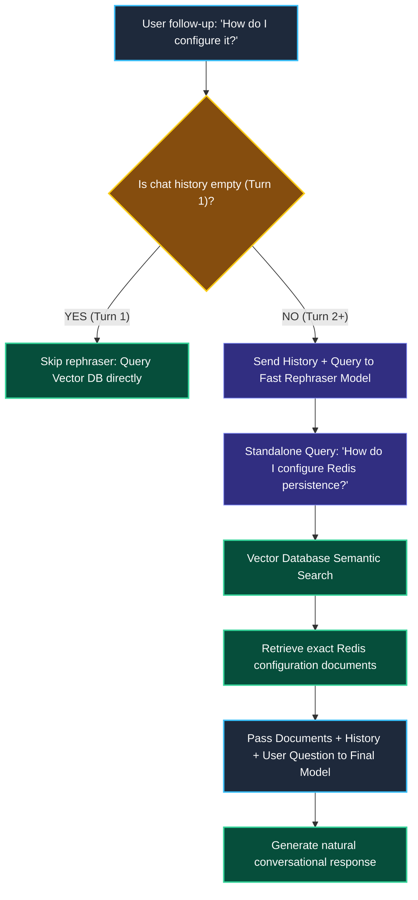
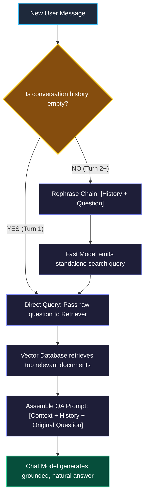

# Conversational RAG Chains in LangChain

> "A courtroom stenographer rephrases ambiguous questions like 'Did you see him there?' into clear legal statements like 'Did the witness see defendant John Smith at the bank?' before recording it in the official archive."

---

### Step 1: Why Do We Need This?

#### The Real Problem

In real chat applications, users never repeat the full subject in every message. They speak in natural conversation, using pronouns like **"it"**, **"that"**, **"they"**, or **"the second option"**:

```
THE MULTI-TURN RAG BREAKDOWN:
Turn 1: User asks: "Tell me about Redis persistence."
        Assistant: "Redis supports two persistence models: RDB snapshots and AOF logs."

Turn 2: User asks: "How do I configure it?"
        Raw Vector Search on "How do I configure it?":
        → The vector database has NO IDEA what "it" refers to!
        → Searches for generic words like "configure".
        → Retrieves random guides for Docker, React, and Nginx.
        → Completely fails to retrieve Redis documentation!
```

Two major problems happen without conversational query rephrasing:
1. **The Pronoun Amnesia Bug:** The vector database only sees the latest query string, so follow-up questions return completely irrelevant documents.
2. **Conversation Drift:** As the chat continues, answers get worse because search queries lack the original context established in turn 1.

We need a system that reads the chat history and **rewrites ambiguous follow-up questions into standalone search queries** before querying the vector store.

---

### Step 2: What Is It?

#### Simple Explanation

Think of Conversational RAG like **having an executive research assistant**:

1. You tell your assistant: *"Let's talk about the Paris office lease."*
2. Then you say: *"When does it expire?"*
3. Your assistant does not search Google for the words *"When does it expire?"*.
4. Your assistant automatically searches for: *"When does the Paris office lease expire?"*

In LangChain, this is called **History-Aware Query Reformulation**:
- The model reads the chat history (`[HumanMessage, AIMessage]`) and the latest question.
- It reformulates the question into a clean, standalone sentence that makes sense without reading the previous messages.
- The standalone question is sent to the vector database.

---

### Step 3: Real-World Example

#### The Tech Store E-Commerce Chatbot

```
User (Turn 1): "Show me specs for the Sony WH-1000XM5 headphones."
AI (Turn 1):   "The Sony WH-1000XM5 features 30-hour battery life and industry-leading noise canceling."

User (Turn 2): "Does it support multipoint Bluetooth pairing?"
Rephraser:     Rewrites Turn 2 into -> "Does the Sony WH-1000XM5 support multipoint Bluetooth pairing?"
Vector Search: Searches vector store with the clarified query.
Retrieved:     "Sony WH-1000XM5 supports seamless multipoint connection with up to two devices simultaneously."
AI (Turn 2):   "Yes, the WH-1000XM5 can connect to two Bluetooth devices at the same time."
```

**What the system receives:** The full message history and the user's latest follow-up question.  
**What decision it makes:** Detects that the question contains pronouns ("it"). Rewrites the query to include the product name before querying vector storage.  
**What it returns:** An accurate, relevant answer based on the correct product manual.

---

### Step 4: How Does It Work?

#### The 2-Stage Conversational Pipeline



1. **Stage 1 (Query Reformulation):** A fast, small model reads previous turns and turns ambiguous sentences into standalone search queries.
2. **Stage 2 (Grounded Retrieval):** The standalone query hits the vector store, retrieving the exact relevant chunks.
3. **Stage 3 (Final Answer):** The main chat model receives the retrieved documents AND the conversational context to generate a polite, complete response.

---

### Step 5: Code Example

#### Building a Conversational RAG Chain with LCEL

Here is a complete, working script in LangChain 1.x:

```python
from langchain_core.prompts import ChatPromptTemplate, MessagesPlaceholder
from langchain_core.messages import HumanMessage, AIMessage
from langchain_core.output_parsers import StrOutputParser
from langchain_core.runnables import RunnablePassthrough
from langchain_core.vectorstores import InMemoryVectorStore
from langchain_openai import OpenAIEmbeddings
from langchain.chat_models import init_chat_model
from langchain_core.documents import Document

# 1. Setup Document Store with Redis knowledge
docs = [
    Document(
        page_content="Redis persistence: RDB creates periodic point-in-time snapshots. "
                     "AOF logs every write operation received by the server. "
                     "To enable AOF, set 'appendonly yes' in redis.conf.",
        metadata={"source": "redis_persistence.md"}
    )
]
embeddings = OpenAIEmbeddings(model="text-embedding-3-small")
vector_store = InMemoryVectorStore.from_documents(docs, embeddings)
retriever = vector_store.as_retriever()

# 2. Setup Models
fast_rephrase_model = init_chat_model("openai:gpt-4o-mini", temperature=0.0)
main_answer_model = init_chat_model("openai:gpt-4o-mini", temperature=0.2)

# 3. Stage 1: History-Aware Query Rephraser Prompt
rephrase_prompt = ChatPromptTemplate.from_messages([
    MessagesPlaceholder(variable_name="chat_history"),
    ("human", "{input}"),
    ("system", "Given the above conversation, rewrite the latest user question into a standalone, "
               "self-contained search query. Do NOT answer the question, just rewrite it clearly.")
])
rephrase_chain = rephrase_prompt | fast_rephrase_model | StrOutputParser()

# 4. Stage 2: Final Answering Prompt
qa_prompt = ChatPromptTemplate.from_messages([
    ("system", "Answer the user question using ONLY the provided context:\n\n{context}"),
    MessagesPlaceholder(variable_name="chat_history"),
    ("human", "{input}")
])

# 5. Simulate Multi-Turn Conversation
# Turn 1 is already completed:
chat_history = [
    HumanMessage(content="Tell me about Redis persistence."),
    AIMessage(content="Redis supports two persistence models: RDB snapshots and AOF logs.")
]

# Turn 2: Follow-up question with ambiguous pronoun "it"
latest_user_input = "How do I enable it in the config file?"

# Step A: Rephrase into standalone query
standalone_query = rephrase_chain.invoke({
    "chat_history": chat_history,
    "input": latest_user_input
})
print("Original Ambiguous Input:", latest_user_input)
print("Rephrased Standalone Query:", standalone_query)

# Step B: Retrieve relevant context
retrieved_docs = retriever.invoke(standalone_query)

# Step C: Answer with context
final_qa_chain = qa_prompt | main_answer_model | StrOutputParser()
answer = final_qa_chain.invoke({
    "context": "\n".join([d.page_content for d in retrieved_docs]),
    "chat_history": chat_history,
    "input": latest_user_input
})

print("\n--- Final Conversational Answer ---")
print(answer)
```

---

### Step 6: How Is It Used in Production?

#### Real-World Engineering Rules

| Production Mistake | Why it hurts | How to fix it |
| :--- | :--- | :--- |
| **Running the Rephraser on Turn 1** | On the first question of a new session, there is no history to consider. Calling the rephraser wastes 300ms and extra API money. | If `len(chat_history) == 0`, skip the rephraser completely and pass the user's raw query straight to the vector database. |
| **Passing Unbounded History to the Rephraser** | Passing 50 messages of chat history to the rephraser burns thousands of tokens on every single turn. | Pass only the **last 3 to 5 turns** to the rephrase prompt. Earlier turns rarely affect the current pronoun reference. |
| **The Rephraser Answers the Question** | Sometimes the rephrase model gets confused and tries to answer the user's question directly instead of just outputting the query. | Enforce strict system instructions: `"Output ONLY the revised search query, nothing else."` or use structured output (Module 3). |

---

### Step 7: Quick Revision

- **Pronouns Break Search:** Vector databases cannot resolve words like "it", "that", or "her".
- **The Solution:** History-aware query reformulation turns ambiguous follow-ups into standalone search strings.
- **Two-Stage Execution:** Stage 1 rewrites the query using a fast model; Stage 2 retrieves documents and generates the grounded response.
- **Optimize Turn 1:** Never call the rephrase model if there is no previous conversation history.

#### Short Interview Answer

> *"In conversational RAG systems, user follow-up queries heavily utilize pronouns and contextual ellipses that fail under isolated vector search. We resolve this using a two-stage architecture: a lightweight model first reformulates the latest user query into a self-contained search string conditioned on recent conversational turns (`MessagesPlaceholder`). The resolved query is then dispatched to the retriever, ensuring document relevance across multi-turn sessions while skipping the rephrase step on initial turns to save latency."*

---

### Step 8: Final Flow Diagram



---

### Step 9: Quiz

Test your understanding of conversational RAG chains. Submit your answers as (1-A, 2-B, etc.) and we will review the explanations together!

#### Question 1
During a conversation about AWS S3, a user asks as their second message: "How do I enable versioning on it?" If this question is passed directly to a vector database without query rephrasing, what failure occurs?
- A. The vector database throws an authentication exception.
- B. The vector search vectorizes the word "it" without context, retrieving generic documents about version control, Git, or unrelated software instead of AWS S3 documentation.
- C. The user's internet connection drops.
- D. The embedding model runs out of GPU memory.

#### Question 2
What is the primary role of the query rephrase step in a conversational RAG pipeline?
- A. To verify the user's credit card validity.
- B. To translate English questions into binary code.
- C. To transform a contextual, pronoun-heavy follow-up question into an independent, standalone search query that contains all necessary entities.
- D. To delete old messages from the database.

#### Question 3
An engineer wants to optimize latency in a conversational RAG pipeline. Which optimization should they immediately implement regarding the query rephrase step?
- A. Never rephrase questions on Turn 1 of a new conversation, because there is no prior history to resolve.
- B. Stop using vector stores completely.
- C. Limit user questions to a maximum of 3 characters.
- D. Turn off SSL encryption on database sockets.

#### Question 4
Why should the final question-answering prompt receive BOTH the retrieved documents AND the previous chat history?
- A. So the final model can maintain conversational flow, remember user preferences established earlier, and ground its answer strictly on the newly retrieved facts.
- B. Because LangChain models crash if chat history is empty.
- C. To force the user to pay twice as many tokens.
- D. So the model can change the user's account password.
