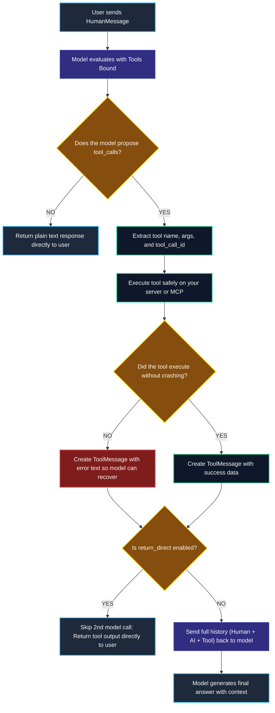

# Tools, Function Calling, and MCP (Model Context Protocol)

> "A large language model is like a brilliant strategist locked in a room without a phone or computer. Giving it tools is like handing it a calculator, a web browser, and a terminal."

---

### Step 1: Why Do We Need This?

#### The Real Problem

Large language models are essentially text predictors. They have two major blind spots in real applications:
1. **They cannot access real-time information:** They cannot check today's stock price, look up a customer in your SQL database, or read private company documents.
2. **They cannot take real-world actions:** They cannot send a Slack message, process a refund, or restart a server.

```
WITHOUT TOOLS:
User: "What is 482,910 * 3,821, and what is our current server CPU usage?"
LLM:  "The answer is roughly 1,845,000,000 (Hallucination!) and your servers are at 45% (Guessing!)."
```

If we try to fix this by writing messy text parsers that search for commands like `"RUN_SQL"`, the system breaks whenever the model changes its sentence phrasing.

We need a standard protocol where the model can safely say:  
*"I cannot answer this alone. Please run this exact function with these exact arguments, and give me the result back."*

---

### Step 2: What Is It?

#### Simple Explanation

Think of a model with tools like **a smart manager sitting at a desk with no internet connection**:

When the manager needs to know today's numbers, they write an official memo: *"Please run the sales report for Region West."*  
You (the backend code) take the memo, execute the report on your database, and hand the result back. The manager reads your result and writes the final summary for the client.

**Crucial rule to remember:**  
The model **never executes the code itself**. The model only **proposes** the function call. Your application executes the function safely on your server, and passes the answer back.


#### What is MCP (Model Context Protocol)?

Before MCP, if you wanted your model to read a Postgres database, a GitHub repo, and a Slack workspace, you had to write custom tool wrappers for each one.

**MCP** is an open standard created by Anthropic. Think of it like **USB for AI tools**. Any tool that supports MCP can plug into any model or agent with zero custom glue code.

---

### Step 3: Real-World Example

#### The Bank Balance Assistant

A customer asks: *"Can I afford a $150 flight ticket today?"*

1. **User asks the question:** Your app passes the user's message to the model.
2. **Model realizes it lacks data:** It checks its available tools and finds `get_account_balance(account_id)`.
3. **Model proposes a tool call:** It stops generating text and outputs a structured request: `ToolCall(name="get_account_balance", args={"account_id": "ACC_992"})`.
4. **Your backend runs the tool:** Your Python code queries the database and receives `{"balance": 320.00}`.
5. **Your code sends the result back:** You wrap the result in a `ToolMessage` and send it back to the model.
6. **Model gives the final answer:** *"Yes, you currently have $320.00 in your account, so you can afford the $150 ticket."*

---

### Step 4: How Does It Work?

#### The 3-Message Conversation Dance

Every tool interaction follows an exact conversation pattern:

```
1. HumanMessage:  "What is the weather in Tokyo?"
         │
         ▼
2. AIMessage:     "I need to run a tool."
                  tool_calls = [{"id": "call_abc123", "name": "get_weather", "args": {"city": "Tokyo"}}]
         │
         ▼ (Your server executes: get_weather("Tokyo"))
         │
3. ToolMessage:   content = "Sunny, 22°C"
                  tool_call_id = "call_abc123"  <-- Must match the ID from step 2!
         │
         ▼
4. Final AIMessage: "The weather in Tokyo is currently sunny and 22°C."
```

| Term | What it means in simple English |
| :--- | :--- |
| `@tool` decorator | A quick way in Python to turn any function into an AI-ready tool. |
| `tool_calls` | A list on the `AIMessage` containing the function name and inputs requested by the model. |
| `ToolMessage` | A special message holding the tool result. It must include `tool_call_id` so the model knows which question it answers. |
| `return_direct=True` | A setting that tells the system: *"Do not call the model a second time. Just return this tool output straight to the user."* |

---

### Step 5: Code Example

#### A Complete, Manual Tool-Calling Loop

Here is a complete, working script in LangChain 1.x showing the exact machinery of a tool loop:

```python
from langchain.chat_models import init_chat_model
from langchain_core.tools import tool
from langchain_core.messages import HumanMessage, ToolMessage

# 1. Define a tool using the @tool decorator
# The docstring is critical: the model reads it to know WHEN to use this tool!
@tool
def multiply(a: float, b: float) -> float:
    """Multiplies two numbers together and returns the exact mathematical result."""
    return a * b

# 2. Initialize the model and bind the tool
model = init_chat_model("openai:gpt-4o-mini", temperature=0.0)
model_with_tools = model.bind_tools([multiply])

# 3. Step 1: User asks a question that requires exact math
user_message = HumanMessage(content="What is 482910 * 3821?")
response = model_with_tools.invoke([user_message])

# The model does not return plain text. It returns tool_calls!
print("Did the model propose a tool?", bool(response.tool_calls))
tool_call = response.tool_calls[0]
print(f"Tool requested: {tool_call['name']} with args: {tool_call['args']}")

# 4. Step 2: Execute the Python function on our server
tool_result = multiply.invoke(tool_call["args"])

# 5. Step 3: Wrap the result into a ToolMessage
# The tool_call_id MUST match tool_call['id'] exactly!
tool_message = ToolMessage(
    content=str(tool_result),
    tool_call_id=tool_call["id"]
)

# 6. Step 4: Send the full conversation back to the model for the final answer
final_response = model_with_tools.invoke([
    user_message,
    response,      # The AIMessage containing the tool call request
    tool_message   # The ToolMessage containing our calculated answer
])

print("\nFinal Answer from Model:")
print(final_response.content)
```

---

### Step 6: How Is It Used in Production?

#### Real-World Engineering Rules

| Common Mistake | Why it hurts | How to fix it |
| :--- | :--- | :--- |
| **Giving the model 50 tools at once** | The model gets confused, picks the wrong tools, and prompt token costs skyrocket. | Keep tool sets small (3 to 7 sharp tools per task). |
| **Vague tool descriptions** | If a docstring says `"Runs lookups"`, the model will guess randomly. | Write clear, specific descriptions: `"Finds user account balances by email. Input must be a valid email string."` |
| **Dumping 5MB of raw JSON into ToolMessage** | Returning huge API responses exhausts your context window and spikes latency. | Filter tool outputs. Return only the 3 or 4 fields the model actually needs. |
| **Non-idempotent action tools** | If a tool sends a payment or writes to a database, network retries might charge the user twice. | Ensure action tools require an `idempotency_key` or human approval. |

---

### Step 7: Quick Revision

- **The Core Rule:** Models never run code. They emit a structured request (`tool_calls`), your server runs the code, and you reply with a `ToolMessage`.
- **The Golden Link:** A `ToolMessage` must always have a `tool_call_id` matching the ID created by the model.
- **MCP is the Universal Standard:** Model Context Protocol allows connecting external data sources and tools without writing custom integration adapters for each.
- **`return_direct`:** Skips the second model call to save time and tokens when the raw tool answer is already complete.

#### Short Interview Answer

> *"In production, LLMs never execute code directly. Instead, we bind tools to the model, which allows it to emit structured function calls with arguments. Our backend executes the tool locally or via MCP, and returns the result as a `ToolMessage` linked by a unique `tool_call_id`. To keep production systems fast and safe, we limit agents to a few well-described tools, sanitize tool return values to protect context windows, and enforce idempotency on state-changing operations."*

---

### Step 8: Final Flow Diagram



---

### Step 9: Quiz

Test your understanding of tools and MCP. Submit your answers as (1-A, 2-B, etc.) and we will review the explanations together!

#### Question 1
You run a tool on your server, but the database connection fails and throws an error. How should your system handle this before returning to the model?
- A. Crash the entire application immediately and disconnect the user.
- B. Return a `ToolMessage` containing the error description and matching `tool_call_id`, so the model can understand the problem and inform the user.
- C. Change the message to a `HumanMessage` and ask the user to fix the database.
- D. Delete the model's previous message so the trace looks clean.

#### Question 2
Why is it dangerous to return a full 20,000-line database dump inside a single `ToolMessage`?
- A. The Python `ToolMessage` class has a hard limit of 500 characters.
- B. It floods the model's context window, wastes thousands of tokens, increases latency, and makes it harder for the model to find the relevant fact.
- C. It causes the model provider to revoke your API key for data privacy violations.
- D. Tools are only allowed to return integer numbers, not text.

#### Question 3
An engineer notices that a search tool always takes 3 seconds, and the final model call takes another 2 seconds (5 seconds total). The search tool's output is already a clean, human-readable summary. How can the engineer cut the latency down to 3 seconds?
- A. Set `temperature=1.0` on the model.
- B. Enable `return_direct=True` on the tool so the loop finishes immediately after the tool runs, skipping the second model call.
- C. Pass the tool output directly to a `RunnableLambda` that terminates the Python interpreter.
- D. Remove the docstring from the tool function.

#### Question 4
What is the primary benefit of using **Model Context Protocol (MCP)** compared to writing custom LangChain tools for every third-party service?
- A. MCP allows models to run Python code directly inside the user's browser without a backend.
- B. MCP provides a single, universal protocol so an agent can connect to external tools, databases, and resources without writing custom integration code for each provider.
- C. MCP makes all API calls 100% free of token costs.
- D. MCP replaces LangGraph with a single command-line bash script.
