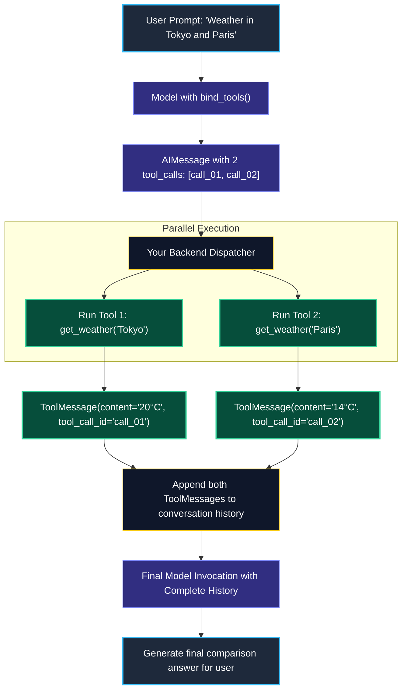
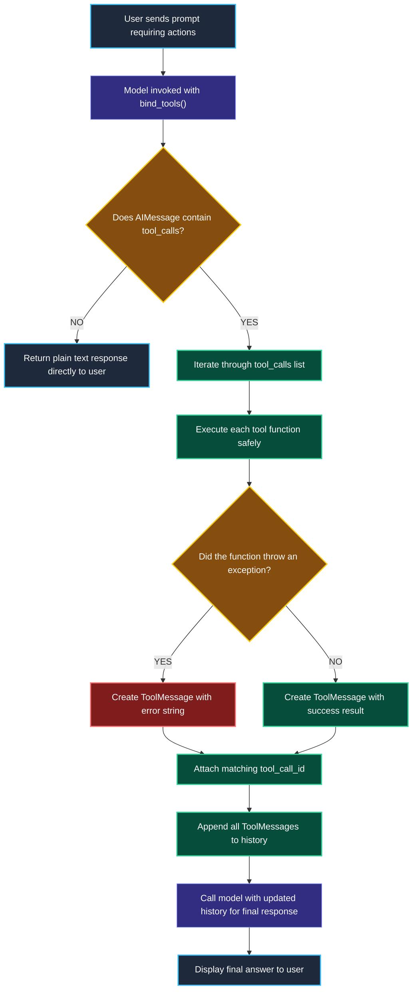

# Model Tool Calling Mechanics in LangChain

> "A crane operator at a shipping port does not shout vague instructions over a static radio. A digital dispatch computer transmits exact container coordinates, and the crane confirms execution with an official tracking ID."

---

### Step 1: Why Do We Need This?

#### The Real Problem

In early AI systems, developers forced models to call tools by writing long prompt instructions like:
> *"When you need a tool, print: Action: tool_name and Action Input: {'arg': 1}"*

This old text-parsing approach (called ReAct string parsing) caused endless production crashes:

```
THE TEXT-PARSING NIGHTMARE:
Model prints: "Thought: I need weather. Action: get_weather('Tokyo')"
→ Your regex parser expected JSON with double quotes, but the model used single quotes.
→ Parser crashes with a SyntaxError!
→ The model cannot call multiple tools in parallel because text parsing only handles one line at a time.
```

Two major problems happen:
1. **Formatting Failures:** Models frequently make typos, forget brackets, or add extra conversational words that break regex parsers.
2. **Sequential Tool Bottleneck:** If a user asks about two things at once, older text parsing forced tools to run one by one.

Modern frontier models support **Native Tool Calling**. The provider's API outputs structured function calls directly into a dedicated `tool_calls` field, completely eliminating string parsing.

---

### Step 2: What Is It?

#### Simple Explanation

Think of Native Tool Calling like a **Digital Dispatch Ticket**:

- Instead of the model shouting informal text, it issues an official digital ticket:  
  `tool_calls = [{"id": "call_9921", "name": "get_weather", "args": {"city": "Tokyo"}}]`
- Your server executes the function.
- Your server stamps the result with the **exact same ticket ID** in a `ToolMessage`:  
  `ToolMessage(content="22°C, Sunny", tool_call_id="call_9921")`
- The model receives its ticket back with the answer and writes the final response.

#### Parallel Tool Calling

Modern models can issue **multiple tool calls in a single turn**.  
If the user asks: *"What is the weather in Tokyo and London?"*, the model emits two separate tickets in the same `tool_calls` list, allowing your server to run both tools in parallel!

---

### Step 3: Real-World Example

#### The Multi-City Weather Service

A user asks: *"Compare the weather in Tokyo and Paris right now."*

1. **User asks question:** `HumanMessage(content="Compare weather in Tokyo and Paris")`.
2. **Model proposes two tool calls at once:**
   - Ticket 1: `id="call_01"`, `name="get_weather"`, `args={"city": "Tokyo"}`
   - Ticket 2: `id="call_02"`, `name="get_weather"`, `args={"city": "Paris"}`
3. **Backend executes in parallel:**
   - Runs `get_weather("Tokyo")` -> `"Sunny, 20°C"`
   - Runs `get_weather("Paris")` -> `"Rainy, 14°C"`
4. **Backend returns two `ToolMessage`s:**
   - `ToolMessage(content="Sunny, 20°C", tool_call_id="call_01")`
   - `ToolMessage(content="Rainy, 14°C", tool_call_id="call_02")`
5. **Model writes final comparative summary:**  
   *"Tokyo is currently sunny at 20°C, while Paris is cooler and rainy at 14°C."*

---

### Step 4: How Does It Work?

#### The Request-Response Cycle



1. **Binding:** You call `model.bind_tools([tools])` to give the model the JSON schemas of your functions.
2. **Generation:** The model evaluates the user prompt and decides whether to output plain text or structured `tool_calls`.
3. **Execution:** Your code iterates through `response.tool_calls` and executes the matching Python functions.
4. **Resolution:** You reply with a `ToolMessage` for each tool call, ensuring `tool_call_id` matches the model's generated ID.

---

### Step 5: Code Example

#### Handling Parallel Tool Calls with Python

Here is a complete, working script demonstrating how to process multiple tool calls in LangChain 1.x:

```python
from langchain.chat_models import init_chat_model
from langchain_core.tools import tool
from langchain_core.messages import HumanMessage, ToolMessage

# 1. Define sample tool
@tool
def get_current_weather(city: str) -> str:
    """Gets the current temperature and weather conditions for a city."""
    weather_data = {
        "tokyo": "22°C, Clear Sky",
        "london": "13°C, Light Drizzle",
        "new york": "18°C, Partly Cloudy"
    }
    return weather_data.get(city.lower(), "15°C, Unknown Conditions")

# 2. Initialize model and bind tools
model = init_chat_model("openai:gpt-4o-mini", temperature=0.0)
model_with_tools = model.bind_tools([get_current_weather])

# 3. User asks a question that requires multiple tool executions
messages = [HumanMessage(content="What is the weather in Tokyo and London right now?")]

# First model invocation
ai_response = model_with_tools.invoke(messages)
messages.append(ai_response)

print(f"Total Tool Calls Requested: {len(ai_response.tool_calls)}")

# 4. Execute all requested tool calls
tool_map = {"get_current_weather": get_current_weather}

for call in ai_response.tool_calls:
    print(f"\n[Executing Tool: {call['name']} (ID: {call['id']})]")
    print(f"Arguments: {call['args']}")
    
    # Run the function
    selected_tool = tool_map[call["name"]]
    output = selected_tool.invoke(call["args"])
    
    # Package into ToolMessage with matching ID
    tool_msg = ToolMessage(content=str(output), tool_call_id=call["id"])
    messages.append(tool_msg)

# 5. Final model call to generate natural language response
final_response = model_with_tools.invoke(messages)

print("\n--- Final Model Output ---")
print(final_response.content)
```

---

### Step 6: How Is It Used in Production?

#### Real-World Engineering Rules

| Production Mistake | Why it hurts | How to fix it |
| :--- | :--- | :--- |
| **Missing `tool_call_id` on Return** | If your `ToolMessage` has an empty or wrong `tool_call_id`, the provider API crashes immediately with an HTTP 400 Bad Request error. | Always map `tool_call_id=call["id"]` directly from the model's request. |
| **Executing Tools Sequentially** | If a model emits 5 tool calls and you run them in a simple `for` loop, user latency multiplies by 5. | Use Python's `asyncio.gather` or thread pools to execute independent tool calls concurrently. |
| **Crashing on Tool Exceptions** | If a tool raises a database exception, your whole API worker dies. | Catch exceptions inside the tool runner and return the error message inside the `ToolMessage` so the model can explain the problem to the user. |

---

### Step 7: Quick Revision

- **Native Tool Calling:** Replaces fragile text parsing. The model outputs structured `tool_calls` with arguments directly.
- **The Golden Matching ID:** Every `ToolMessage` must have a `tool_call_id` that matches the ID emitted by the model.
- **Parallel Calling:** Models can request multiple tool calls in a single turn. Your backend should execute them concurrently.
- **Error Transparency:** If a tool fails, send the error back in a `ToolMessage` so the model can recover gracefully.

#### Short Interview Answer

> *"Native tool calling replaces legacy string-parsing prompts with structured token generation supported directly by frontier model APIs. Chat models emit strongly typed `tool_calls` containing unique IDs and JSON arguments. Our backend executes these tools—concurrently when multiple calls are requested—and returns each result wrapped in a `ToolMessage` carrying the corresponding `tool_call_id`. If a tool fails, we return the error text in the message payload so the model can explain the issue or adjust its strategy without crashing."*

---

### Step 8: Final Flow Diagram



---

### Step 9: Quiz

Test your understanding of model tool calling mechanics. Submit your answers as (1-A, 2-B, etc.) and we will review the explanations together!

#### Question 1
A model returns an `AIMessage` with `tool_calls=[{"id": "call_123", "name": "search_db", "args": {"id": 5}}]`. You run the function and get `{"name": "Alice"}`. How must you package this result to send it back to the model?
- A. Wrap it in a `HumanMessage(content="Alice")`.
- B. Wrap it in a `ToolMessage(content="{'name': 'Alice'}", tool_call_id="call_123")`.
- C. Print it to the Python terminal stdout.
- D. Delete the previous message from the conversation list.

#### Question 2
What happens if your code replies to a tool call with a `ToolMessage` whose `tool_call_id` is missing or does not match any ID requested by the model?
- A. The provider API will reject the request with an HTTP 400 error, because the model cannot match the tool output to its original request.
- B. The model will automatically guess which function it came from.
- C. The user's account balance will increase by $10.
- D. Python will automatically rename the tool ID.

#### Question 3
A user asks: *"Compare stock prices for Apple, Microsoft, and Google."* The model emits three tool calls in a single response. What is the most efficient way to run these on your backend?
- A. Run them in a sequential `for` loop, waiting 1 second for each stock API to return one after another.
- B. Execute all three tool calls concurrently using `asyncio.gather` or a thread pool, reducing total latency to the slowest single API call.
- C. Delete two of the requests and only run the first one.
- D. Tell the user to ask one stock at a time.

#### Question 4
Why is native tool calling (`bind_tools`) significantly more reliable than older ReAct text-parsing prompts?
- A. Because native tool calling uses UDP instead of TCP.
- B. Because the model outputs structured tokens directly matching the function schema, eliminating formatting errors like single-quote syntax issues and broken regex delimiters.
- C. Because native tools do not consume any tokens.
- D. Because native tools only work with Python 2.7.
