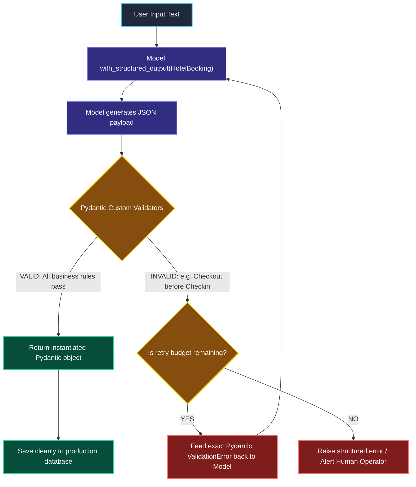
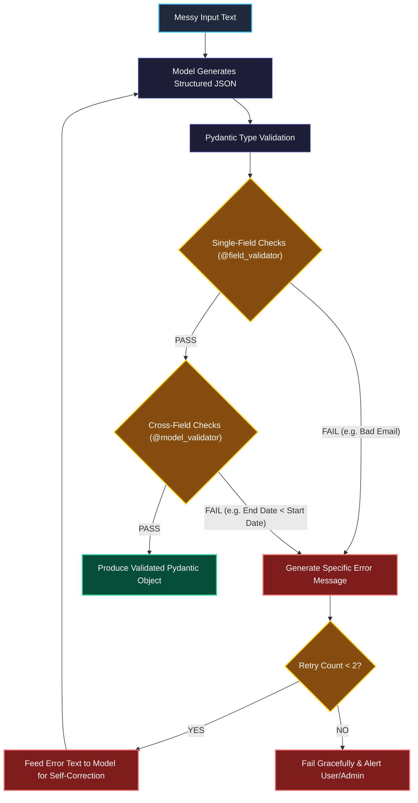

# Advanced Structured Outputs with Pydantic Validation

> "A coin-sorting machine has calibrated mechanical slots. A nickel physically cannot drop into a dime chute. Pydantic gives your AI pipeline that exact same physical guarantee."

---

### Step 1: Why Do We Need This?

#### The Real Problem

Even if a model outputs valid JSON that matches basic types (like integers and strings), the **data inside can still be completely illegal**:

```
THE BUSINESS LOGIC BREAKDOWN:
Model output:
{
  "email": "not-an-email-address",
  "age": -24,
  "checkin_date": "2026-12-31",
  "checkout_date": "2026-12-15"  <-- Checkout happens BEFORE checkin!
}

→ Basic JSON parsers say: "This is valid JSON! Everything is strings and numbers!"
→ But your backend database throws a constraint violation and crashes.
```

Two major problems happen without deep validation:
1. **Semantic Garbage:** An integer field might accept `-999` or a string field might accept a string with 50,000 blank spaces.
2. **Multi-Field Contradictions:** Fields that depend on each other (like start dates and end dates) contradict one another, corrupting your database.

We need **Pydantic Custom Validators** that enforce strict business logic and automatically tell the model how to fix its mistakes if it gets them wrong.

---

### Step 2: What Is It?

#### Simple Explanation

Think of Pydantic validation like an **Airport Passport Control Officer**:

- It's not enough that you have a blue booklet that looks like a passport (basic JSON).
- The officer scans the passport against the criminal database, checks if the expiration date is at least 6 months away, and verifies your visa (Pydantic Validators).
- If something is wrong, the officer sends you back with a clear explanation: *"Your passport expired yesterday."*

#### Core Pydantic Tools in LangChain

- **`Field(ge=0, le=120)`:** Built-in numerical boundaries (e.g. age must be greater than or equal to 0 and less than 120).
- **`@field_validator`:** Custom Python logic that checks a single field (like validating that an email contains `@` and a valid domain).
- **`@model_validator(mode='after')`:** Multi-field logic that compares two fields together (e.g. ensuring `checkout_date > checkin_date`).

---

### Step 3: Real-World Example

#### Hotel Reservation Booking Assistant

A customer says: *"Book a room for 2 guests from November 10 to November 14, 2026. My email is alex@company.com."*

1. **Extraction:** The model fills the `HotelBooking` Pydantic schema.
2. **Field Validation:**
   - Checks guest count: `2` (valid: must be between 1 and 4).
   - Checks email: `alex@company.com` (valid: contains `@` and `.`).
3. **Cross-Field Validation:**
   - Compares dates: `Nov 14` is after `Nov 10` (valid!).
4. **Result:** The system saves the reservation directly to PostgreSQL without any secondary cleanup scripts.

---

### Step 4: How Does It Work?

#### The Self-Correcting Validation Loop



1. **Schema Formulation:** You define a Pydantic model with custom validation rules.
2. **Generation:** The model calls the schema through `with_structured_output`.
3. **Execution of Validators:** Pydantic executes all Python validation functions.
4. **Self-Correction:** If validation fails, the exact Python error message is appended to the conversation, allowing the model to correct its mistake on the next try.

---

### Step 5: Code Example

#### Pydantic Model with Custom Validators & Retries

Here is a complete, working script demonstrating custom Pydantic validators in LangChain 1.x:

```python
from datetime import date
from pydantic import BaseModel, Field, field_validator, model_validator
from langchain.chat_models import init_chat_model

# 1. Define schema with strict business logic
class HotelReservation(BaseModel):
    guest_name: str = Field(description="Full name of the primary guest.")
    number_of_guests: int = Field(ge=1, le=4, description="Total guests (1 to 4).")
    email: str = Field(description="Contact email address.")
    checkin_date: date = Field(description="Check-in date (YYYY-MM-DD).")
    checkout_date: date = Field(description="Check-out date (YYYY-MM-DD).")

    # Custom single-field validation
    @field_validator("email")
    @classmethod
    def validate_email_format(cls, v: str) -> str:
        if "@" not in v or "." not in v:
            raise ValueError(f"'{v}' is not a valid email address.")
        return v.lower().strip()

    # Custom cross-field validation
    @model_validator(mode="after")
    def validate_dates(self):
        if self.checkout_date <= self.checkin_date:
            raise ValueError(
                f"checkout_date ({self.checkout_date}) must be after checkin_date ({self.checkin_date})."
            )
        return self

# 2. Initialize Model
model = init_chat_model("openai:gpt-4o-mini", temperature=0.0)
structured_model = model.with_structured_output(HotelReservation)

# 3. Test with natural language input
user_text = (
    "Hi, I would like to reserve a hotel room for Sarah Connor. "
    "There will be 2 of us. We will arrive on 2026-11-20 and leave on 2026-11-25. "
    "Reach me at SARAH@SKYNET.COM"
)

reservation = structured_model.invoke(user_text)

print("--- Validated Reservation Object ---")
print(f"Guest:    {reservation.guest_name}")
print(f"Guests:   {reservation.number_of_guests}")
print(f"Email:    {reservation.email}")
print(f"Stay:     From {reservation.checkin_date} to {reservation.checkout_date}")
print(f"Type:     {type(reservation)}")
```

#### What Happens When You Run This:
1. Pydantic automatically parses string dates into real Python `datetime.date` objects.
2. The email validator cleans and lowercases the email.
3. The model validator verifies that the checkout date is strictly after the checkin date.

---

### Step 6: How Is It Used in Production?

#### Real-World Engineering Rules

| Production Mistake | Why it hurts | How to fix it |
| :--- | :--- | :--- |
| **Silent Swallowing of Validation Errors** | If validation fails and your code replaces it with `None`, bad records slip into your database unnoticed. | Catch `ValidationError`, log the exact failure, and feed the error text back to the model for self-correction. |
| **Vague Error Messages in Validators** | If a validator raises `ValueError("Invalid")`, the model has no idea what went wrong and makes the same mistake again. | Write clear, descriptive error messages: `ValueError(f"Checkout ({out}) must be after Checkin ({in})")`. |
| **Infinite Retry Loops** | If an input is impossible to satisfy, an unconstrained retry loop will burn API tokens forever. | Cap self-correction retries to a maximum of **2 or 3 attempts**. |

---

### Step 7: Quick Revision

- **Types Alone Aren't Enough:** An integer can still be negative, and a string can still be an invalid email. Pydantic custom validators enforce real business rules.
- **`@field_validator`:** Use for single-field logic (e.g. verifying email structure).
- **`@model_validator`:** Use for comparing multiple fields together (e.g. `checkout > checkin`).
- **Self-Correction:** Feed Pydantic error messages back to the model so it can fix its own mistakes.

#### Short Interview Answer

> *"While basic JSON schemas guarantee data types, they fail to enforce complex domain constraints such as date sequencing or semantic email formatting. In production, we back `with_structured_output` with Pydantic models equipped with `@field_validator` and `@model_validator` decorators. When validation fails, we capture the structured `ValidationError` and feed it back to the model in an automated retry loop, enabling the LLM to self-correct within a bounded attempt limit before failing gracefully."*

---

### Step 8: Final Flow Diagram



---

### Step 9: Quiz

Test your understanding of advanced structured outputs with Pydantic. Submit your answers as (1-A, 2-B, etc.) and we will review the explanations together!

#### Question 1
An AI model extracts hotel booking data and sets `checkin_date = "2026-10-15"` and `checkout_date = "2026-10-10"`. Why does a standard basic JSON Schema fail to prevent this bug?
- A. Because JSON Schema does not support calendar dates.
- B. Because basic JSON Schema validates each field's type individually (both are valid date strings), but cannot compare two fields against each other to enforce that checkout must happen after checkin.
- C. Because OpenAI disabled Python models in 2026.
- D. Because dates can only be validated using C++ extensions.

#### Question 2
When writing a custom Pydantic `@field_validator`, why is it critical to raise a descriptive `ValueError("Expected email with '@' and domain, got 'abc'")` instead of a generic `ValueError("Error")`?
- A. Because Python crashes if an error message has fewer than 10 words.
- B. Because in an automated self-correction loop, the exact error message is fed back to the LLM as a hint, allowing the model to understand its mistake and fix it on the next attempt.
- C. Because Pydantic requires error messages to be written in legal English.
- D. It does not matter; LLMs ignore error messages completely.

#### Question 3
In Pydantic v2, which decorator is used to validate relationships across multiple fields on an instantiated model?
- A. `@model_validator(mode="after")`
- B. `@field_validator("*")`
- C. `@system_prompt_validator`
- D. `@langchain_tool`

#### Question 4
An engineer sets up an automated self-correcting retry loop for structured output validation failures. What production guardrail must they always enforce?
- A. An infinite `while True` loop so the model never gives up.
- B. A hard maximum attempt limit (e.g. `max_retries=2` or `3`) to prevent runaway API token spending if the input text simply lacks the required information.
- C. Setting model temperature to 2.0.
- D. Deleting the Pydantic schema on failure.
