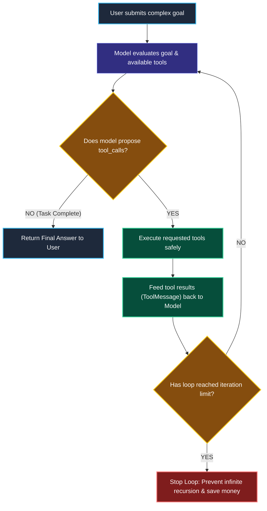
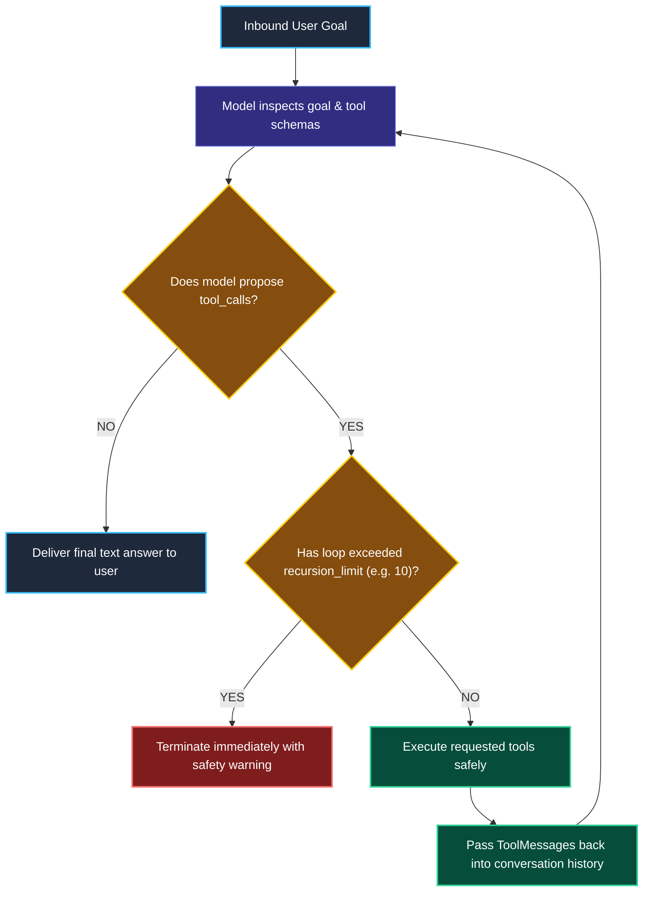

# Agent Architectures and the Autonomous Loop

> "A detective investigating a crime scene does not follow a printed rigid checklist. They form a hypothesis, examine a physical clue, observe the result, and repeat the process until the case is solved."

---

### Step 1: Why Do We Need This?

#### The Real Problem

Standard LCEL chains (`prompt | model | parser`) follow a hardcoded, rigid path:

```python
# A Fixed Chain Cannot Adapt
fixed_chain = fetch_user_db | search_weather_api | format_email
```

If a user asks: *"What is the capital of France?"*, this fixed chain blindly calls the user database, runs the weather API, and formats an email anyway! It has no ability to say: *"I don't need any tools for this question."*

Conversely, if a user asks a complex multi-step question: *"Find our top 3 unpaid invoices, look up the client email for each, and send them a reminder"*, a fixed chain cannot loop dynamically based on how many invoices are found.

Two major problems happen without Agents:
1. **No Dynamic Decision-Making:** Fixed pipelines cannot choose *which* tools to use or *when* to skip them.
2. **No Iterative Problem-Solving:** A fixed pipeline cannot inspect the output of step 1 to decide what step 2 should be.

We need **Autonomous Agents**: systems where the AI model acts as a reasoning engine that chooses tools, observes the results, and loops until the job is done.

---

### Step 2: What Is It?

#### Simple Explanation

Think of an Agent like a **Doctor Treating a Patient**:

1. **Thought:** The patient has a fever and headache. I should test for the flu.
2. **Action:** The doctor orders a flu swab test (calls a tool).
3. **Observation:** The lab returns the result: *"Negative for flu"* (tool output).
4. **Thought:** Since it is not the flu, I will check their blood work (calls a second tool).
5. **Observation:** Blood work shows a mild bacterial infection.
6. **Final Answer:** The doctor prescribes antibiotics. The task is complete!

In LangChain:
- **`create_agent()`** is the modern 1.x standard that creates this loop.
- The model evaluates the conversation, calls tools if needed, reads the tool outputs, and only stops when it generates a final text response.

---

### Step 3: Real-World Example

#### The Cloud Server Incident Triage Agent

A DevOps engineer alerts the bot: *"The payments service is throwing 500 errors. Can you check CPU usage, find recent error logs, and restart the pod if needed?"*

```
Turn 1: Agent calls `get_pod_cpu_usage(service="payments")`
        Observation: "CPU usage is normal at 14%."
Turn 2: Agent calls `get_recent_error_logs(service="payments", limit=5)`
        Observation: "Error: Database connection pool maxed out at 50 connections."
Turn 3: Agent decides NOT to reboot (because rebooting won't fix database pool exhaustion!).
        Agent calls `get_database_active_connections()`
Turn 4: Final Answer to Engineer:
        "The payments pod is healthy, but the PostgreSQL database connection pool is full (50/50).
        Rebooting the pod will not resolve the issue. Please scale the database pool size."
```

**What the system receives:** A high-level operational problem.  
**What decision it makes:** Dynamically chooses which diagnostic tools to run based on what previous tools reported.  
**What it returns:** An intelligent diagnosis with the exact root cause.

---

### Step 4: How Does It Work?

#### The Modern Agent Loop



1. **Prompt Evaluation:** The model receives the user's goal along with descriptions of all bound tools.
2. **Action Decision:** If the model needs more data or needs to perform an action, it outputs `tool_calls`.
3. **Observation Feedback:** The runtime executes the tools and passes the output back as `ToolMessage`s.
4. **Stopping Condition:** The loop repeats until the model decides it has enough evidence to output a final user-facing message, or it hits the safety iteration limit.

---

### Step 5: Code Example

#### Building an Agent in LangChain 1.x

Here is a complete, working script using LangChain's modern `create_agent`:

```python
from langchain.chat_models import init_chat_model
from langchain_core.tools import tool
from langchain.agents import create_agent

# 1. Define sharp, specific tools
@tool
def get_order_status(order_id: str) -> str:
    """Looks up current shipping status for an e-commerce order ID."""
    db = {"ORD-101": "Shipped - Out for delivery", "ORD-102": "Processing in warehouse"}
    return db.get(order_id.upper(), "Order ID not found.")

@tool
def get_refund_policy() -> str:
    """Returns the company refund eligibility rules."""
    return "Items can be refunded within 30 days of delivery if undamaged."

# 2. Initialize Model
model = init_chat_model("openai:gpt-4o-mini", temperature=0.0)

# 3. Create the Agent in 1.x
# Behind the scenes, create_agent compiles directly into a LangGraph graph!
agent = create_agent(
    model=model,
    tools=[get_order_status, get_refund_policy],
    system_prompt="You are a helpful customer support agent. Use tools to look up facts before answering."
)

# 4. Invoke the Agent
print("--- Running Support Agent ---")
response = agent.invoke({
    "messages": [("human", "What is the status of my order ORD-101, and can I refund it?")]
})

# 5. Inspect the Conversation History
for msg in response["messages"]:
    msg_type = type(msg).__name__
    if msg_type == "AIMessage" and msg.tool_calls:
        print(f"\n[AI Action]: Calling tool -> {msg.tool_calls[0]['name']}")
    elif msg_type == "ToolMessage":
        print(f"[Tool Observation]: {msg.content}")
    elif msg_type == "AIMessage" and not msg.tool_calls:
        print(f"\n[Final Answer]:\n{msg.content}")
```

---

### Step 6: How Is It Used in Production?

#### Real-World Engineering Rules

| Production Mistake | Why it hurts | How to fix it |
| :--- | :--- | :--- |
| **No Recursion Limit (Infinite Loops)** | If an agent gets stuck in a loop calling the same failing tool repeatedly, you wake up to a $5,000 API bill. | Always set a hard recursion limit (e.g., `recursion_limit=10`) so runaway loops terminate automatically. |
| **Vague System Prompts** | An agent with no clear instructions will wander between tools or guess instead of searching. | Give explicit instructions: *"You must always check order status before discussing shipping times."* |
| **Giving Dangerous Destructive Tools Unchecked** | Giving an agent a tool named `delete_user_account()` with no human confirmation can delete real customer data accidentally. | Require **Human-in-the-Loop approval** (Module 10) before executing destructive tools. |

---

### Step 7: Quick Revision

- **Chains vs Agents:** Chains follow a fixed, pre-written path. Agents dynamically choose tools, observe outputs, and decide their next steps iteratively.
- **The ReAct Loop:** Thought -> Action -> Observation -> Final Answer.
- **`create_agent` in 1.x:** LangChain 1.x replaces legacy `AgentExecutor` with `create_agent()`, which runs directly on top of LangGraph.
- **Always Bound the Loop:** Enforce iteration limits to prevent infinite loops and runaway token spending.

#### Short Interview Answer

> *"In contrast to static LCEL pipelines that execute deterministic directed acyclic graphs, autonomous agents use the LLM as a dynamic reasoning engine within an iterative loop. In LangChain 1.x, `create_agent` compiles into a LangGraph runtime where the model evaluates incoming messages, selects appropriate tools, observes intermediate execution payloads, and iterates until goal completion. In production, we enforce strict recursion limits to prevent runaway loops and guard state-changing tools behind human approval."*

---

### Step 8: Final Flow Diagram



---

### Step 9: Quiz

Test your understanding of agent architectures. Submit your answers as (1-A, 2-B, etc.) and we will review the explanations together!

#### Question 1
What is the fundamental architectural difference between an LCEL Chain (`prompt | model | parser`) and an Agent (`create_agent`)?
- A. LCEL chains only work in Python, while Agents only work in JavaScript.
- B. An LCEL chain executes a fixed, predetermined sequence of steps, whereas an Agent uses the LLM to dynamically decide which tools to call, in what order, and how many times to loop.
- C. Agents do not use LLMs.
- D. LCEL chains are 100% free of token costs.

#### Question 2
An agent searching for a customer file gets stuck in an infinite loop, calling `search_file("invoice")` over and over because the file does not exist. What critical production guardrail was missing?
- A. A recursion limit (maximum iteration limit) that automatically terminates the loop after a set number of steps (e.g., 5 or 10 turns).
- B. A faster internet connection.
- C. The `langchain-classic` package.
- D. Setting temperature to 2.0.

#### Question 3
In LangChain 1.x, what execution engine powers `create_agent()` under the hood?
- A. The legacy pre-1.0 `AgentExecutor` class.
- B. LangGraph's durable state graph runtime.
- C. A raw Unix bash script.
- D. Docker swarm containers.

#### Question 4
An agent needs to answer: *"What is the stock price of Apple, and who is the CEO?"* How does the agent resolve this?
- A. It crashes because questions cannot have two parts.
- B. It can issue parallel or sequential tool calls (e.g., calling a finance tool for stock price, and an executive database tool for the CEO), collect both observations, and synthesize a single unified final answer.
- C. It only answers the first half and deletes the second half.
- D. It asks the user to re-type the question in Spanish.
