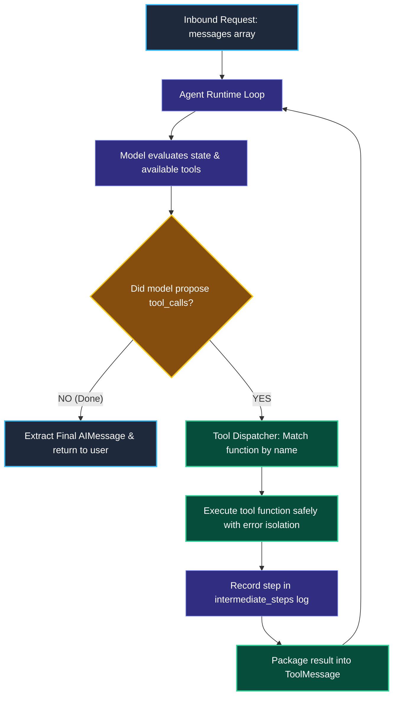
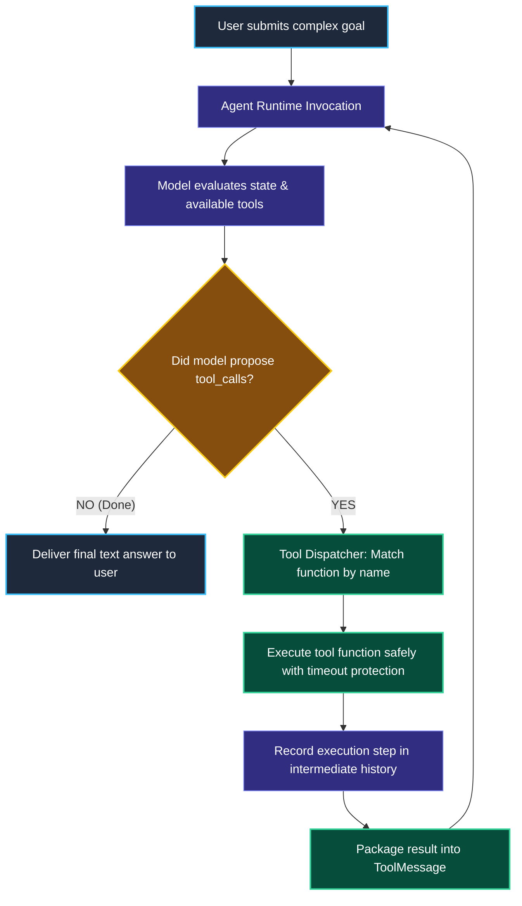

# Tool Calling Agents and Execution Runtimes

> "A general contractor does not pour concrete, wire circuit breakers, and install plumbing alone. They read the blueprint, hire licensed specialists, verify completed work, and sign off on the final building."

---

### Step 1: Why Do We Need This?

#### The Real Problem

In Module 4, we built a manual tool loop using a `while` loop. While writing a manual loop helps understand the mechanics, writing it by hand in production causes major headaches:

```python
# The Manual Boilerplate Nightmare
while True:
    response = model.invoke(messages)
    if not response.tool_calls:
        break
    # You must manually:
    # 1. Match tool names to Python functions
    # 2. Track matching tool_call_ids
    # 3. Handle tool exceptions so the loop doesn't crash
    # 4. Enforce timeout limits and maximum loops
    # 5. Record intermediate steps for tracing and audit logs
```

If you hand-roll this loop for every service:
1. **Error-Handling Bugs:** An unhandled error in one tool crashes your entire server.
2. **Missing Intermediate Observability:** You lose the ability to easily inspect which tools were called, how long each tool took, and what inputs were passed.

We need a standardized **Agent Runtime** that manages the loop, executes tools safely, tracks intermediate steps, and enforces production limits automatically.

---

### Step 2: What Is It?

#### Simple Explanation

Think of the Agent Runtime like an **Experienced Project Manager**:

- **The Blueprint (Prompt & Model):** Explains what goal needs to be accomplished.
- **The Specialists (Tools):** Certified functions for database lookup, email sending, or math.
- **The Runtime Engine:** Manages the schedule, dispatches tasks to specialists, inspects their completed work, and delivers the final result to the client.

In LangChain 1.x:
- **`create_agent()`** packages the model, tools, and system prompt into a resilient execution engine.
- Every run automatically returns both the **`final_response`** and the full history of **`intermediate_steps`** (which tools ran and what they returned).

---

### Step 3: Real-World Example

#### The E-Commerce Customer Support Agent

A customer asks: *"Where is my package ORD-404, and if it's delayed, can you issue a $10 courtesy credit to my balance?"*

1. **Step 1:** The agent calls `check_shipping_status("ORD-404")`.
   - *Observation:* Returns `{"status": "DELAYED", "delay_days": 3}`.
2. **Step 2:** The agent recognizes the delay qualifies for a courtesy credit. It calls `apply_courtesy_credit(user_id="USER-88", amount=10.0)`.
   - *Observation:* Returns `{"status": "SUCCESS", "new_balance": 10.0}`.
3. **Step 3:** The agent decides all conditions have been met. No more tools are needed.
4. **Final Answer:** *"Your package ORD-404 is currently delayed by 3 days. I have credited $10 to your account balance as an apology for the inconvenience."*

---

### Step 4: How Does It Work?

#### The Runtime Execution Lifecycle



1. **Input Submission:** The user sends a prompt into `agent.invoke({"messages": [...]})`.
2. **Autonomous Iteration:** The runtime invokes the model. If tool calls exist, it matches the tool name against the registered tool registry, executes the function, and wraps the output in a `ToolMessage`.
3. **Audit Trail:** Every tool call and observation is recorded in the run state, providing full transparency.
4. **Completion:** When the model outputs standard text with no tool calls, the runtime halts and returns the final conversation history.

---

### Step 5: Code Example

#### Inspecting Intermediate Agent Steps

Here is a complete, working script in LangChain 1.x showing how to run an agent and inspect every action it took behind the scenes:

```python
from langchain.chat_models import init_chat_model
from langchain_core.tools import tool
from langchain.agents import create_agent

# 1. Define sample tools
@tool
def lookup_customer_tier(customer_id: str) -> str:
    """Finds customer loyalty tier ('VIP' or 'Standard') by customer ID."""
    tiers = {"CUST-001": "VIP", "CUST-002": "Standard"}
    return tiers.get(customer_id.upper(), "Standard")

@tool
def calculate_discount(tier: str, cart_total: float) -> float:
    """Calculates discount amount based on tier and current cart total."""
    discount_pct = 0.20 if tier.upper() == "VIP" else 0.05
    return cart_total * discount_pct

# 2. Initialize Model (Using Grok via xAI)
model = init_chat_model("grok-2-latest", model_provider="xai", temperature=0.0)

# 3. Create Agent
agent = create_agent(
    model=model,
    tools=[lookup_customer_tier, calculate_discount],
    system_prompt="You are a store assistant. Always check the customer's loyalty tier before calculating discounts."
)

# 4. Invoke Agent
query = "I am customer CUST-001 and my cart total is $150. What is my final discount?"
print(f"User Query: '{query}'\n")

response = agent.invoke({
    "messages": [("human", query)]
})

# 5. Inspect Intermediate Steps and Final Answer
print("--- AGENT EXECUTION TRAIL ---")
for msg in response["messages"]:
    if hasattr(msg, "tool_calls") and msg.tool_calls:
        for call in msg.tool_calls:
            print(f"[ACTION]: Calling '{call['name']}' with {call['args']}")
    elif msg.type == "tool":
        print(f"[OBSERVATION]: {msg.content}")
    elif msg.type == "ai" and not msg.tool_calls:
        print(f"\n[FINAL RESPONSE]:\n{msg.content}")
```

#### What Happens When You Run This:
1. The agent first calls `lookup_customer_tier("CUST-001")` and observes `"VIP"`.
2. It then calls `calculate_discount("VIP", 150.0)` and observes `30.0`.
3. Finally, it synthesizes the final answer: *"As a VIP customer, you receive a 20% discount of $30.00."*

---

### Step 6: How Is It Used in Production?

#### Real-World Engineering Rules

| Production Mistake | Why it hurts | How to fix it |
| :--- | :--- | :--- |
| **No Per-Tool Timeout** | If an external shipping API hangs for 60 seconds, the entire agent run freezes. | Configure explicit timeouts on every tool using `ToolRuntime` or HTTP client timeouts (Module 4). |
| **Hiding Intermediate Logs from Telemetry** | When an agent fails, you have no record of what numbers or inputs were passed to intermediate tools. | Use LangSmith tracing so every tool span records exact parameters, execution time, and return values. |
| **Mixing Read-Only and Destructive Tools** | An agent might decide to execute a payment before the user even confirmed the details. | Separate read-only inquiry tools from destructive action tools, and require approval (Module 10) for writes. |

---

### Step 7: Quick Revision

- **The Runtime Job:** Manages the autonomous loop, executes tools safely, handles error propagation, and packages `ToolMessage`s.
- **Inspection of Steps:** You can inspect intermediate steps to see exactly why an agent made a specific decision.
- **`create_agent` in LangChain 1.x:** The standard agent factory that replaces legacy pre-1.0 `AgentExecutor` classes.
- **Fail Fast:** Always set timeouts on individual tools so one slow third-party API does not freeze the entire agent.

#### Short Interview Answer

> *"In production agent architectures, execution runtimes manage the cycle between model tool-call generation, tool dispatch, and observation feedback. In LangChain 1.x, `create_agent` compiles this workflow into a durable state machine that handles parallel tool execution, isolates function exceptions, and captures intermediate execution steps for auditing. In our microservices, we enforce per-tool timeouts and stream intermediate step events to user interfaces so users see real-time progress while complex workflows execute."*

---

### Step 8: Final Flow Diagram



---

### Step 9: Quiz

Test your understanding of tool calling agents and runtimes. Submit your answers as (1-A, 2-B, etc.) and we will review the explanations together!

#### Question 1
Why is it important to capture and record `intermediate_steps` during an agent's execution?
- A. Because Python cannot run unless intermediate steps are printed to the screen.
- B. To provide complete observability into why the agent made a specific decision, which tools were called, and what exact arguments were passed.
- C. To reduce the dollar cost of the API call by 80%.
- D. To delete temporary files from the hard drive.

#### Question 2
What happens if a tool called by an agent raises an unhandled database exception inside a production agent runtime?
- A. The runtime catches the exception and packages the error description into a `ToolMessage`, allowing the model to understand that the tool failed and attempt a recovery or explain the problem to the user.
- B. The user's computer will automatically restart.
- C. The model will permanently delete the tool from its memory.
- D. The agent will repeat the exact same failing query for 24 hours.

#### Question 3
An agent needs to query a third-party shipping API that is currently experiencing a degraded network connection. What happens if the tool function has no timeout configured?
- A. The model provider will automatically fix the third-party shipping API.
- B. The entire agent execution will hang and block the web server thread until the operating system TCP connection times out, severely degrading user experience.
- C. The agent will run in reverse.
- D. Python will switch the model to an offline mode.

#### Question 4
In LangChain 1.x, which method creates the recommended production tool-calling agent?
- A. `create_agent(model, tools, system_prompt)`
- B. `import legacy_agent_executor`
- C. `run_bash_script("agent.sh")`
- D. `while True: model.predict()`
