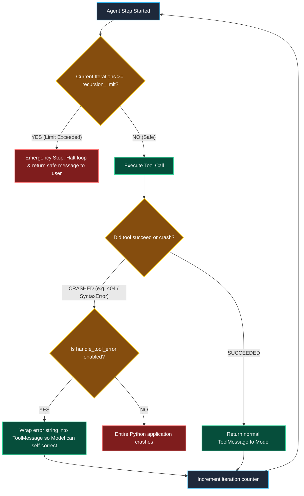
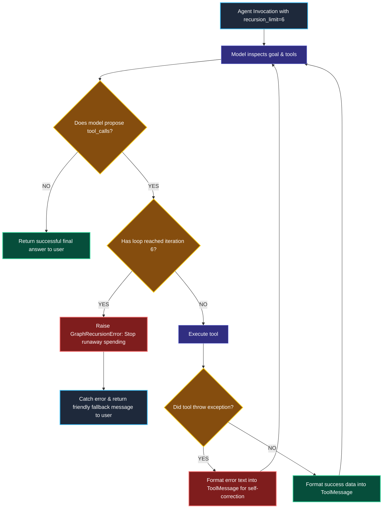

# Agent Error Handling and Iteration Limits

> "A Formula 1 race car has an electronic rev limiter. If the engine spins too fast, the computer cuts the fuel to prevent the engine from exploding. Your AI agents need the exact same rev limiter."

---

### Step 1: Why Do We Need This?

#### The Real Problem

When an autonomous agent runs, the AI model decides when to stop. If something unexpected happens—like a database query error or a missing file—the model can get trapped in a **Runaway Death Loop**:

```
THE RUNAWAY DEATH SPIRAL:
Turn 1: Agent calls SQL: "SELECT * FROM user_profiles"
        Error returned: "Table 'user_profiles' does not exist."
Turn 2: Agent retries the EXACT same SQL query: "SELECT * FROM user_profiles"
        Error returned: "Table 'user_profiles' does not exist."
Turn 3: Agent retries again...
...
Turn 80: The agent has run for 4 minutes, burned 300,000 tokens ($12.00 cost),
         and timed out the web server!
```

Two major problems happen without error boundaries:
1. **Runaway Financial Cost:** A single stuck agent loop can burn hundreds of thousands of tokens before an engineer notices.
2. **Server Thread Exhaustion:** Unbounded agents hang for minutes, keeping backend worker connections open and starving other users.

We need **hard limits** (iteration caps and timeouts) and **smart error handling** so the agent can fix its mistakes or safely give up without burning your budget.

---

### Step 2: What Is It?

#### Simple Explanation

Think of iteration limits and error handlers like a **Circuit Breaker and Emergency Brake**:

- **The Rev Limiter (`recursion_limit=8`):** No matter what the model wants to do, after 8 turns, the system pulls the emergency brake and halts execution.
- **The Wall-Clock Timeout (`timeout=25.0`):** If the total task takes longer than 25 seconds, the request stops immediately.
- **The Self-Correction Loop (`handle_tool_error=True`):** When a tool crashes, the system does not crash Python. It wraps the error into a polite `ToolMessage` explaining the mistake, so the model can read the error and try a different approach.

---

### Step 3: Real-World Example

#### The Self-Correcting SQL Assistant

A user asks: *"How many active users signed up this month?"*

1. **Attempt 1:** The agent calls `run_sql("SELECT COUNT(*) FROM user_accounts WHERE status = 'active'")`.
   - *Error:* `DatabaseError: Relation 'user_accounts' does not exist.`
2. **Error Interception:** The system catches the error and sends it back:
   - `ToolMessage(content="Error: Table 'user_accounts' not found. Available tables: [users, orders, logs]")`.
3. **Attempt 2 (Self-Correction):** The model reads the error, realizes the table is named `users`, and calls:
   - `run_sql("SELECT COUNT(*) FROM users WHERE status = 'active'")`.
   - *Result:* `{"count": 1420}`.
4. **Final Answer:** *"There are currently 1,420 active users."*

Because the error was handled gracefully, the agent solved the problem on turn 2 instead of crashing!

---

### Step 4: How Does It Work?

#### The Guardrail Lifecycle



1. **Pre-Step Check:** Before every model invocation, the engine checks if the iteration counter has exceeded `recursion_limit` or if the wall-clock timeout has expired.
2. **Error Isolation:** If a tool raises an exception, the handler catches it, converts the traceback into an informative string, and packages it into a `ToolMessage`.
3. **Course Correction:** The model inspects the error message in the next turn and modifies its arguments.

---

### Step 5: Code Example

#### Setting Hard Recursion Limits and Tool Error Handling

Here is a complete, working script in LangChain 1.x:

```python
from langchain.chat_models import init_chat_model
from langchain_core.tools import tool
from langchain_core.runnables import RunnableConfig
from langchain.agents import create_agent

# 1. Define a tool with built-in error handling
@tool
def execute_database_query(query: str) -> str:
    """Executes a SQL query against the customer database."""
    # Simulate a table error if the model guesses the wrong table
    if "user_profiles" in query.lower():
        # Raising an error simulates real database failures
        raise ValueError("Table 'user_profiles' does not exist. Did you mean 'customers'?")
    
    if "customers" in query.lower():
        return "Query Result: 450 active customers found."
    
    return "Query executed with 0 results."

# 2. Initialize Model
model = init_chat_model("openai:gpt-4o-mini", temperature=0.0)

# 3. Create Agent
agent = create_agent(
    model=model,
    tools=[execute_database_query],
    system_prompt="You are a data analyst. If a database query fails, read the error message carefully and fix the table name."
)

# 4. Invoke Agent with Strict Production Guardrails in RunnableConfig!
config = RunnableConfig(
    recursion_limit=6,  # Hard limit: Agent cannot loop more than 6 times!
    tags=["production", "sql-agent"]
)

print("--- Running Protected Agent ---")
try:
    response = agent.invoke(
        {"messages": [("human", "How many active users are in the user_profiles table?")]},
        config=config
    )
    
    # Print the conversation history showing error self-correction
    for msg in response["messages"]:
        if msg.type == "tool":
            print(f"\n[Tool Feedback / Error]:\n{msg.content}")
        elif msg.type == "ai" and not msg.tool_calls:
            print(f"\n[Final Answer]:\n{msg.content}")

except Exception as e:
    print(f"\n[Safety Circuit Breaker Tripped]: {e}")
```

#### What Happens When You Run This:
1. The agent first queries `user_profiles` and receives the error message: *"Table 'user_profiles' does not exist. Did you mean 'customers'?"*.
2. Instead of crashing, the model reads the hint, corrects its query to `customers`, and succeeds!
3. If the model got stuck, the `recursion_limit=6` would terminate the run automatically.

---

### Step 6: How Is It Used in Production?

#### Real-World Engineering Rules

| Production Mistake | Why it hurts | How to fix it |
| :--- | :--- | :--- |
| **Default Unbounded Recursion** | Allowing an agent to loop 50+ times burns budget and locks up server resources. | Enforce a strict `recursion_limit` between **6 and 10** for standard user-facing tasks. |
| **Masking Critical System Failures** | If an external database is completely dead (network down), letting the agent retry 10 times wastes money. | If a tool throws a fatal connection error (like `ConnectionRefused`), fail fast instead of letting the agent retry. |
| **Hiding Timeouts from Users** | When an agent times out after 20 seconds, the user sees a blank screen or a generic 500 error. | Catch `GraphRecursionError` and return a friendly message: *"I was unable to complete the task within the allowed time. Please try rephrasing your request."* |

---

### Step 7: Quick Revision

- **The Rev Limiter:** Always set `recursion_limit` in `RunnableConfig`. It is your ultimate defense against runaway token bills.
- **Self-Correction via Errors:** Return clean, descriptive error strings inside `ToolMessage` so the model can fix its own parameters.
- **Fail Fast on Fatal Errors:** Don't let an agent retry if the underlying service is completely down.
- **Graceful Degradation:** When the limit is reached, return a polite fallback message to the user rather than an unhandled stack trace.

#### Short Interview Answer

> *"Production autonomous agents require deterministic execution boundaries to prevent unbounded looping and runaway token consumption. We enforce hard caps using `recursion_limit` in `RunnableConfig` (typically 6-10 super-steps) alongside wall-clock timeouts. At the tool level, we intercept transient exceptions and return structured diagnostic strings in the `ToolMessage` payload, enabling the model to self-correct its query parameters within its allowed retry budget. When recursion thresholds are exceeded, the system fails gracefully with friendly user fallbacks and triggers alert telemetry in LangSmith."*

---

### Step 8: Final Flow Diagram



---

### Step 9: Quiz

Test your understanding of agent error handling and iteration limits. Submit your answers as (1-A, 2-B, etc.) and we will review the explanations together!

#### Question 1
An agent searching for an employee record gets stuck in a loop calling `lookup_user("John Doe")` 50 times in a row because the name is ambiguous. What parameter in `RunnableConfig` prevents this runaway spending?
- A. `recursion_limit`
- B. `temperature=1.0`
- C. `model="gpt-3.5-turbo"`
- D. `allow_infinite_loops=True`

#### Question 2
When a tool function throws a Python `ValueError("Invalid date format, expected YYYY-MM-DD")`, what is the best production way to handle it inside an agent?
- A. Let the entire server crash so the developer gets a phone call.
- B. Catch the error and return the clear error message inside a `ToolMessage`, allowing the model to read the format requirement and self-correct on its next attempt.
- C. Delete the date tool from the server.
- D. Automatically change the user's password.

#### Question 3
Why should an engineer avoid setting `recursion_limit=100` on a customer-facing support chatbot?
- A. Because Python cannot count up to 100.
- B. Because if the agent gets trapped in a loop, it will run for several minutes, consume hundreds of thousands of tokens, run up high API costs, and keep the user waiting on a frozen screen.
- C. Because model providers charge a $1,000 fine for loops over 10.
- D. Because recursion limits only apply to sorting algorithms.

#### Question 4
What should your application do if an agent hits its `recursion_limit` before finding the complete answer?
- A. Show the raw Python stack trace to the user.
- B. Catch the recursion exception and return a polite, graceful fallback response (e.g. *"I was unable to complete your request. Would you like me to connect you to a human agent?"*).
- C. Delete the database records.
- D. Restart the computer.
