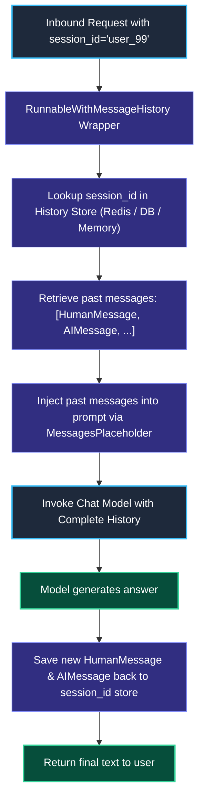
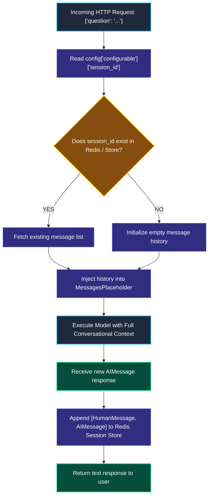

# Chat Message History and Session Memory

> "A patient in a hospital does not re-explain their entire life story every time a nurse walks into the room. The nurse simply pulls Patient Chart #8891, reads the past notes, and adds a new entry."

---

### Step 1: Why Do We Need This?

#### The Real Problem

Large language models have **no memory across different HTTP requests**. Every single call you make to an LLM API is completely isolated and stateless:

```
THE AMNESIA BREAKDOWN:
Turn 1: User sends HTTP POST: "My name is Sarah and my favorite language is Python."
        AI replies: "Nice to meet you, Sarah! How can I help you with Python today?"

Turn 2: User sends HTTP POST: "What is my name and what do I like?"
        AI replies: "I am an AI assistant and I don't know your name or what you like."
```

Two major problems happen without session memory:
1. **Frustrating User Experience:** Users have to repeat their context, account IDs, and preferences in every single message.
2. **Session Collision in Multi-User Apps:** If you store history in a single global variable, Alice will see Bob's private messages!

We need a standardized way to store conversation history keyed by a unique **`session_id`**, automatically load past messages before each prompt, and save new messages when the model finishes.

---

### Step 2: What Is It?

#### Simple Explanation

Think of Session Memory like a **Doctor's Medical Chart**:

- **The Patient ID (`session_id="user_123"`):** The unique tag for a specific customer or conversation.
- **The Chart (`ChatMessageHistory`):** The list of past messages (`HumanMessage`, `AIMessage`) stored for that patient.
- **The Attending Nurse (`RunnableWithMessageHistory`):** A wrapper that automatically pulls Chart `user_123`, feeds the past conversation into the prompt, and writes down the new conversation when the call ends.

In LangChain:
- You wrap any standard LCEL chain with **`RunnableWithMessageHistory`**.
- You pass `config={"configurable": {"session_id": "session_abc"}}`.
- The chain automatically maintains multi-turn conversation memory for that specific user.

---

### Step 3: Real-World Example

#### Multi-Tenant Customer Support Bot

Two different users are chatting with your support bot at the exact same moment:
- **Session 1 (Sarah):** Asks about returning a blue sweater.
- **Session 2 (Mark):** Asks about tracking a lost shoe delivery.

```
Request 1 (session_id="sarah_101"):
  Prompt: "Can I get a refund for it?"
  -> Loads Sarah's history: [Discussed blue sweater]
  -> AI Answer: "Yes, you can return your blue sweater within 30 days."

Request 2 (session_id="mark_202"):
  Prompt: "Can I get a refund for it?"
  -> Loads Mark's history: [Discussed lost shoes]
  -> AI Answer: "Since your shoes were lost in transit, we can issue an immediate refund."
```

**What the system receives:** The message text and the user's `session_id`.  
**What decision it makes:** Isolates each user's history so there is zero data leakage between customers.  
**What it returns:** Personalized, context-aware answers that remember past conversation turns.

---

### Step 4: How Does It Work?

#### The Session Lifecycle



1. **Session Resolution:** The wrapper inspects `config["configurable"]["session_id"]`.
2. **History Retrieval:** It calls your session factory to get or create the `ChatMessageHistory` for that session.
3. **Prompt Injection:** It injects the messages into the prompt where `MessagesPlaceholder(variable_name="history")` sits.
4. **Automatic Persistence:** After the model responds, both the user's prompt and the model's reply are automatically saved back to the session store.

---

### Step 5: Code Example

#### Multi-User Memory with `RunnableWithMessageHistory`

Here is a complete, working script in LangChain 1.x:

```python
from langchain_core.prompts import ChatPromptTemplate, MessagesPlaceholder
from langchain_core.output_parsers import StrOutputParser
from langchain_core.chat_history import InMemoryChatMessageHistory
from langchain_core.runnables.history import RunnableWithMessageHistory
from langchain.chat_models import init_chat_model

# 1. Base Chain Setup
model = init_chat_model("openai:gpt-4o-mini", temperature=0.0)

prompt = ChatPromptTemplate.from_messages([
    ("system", "You are a friendly personal AI assistant."),
    MessagesPlaceholder(variable_name="history"),  # Past turns get injected here!
    ("human", "{question}")
])

base_chain = prompt | model | StrOutputParser()

# 2. In-Memory Session Store (Simulating a session database)
session_store: dict[str, InMemoryChatMessageHistory] = {}

def get_session_history(session_id: str) -> InMemoryChatMessageHistory:
    """Returns the chat history for a session, creating one if it doesn't exist."""
    if session_id not in session_store:
        session_store[session_id] = InMemoryChatMessageHistory()
    return session_store[session_id]

# 3. Wrap the Base Chain with Session Management
chain_with_history = RunnableWithMessageHistory(
    base_chain,
    get_session_history,
    input_messages_key="question",
    history_messages_key="history"
)

# 4. Test Multi-Turn Conversation for User Sarah
sarah_config = {"configurable": {"session_id": "sarah_session_1"}}

print("--- User Sarah: Turn 1 ---")
r1 = chain_with_history.invoke({"question": "Hi! My name is Sarah and I love building robots."}, config=sarah_config)
print("AI:", r1)

print("\n--- User Sarah: Turn 2 (Testing Memory) ---")
r2 = chain_with_history.invoke({"question": "What is my name and what is my hobby?"}, config=sarah_config)
print("AI:", r2)

# 5. Test Separate Conversation for User Bob (Testing Session Isolation)
bob_config = {"configurable": {"session_id": "bob_session_2"}}

print("\n--- User Bob: Turn 1 (Checking for Data Leakage) ---")
r3 = chain_with_history.invoke({"question": "What is my name?"}, config=bob_config)
print("AI:", r3)
```

#### What Happens When You Run This:
1. In Turn 2, Sarah asks what her name is. The model accurately remembers: *"Your name is Sarah and you love building robots."*
2. When Bob asks what his name is, the model replies that it doesn't know his name yet, proving that Sarah's private data never leaked into Bob's session.

---

### Step 6: How Is It Used in Production?

#### Real-World Engineering Rules

| Production Mistake | Why it hurts | How to fix it |
| :--- | :--- | :--- |
| **Using `InMemoryChatMessageHistory` in Production** | Whenever you redeploy your Docker container or restart your server, all user conversations are permanently wiped. | Use persistent session stores like **Redis** (`RedisChatMessageHistory`) or **PostgreSQL** (Module 9). |
| **Forgetting to Pass `session_id`** | If `session_id` is missing or hardcoded to a static string like `"default"`, all concurrent users share the same memory! | Always extract `session_id` from verified user authentication tokens or cookies. |
| **Unbounded Memory Growth** | If a user chats for 3 hours, their history reaches 100,000 tokens. The next call crashes with a token context limit or costs $2.00 per message. | Apply message trimming or windowing (Phase 7, Lesson 3) to keep only the most recent $N$ messages. |

---

### Step 7: Quick Revision

- **LLMs are Stateless:** They have no memory of past turns unless you feed the previous messages back into the prompt.
- **The Wrapper Standard:** `RunnableWithMessageHistory` wraps any standard LCEL chain and automatically manages fetching and saving messages.
- **`session_id` Isolation:** Every user or chat thread must have a unique `session_id` to prevent cross-customer data leaks.
- **Persistent Storage:** Never use in-memory history in production. Connect session stores to Redis or SQL.

#### Short Interview Answer

> *"Because LLM APIs are completely stateless, multi-turn conversational systems require session state management. In LangChain, we implement `RunnableWithMessageHistory` to wrap standard LCEL pipelines. It uses a session factory to fetch historical `BaseMessage` arrays by `session_id`, injects them into prompts via `MessagesPlaceholder`, and appends new user-assistant pairs upon completion. In production, we back this with distributed key-value stores like Redis with TTL expiration to prevent memory loss during server restarts while isolating customer sessions."*

---

### Step 8: Final Flow Diagram



---

### Step 9: Quiz

Test your understanding of chat message history and session memory. Submit your answers as (1-A, 2-B, etc.) and we will review the explanations together!

#### Question 1
Why does an AI model fail to remember the user's name across two consecutive HTTP requests if no memory system is configured?
- A. Because HTTP requests are stateless, and the model provider does not save conversation history between independent API calls.
- B. Because Python deletes variables whenever the CPU fan turns on.
- C. Because the user's browser automatically encrypts their name.
- D. Because model providers charge a penalty for remembering names.

#### Question 2
What security catastrophe occurs if a developer hardcodes `session_id = "default_user"` for all requests in a multi-tenant web application?
- A. The server runs out of disk space in 5 seconds.
- B. Every single customer will read and write to the exact same shared conversation history, completely leaking private customer data across users.
- C. The model will refuse to output English.
- D. Python will throw a syntax error.

#### Question 3
Why is `InMemoryChatMessageHistory` dangerous to use in a production environment?
- A. It only works on Windows computers.
- B. It stores all messages inside the local Python process RAM, meaning every server reboot, deployment, or auto-scaling event permanently wipes all user conversations.
- C. It doubles the latency of every prompt.
- D. It limits chat messages to 10 characters.

#### Question 4
In an LCEL prompt template, what component acts as the placeholder where previous conversation turns are injected dynamically?
- A. `StrOutputParser()`
- B. `MessagesPlaceholder(variable_name="history")`
- C. `RunnablePassthrough()`
- D. `init_chat_model()`
