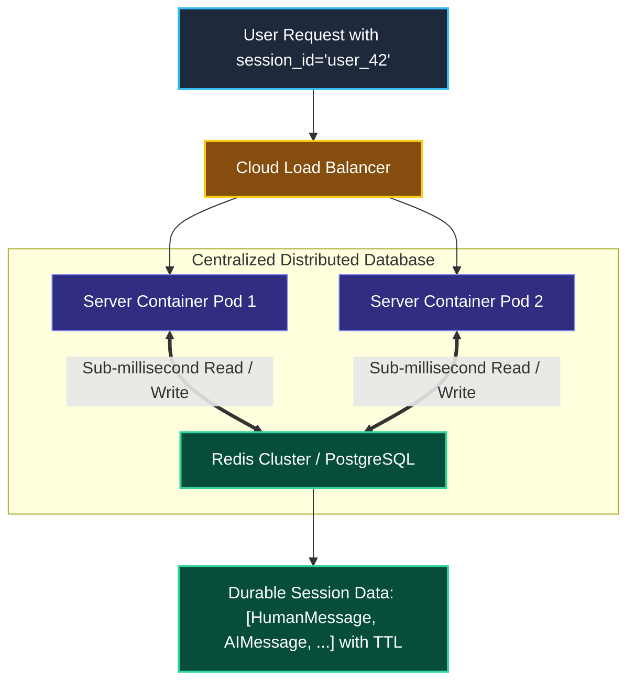
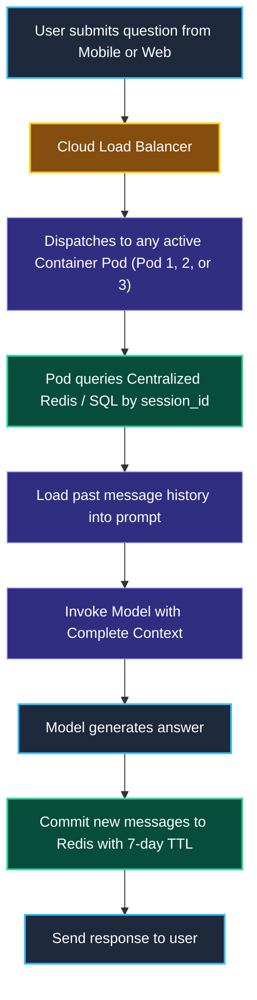

# Persistent Session Stores (Redis and SQL) in LangChain

> "A bank does not write your account balance on a sticky note left on a teller's desk. Your balance is stored in a secure, centralized database so you can access it from any branch or ATM."

---

### Step 1: Why Do We Need This?

#### The Real Problem

In Lesson 1, we stored chat history in a local Python dictionary (`session_store = {}`).

In real cloud production, this in-memory approach breaks completely because modern applications run behind **Load Balancers with multiple server pods**:

```
THE MULTI-CONTAINER DISASTER:
Load Balancer
  ├── Pod A (Local RAM: Holds User 1 Turn 1)
  └── Pod B (Local RAM: Empty)

Step 1: User sends Turn 1 ──▶ Routed to Pod A. Saved in Pod A's local RAM.
Step 2: User sends Turn 2 ──▶ Routed to Pod B. Pod B's memory is EMPTY!
        AI replies: "I'm sorry, who are you? I have no memory of your last question."
Step 3: Docker container restarts or deploys a new version ──▶ ALL active chats wiped!
```

Two major problems happen without persistent session storage:
1. **The Multi-Pod Amnesia Bug:** When user requests bounce between different containers in your cluster, the memory is lost.
2. **Container Deployment Data Loss:** Every time you push a code update or Kubernetes scales your pods, user conversations vanish.

We need **centralized persistent storage** (like Redis or PostgreSQL) so any server pod can read and write the exact same conversation history.

---

### Step 2: What Is It?

#### Simple Explanation

Think of a Persistent Session Store like a **Centralized Cloud Locker**:

- No matter which teller you talk to, they type in your `session_id`, and your locker opens.
- When the conversation ends, the locker closes and stays safely stored in the cloud.
- Even if the bank building's power goes out, your locker is unharmed.

#### Choosing the Right Storage Backend

| Storage Engine | Why use it | Best for |
| :--- | :--- | :--- |
| **Redis (`RedisChatMessageHistory`)** | Sub-millisecond read/write speeds, built-in TTL expiration (e.g., auto-delete sessions after 7 days). | High-traffic chatbots, real-time customer support apps. |
| **PostgreSQL / SQL (`SQLChatMessageHistory`)** | Permanent durability, relational queries, easy to join with customer CRM tables. | Enterprise compliance, legal audits, banking records. |

---

### Step 3: Real-World Example

#### The Seamless Mobile Banking Assistant

A customer is on the subway using their mobile banking app:
1. **Turn 1 (Cell phone on 4G):** *"Can I freeze my debit card?"*
   - Request hits **Server Pod 1**.
   - Pod 1 saves the answer into **Redis** under `session_user_882`.
2. **Turn 2 (Customer gets home, opens laptop):** *"Actually, I found it. How do I unfreeze it?"*
   - Request hits **Server Pod 3** on the other side of the country.
   - Pod 3 instantly loads the history from **Redis**.
   - AI answers: *"Glad you found your card! To unfreeze it, go to Settings -> Cards and click Unfreeze."*

**What the system receives:** A request on a completely different server instance.  
**What decision it makes:** Fetches the shared session from the centralized Redis cluster.  
**What it returns:** A seamless, uninterrupted conversation across devices and server restarts.

---

### Step 4: How Does It Work?

#### The Distributed Architecture



1. **Load Balancing:** The request arrives at any healthy application pod.
2. **Centralized Query:** The pod opens a connection to the shared database (Redis or SQL) using the provided `session_id`.
3. **Execution:** The messages are injected into the prompt and processed by the model.
4. **Persisted Write:** The newly generated user and AI messages are committed to the database with a **TTL (Time-To-Live)** expiration.

---

### Step 5: Code Example

#### Persistent Session History with SQLite / SQL

Here is a complete, working script demonstrating persistent storage using LangChain's `SQLChatMessageHistory`. Even if you restart the Python program, your conversation history survives!

```python
import os
from langchain_community.chat_message_histories import SQLChatMessageHistory
from langchain_core.prompts import ChatPromptTemplate, MessagesPlaceholder
from langchain_core.runnables.history import RunnableWithMessageHistory
from langchain_core.output_parsers import StrOutputParser
from langchain.chat_models import init_chat_model

# 1. Connection string for a durable local SQLite database
db_file = "chat_history_production.db"
connection_string = f"sqlite:///{db_file}"

# 2. Session Factory: Reads and writes directly to SQL!
def get_sql_history(session_id: str) -> SQLChatMessageHistory:
    return SQLChatMessageHistory(
        session_id=session_id,
        connection=connection_string,
        table_name="customer_chat_sessions"
    )

# 3. Base Chain Setup
model = init_chat_model("openai:gpt-4o-mini", temperature=0.0)

prompt = ChatPromptTemplate.from_messages([
    ("system", "You are an enterprise support bot. Remember past interactions."),
    MessagesPlaceholder(variable_name="history"),
    ("human", "{question}")
])

chain = prompt | model | StrOutputParser()

# 4. Wrap with Persistent History
durable_chain = RunnableWithMessageHistory(
    chain,
    get_sql_history,
    input_messages_key="question",
    history_messages_key="history"
)

# 5. Simulate User Interaction (Turn 1)
user_session = {"configurable": {"session_id": "client_enterprise_99"}}

print("--- Turn 1: Storing Fact in SQL Database ---")
res1 = durable_chain.invoke(
    {"question": "Our primary production server IP is 192.168.1.100. Remember this."},
    config=user_session
)
print("AI:", res1)

print("\n--- Turn 2: Querying from SQL Database ---")
res2 = durable_chain.invoke(
    {"question": "What is our production server IP?"},
    config=user_session
)
print("AI:", res2)

# Verify the database file physically exists on disk!
print(f"\nPhysical database file exists on disk: {os.path.exists(db_file)}")
```

#### What Happens When You Run This:
1. LangChain automatically creates a table named `customer_chat_sessions` in SQLite.
2. It writes every message directly to disk.
3. If you stop the Python process and run it tomorrow, the database will still remember the server IP address!

---

### Step 6: How Is It Used in Production?

#### Real-World Engineering Rules

| Production Mistake | Why it hurts | How to fix it |
| :--- | :--- | :--- |
| **No TTL Expiration on Redis Sessions** | If 500,000 users chat once and leave, Redis keeps their messages forever until RAM hits 100% and crashes. | Always configure a **TTL (Time-To-Live)** (e.g. `ttl=604800` for 7 days) so old, inactive chats automatically delete. |
| **Storing Unencrypted Sensitive PII in Chat Logs** | If a customer pastes their credit card or password, it sits in plain text inside your Redis database. | Use client-side encryption or PII redaction middleware (Module 5) before saving to the database. |
| **Database Socket Exhaustion** | Opening a brand-new SQL database connection for every single message turn under high QPS exhausts your database connection pool. | Use **Connection Pooling** (e.g. SQLAlchemy connection pool or Redis connection pool). |

---

### Step 7: Quick Revision

- **Why In-Memory Storage Fails:** It does not work behind load balancers with multiple pods, and data is erased on every container deployment.
- **The Standard Solution:** Store chat histories in a centralized database like **Redis** (for speed and auto-expiry) or **PostgreSQL** (for permanent records).
- **TTL is Mandatory:** Always set a Time-To-Live on session keys in Redis so your database memory does not grow infinitely.
- **SQLChatMessageHistory:** Gives you instant, battle-tested database storage with zero manual schema migration boilerplate.

#### Short Interview Answer

> *"In production microservice architectures, in-memory chat histories fail because requests are distributed across multiple horizontal containers via load balancers. We implement distributed session persistence using `RedisChatMessageHistory` or `SQLChatMessageHistory`. This decouples conversation state from application compute pods, allowing seamless container auto-scaling and zero data loss during rolling deployments. We enforce TTL key expirations in Redis to manage memory budgets and use connection pooling to protect database socket limits."*

---

### Step 8: Final Flow Diagram



---

### Step 9: Quiz

Test your understanding of persistent session stores. Submit your answers as (1-A, 2-B, etc.) and we will review the explanations together!

#### Question 1
A web application runs on 4 Kubernetes pods behind a round-robin load balancer. If the application stores user chat history in a local Python dictionary, what bug will users experience?
- A. The user's browser will crash.
- B. On every new message, the request may hit a different pod that has no record of the previous turns, causing the AI to repeatedly lose conversation context and suffer from amnesia.
- C. The model will automatically charge double token fees.
- D. Python will throw a syntax error.

#### Question 2
Why is configuring a **TTL (Time-To-Live)** expiration essential when storing chat message histories inside a Redis cluster?
- A. Because Redis automatically deletes all data every 60 seconds if TTL is missing.
- B. To prevent Redis memory from filling up over time with millions of abandoned, one-time chat sessions, which would eventually cause Out-Of-Memory crashes.
- C. Because TTL makes the embedding model run twice as fast.
- D. Because model providers require TTL to verify user identities.

#### Question 3
An enterprise healthcare company must retain patient conversation logs for 7 years for compliance, while allowing doctors to audit past records using SQL queries. Which persistent store is best suited?
- A. `InMemoryChatMessageHistory`
- B. `SQLChatMessageHistory` or `PostgresChatMessageHistory`
- C. A temporary text file in the `/tmp` folder
- D. Storing history inside the browser's local cookie

#### Question 4
What happens to user conversation histories stored in a properly configured `SQLChatMessageHistory` when you redeploy your Docker application container?
- A. All user conversations are permanently lost.
- B. The conversation histories remain safe and intact inside the external database, and the new container connects to them seamlessly upon boot.
- C. The database file is automatically deleted.
- D. The user is logged out permanently.
