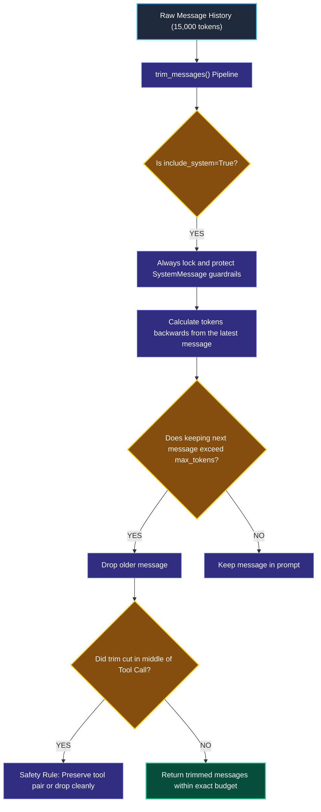
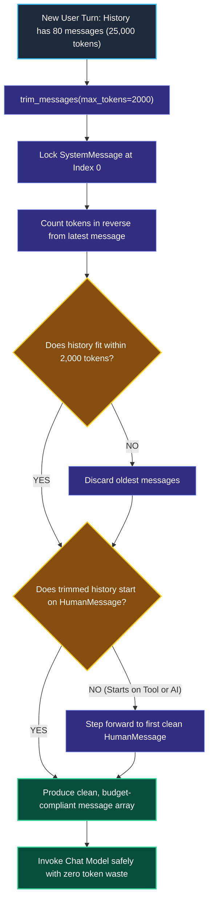

# Token Windowing and Conversation Summarization

> "A busy CEO does not read 4,000 unedited Slack messages from the past six months. An executive assistant condenses the older discussions into a one-page summary, and hands the CEO only the five most recent messages."

---

### Step 1: Why Do We Need This?

#### The Real Problem

In any multi-turn conversation, the message history grows on every turn. If you simply append every message to the list without trimming, you hit a catastrophic **Token Explosion**:

```
THE TOKEN COST BLOWUP:
Turn 1:   Prompt is 100 tokens ($0.0001)
Turn 20:  Prompt is 4,000 tokens ($0.006)
Turn 80:  Prompt is 35,000 tokens ($0.15 per message!)
Turn 150: Prompt hits 128,000 tokens ──▶ ContextWindowExceededError! (Crash!)
```

Two major problems happen without history management:
1. **Compounding Costs and Sluggish Latency:** You pay to re-send the exact same old messages over and over again on every single question. Latency climbs from 0.5s to 6+ seconds.
2. **Context Window Crashes:** Eventually, the conversation exceeds the model's maximum allowed context window and throws an unrecoverable API error.

We need a way to **cap token spending** using sliding windows (`trim_messages`) and **compress older conversations into high-level summaries**.

---

### Step 2: What Is It?

#### Simple Explanation

Think of managing conversation memory using **two standard strategies**:

1. **The Sliding Window (`trim_messages`):**  
   Like a dashcam in a car. It records continuously, but only keeps the last 20 minutes of footage. In LangChain, `trim_messages` keeps only the most recent $N$ tokens, discarding older turns.
2. **The Summary Buffer:**  
   Like an executive summary. When the chat gets too long, a fast model compresses turns 1 through 20 into a 3-sentence summary:  
   *"User is John from Austin. He asked about refunding item #882 and agreed to store credit."*  
   Then you keep turns 21 through 25 verbatim.

---

### Step 3: Real-World Example

#### The 2-Hour Financial Advisory Session

A client is chatting with an AI financial advisor:
- For the first hour, they discussed their retirement age, risk tolerance, and tax bracket (15,000 tokens).
- Now they are asking specific questions about choosing between two index funds.

```
WITHOUT SUMMARIZATION:
Every single follow-up question sends all 15,000 tokens to the model ($$$).

WITH TOKEN TRIMMING & SUMMARY:
System Message:
  "You are a financial advisor.
   Summary of prior chat: Client is 35 years old, moderate risk tolerance, targeting retirement at 60."
Recent Messages:
  User: "What is the expense ratio of Fund A vs Fund B?"
  AI: "Fund A has an expense ratio of 0.03%, while Fund B is 0.07%."

Total Tokens: 450 tokens instead of 15,000! (97% cost reduction with zero lost context!)
```

---

### Step 4: How Does It Work?

#### The `trim_messages` Lifecycle

LangChain 1.x provides a native utility called **`trim_messages`**:



1. **Lock System Prompt:** The `SystemMessage` containing your core instructions and safety rules is protected and never trimmed away.
2. **Reverse Counting:** The utility counts tokens backwards starting from the *most recent* human message.
3. **Boundary Safety:** It ensures the resulting message list begins cleanly with a `HumanMessage`, preventing orphaned `AIMessage` or `ToolMessage` pairs that break provider APIs.

---

### Step 5: Code Example

#### Trimming History with `trim_messages`

Here is a complete, working script in LangChain 1.x:

```python
from langchain_core.messages import SystemMessage, HumanMessage, AIMessage, trim_messages
from langchain.chat_models import init_chat_model

# 1. Simulate a long conversation history
messages = [
    SystemMessage(content="You are a professional customer support assistant for Acme Corp."),
    HumanMessage(content="Hi, my name is Alex. I ordered a laptop on Monday."),
    AIMessage(content="Hello Alex! I see your laptop order. How can I help you today?"),
    HumanMessage(content="Can I change the delivery address to 123 Main Street?"),
    AIMessage(content="I have updated your shipping address to 123 Main Street."),
    HumanMessage(content="What was the original address on my account?"),
    AIMessage(content="The original address was 456 Elm Street."),
    HumanMessage(content="Awesome, thank you for your help!")
]

# 2. Initialize Model for token counting
model = init_chat_model("openai:gpt-4o-mini", temperature=0.0)

# 3. Configure trim_messages
# Keep only the most recent tokens, but ALWAYS preserve the SystemMessage!
selected_messages = trim_messages(
    messages,
    max_tokens=65,                  # Strict token budget!
    strategy="last",                # Keep the newest messages
    token_counter=model,            # Use the model's exact tokenizer
    include_system=True,            # Never discard the system prompt!
    allow_partial=False,            # Do not cut a single message in half
    start_on="human"                # Ensure the history starts with a human message
)

print(f"Original message count: {len(messages)}")
print(f"Trimmed message count:  {len(selected_messages)}\n")

print("--- REMAINING TRIMMED MESSAGES ---")
for msg in selected_messages:
    print(f"[{type(msg).__name__}]: {msg.content}")
```

#### What Happens When You Run This:
1. The `SystemMessage` is locked in place.
2. Old conversation turns are discarded.
3. Only the most recent messages that fit inside the 65-token budget are kept, starting properly on a `HumanMessage`.

---

### Step 6: How Is It Used in Production?

#### Real-World Engineering Rules

| Production Mistake | Why it hurts | How to fix it |
| :--- | :--- | :--- |
| **Accidentally Trimming the `SystemMessage`** | If you discard the system prompt, the AI forgets all safety guardrails, persona instructions, and tools. | Always pass `include_system=True` to `trim_messages`. |
| **Orphaned `ToolMessage`s** | If you trim an `AIMessage` that called a tool, but keep the `ToolMessage` result, the OpenAI/Anthropic API crashes with an HTTP 400 error. | Use `trim_messages(start_on="human")` to ensure tool call pairs are never split across boundaries. |
| **Counting Words Instead of Tokens** | Calculating length using `len(text.split())` is inaccurate. A 100-character code snippet can be 50 tokens. | Always pass `token_counter=model` to count actual tokenizer tokens. |

---

### Step 7: Quick Revision

- **The Problem:** Long chats cause compounding token bills, slow latency, and context window crashes.
- **`trim_messages`:** The modern LangChain 1.x standard to maintain a strict sliding window of the latest $N$ tokens.
- **Protect the System Prompt:** Always set `include_system=True` so core instructions are never discarded.
- **Start on Human:** Ensure trimmed history starts with a `HumanMessage` to avoid orphaned tool messages that cause API errors.

#### Short Interview Answer

> *"Unmanaged conversation histories lead to linear cost scaling, elevated P95 latency, and inevitable context window exhaustion. In production, we bound history using `trim_messages` with a `strategy='last'` sliding window and exact tokenizer counters. We enforce `include_system=True` to preserve behavioral guardrails and mandate `start_on='human'` to prevent orphaned `ToolMessage` payloads from triggering provider validation exceptions."*

---

### Step 8: Final Flow Diagram



---

### Step 9: Quiz

Test your understanding of token windowing and summarization. Submit your answers as (1-A, 2-B, etc.) and we will review the explanations together!

#### Question 1
Why does an application experience an HTTP 400 Bad Request error from model providers if a naive message trimmer simply deletes the oldest 5 messages from the list?
- A. Because model providers require messages to be submitted in alphabetical order.
- B. Because deleting a fixed number of messages can easily orphan a `ToolMessage` whose corresponding `AIMessage` (which proposed the tool call) was deleted.
- C. Because Python lists cannot have odd numbers of elements.
- D. Because model providers charge a penalty for deleting messages.

#### Question 2
What is the primary operational danger of letting chat history grow unconstrained in a long-running customer service bot?
- A. The user's internet connection will drop.
- B. Every single message re-sends the entire past history, causing linear cost escalation, high response latency, and eventually a `ContextWindowExceededError` crash.
- C. The bot will automatically change its language to French.
- D. The database hard drive will physically burn out.

#### Question 3
In LangChain's `trim_messages()`, why is `include_system=True` almost always enabled in production?
- A. To make the model generate longer responses.
- B. To guarantee that the foundational `SystemMessage` containing the agent's persona, business rules, and safety guardrails is never discarded by the trimmer.
- C. To delete the user's login session.
- D. Because system messages do not consume any tokens.

#### Question 4
How does Conversation Summarization differ from a plain sliding window trimmer?
- A. Summarization compresses older conversational turns into a compact semantic summary block rather than discarding them completely, preserving past facts while using very few tokens.
- B. Summarization only works on audio files.
- C. A sliding window costs 10 times more tokens than full history.
- D. Summarization translates text into German.
