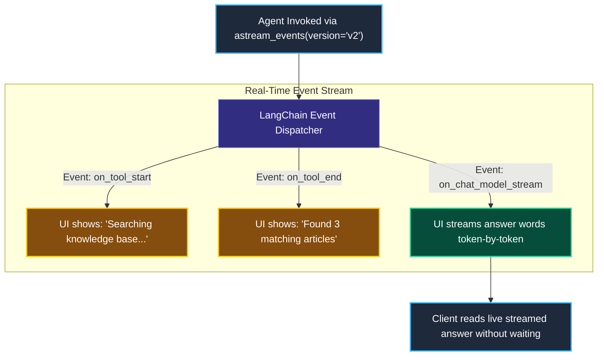
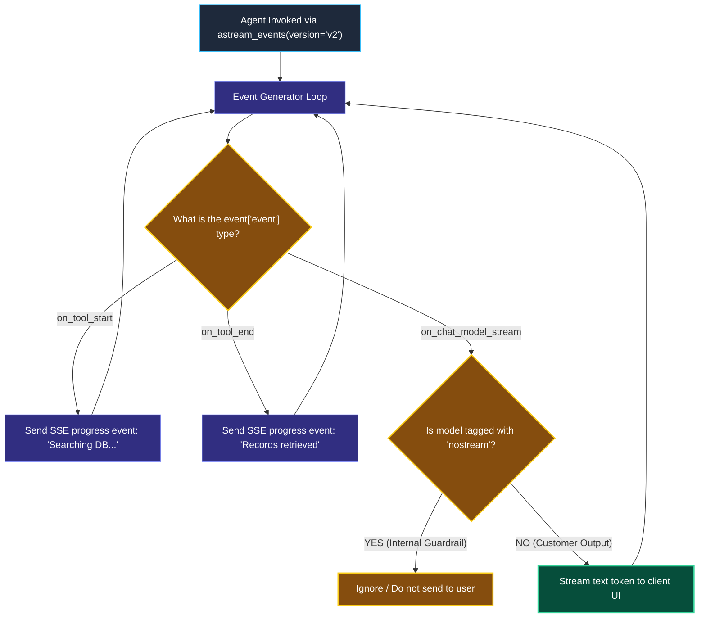

# Event Streaming and Granular Lifecycle Events

> "A live radio commentator does not sit in complete silence for 90 minutes and then announce the final score. They broadcast every pass, tackle, and goal second-by-second in real time."

---

### Step 1: Why Do We Need This?

#### The Real Problem

In Phase 2, we learned how `.astream()` streams text tokens from a single model.

However, in real-world applications with **multi-step agents and tools**, standard text streaming falls short:

```
THE AGENT SILENCE PROBLEM (with plain .astream()):
User asks: "Find my order #882 and process a refund."

What the user sees:
0.0s ──▶ [Silence: Agent is thinking...]
2.5s ──▶ [Silence: Agent is querying order database...]
5.0s ──▶ [Silence: Agent is running refund transaction API...]
8.0s ──▶ Suddenly tokens stream: "Your refund of $50 has been processed."

→ The user stared at a frozen screen for 8 seconds!
→ They have no idea if the system is actually working or completely hung.
```

Two major problems happen:
1. **Tool Blindness:** Plain `.astream()` only yields tokens from the final model call; it remains completely silent while tools are executing in the background.
2. **Poor Observability:** Frontends cannot show dynamic status indicators like *"Searching inventory..."* or *"Calculating tax..."*.

We need **Event Streaming (`astream_events`)**: a system that broadcasts every lifecycle event—when tools start, what data they return, and when tokens flow—in real time.

---

### Step 2: What Is It?

#### Simple Explanation

Think of Event Streaming like **Live Order Tracking on a Food Delivery App**:

- The app doesn't stay completely blank until the driver rings your doorbell.
- It streams real-time status events:  
  1. `[Event: on_tool_start]` -> *"Restaurant accepted your order."*
  2. `[Event: on_tool_end]`   -> *"Food is prepared. Driver picked up the bag."*
  3. `[Event: on_chat_model_stream]` -> *"Driver is 2 minutes away: 'Arriving now!'"*

In LangChain 1.x:
- **`astream_events(version="v2")`** yields a structured stream of typed event dictionaries as your pipeline executes.
- You can filter the stream to show users tool progress, while hiding private internal prompts.

---

### Step 3: Real-World Example

#### The Transparent AI Customer Support Agent

A user asks: *"Why was my flight cancelled, and what are my options?"*

1. **Event 1 (`on_tool_start`):** Agent calls `flight_status_lookup(flight="AA-102")`.  
   - Frontend UI displays: 🟡 *"Checking live flight database..."*
2. **Event 2 (`on_tool_end`):** Tool returns weather cancellation details.  
   - Frontend UI displays: 🟢 *"Flight records retrieved."*
3. **Event 3 (`on_tool_start`):** Agent calls `search_rebooking_policy()`.  
   - Frontend UI displays: 🟡 *"Reviewing compensation policy..."*
4. **Event 4 (`on_chat_model_stream`):** Final answer tokens begin flowing:  
   - Text streams: *"Your flight was cancelled due to severe thunderstorms in Chicago. You are eligible for..."*

**What the system receives:** A complex, multi-tool query.  
**What decision it makes:** Emits fine-grained status events over a Server-Sent Events (SSE) socket.  
**What it returns:** An interactive, transparent user experience where the customer sees exactly what the agent is doing every second.

---

### Step 4: How Does It Work?

#### The Event Stream Architecture



#### The Common Event Types in v2

| Event Name | When it triggers | What data it carries |
| :--- | :--- | :--- |
| **`on_tool_start`** | The instant an agent calls a tool function. | Tool name and exact input arguments. |
| **`on_tool_end`** | When the tool finishes executing. | The output returned by the tool. |
| **`on_chat_model_stream`** | On every individual token generated by an LLM. | The token chunk (`AIMessageChunk`). |
| **`on_chain_end`** | When the entire pipeline completes. | Final composite output. |

---

### Step 5: Code Example

#### Streaming Tool Actions and Model Tokens

Here is a complete, working script in LangChain 1.x using `astream_events`:

```python
import asyncio
from langchain.chat_models import init_chat_model
from langchain_core.tools import tool
from langchain.agents import create_agent

# 1. Define a tool with a slight delay to simulate real API latency
@tool
def check_order_delivery(order_id: str) -> str:
    """Checks the delivery status of an order."""
    return f"Order {order_id} is currently on the delivery truck and arriving today."

# 2. Initialize Model and Agent
model = init_chat_model("openai:gpt-4o-mini", temperature=0.0)
agent = create_agent(
    model=model,
    tools=[check_order_delivery],
    system_prompt="You are a shipping support agent. Use tools to check status."
)

# 3. Stream Fine-Grained Events
async def stream_agent_events():
    user_query = "Where is order ORD-9921?"
    print(f"User: '{user_query}'\n")

    # Use astream_events with version="v2" (the modern standard)
    async for event in agent.astream_events(
        {"messages": [("human", user_query)]},
        version="v2"
    ):
        event_kind = event["event"]

        # Catch when a tool starts executing
        if event_kind == "on_tool_start":
            print(f"\n[STATUS]: Running tool '{event['name']}' with args: {event['data'].get('input')}")

        # Catch when a tool finishes executing
        elif event_kind == "on_tool_end":
            print(f"[STATUS]: Tool finished! Result: {event['data'].get('output').content}")
            print("[AI STREAM]: ", end="", flush=True)

        # Catch live token generation from the chat model
        elif event_kind == "on_chat_model_stream":
            chunk = event["data"]["chunk"]
            # Print only text tokens (ignore empty tool-call chunks)
            if chunk.content:
                print(chunk.content, end="", flush=True)

    print("\n\n[All Events Completed]")

if __name__ == "__main__":
    asyncio.run(stream_agent_events())
```

#### What Happens When You Run This:
1. The moment the agent decides to look up the order, your terminal immediately prints: `[STATUS]: Running tool 'check_order_delivery'`.
2. When the tool completes, it prints the status.
3. Then the words of the final answer flow smoothly across the screen.

---

### Step 6: How Is It Used in Production?

#### Real-World Engineering Rules

| Production Mistake | Why it hurts | How to fix it |
| :--- | :--- | :--- |
| **Streaming Internal Classification Tokens** | If your agent runs an internal classification step (like checking for toxic content), tokens like `"SAFE"` or `"TOXIC"` stream to the user's screen accidentally! | Add the `tags=["nostream"]` tag to internal models, and filter out any event carrying that tag in your streaming loop. |
| **Using `version="v1"` for Event Streaming** | Version 1 has deprecated payload formats that omit namespace and structured chunk metadata. | Always specify `version="v2"` when calling `astream_events`. |
| **Python 3.10 Context Loss** | In Python 3.10, asynchronous background tasks can occasionally lose context variables in event streaming. | Use **Python 3.11+**, which natively preserves context across async generators. |

---

### Step 7: Quick Revision

- **Beyond Text Streaming:** `astream_events` streams not just final text tokens, but tool start, tool end, and intermediate progress events.
- **Always Use `version="v2"`:** The modern standard format for typed event dictionaries in LangChain 1.x.
- **The Core Event Names:** `on_tool_start`, `on_tool_end`, and `on_chat_model_stream`.
- **Hide Internal Steps:** Use tags (`nostream`) to filter out internal guardrails or router calls so users only see customer-facing text.

#### Short Interview Answer

> *"In complex multi-tool agent architectures, plain token streaming leaves users in the dark while background tools execute. We implement `astream_events(version='v2')` to stream structured lifecycle events over Server-Sent Events (SSE). This allows frontends to display dynamic progress indicators upon `on_tool_start` and `on_tool_end`, while piping raw tokens to the client upon `on_chat_model_stream`. To prevent internal guardrail or routing tokens from polluting user feeds, we apply filtering based on span tags."*

---

### Step 8: Final Flow Diagram



---

### Step 9: Quiz

Test your understanding of astream and event streaming. Submit your answers as (1-A, 2-B, etc.) and we will review the explanations together!

#### Question 1
Why is `astream_events()` vastly superior to plain `.stream()` for multi-tool AI agents?
- A. Because `astream_events()` is written in assembly language.
- B. Because plain `.stream()` remains completely silent while background tools execute, whereas `astream_events()` yields immediate lifecycle events (`on_tool_start`, `on_tool_end`) so users see real-time progress.
- C. Because `astream_events()` works without an internet connection.
- D. Because model providers do not charge for tokens when using `astream_events()`.

#### Question 2
You have an internal safety guardrail model that classifies user questions as `"SAFE"` or `"UNSAFE"` before the main agent answers. How do you prevent the word `"SAFE"` from streaming to the customer's screen?
- A. Delete the safety model.
- B. Tag the internal safety model with `tags=["nostream"]`, and filter out events that contain this tag inside your `astream_events` loop.
- C. Change the model temperature to 0.0.
- D. Wait 10 seconds before starting the stream.

#### Question 3
Which version of the event streaming protocol is the recommended standard in LangChain 1.x?
- A. `version="v2"`
- B. `version="beta"`
- C. `version="v0"`
- D. `version="classic"`

#### Question 4
An application frontend receives an event with `event["event"] == "on_tool_start"`. What useful data can the frontend extract from this event payload?
- A. The user's credit card expiration date.
- B. The name of the tool being called and the specific arguments passed into it, allowing the UI to display a helpful progress indicator like *"Searching order #102..."*.
- C. The physical address of the data center.
- D. The Python version of the operating system.
