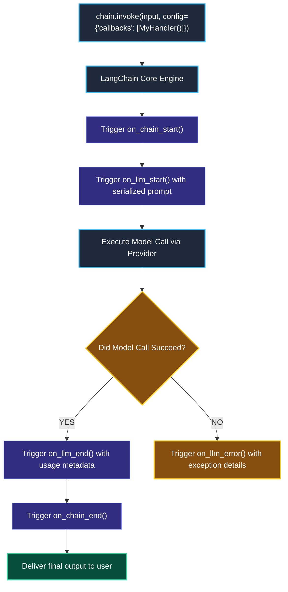
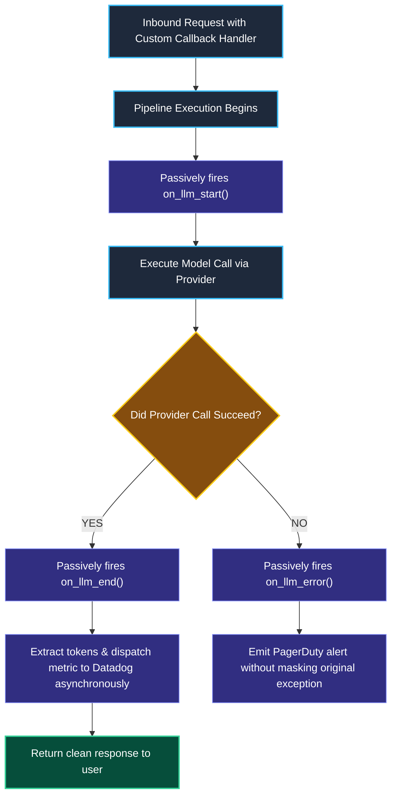

# Custom Callbacks and Lifecycle Hooks in LangChain

> "Power grid engineers do not cut open household electrical wires to measure voltage. They attach non-invasive telemetry clamps that monitor power flow passively without disrupting electricity."

---

### Step 1: Why Do We Need This?

#### The Real Problem

When developers need to track metrics (like token costs, response latency, or error logs), they often write messy code inside their functions:

```python
# The Messy Polluted Anti-Pattern
def my_function(user_query):
    start_time = time.time()
    response = model.invoke(user_query)
    # Manual tracking polluted everywhere:
    datadog.timing("model_latency", time.time() - start_time)
    statsd.increment("tokens_used", response.usage_metadata["total_tokens"])
    audit_db.save_log(user_query, response.content)
    return response
```

This manual logging creates three serious production problems:
1. **Polluted Business Logic:** Your clean AI code gets buried under dozens of lines of timers, metric counters, and database writes.
2. **Maintenance Nightmare:** If you change your monitoring tool from Datadog to Prometheus, you have to edit every single prompt and function in your codebase.
3. **Incomplete Coverage:** If an exception occurs in a third-party library, manual logging statements never run, leaving you blind to the failure.

We need **Lifecycle Callbacks**: a decoupled, non-invasive system that automatically triggers events whenever a model starts, finishes, or errors out.

---

### Step 2: What Is It?

#### Simple Explanation

Think of Callbacks like **Event Listeners in Web Development** (like `button.addEventListener("click")`):

You don't rebuild the button; you just attach a listener that passively runs whenever the event happens.

In LangChain:
- **`BaseCallbackHandler`:** A class you inherit from to listen to events synchronously.
- **`AsyncCallbackHandler`:** The asynchronous version for non-blocking web servers.
- You pass your handler into `RunnableConfig(callbacks=[MyCustomHandler()])`.
- LangChain automatically calls your methods:
  - `on_llm_start()`: Fires before the prompt is sent.
  - `on_llm_end()`: Fires the instant the response returns.
  - `on_llm_error()`: Fires if the provider throws an exception.
  - `on_tool_start()` / `on_tool_end()`: Fires before and after tools execute.

---

### Step 3: Real-World Example

#### The Production Token & Cost Accounting Meter

Your finance team needs to track the exact dollar cost of every AI request across 50 different microservices:
1. You write a single **`CostAccountingHandler`**.
2. Whenever any team's chain runs `chain.invoke(..., config={"callbacks": [CostAccountingHandler()]})`:
   - It intercepts the completed model response in `on_llm_end()`.
   - It extracts `response.llm_output["token_usage"]`.
   - It calculates the cost (e.g. $0.00015 per 1k input tokens) and sends an asynchronous metric to Prometheus.
3. The application engineers never write a single line of token-counting code.

---

### Step 4: How Does It Work?

#### The Callback Lifecycle



1. **Attachment:** You attach the handler via `RunnableConfig` at runtime or bind it to the model constructor.
2. **Propagation:** LangChain passes your callback down to all nested child components (prompts, models, tools, retrievers) via Python context variables.
3. **Execution:** Whenever an internal milestone occurs, your custom hook executes cleanly in isolation.

---

### Step 5: Code Example

#### A Custom Latency and Token Tracker

Here is a complete, working script in LangChain 1.x:

```python
import time
from langchain_core.callbacks import BaseCallbackHandler
from langchain_core.prompts import ChatPromptTemplate
from langchain_core.output_parsers import StrOutputParser
from langchain_core.runnables import RunnableConfig
from langchain.chat_models import init_chat_model

# 1. Define custom telemetry callback handler
class ProductionMetricsHandler(BaseCallbackHandler):
    """Passively records model latency and token counts."""
    
    def on_llm_start(self, serialized, prompts, **kwargs):
        """Fires right before the model is called."""
        self.start_time = time.time()
        print("\n[TELEMETRY EVENT]: Model invocation started...")

    def on_llm_end(self, response, **kwargs):
        """Fires right after the model returns."""
        duration_ms = (time.time() - self.start_time) * 1000
        # Standard token extraction from LangChain response
        token_usage = response.llm_output.get("token_usage", {}) if response.llm_output else {}
        total_tokens = token_usage.get("total_tokens", "N/A")
        
        print(f"[TELEMETRY EVENT]: Model completed in {duration_ms:.2f}ms | Tokens: {total_tokens}")

    def on_llm_error(self, error, **kwargs):
        """Fires if the provider throws an exception."""
        print(f"[TELEMETRY ALERT]: Model failed with error: {error}")

# 2. Build clean LCEL chain with zero logging pollution
model = init_chat_model("openai:gpt-4o-mini", temperature=0.0)
prompt = ChatPromptTemplate.from_template("What are the top three principles of clean code?")
chain = prompt | model | StrOutputParser()

# 3. Attach the callback at runtime using RunnableConfig!
config = RunnableConfig(
    callbacks=[ProductionMetricsHandler()],
    tags=["production", "audit-service"]
)

# 4. Invoke the chain
print("--- Calling Chain with Passive Telemetry Handler ---")
result = chain.invoke({}, config=config)

print("\n--- User Answer ---")
print(result)
```

#### What Happens When You Run This:
1. Your chain logic remains 100% clean and readable.
2. The `ProductionMetricsHandler` automatically intercepts the start and end of the model call, printing the exact latency and token counts.

---

### Step 6: How Is It Used in Production?

#### Real-World Engineering Rules

| Production Mistake | Why it hurts | How to fix it |
| :--- | :--- | :--- |
| **Heavy Blocking Calls inside Handlers** | If your callback writes to a slow relational database inside `on_llm_end()`, you add 200ms of delay to every customer request. | Use **`AsyncCallbackHandler`** and push events into an async background queue (like RabbitMQ or Redis). |
| **Crashing the Main Request inside Callbacks** | If your metrics server throws a 500 error inside your callback, it shouldn't crash the user's chat! | Wrap all callback metric-dispatch code in safe `try/except` blocks so telemetry bugs never affect users. |
| **Constructor Callbacks vs. Runtime Callbacks** | Attaching a callback to the model constructor (`init_chat_model(callbacks=[...])`) makes it static for all users. | Attach callbacks at runtime via **`RunnableConfig`** so each user request carries its own trace metadata. |

---

### Step 7: Quick Revision

- **Decoupled Observability:** Callbacks separate logging, metric tracking, and audit trails from your core AI business logic.
- **The Lifecycle Points:** `on_llm_start`, `on_llm_end`, `on_llm_error`, `on_tool_start`, `on_tool_end`.
- **Runtime Injection:** Pass handlers inside `RunnableConfig(callbacks=[...])` so they automatically travel down through all child components.
- **Async for High Performance:** Use `AsyncCallbackHandler` in web backends to ensure metric collection never blocks the event loop.

#### Short Interview Answer

> *"In production AI infrastructure, we decouple telemetry and audit logging from core application pipelines using LangChain's event-driven callback system (`BaseCallbackHandler` and `AsyncCallbackHandler`). By injecting handlers at runtime via `RunnableConfig`, lifecycle hooks automatically intercept model and tool events without polluting business logic. In our microservices, we ensure callbacks execute asynchronously or push to background message queues so that metric emission never introduces latency into user-facing requests."*

---

### Step 8: Final Flow Diagram



---

### Step 9: Quiz

Test your understanding of custom callbacks and lifecycle hooks. Submit your answers as (1-A, 2-B, etc.) and we will review the explanations together!

#### Question 1
What is the primary architectural advantage of using a `BaseCallbackHandler` instead of writing manual `print()` and logging statements inside every chain step?
- A. It makes the model generate answers 10 times faster.
- B. It decouples telemetry, metrics, and audit logging from business logic, ensuring that code remains clean, maintainable, and easy to swap between monitoring providers.
- C. It reduces the size of the Python virtual environment.
- D. It makes all API calls 100% free of charge.

#### Question 2
An engineer writes a custom callback handler that performs a synchronous HTTP POST request to an external analytics server inside `on_llm_end()`. In production under high user traffic, response times become sluggish. Why?
- A. Because LangChain models do not support analytics.
- B. Because the synchronous network call inside the callback blocks the main thread, adding extra latency to every single user request before returning the response.
- C. Because the user's browser ran out of memory.
- D. Because Python 3.10 disabled HTTP POST requests.

#### Question 3
Where should an engineer attach a callback handler if they need the handler to have access to request-specific user metadata (like a user's session ID or IP address)?
- A. Permanently hardcoded inside the model's global constructor.
- B. Injected dynamically on every call using `RunnableConfig(callbacks=[...], metadata={...})`.
- C. Inside the operating system's kernel settings.
- D. In the Python `requirements.txt` file.

#### Question 4
Which lifecycle hook is automatically triggered if an AI model call times out or throws an HTTP 429 rate limit error?
- A. `on_llm_start()`
- B. `on_llm_error()`
- C. `on_chain_end()`
- D. `on_tool_start()`
