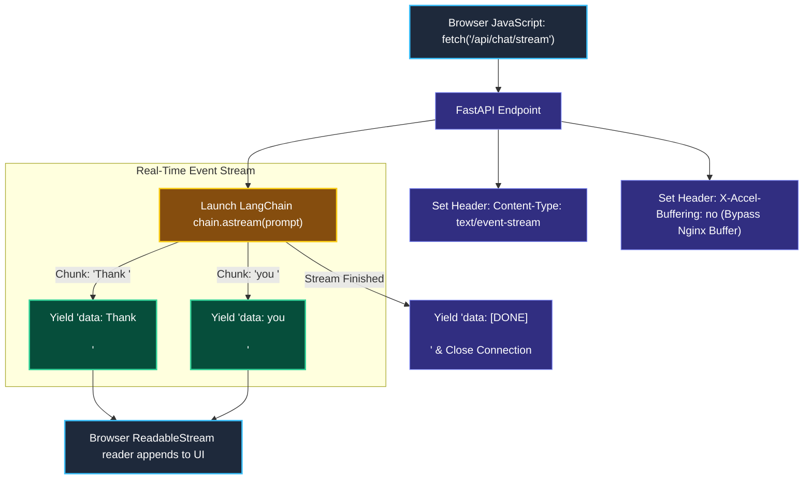
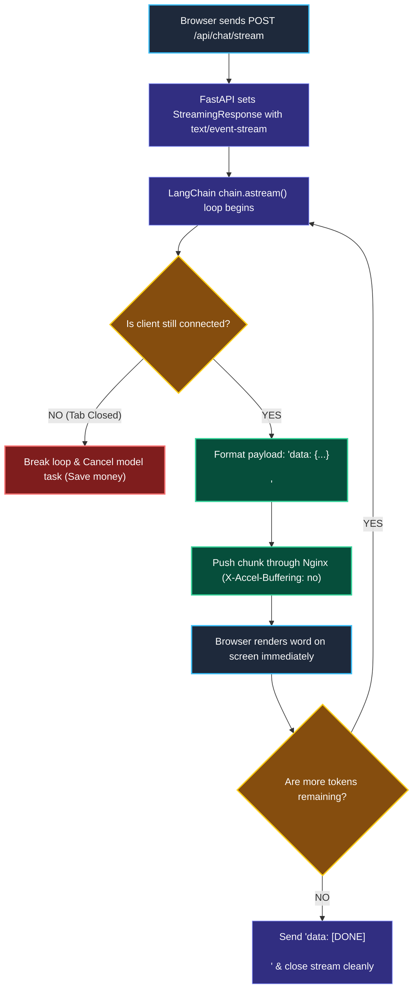

# Server-Sent Events (SSE) and FastAPI Streaming

> "A Wall Street ticker-tape machine prints continuous paper ribbons of live stock prices directly onto the trading room floor, rather than requiring traders to place a phone call for every single transaction."

---

### Step 1: Why Do We Need This?

#### The Real Problem

Standard web REST APIs are built on a simple request-and-reply model: the browser asks a question, the server does all the work, and then sends back a single JSON object:

```
STANDARD REST (High Perceived Latency):
Browser POST /api/chat ──▶ [10s Processing on Server] ──▶ Returns {"answer": "Full text..."}
The user stares at a blank screen for 10 seconds!
```

If we want the user to see words appearing in real-time as the model generates them, how do we send tokens across the internet?

- **Polling (Bad):** The browser asking *"Are there new words?"* every 500ms adds massive server overhead.
- **WebSockets (Overkill):** WebSockets are bidirectional and require custom protocol upgrades, complex firewall handling, and dedicated stateful servers.

We need **Server-Sent Events (SSE)**: a lightweight, standardized way for a regular HTTP server to hold a connection open and stream text deltas directly to any browser.

---

### Step 2: What Is It?

#### Simple Explanation

Think of Server-Sent Events (SSE) like a **One-Way Live Radio Station**:

- Your browser connects to the stream over regular HTTP.
- The server sets the header: `Content-Type: text/event-stream`.
- Whenever the AI generates a new word, the server pushes a tiny text frame ending in two newlines:
  ```text
  data: {"text": "Hello"}

  data: {"text": " world"}

  data: [DONE]
  ```
- The browser reads the stream using standard JavaScript (`fetch()` with `ReadableStream` or `EventSource`) and renders each word instantly.

---

### Step 3: Real-World Example

#### The AI Chat Interface in Next.js & FastAPI

A user types: *"Draft a polite email declining a job offer."*

1. **Frontend:** React sends an HTTP `POST` to `/api/chat/stream`.
2. **Backend (FastAPI):**
   - Launches an asynchronous generator using LangChain's `chain.astream()`.
   - Wraps the generator inside a FastAPI `StreamingResponse`.
3. **Wire Protocol:** As tokens yield from the LLM, FastAPI writes:
   - `data: {"token": "Thank "}\n\n`
   - `data: {"token": "you "}\n\n`
   - `data: {"token": "for "}\n\n`
4. **Client Rendering:** The React UI appends each word to the screen immediately, giving the user a smooth, real-time typing animation.

---

### Step 4: How Does It Work?

#### The Wire Lifecycle



1. **Persistent HTTP Request:** The client makes a standard HTTP request, but the server does not immediately close the socket.
2. **Double Newline Formatting:** The SSE specification strictly requires every message frame to end in `\n\n`.
3. **Client-Side Parsing:** Modern frontends read the stream chunk-by-chunk using a `TextDecoder` without needing third-party libraries.

---

### Step 5: Code Example

#### A Production FastAPI Streaming Server

Here is a complete, working script in FastAPI and LangChain 1.x:

```python
import asyncio
import json
from fastapi import FastAPI, Request
from fastapi.responses import StreamingResponse
from fastapi.middleware.cors import CORSMiddleware
from langchain_core.prompts import ChatPromptTemplate
from langchain_core.output_parsers import StrOutputParser
from langchain.chat_models import init_chat_model

# 1. Initialize FastAPI App
app = FastAPI(title="AI Streaming Service")

# Allow browser connections via CORS
app.add_middleware(
    CORSMiddleware,
    allow_origins=["*"],
    allow_methods=["*"],
    allow_headers=["*"],
)

# 2. Build standard LCEL Chain
model = init_chat_model("openai:gpt-4o-mini", temperature=0.0)
prompt = ChatPromptTemplate.from_template("Write a helpful answer about {topic}.")
chain = prompt | model | StrOutputParser()

# 3. Asynchronous Generator conforming to W3C SSE standard
async def sse_event_generator(topic: str, request: Request):
    """Streams tokens formatted as Server-Sent Events."""
    try:
        # Stream chunks asynchronously from LangChain
        async for chunk in chain.astream({"topic": topic}):
            # Disconnect protection: If user closes browser, stop generating!
            if await request.is_disconnected():
                print("[INFO]: Client disconnected. Halting model generation.")
                break

            # Format as standard SSE: "data: ...\n\n"
            payload = json.dumps({"token": chunk})
            yield f"data: {payload}\n\n"

        # Signal completion to frontend
        yield "data: [DONE]\n\n"

    except Exception as e:
        yield f"data: {json.dumps({'error': str(e)})}\n\n"

# 4. Streaming Endpoint
@app.post("/api/chat/stream")
async def chat_stream_endpoint(request: Request):
    body = await request.json()
    user_topic = body.get("topic", "General Technology")

    return StreamingResponse(
        sse_event_generator(user_topic, request),
        media_type="text/event-stream",
        headers={
            "Cache-Control": "no-cache",
            "Connection": "keep-alive",
            "X-Accel-Buffering": "no"  # Crucial: Disables buffering in Nginx!
        }
    )

if __name__ == "__main__":
    import uvicorn
    # Run server locally: uvicorn server:app --reload --port 8000
    uvicorn.run(app, host="127.0.0.1", port=8000)
```

#### What Happens When You Run This:
1. When a client makes a request to `/api/chat/stream`, FastAPI returns a `StreamingResponse`.
2. Every token generated by the model is immediately formatted as `data: {"token": "..."}\n\n` and pushed over the HTTP wire.
3. If the user closes their browser tab, `request.is_disconnected()` triggers and cancels the task immediately, saving your API token budget!

---

### Step 6: How Is It Used in Production?

#### Real-World Engineering Rules

| Production Mistake | Why it hurts | How to fix it |
| :--- | :--- | :--- |
| **Nginx Buffering Tokens** | In production behind Nginx, tokens don't stream; they appear in delayed 4KB chunks. | Add the response header **`X-Accel-Buffering: no`** to tell Nginx to forward each packet instantly. |
| **Zombie Streaming on Disconnect** | When a user navigates away, the backend keeps generating tokens and burning your money. | Check `await request.is_disconnected()` in your generator loop to cancel the task. |
| **Forgetting `\n\n` Newlines** | If an event frame doesn't end in two newlines (`\n\n`), the browser's SSE parser never fires the message event. | Always end every SSE chunk with `\n\n`. |
| **Overusing WebSockets for Simple Chat** | WebSockets require stateful load balancing (sticky sessions) and fail over standard HTTP proxies. | Use **Server-Sent Events (SSE)** for one-way streaming; it uses regular HTTP and handles reconnection natively. |

---

### Step 7: Quick Revision

- **The SSE Standard:** Server-Sent Events stream one-way text data over regular HTTP using `Content-Type: text/event-stream`.
- **FastAPI `StreamingResponse`:** Pairs directly with LangChain's `.astream()` async generators.
- **Double Newline Rule:** Every SSE frame must end with `\n\n`.
- **Disable Proxy Buffering:** Always set `X-Accel-Buffering: no` so reverse proxies (like Nginx) do not hold tokens in memory.
- **Disconnect Handling:** Always listen to `request.is_disconnected()` to terminate zombie model calls.

#### Short Interview Answer

> *"To deliver real-time model completions to browser frontends, we use Server-Sent Events (SSE) via FastAPI's `StreamingResponse` coupled with LangChain's `.astream()` generators. SSE runs over standard HTTP without the connection complexity or sticky-session requirements of WebSockets. In production, we configure `X-Accel-Buffering: no` to prevent Nginx proxy buffering, format frames strictly with `\n\n` delimiters, and monitor client socket disconnects to cancel underlying LLM tasks and prevent wasted token spending."*

---

### Step 8: Final Flow Diagram



---

### Step 9: Quiz

Test your understanding of SSE and FastAPI streaming. Submit your answers as (1-A, 2-B, etc.) and we will review the explanations together!

#### Question 1
Why is Server-Sent Events (SSE) generally preferred over WebSockets for AI chat streaming applications?
- A. Because WebSockets only work on Apple computers.
- B. Because AI token streaming is purely unidirectional (server-to-client); SSE operates over standard HTTP/HTTPS, avoids stateful connection overhead, passes easily through firewalls, and requires no protocol upgrade.
- C. Because WebSockets cannot transmit text.
- D. Because SSE is completely free of network bandwidth.

#### Question 2
What is the specific purpose of including the HTTP header `"X-Accel-Buffering": "no"` in a production FastAPI streaming endpoint?
- A. To make Python run on multiple CPU cores.
- B. To instruct reverse proxies like Nginx not to hold small chunks in memory buffers, allowing individual token chunks to reach the browser instantly.
- C. To encrypt the user's password.
- D. To delete temporary files from the hard drive.

#### Question 3
According to the official W3C Server-Sent Events specification, what characters must terminate every single event message block?
- A. A semicolon (`;`)
- B. Two newline characters (`\n\n`)
- C. A period (`.`)
- D. A closing XML tag (`</event>`)

#### Question 4
Why is it critical for an asynchronous streaming generator to check `await request.is_disconnected()` on every token iteration?
- A. To verify the user's internet speed.
- B. To immediately abort the model task and stop paying API token costs if the user closes their browser tab or navigates away mid-generation.
- C. To change the user's font color in the UI.
- D. Because Python crashes if a client disconnects.
