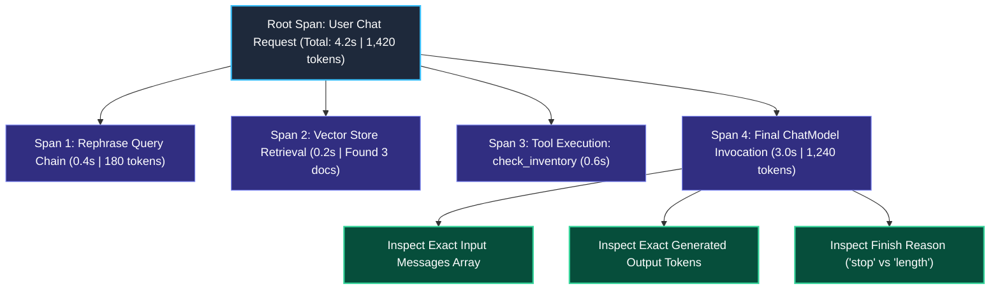
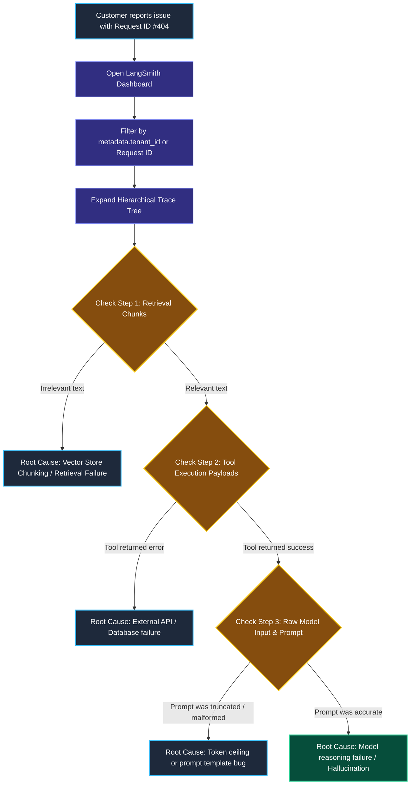

# LangSmith Tracing and Debugging in Production

> "An air traffic control radar screen maps the precise flight path, altitude, airspeed, and radio chatter of every aircraft in the sky simultaneously. It leaves zero blind spots."

---

### Step 1: Why Do We Need This?

#### The Real Problem

When a user complains that an AI customer service agent gave a completely wrong answer, traditional backend server logs are almost useless:

```
TRADITIONAL SERVER LOGS (Blind to AI Logic):
INFO: 2026-10-19 14:02:11 - POST /api/chat - 200 OK - Latency: 6.2s
INFO: 2026-10-19 14:02:18 - POST /api/chat - 200 OK - Latency: 5.8s

→ Did the vector store retrieve the wrong documents?
→ Did an external API tool return malformed data?
→ Did the prompt template format properly?
→ Did the LLM hallucinate or misread good context?
→ How many tokens were burned on each step?
```

Without distributed AI tracing, debugging a failure requires adding manual print statements, redeploying code, and trying to recreate the user's exact inputs.

We need a **Flight Data Recorder**: a system that automatically records the full hierarchical execution tree—prompts, exact token inputs and outputs, latencies, and tool calls—with zero code modifications.

---

### Step 2: What Is It?

#### Simple Explanation

Think of LangSmith Tracing like a **Hospital X-Ray and MRI Machine**:

Instead of guessing what is wrong based on surface symptoms, you look inside the running system to see every bone and organ.

In LangSmith:
- **Root Run:** Represents the entire user request from start to finish.
- **Child Spans:** Represent the individual steps inside the request:
  1. The Prompt Template step (shows formatted text).
  2. The Retriever step (shows the exact document chunks pulled from vector DB).
  3. The Tool execution step (shows function inputs and outputs).
  4. The Model call (shows raw prompt tokens, output tokens, latency, and model name).

---

### Step 3: Real-World Example

#### Debugging a False Price Quote

A customer reports: *"Your bot said your Enterprise Plan costs $20/month, but our bill was $2,000!"*

1. **Open LangSmith:** You search for the user's `session_id`.
2. **Inspect the Trace Tree:**
   - Step 1 (Vector Retriever): Retrieved Document `pricing_tiers.md`.
   - Inspection: The chunk states: *"Personal Plan: $20/month. Enterprise Plan: $2,000/month."*
   - Step 2 (Model Prompt): Shows both prices were clearly provided in context.
   - Step 3 (Model Output): Shows the model mistakenly matched the personal price to the enterprise tier.
3. **Root Cause Confirmed:** In 60 seconds, you prove that retrieval was healthy, but the prompt lacked strict grounding instructions. You update the prompt template and fix the issue.

---

### Step 4: How Does It Work?

#### The Hierarchical Flame Graph



- Every nested function inherits the parent run's ID automatically via Python's `contextvars`.
- When an error occurs at any depth, the exact traceback is attached to that specific child span.
- You can filter runs by latency, token cost, tags, and feedback scores.

---

### Step 5: Code Example

#### Attaching Production Tags & Metadata to Traces

Here is a complete, working script in LangChain 1.x showing how to tag traces for easy filtering:

```python
import os
from langchain_core.prompts import ChatPromptTemplate
from langchain_core.output_parsers import StrOutputParser
from langchain_core.runnables import RunnableConfig
from langchain.chat_models import init_chat_model

# 1. Enable Tracing via Environment Variables
os.environ["LANGCHAIN_TRACING_V2"] = "true"
os.environ["LANGCHAIN_PROJECT"] = "production-support-bot"

# 2. Build Standard LCEL Chain
model = init_chat_model("openai:gpt-4o-mini", temperature=0.0)
prompt = ChatPromptTemplate.from_template("Answer the customer query: {query}")
chain = prompt | model | StrOutputParser()

# 3. Attach Rich Metadata in RunnableConfig!
# Tags and metadata make finding specific runs in LangSmith instant!
config = RunnableConfig(
    run_name="CustomerSupportInquiry",
    tags=["tier:enterprise", "env:production", "department:billing"],
    metadata={
        "tenant_id": "org_enterprise_99",
        "user_email": "cto@company.com",
        "client_version": "v2.4.1"
    }
)

# 4. Execute Chain
if __name__ == "__main__":
    print("--- Executing Traced Request ---")
    response = chain.invoke(
        {"query": "How do I upgrade from 5 to 50 user seats?"},
        config=config
    )
    print("\nAI Response:")
    print(response)
    print("\n[Trace published to LangSmith under project 'production-support-bot']")
```

#### What Happens When You Run This:
1. LangChain executes the call.
2. In your LangSmith dashboard, you can search: `filter: metadata.tenant_id == "org_enterprise_99"` or filter by the tag `tier:enterprise`.
3. You immediately see the exact prompt, latency, and token cost for that customer.

---

### Step 6: How Is It Used in Production?

#### Real-World Engineering Rules

| Production Mistake | Why it hurts | How to fix it |
| :--- | :--- | :--- |
| **Sending Unmasked Passwords or PII to Traces** | If users type social security numbers or credit cards, they get stored in plain text in your telemetry dashboard. | Use LangSmith's client-side masking rules (`hide_inputs=True`, `hide_outputs=True`) or add a PII scrubber middleware. |
| **Mixing Dev and Prod in the Same Project** | If local developer tests and production user traffic share the project name `"default"`, your production metrics become noisy and inaccurate. | Set `LANGCHAIN_PROJECT=production` in production and `LANGCHAIN_PROJECT=development` on local machines. |
| **Trace Flooding Under 100,000 QPS** | Tracing every single successful routine classification request in a massive system runs up unnecessary data costs. | Use **trace sampling**: trace 100% of errors and slow requests (>3s), and sample 5% of healthy requests. |

---

### Step 7: Quick Revision

- **The Black Box Solved:** LangSmith traces capture the full hierarchical execution tree—prompts, chunks, tool arguments, and token costs.
- **Hierarchical Spans:** Inspect parent runs down to child spans to isolate whether an issue was caused by bad retrieval, tool errors, or LLM hallucination.
- **Metadata Tagging:** Always attach `tenant_id` and environment tags in `RunnableConfig` for instant debugging in production.
- **Zero Boilerplate:** Turning on `LANGCHAIN_TRACING_V2=true` activates background telemetry without writing manual log code.

#### Short Interview Answer

> *"Debugging production LLM architectures requires distributed tracing because traditional HTTP logs cannot isolate whether failures originate from retrieval noise, malformed tool arguments, or model hallucinations. We mandate LangSmith tracing from day zero, organizing telemetry into hierarchical trace trees. At runtime, we enrich execution spans with metadata tags (`tenant_id`, user tier, environment) via `RunnableConfig`, enabling sub-second filtering during incident triage while configuring client-side masking to protect customer PII."*

---

### Step 8: Final Flow Diagram



---

### Step 9: Quiz

Test your understanding of LangSmith tracing and debugging. Submit your answers as (1-A, 2-B, etc.) and we will review the explanations together!

#### Question 1
A customer support agent gives a completely inaccurate response. An engineer opens the LangSmith trace and sees the `Retriever` child span returned three document chunks containing facts about an unrelated product. What did the trace instantly reveal?
- A. The LLM model has a hardware failure.
- B. The issue is a retrieval failure (bad vector search, poor chunking, or wrong metadata filter), completely exonerating the model's reasoning capabilities.
- C. The user's internet browser is out of date.
- D. Python 3.10 cannot run searches.

#### Question 2
Why should an engineering team pass `tenant_id` and `environment` inside `RunnableConfig(metadata={...})` on every request?
- A. To make the database write twice as fast.
- B. To allow engineers to instantly filter and isolate traces for a specific customer or environment in the LangSmith dashboard during an outage.
- C. Because model providers refuse to answer requests without a tenant ID.
- D. To turn off API billing.

#### Question 3
An engineering team is deploying an AI application that handles protected health information (PHI). How do they prevent sensitive patient health data from appearing in cloud trace dashboards?
- A. Turn off tracing permanently and never look at errors.
- B. Configure client-side masking rules (`hide_inputs=True`, `hide_outputs=True`) or apply PII-redacting middleware before traces leave the local network.
- C. Store all medical data in plain text.
- D. Tell patients not to mention their health conditions.

#### Question 4
In a LangSmith trace tree, what does a child span represent?
- A. A child user who logged into the website.
- B. An individual sub-step within the execution—such as a specific prompt formatting, a tool execution, or an LLM call—displaying its own isolated inputs, outputs, latency, and token consumption.
- C. A deleted file on the server.
- D. A new git commit.
