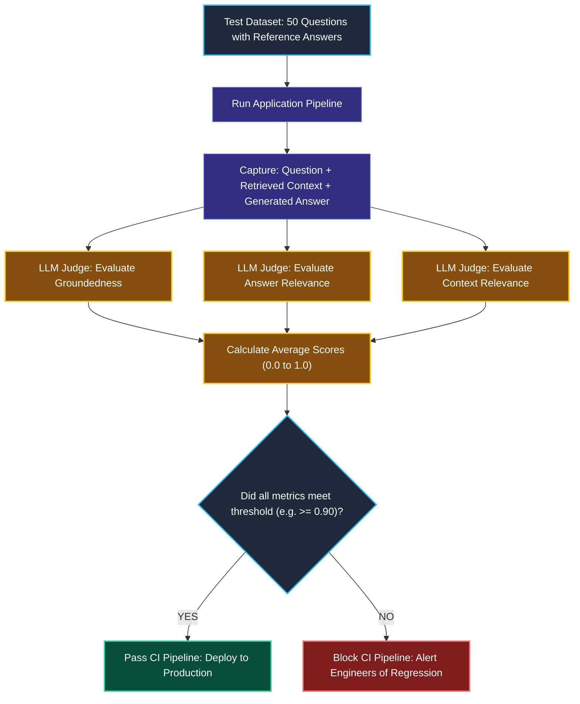
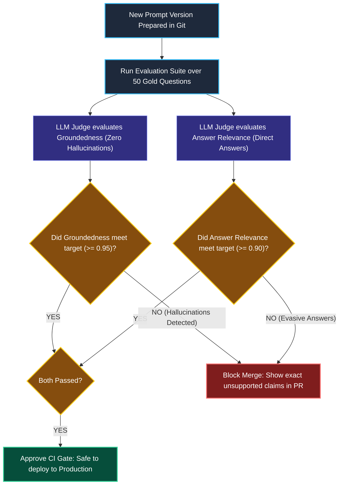

# RAG and Agent Evaluators in Production

> "Olympic gymnastics judges do not measure whether an athlete landed on an exact millimeter coordinate. Three certified judges independently score the routine on difficulty, execution form, and landing stability."

---

### Step 1: Why Do We Need This?

#### The Real Problem

In traditional software engineering, you write unit tests using exact assertions:
```python
assert calculate_total(10, 5) == 15
```

In AI engineering, **exact string matching breaks completely**:

```
THE EVALUATION DILEMMA:
Reference Truth: "Redis AOF logs every write command to disk."
Model Output 1:  "Redis records all write operations to an append-only file."
→ Traditional assert fails (0% matching words)! But the answer is 100% correct!

Model Output 2:  "Redis AOF deletes all data upon server restart."
→ Traditional assert fails, but tells you nothing about WHERE the failure occurred:
  Did retrieval fail? Or did the model hallucinate despite good context?
```

Two major problems happen:
1. **You Cannot "Eyeball" at Scale:** Manually reading 500 answers every time you tweak a prompt template is slow, subjective, and unscalable.
2. **Silent Production Regressions:** A prompt change that improves Question 1 might secretly break Questions 20 through 50 without you realizing it.

We need automated **Evaluator Rubrics (LLM-as-a-Judge)** that score answers on semantic correctness, context relevance, and groundedness before code is shipped to production.

---

### Step 2: What Is It?

#### Simple Explanation

Think of automated evaluation like a **Panel of Three Olympic Judges**:

Instead of checking exact words, three judges evaluate the three critical pillars of RAG (known as **The RAG Triad**):

```
                       [User Question]
                         ╱         ╲
      Context Relevance ╱           ╲ Answer Relevance
                       ▼             ▼
             [Retrieved Context] ──▶ [Model Answer]
                       ▲             ▲
                       └──────┬──────┘
                        Groundedness
```

#### The RAG Triad Defined

| Metric | What it checks in simple English | Why it matters |
| :--- | :--- | :--- |
| **1. Context Relevance** | Did the retriever pull documents that actually talk about the question? | Catches bad vector searches and chunking errors. |
| **2. Groundedness (Faithfulness)** | Is every fact in the model's answer directly supported by the retrieved text? | Catches hallucinations. A score < 1.0 means the model made up facts! |
| **3. Answer Relevance** | Did the model actually answer what the user asked, or did it dodge the question? | Catches evasive or overly wordy answers. |

---

### Step 3: Real-World Example

#### The CI/CD Release Gate for an Enterprise Bot

You are updating your prompt template from Version 1.2 to Version 2.0. Before pushing to production:
1. You run your test suite of **50 Gold Questions** against both versions in LangSmith.
2. **Version 1.2 Scores:** Groundedness = 94%, Answer Relevance = 88%.
3. **Version 2.0 Scores:** Groundedness = 72%, Answer Relevance = 92%.
4. **Automated CI Decision:** The CI pipeline **blocks the deployment**!  
   Even though Version 2.0 sounded more fluent, its groundedness dropped by 22%, meaning it started hallucinating answers on 11 questions. You caught the bug before a single customer was affected.

---

### Step 4: How Does It Work?

#### The Evaluation Flow



1. **Dataset Definition:** You curate a dataset of realistic questions paired with known ground-truth reference answers.
2. **Execution:** Your pipeline runs the dataset, capturing the retrieved chunks and generated answers.
3. **Structured Grading:** An independent evaluator model (like GPT-4o) scores each output against a strict JSON rubric.
4. **Regression Gate:** If scores drop below your team's threshold, deployment is automatically halted.

---

### Step 5: Code Example

#### A Custom LLM-as-a-Judge Evaluator

Here is a complete, working script in LangChain 1.x using structured outputs to grade whether an answer is grounded in the retrieved facts:

```python
from typing import Literal
from pydantic import BaseModel, Field
from langchain_core.prompts import ChatPromptTemplate
from langchain.chat_models import init_chat_model

# 1. Define the Structured Grading Rubric Schema
class GroundednessEvaluation(BaseModel):
    reasoning: str = Field(description="Step-by-step reasoning explaining if every claim in the answer is supported by context.")
    score: Literal["PASS", "FAIL"] = Field(description="PASS if answer contains no unsupported claims. FAIL if any fact is hallucinated.")
    unsupported_claims: list[str] = Field(default=[], description="List of any specific claims made in the answer that are NOT in the context.")

# 2. Setup Evaluator Model
judge_model = init_chat_model("openai:gpt-4o-mini", temperature=0.0)
structured_judge = judge_model.with_structured_output(GroundednessEvaluation)

# 3. Judge Prompt Template
judge_prompt = ChatPromptTemplate.from_messages([
    ("system", "You are an expert impartial auditor evaluating RAG applications. "
               "Check whether the Generated Answer is strictly grounded in the Provided Context. "
               "If the answer invents ANY fact not in the context, score it FAIL."),
    ("human", "PROVIDED CONTEXT:\n{context}\n\nGENERATED ANSWER:\n{answer}")
])

evaluator_chain = judge_prompt | structured_judge

# 4. Test Case A: A Grounded Answer (Should PASS)
context_text = "Acme Corp standard delivery takes 3 to 5 business days. Express delivery takes 24 hours."
good_answer = "Standard delivery takes between 3 and 5 business days."

print("--- EVALUATING CASE A (Clean Answer) ---")
result_a = evaluator_chain.invoke({"context": context_text, "answer": good_answer})
print(f"Score:     {result_a.score}")
print(f"Reasoning: {result_a.reasoning}")

# 5. Test Case B: A Hallucinated Answer (Should FAIL)
hallucinated_answer = "Standard delivery takes 3 to 5 days, and delivery on Sundays is completely free."

print("\n--- EVALUATING CASE B (Hallucinated Answer) ---")
result_b = evaluator_chain.invoke({"context": context_text, "answer": hallucinated_answer})
print(f"Score:              {result_b.score}")
print(f"Reasoning:          {result_b.reasoning}")
print(f"Unsupported Claims: {result_b.unsupported_claims}")
```

#### What Happens When You Run This:
1. In Case A, the evaluator confirms that the answer is strictly grounded in the text and outputs `PASS`.
2. In Case B, the evaluator catches that Sunday delivery was never mentioned in the context, outputs `FAIL`, and lists `"Sunday delivery is completely free"` under `unsupported_claims`!

---

### Step 6: How Is It Used in Production?

#### Real-World Engineering Rules

| Production Mistake | Why it hurts | How to fix it |
| :--- | :--- | :--- |
| **Trusting Self-Reported Confidence** | Asking the answering model *"How confident are you from 1 to 10?"* is uncalibrated. Hallucinating models often claim 99% confidence. | Always use an independent evaluator model with a structured grading rubric. |
| **Evaluating Only the Final Answer** | If the answer is bad, you don't know whether the vector search pulled bad chunks or the LLM misread good chunks. | Evaluate **Context Relevance** and **Groundedness** separately to isolate the failure point. |
| **Using Giant Expensive Models for Grading** | Grading 5,000 production traces with an expensive frontier model costs thousands of dollars daily. | Use fast, cost-effective models (like `gpt-4o-mini` or `claude-3-5-haiku`) with strict Pydantic schemas for automated grading. |

---

### Step 7: Quick Revision

- **The Problem:** Exact string `assert` tests cannot evaluate non-deterministic AI outputs.
- **The RAG Triad:** Measure **Context Relevance** (search quality), **Groundedness** (zero hallucinations), and **Answer Relevance** (did it answer the prompt).
- **LLM-as-a-Judge:** Use an independent model with a Pydantic rubric to output transparent reasoning and pass/fail scores.
- **CI/CD Quality Gates:** Run evaluation suites automatically before deploying new prompts or models to prevent regressions.

#### Short Interview Answer

> *"Evaluating production RAG applications requires moving beyond brittle string-matching assertions to structured LLM-as-a-Judge rubrics based on the RAG Triad: Context Relevance, Groundedness (Faithfulness), and Answer Relevance. In our CI/CD pipelines, we execute curated datasets against proposed prompt updates, evaluating outputs with Pydantic-enforced grading chains. If Groundedness falls below our target threshold (e.g. 95%), deployment is automatically blocked to prevent hallucinations from reaching users."*

---

### Step 8: Final Flow Diagram



---

### Step 9: Quiz

Test your understanding of RAG and agent evaluators. Submit your answers as (1-A, 2-B, etc.) and we will review the explanations together!

#### Question 1
Why do traditional software testing assertions (like `assert actual_output == expected_output`) fail when testing production LLM applications?
- A. Because LLMs are non-deterministic and can phrase a 100% correct answer using different vocabulary or sentence structure, causing exact string checks to fail falsely.
- B. Because Python unit test frameworks do not support strings longer than 10 words.
- C. Because model providers ban applications that run unit tests.
- D. Because embeddings delete the expected output.

#### Question 2
In the RAG Triad, what specific failure does the **Groundedness (Faithfulness)** metric measure?
- A. Whether the model responded in under 500 milliseconds.
- B. Whether every single claim in the model's generated answer is supported by the retrieved document context, directly detecting hallucinations.
- C. Whether the user was polite in their prompt.
- D. Whether the vector database is hosted on AWS or GCP.

#### Question 3
An engineer wants to know if a RAG chatbot is failing because of poor document chunking and vector search, or because the LLM is misinterpreting facts. Which metric specifically tests the retrieval quality before the generator runs?
- A. Answer Relevance
- B. Context Relevance
- C. Recursion Limit
- D. Memory Windowing

#### Question 4
What is the primary benefit of including a `reasoning: str` field in a Pydantic LLM-as-a-Judge schema?
- A. It makes the test suite take 10 times longer.
- B. It forces the evaluator model to generate chain-of-thought justification before assigning a score, improving grading accuracy and giving engineers a transparent explanation of why a test failed.
- C. It deletes the test dataset after running.
- D. It allows the judge to change the customer's database records.
