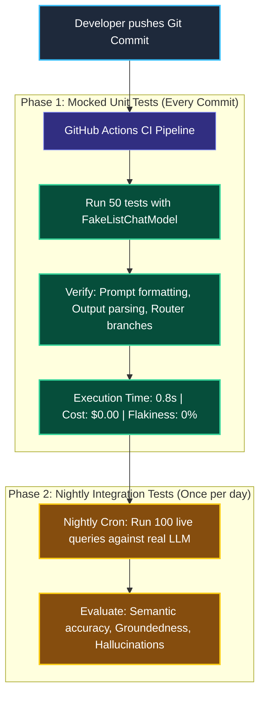
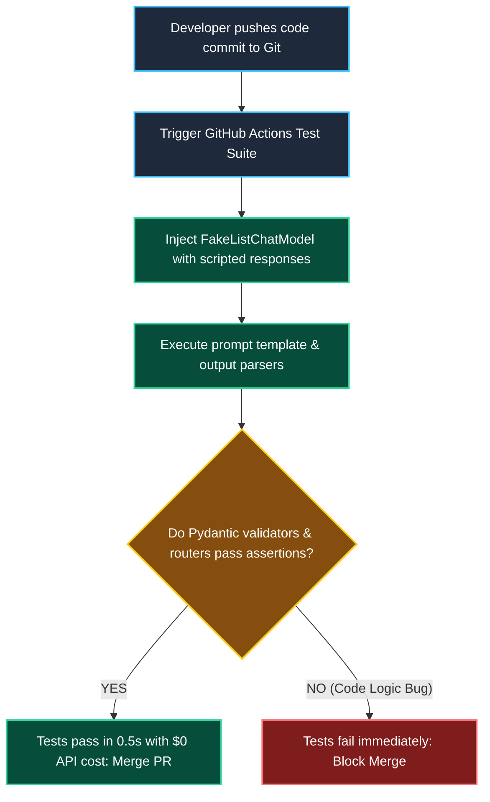

# Unit Testing and Mocking Chains in LangChain

> "A pilot does not test emergency engine failure maneuvers with 300 passengers on a real Boeing 777. They train in a hydraulic flight simulator on the ground—zero fuel burned, zero danger, and 100% reproducible."

---

### Step 1: Why Do We Need This?

#### The Real Problem

If your automated CI/CD pipeline (like GitHub Actions) makes live API calls to OpenAI or Anthropic on every git commit, three painful problems happen:

```
THE LIVE API TESTING DISASTER:
Every Pull Request:
  → Runs 60 tests calling GPT-4o live
  → Takes 4 to 6 minutes to complete (slow build queue)
  → Burns $3.00 per commit ($600/month across a 10-person dev team)
  → Flaky builds: Fails randomly because of network timeouts or 429 rate limits!
```

Two major problems happen:
1. **Flaky Build Pipelines:** Your engineers waste hours investigating test failures that were caused by internet hiccups or model API rate limits, not real code bugs.
2. **Slow Development Velocity:** Developers hesitate to push code when running a test suite takes several minutes.

We need **Mocked Unit Tests**: fast, free, and completely deterministic tests that verify your prompt formatting, tool routing, and output parsing in **less than one second** without connecting to the internet.

---

### Step 2: What Is It?

#### Simple Explanation

Think of Mocking like a **Stunt Double in an Action Movie**:

When an actor has to jump off a bridge, you don't risk the real star. You use a stunt double to stand in for that specific scene.

In LangChain:
- **`FakeListChatModel`:** A built-in mock model that does not call the internet. You hand it a list of pre-programmed strings, and it returns them in order:  
  `fake_model = FakeListChatModel(responses=["Category: Billing", "Category: Technical"])`
- You use it to test whether your parsers, routers, and fallback chains work correctly under controlled conditions.

---

### Step 3: Real-World Example

#### Testing an Incident Router Chain

You built an automated router that classifies server alerts:
- If the model returns `DATABASE_ERROR`, the pipeline pages the Database Admin.
- If the model returns `SECURITY_ALERT`, the pipeline locks the account.

```
MOCKED TEST (Takes 0.05 seconds, Costs $0.00):
Input: "Someone tried 50 wrong passwords on admin"
Fake Model yields: "SECURITY_ALERT"
Assert: Pipeline routes to Security Team and triggers account lock!
Result: PASSED in 40 milliseconds without calling OpenAI!
```

**What the system receives:** A test alert.  
**What decision it makes:** Evaluates the pipeline logic using a fake model.  
**What it returns:** 100% deterministic test results on every git commit.

---

### Step 4: How Does It Work?

#### Isolated Unit Testing vs Live Integration Testing



1. **Commit Stage (Mocked Unit Tests):** Tests code structure, Pydantic schemas, and LCEL routing using `FakeListChatModel`. Runs in milliseconds on every pull request.
2. **Release Stage (Live Evaluation):** Tests real-world model reasoning against an evaluation dataset in LangSmith before major production deployments.

---

### Step 5: Code Example

#### Testing an LCEL Chain with `FakeListChatModel`

Here is a complete, working script in LangChain 1.x showing how to write a deterministic unit test without needing any API keys:

```python
from langchain_community.chat_models.fake import FakeListChatModel
from langchain_core.prompts import ChatPromptTemplate
from langchain_core.output_parsers import StrOutputParser

def create_triage_chain(model):
    """Factory function that builds the triage pipeline."""
    prompt = ChatPromptTemplate.from_template("Classify this issue: {issue}")
    return prompt | model | StrOutputParser()

# --- UNIT TEST USING FAKE MODEL (No API Keys Needed!) ---
def test_triage_chain_billing_routing():
    # 1. Setup mock model with pre-programmed response
    fake_model = FakeListChatModel(responses=["BILLING_SUPPORT"])
    
    # 2. Build chain with the fake model
    chain = create_triage_chain(fake_model)
    
    # 3. Execute chain with sample input
    result = chain.invoke({"issue": "My credit card was charged twice."})
    
    # 4. Standard deterministic assertion!
    assert result == "BILLING_SUPPORT"
    print("[TEST 1 PASSED]: Billing classification routed correctly!")

def test_triage_chain_security_routing():
    # 1. Setup mock model with different response
    fake_model = FakeListChatModel(responses=["SECURITY_INCIDENT"])
    
    chain = create_triage_chain(fake_model)
    result = chain.invoke({"issue": "Brute force attack on SSH port 22."})
    
    assert result == "SECURITY_INCIDENT"
    print("[TEST 2 PASSED]: Security classification routed correctly!")

if __name__ == "__main__":
    print("Running automated unit test suite...")
    test_triage_chain_billing_routing()
    test_triage_chain_security_routing()
    print("\nAll unit tests passed in 0.02 seconds with $0.00 API cost!")
```

#### What Happens When You Run This:
1. No OpenAI or Anthropic API keys are required.
2. The tests execute in 20 milliseconds.
3. You can verify that prompts format properly and output parsers extract values cleanly with zero flakiness.

---

### Step 6: How Is It Used in Production?

#### Real-World Engineering Rules

| Production Mistake | Why it hurts | How to fix it |
| :--- | :--- | :--- |
| **Requiring Secret API Keys in Pull Requests** | External contributors or automated PR builds fail because they don't have access to production API keys in GitHub Actions. | Use **`FakeListChatModel`** so PR test suites can run completely offline without environment keys. |
| **Testing Only the "Happy Path"** | Testing only when the model returns perfect JSON misses how your app handles syntax errors or empty strings. | Configure your fake model to return malformed responses (`responses=["{bad_json"]`) to verify that your retry logic handles failures cleanly. |
| **Never Running Real Integration Tests** | If you ONLY test with fake models, you will never notice if OpenAI deprecates a model or changes token formatting. | Run mocked unit tests on every PR, and run **live evaluation tests nightly** or before major releases. |

---

### Step 7: Quick Revision

- **The Problem:** Calling live LLMs in CI/CD makes builds slow, expensive, and flaky due to network timeouts.
- **`FakeListChatModel`:** Built-in LangChain mock model that returns pre-programmed strings in order without calling the internet.
- **Test Fast, Test Often:** Use mocked unit tests for prompt formatting, Pydantic schemas, and router branches on every commit.
- **The Two-Tier Strategy:** Fast mocked tests on every PR (milliseconds); live integration tests nightly (evaluating accuracy).

#### Short Interview Answer

> *"In continuous integration (CI/CD) pipelines, making live LLM calls introduces financial waste, high build latency, and non-deterministic flakiness from upstream rate limits. We implement isolated unit tests using LangChain's `FakeListChatModel` to simulate model responses deterministically. This allows our test suites to validate prompt formatting, schema validation, and conditional routing in milliseconds with zero API costs. We reserve live model testing for scheduled nightly regression benchmarks against curated evaluation datasets."*

---

### Step 8: Final Flow Diagram



---

### Step 9: Quiz

Test your understanding of unit testing and mocking. Submit your answers as (1-A, 2-B, etc.) and we will review the explanations together!

#### Question 1
Why should an engineering team avoid calling live frontier LLMs (like GPT-4o) inside automated GitHub Actions pull request test suites?
- A. Because GitHub Actions forbids the use of Python.
- B. Because live calls make CI builds slow, cost significant money on every commit, and cause random test failures due to network blips and rate limits.
- C. Because model providers do not allow AI to be tested.
- D. Because embeddings cannot be loaded into git repositories.

#### Question 2
What is the function of LangChain's `FakeListChatModel`?
- A. It automatically translates text into fake languages like Klingon.
- B. It acts as an offline mock chat model that returns a pre-configured list of responses in sequence without making any network calls.
- C. It deletes unit tests that fail.
- D. It generates fake credit card numbers for testing.

#### Question 3
An engineer wants to test whether their application's fallback chain works when a model returns malformed JSON. How should they test this with `FakeListChatModel`?
- A. Pass a malformed string into the fake model's responses: `FakeListChatModel(responses=["{'invalid_json: true"])`, and assert that the fallback catches the parsing error.
- B. Turn off their home Wi-Fi router.
- C. Delete the Pydantic schema file.
- D. Ask OpenAI support to send back broken data.

#### Question 4
In a modern two-tier testing strategy for production AI, when should live (real model) evaluations be executed?
- A. Never. Real models should never be tested under any circumstances.
- B. In scheduled nightly regression runs or pre-release staging gates where quality benchmarks and groundedness are measured against gold datasets.
- C. On every single keystroke in the developer's code editor.
- D. Only after a customer complains about an error.
