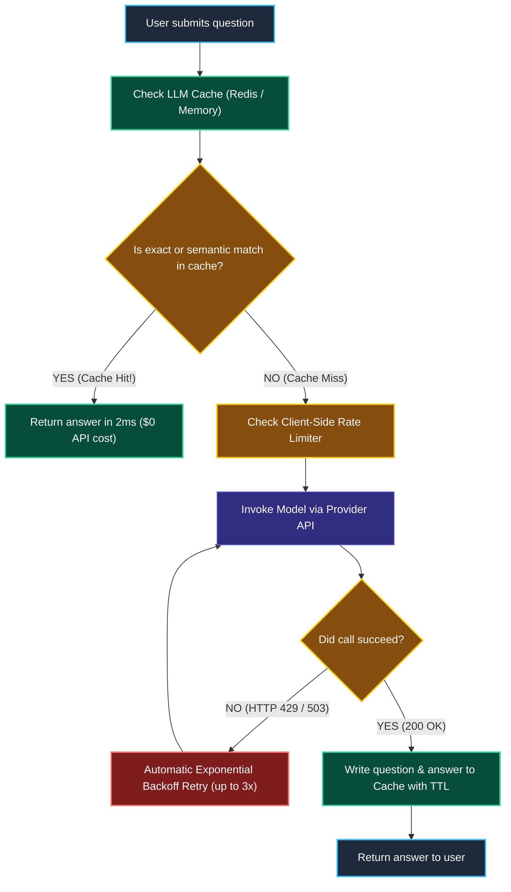
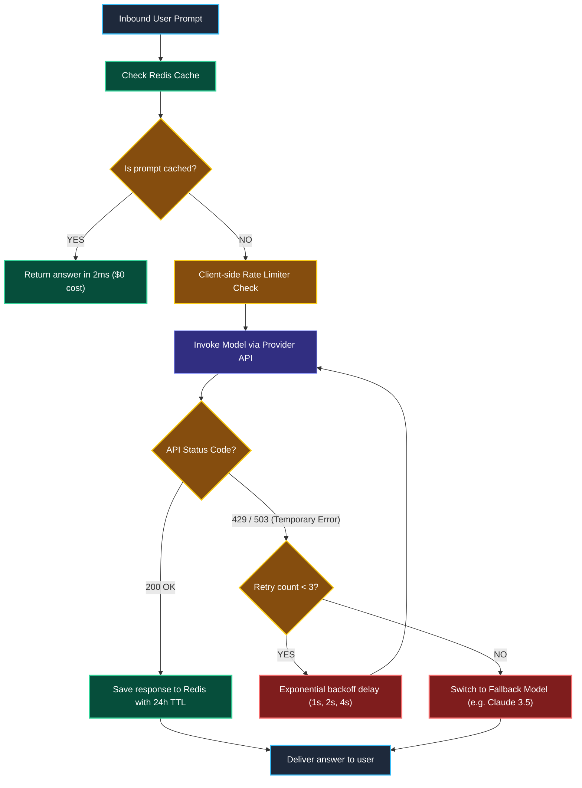

# Caching, Rate Limiting, and Resilient Retries

> "A highway toll plaza uses automated electronic transponder lanes. Registered cars zip through overhead sensors in 5 milliseconds without having to stop, roll down windows, and pay coins at a manual cash booth."

---

### Step 1: Why Do We Need This?

#### The Real Problem

In customer-facing AI applications, a huge portion of user questions are identical or nearly identical:
- *"What is your return policy?"*
- *"How do I track my order?"*
- *"What are your store hours?"*

If you send every single duplicate question to an expensive LLM:

```
THE EXPENSIVE REDUNDANCY TRAP:
10,000 customers ask: "What is your return policy?"
Without Caching:
  → 10,000 live calls to GPT-4o
  → Costs $300.00
  → Total user waiting time: ~15,000 seconds (1.5s per user)

With LLM Caching:
  → 1 live call to GPT-4o + 9,999 instant Cache Hits!
  → Costs $0.03 (99.9% savings!)
  → Response time: 2 milliseconds!
```

Additionally, without **Rate Limiting and Retries**:
- An unexpected burst of traffic hits upstream provider `429 Too Many Requests` errors, crashing your app.
- A temporary 2-second network blip drops user requests that could have easily succeeded with a simple retry.

We need a multi-layer production defense: **caching** to eliminate redundant costs, **rate limiting** to stay within provider quotas, and **retries** for transient network glitches.

---

### Step 2: What Is It?

#### Simple Explanation

Think of this system like a **Librarian with a FAQ Notebook**:

1. **Exact Cache:** If someone asks the exact same question word-for-word, the librarian doesn't re-read the encyclopedia; they read the answer straight from their FAQ notebook.
2. **Semantic Cache:** If someone asks *"How do I return a shirt?"* and another asks *"What is your clothing refund rule?"*, a semantic cache uses embeddings to recognize they mean the same thing and returns the cached answer instantly.
3. **Metered On-Ramp (Rate Limiter):** Limits how many questions enter the system per second so the library doesn't get overwhelmed.

In LangChain:
- **`set_llm_cache(InMemoryCache())` / `RedisCache`:** Globally intercepts model calls before they hit external networks.

---

### Step 3: Real-World Example

#### The E-Commerce Holiday Rush

On Black Friday, 50,000 shoppers ask the store bot: *"Do you ship to Canada?"*

- **Request 1:** Cache miss. The system calls the model (takes 1.2s, costs $0.002). The answer is saved in Redis.
- **Requests 2 through 50,000:** Cache hits! Responses return in **3 milliseconds** directly from Redis without spending a single cent or consuming provider rate-limit quotas.
- Total savings: **$100.00 saved** and over **16 hours of cumulative customer waiting time eliminated**.

---

### Step 4: How Does It Work?

#### The Caching & Retry Decision Tree



1. **Cache Interception:** Before making a network request, LangChain checks the cache key (hashed prompt and temperature).
2. **Hit:** If found, the stored generation is returned immediately.
3. **Miss & Execution:** If not found, the call passes to the model. Upon completion, the result is saved to the cache for future requests.

---

### Step 5: Code Example

#### Enabling Global LLM Caching in LangChain 1.x

Here is a complete, working script demonstrating how caching turns a 1.5-second call into a 0.001-second instant response:

```python
import time
from langchain_core.globals import set_llm_cache
from langchain_community.cache import InMemoryCache
from langchain.chat_models import init_chat_model

# 1. Enable Global In-Memory Caching (Use RedisCache in production!)
set_llm_cache(InMemoryCache())

# 2. Initialize Model
model = init_chat_model("openai:gpt-4o-mini", temperature=0.0)

prompt = "Explain why caching is important in software in one sentence."

# 3. Call 1: CACHE MISS (Hits OpenAI API over the internet)
print("--- Call 1: Cache Miss (Executing over network) ---")
start_time = time.time()
response1 = model.invoke(prompt)
duration1 = (time.time() - start_time) * 1000

print(f"Response: {response1.content}")
print(f"Time Taken: {duration1:.2f} ms")

# 4. Call 2: CACHE HIT (Zero network request, sub-millisecond!)
print("\n--- Call 2: Cache Hit (Returned instantly from local memory) ---")
start_time = time.time()
response2 = model.invoke(prompt)
duration2 = (time.time() - start_time) * 1000

print(f"Response: {response2.content}")
print(f"Time Taken: {duration2:.2f} ms")

# Verify speedup
speedup = duration1 / duration2 if duration2 > 0 else 1000
print(f"\nSpeedup: {speedup:.1f}x faster!")
```

#### What Happens When You Run This:
- **Call 1** takes ~1,200ms because it connects to OpenAI across the internet.
- **Call 2** takes **0.5ms** (over 1,000x faster) because LangChain serves the result straight from the cache with zero token costs!

---

### Step 6: How Is It Used in Production?

#### Real-World Engineering Rules

| Production Mistake | Why it hurts | How to fix it |
| :--- | :--- | :--- |
| **Caching with High Temperature (`temperature=1.0`)** | If users expect creative, randomized answers every time, caching forces them to receive the exact same response repeatedly. | Only enable caching on deterministic tasks (`temperature=0.0`) like customer FAQs, classifications, and extraction. |
| **Stale Cache after Policy Updates** | If your return policy changes from 30 days to 14 days, the cache keeps serving the old 30-day rule to customers. | Enforce a **TTL (Time-To-Live)** (e.g. 24 hours) or invalidate Redis cache keys whenever documentation is updated. |
| **Aggressive Retries Under Total Outages** | If OpenAI has a complete 30-minute outage, retrying 5 times per request overwhelms your own servers. | Pair retries with **exponential backoff and jitter**, and failover to a backup provider using `.with_fallbacks()` (Phase 2). |

---

### Step 7: Quick Revision

- **The Cache Benefit:** Eliminates duplicate API costs and drops response latency from 1.5 seconds down to 2 milliseconds.
- **Exact vs Semantic:** Exact caching matches identical prompt strings; semantic caching uses vector similarity to match equivalent meanings.
- **Temperature Rule:** Only cache deterministic prompts (`temperature=0.0`).
- **TTL for Freshness:** Set a Time-To-Live on cached entries so answers stay up to date when business policies change.

#### Short Interview Answer

> *"In production AI architectures, repetitive user traffic creates unnecessary API expenses and latency bottlenecks. We implement caching layers using `RedisCache` or `RedisSemanticCache` via LangChain's global caching interface. For deterministic tasks (`temperature=0.0`), cached hits return in sub-millisecond latencies with zero token costs. To protect against upstream provider instability, we configure exponential backoff retries and client-side rate limiters, pairing them with cross-provider fallbacks to maintain high availability during outages."*

---

### Step 8: Final Flow Diagram



---

### Step 9: Quiz

Test your understanding of caching, rate limiting, and retries. Submit your answers as (1-A, 2-B, etc.) and we will review the explanations together!

#### Question 1
An e-commerce chatbot receives 5,000 questions a day asking: "What are your shipping rates?" If the engineering team enables global Redis caching on this deterministic prompt (`temperature=0.0`), what is the primary operational result?
- A. The model will refuse to answer questions about shipping.
- B. 4,999 of those requests will be served in 2 milliseconds directly from Redis with zero API token costs, reducing costs by ~99.9%.
- C. The chatbot will automatically translate all shipping policies into Spanish.
- D. Python will require 10 times more CPU power.

#### Question 2
Why should caching typically be disabled or avoided on creative writing prompts with `temperature=1.0`?
- A. Because high temperatures cause hard drives to overheat.
- B. Because users expect creative, randomized variations on every run; caching would force them to receive the exact same cached text repeatedly.
- C. Because model providers do not allow caching for temperatures above 0.5.
- D. Because embeddings cannot be generated when temperature is 1.0.

#### Question 3
An engineering team updates their company return policy from "30-day refunds" to "14-day refunds". However, their chatbot continues telling customers that refunds take 30 days. What production caching mistake caused this?
- A. The team forgot to set a Time-To-Live (TTL) or flush/invalidate the cache keys after updating the policy documentation.
- B. The user's computer monitor has an old image burned in.
- C. Python does not allow numbers in cached text.
- D. LangSmith tracing was disabled.

#### Question 4
What is the difference between an **Exact Cache** and a **Semantic Cache** in LangChain?
- A. An exact cache only works on numbers, while a semantic cache only works on words.
- B. An exact cache requires 100% identical prompt strings to trigger a hit, while a semantic cache uses vector embeddings to match questions with equivalent meaning (e.g. matching "refund policy" to "return rules").
- C. Exact caching is written in C++, while semantic caching is written in HTML.
- D. There is no difference; they are identical.
