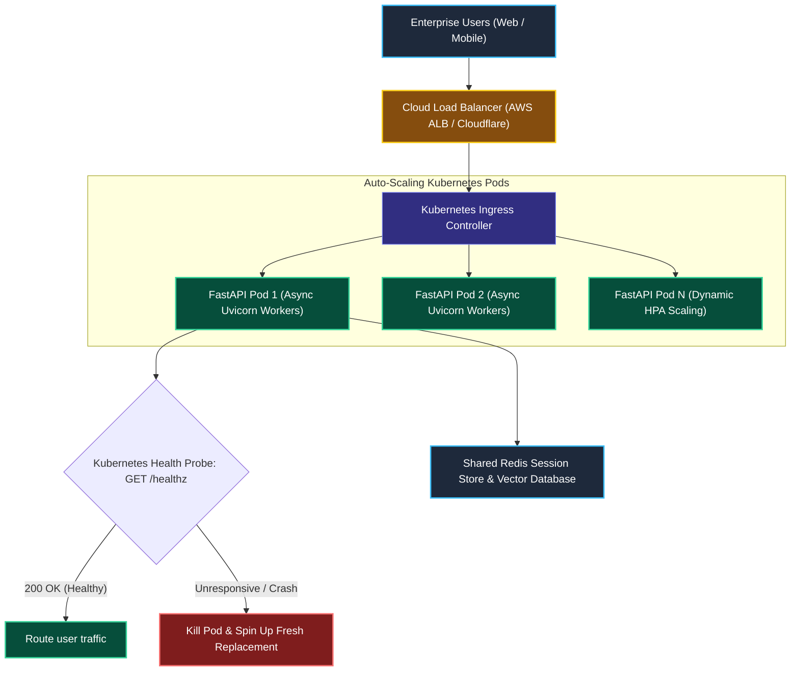
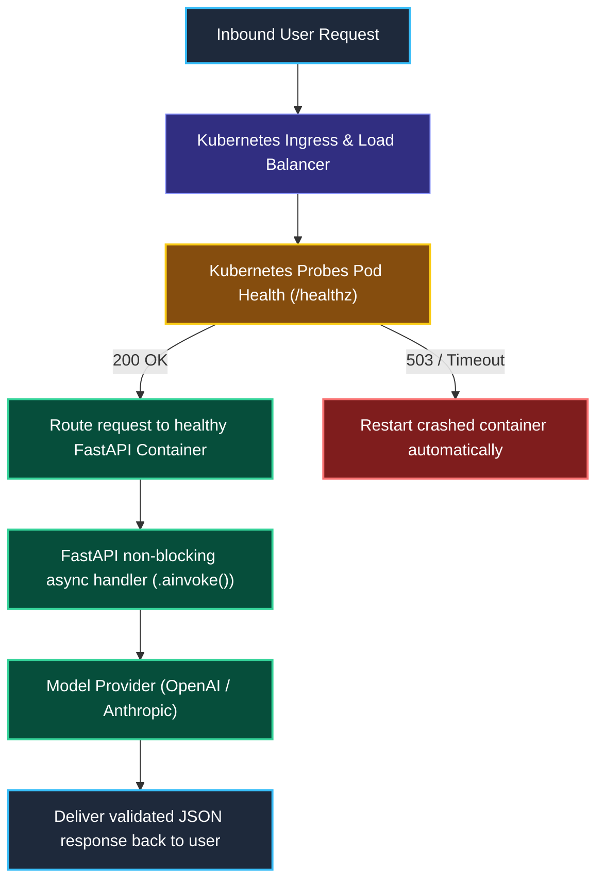

# Production Deployment with FastAPI and Docker

> "A global freight company does not pile loose cargo onto a wooden boat. They pack everything into standardized steel shipping containers that fit onto any truck, train, or cargo ship in the world."

---

### Step 1: Why Do We Need This?

#### The Real Problem

Running a local Python script with `python main.py` works great during development. But if you try to serve real users this way in production, your system collapses:

```
LOCAL SCRIPT TRAPS:
- Single-threaded blocking: User 1 makes a slow request ──▶ User 2 is completely blocked!
- Uncaught exception crashes: One bad input ──▶ The entire Python process dies!
- Zero auto-scaling: 1,000 users arrive at 9:00 AM ──▶ Server runs out of RAM and crashes!
```

Two major problems happen:
1. **No High Availability:** When a cloud server reboots or crashes, a basic Python script does not restart itself.
2. **Cannot Scale Horizontally:** A single server instance cannot handle thousands of concurrent enterprise chat connections.

We need **Containerized Microservices**: packaging our LangChain pipelines inside an asynchronous **FastAPI** web framework, bundling them into a standardized **Docker container**, and managing them with **Kubernetes** health probes and auto-scaling.

---

### Step 2: What Is It?

#### Simple Explanation

Think of deploying an AI app like **Shipping a Container Across the World**:

- **The Product (LangChain LCEL Pipeline):** The actual AI logic you built.
- **The Shipping Box (Docker Container):** Packages your Python code, exact package versions, and dependencies into an isolated box that runs identically on any computer or cloud server.
- **The Harbor Master (FastAPI + Uvicorn):** Manages thousands of simultaneous incoming ships (async HTTP connections) without blocking.
- **The Fleet Manager (Kubernetes):** If a container crashes, Kubernetes immediately boots up a replacement; if traffic surges, it deploys 10 more containers automatically.

---

### Step 3: Real-World Example

#### The High-Throughput Enterprise AI Service

Your enterprise customer support service experiences a 500% traffic surge on Monday morning:
1. **08:55 AM:** Traffic is normal. Kubernetes runs **2 active container pods**.
2. **09:05 AM:** Thousands of employees log in. CPU usage spikes past 70%.
3. **Horizontal Pod Autoscaling (HPA):** Kubernetes automatically boots **8 additional pods** in 30 seconds to handle the load.
4. **Health Check Probes:** Kubernetes checks `/healthz`. As soon as a pod reports healthy, traffic routes to it.
5. **12:00 PM:** Traffic normalizes. Kubernetes scales back down to 2 pods, saving infrastructure costs.

---

### Step 4: How Does It Work?

#### The Production Cloud Architecture



1. **Traffic Ingress:** Requests hit an external load balancer, which distributes connections across healthy FastAPI pods.
2. **Asynchronous Execution:** Uvicorn workers process requests using `asyncio`, ensuring no thread blocks while waiting on LLM network sockets.
3. **Health Monitoring:** Kubernetes probes `/healthz` every 10 seconds. If a pod locks up or runs out of memory, it is terminated and replaced instantly.

---

### Step 5: Code Example

#### Production FastAPI Service & Multi-Stage Dockerfile

Here is a complete, production-ready FastAPI service with health probes and Pydantic schemas:

```python
import os
from contextlib import asynccontextmanager
from fastapi import FastAPI, HTTPException, status
from pydantic import BaseModel, Field
from langchain_core.prompts import ChatPromptTemplate
from langchain_core.output_parsers import StrOutputParser
from langchain.chat_models import init_chat_model

# 1. Input/Output Schemas
class ChatRequest(BaseModel):
    message: str = Field(min_length=1, max_length=2000, description="User prompt text.")
    tenant_id: str = Field(description="Client enterprise identifier.")

class ChatResponse(BaseModel):
    response: str
    tenant_id: str

# 2. Lifecycle Management (Preload models on boot)
pipeline = None

@asynccontextmanager
async def lifespan(app: FastAPI):
    global pipeline
    print("[STARTUP]: Initializing LangChain model connection...")
    model = init_chat_model("openai:gpt-4o-mini", temperature=0.0)
    prompt = ChatPromptTemplate.from_template("You are an enterprise AI service. Answer clearly: {query}")
    pipeline = prompt | model | StrOutputParser()
    yield
    print("[SHUTDOWN]: Cleaning up active connection pools...")

# 3. Initialize FastAPI App
app = FastAPI(title="Production AI Microservice", lifespan=lifespan)

# 4. Kubernetes Liveness & Readiness Probe Endpoint
@app.get("/healthz", status_code=status.HTTP_200_OK)
async def health_check():
    """Kubernetes calls this endpoint every 10s to verify the service is alive."""
    if pipeline is None:
        raise HTTPException(status_code=503, detail="Model pipeline not ready.")
    return {"status": "healthy", "service": "ai-worker"}

# 5. Core Chat Endpoint
@app.post("/api/v1/chat", response_model=ChatResponse)
async def handle_chat(request: ChatRequest):
    try:
        # Non-blocking async invocation
        ai_reply = await pipeline.ainvoke({"query": request.message})
        return ChatResponse(response=ai_reply, tenant_id=request.tenant_id)
    except Exception as err:
        raise HTTPException(status_code=500, detail=f"Generation failed: {str(err)}")
```

#### The Production Multi-Stage `Dockerfile`

```dockerfile
# Stage 1: Build dependencies in a slim Python image
FROM python:3.11-slim as builder

WORKDIR /app
RUN apt-get update && apt-get install -y --no-install-recommends gcc && rm -rf /var/lib/apt/lists/*

COPY requirements.txt .
RUN pip install --no-cache-dir --user -r requirements.txt

# Stage 2: Minimal Production Runtime
FROM python:3.11-slim as runner

WORKDIR /app
# Copy only installed python packages from builder
COPY --from=builder /root/.local /root/.local
COPY . /app

ENV PATH=/root/.local/bin:$PATH
ENV PYTHONUNBUFFERED=1

# Run non-root user for security
RUN useradd -u 8888 appuser && chown -R appuser:appuser /app
USER appuser

EXPOSE 8000

# Start Uvicorn with 4 async worker processes
CMD ["uvicorn", "server:app", "--host", "0.0.0.0", "--port", "8000", "--workers", "4"]
```

---

### Step 6: How Is It Used in Production?

#### Real-World Engineering Rules

| Production Mistake | Why it hurts | How to fix it |
| :--- | :--- | :--- |
| **Running as Root inside Docker** | Running containers as root creates severe security vulnerabilities if an injection exploit occurs. | Add `USER appuser` in your Dockerfile so the container runs with least privilege. |
| **No `/healthz` Endpoint** | If a worker process hangs or deadlocks, Kubernetes cannot tell and keeps routing user traffic to the dead pod. | Always provide a fast, non-blocking `/healthz` probe that checks basic readiness. |
| **Baking API Keys into Docker Images** | If you put `ENV OPENAI_API_KEY=sk-...` inside a Dockerfile, anyone who pulls your image can read your private master keys! | Inject keys at runtime using **Kubernetes Secrets** or AWS Secrets Manager. |

---

### Step 7: Quick Revision

- **FastAPI + Async:** The standard web framework for LangChain microservices, handling thousands of connections without blocking.
- **Docker Containers:** Guarantees your application runs identically across local development, staging, and cloud servers.
- **Kubernetes Health Probes:** `/healthz` tells the orchestrator whether a pod is healthy or needs to be restarted.
- **Secrets via Environment:** Never bake API keys into Dockerfiles; inject them at runtime using secure secret managers.

#### Short Interview Answer

> *"Deploying production LangChain services requires containerizing async FastAPI runtimes with multi-stage Docker builds. We run multiple non-blocking Uvicorn workers and expose dedicated `/healthz` liveness and readiness probes to integrate seamlessly with Kubernetes Horizontal Pod Autoscalers (HPA). All provider credentials and database connection strings are injected dynamically via Kubernetes Secrets at runtime rather than baked into images, and containers execute as non-root users to ensure defense-in-depth security."*

---

### Step 8: Final Flow Diagram



---

### Step 9: Quiz

Test your understanding of production FastAPI deployment. Submit your answers as (1-A, 2-B, etc.) and we will review the explanations together!

#### Question 1
Why should an engineering team wrap LangChain pipelines inside an asynchronous FastAPI server (`async def` with `.ainvoke()`) rather than a synchronous blocking framework for web deployments?
- A. Because async frameworks allow worker threads to serve other incoming requests while waiting for external model API sockets, preventing server thread pool starvation.
- B. Because synchronous frameworks only work on Windows 95.
- C. Because model providers give an 80% discount to asynchronous frameworks.
- D. Because async frameworks eliminate the need for an internet connection.

#### Question 2
What is the primary function of a Kubernetes `/healthz` probe endpoint in an AI microservice?
- A. To check the user's personal medical records.
- B. To allow Kubernetes to verify that the container is alive and ready to process traffic; if the pod hangs or crashes, Kubernetes terminates and replaces it automatically.
- C. To format user prompts into markdown.
- D. To delete temporary files from the server.

#### Question 3
Why is it a catastrophic security mistake to write `ENV OPENAI_API_KEY="sk-..."` directly inside a Dockerfile?
- A. Because Docker cannot read strings with letters.
- B. Because any developer, CI runner, or cloud registry that inspects or pulls the built image can easily view the plaintext secret key and steal company credentials.
- C. Because OpenAI revokes keys written in uppercase.
- D. Because Dockerfiles only accept bash scripts.

#### Question 4
In a production Docker container, why should the application run as a non-root user (`USER appuser`)?
- A. To make Python run twice as fast.
- B. To enforce the principle of least privilege; if a security vulnerability or prompt exploit compromises the container, the attacker cannot gain root access to the underlying host server.
- C. Because Docker forbids root users from running Python.
- D. To make the container image file smaller.
