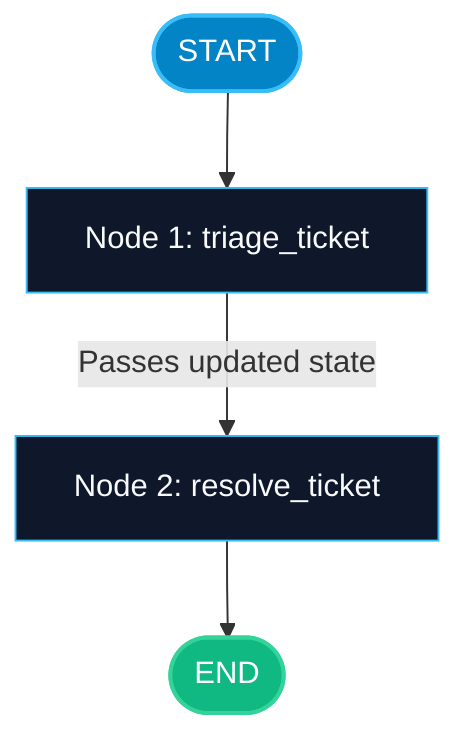

# StateGraph and Nodes in LangGraph

> "A simple chain runs in one direction like a conveyor belt. A graph can loop, make decisions, and remember past steps like an intelligent control room."

---


### Step 1: Why Do We Need This?

#### The Real Problem

When people build AI apps with simple chains (like LCEL or basic API calls), execution only goes in one straight line:
1. User asks question.
2. Search database.
3. Call LLM.
4. Give answer.

In the real world, software is rarely a straight line:
- What if the LLM makes a mistake and needs to fix its own code? A straight chain cannot loop back.
- What if an API call fails and the agent needs to try a different tool?
- What if a human must approve a transaction before money moves?
- What if a task takes 10 minutes and your server crashes halfway through?

With linear chains, you cannot loop, you cannot pause, and you lose all state when something crashes.

#### Why LangGraph Solves It

LangGraph treats your AI application as a **state machine** (a graph):
- **Nodes** do the actual work (calling an LLM, searching a database, running code).
- **Edges** decide where to go next based on what just happened.
- **State** is a single shared notebook that every node can read from and write to.
- The graph can loop back as many times as needed until the job is done.

---

### Step 2: What Is It?

#### Simple Explanation

Think of LangGraph like a **train delivery system**:
- The **Train** is the **State**. It carries boxes of data across the track.
- The **Stations** are the **Nodes**. When the train stops at a station, workers inspect the cargo, do some work, add new items, and send the train forward.
- The **Tracks and Switches** are the **Edges**. They decide which station the train visits next.
- **START** and **END** are the beginning station and final destination.

#### Core Concepts Table

| Concept | What It Does In Simple English | Python Equivalent |
| :--- | :--- | :--- |
| **State** | The shared notebook that stores all data for the run. | `TypedDict` or `BaseModel` |
| **Node** | A python function that takes current state and returns updates. | `def my_node(state): return {"key": val}` |
| **Edge** | A fixed connection directing flow from one node to another. | `builder.add_edge("node_a", "node_b")` |
| **START** | The entry point where user input enters the graph. | `from langgraph.graph import START` |
| **END** | The terminal point where the graph finishes execution. | `from langgraph.graph import END` |
| **Compile** | Validates the graph connections and builds a runnable workflow. | `graph = builder.compile()` |

---

### Step 3: Real-World Example

#### Customer Support Ticket Classifier

Imagine an e-commerce support system that reads customer tickets, classifies their urgency, drafts a response, and routes refunds to billing.

- **What it receives:** A customer message: *"I was charged twice for order #9821. Please refund immediately!"*
- **What decision it makes:**
  1. `triage_node` reads ticket -> labels it as `billing` with `urgency=high`.
  2. The graph directs flow to `billing_node` instead of `shipping_node`.
  3. `billing_node` looks up the charge in Stripe and drafts an apology with refund confirmation.
- **What it outputs:** A finalized refund status and email ready to send.

---

### Step 4: How Does It Work?

1. **Define State Schema:** You specify the exact fields the graph tracks (e.g. `messages`, `customer_id`, `ticket_status`).
2. **Write Node Functions:** Each node is a pure or async Python function. It receives the current state as its first argument and returns a dictionary with updated fields.
3. **Register Nodes:** You add each function to `StateGraph` using `builder.add_node("name", function)`.
4. **Connect Edges:** You connect `START` to your first node, connect nodes together with `add_edge`, and route the final node to `END`.
5. **Compile the Graph:** Calling `builder.compile()` turns your graph layout into an executable `CompiledStateGraph`.
6. **Invoke with Input:** You pass input data into `graph.invoke({"ticket": "..."})`. LangGraph passes state through each station until it reaches `END`.

---

### Step 5: Code Example

Here is a complete, runnable LangGraph example building a 3-step customer support triage graph:

```python
from typing import TypedDict, Optional
from langgraph.graph import StateGraph, START, END

# 1. Define the shared state schema
class SupportState(TypedDict):
    ticket_id: str
    user_query: str
    category: Optional[str]
    resolution: Optional[str]
    step_count: int

# 2. Define Node Functions
def triage_ticket(state: SupportState) -> dict:
    """Classifies the incoming customer query."""
    query = state["user_query"].lower()
    
    if "charge" in query or "refund" in query or "price" in query:
        detected_category = "billing"
    elif "password" in query or "login" in query:
        detected_category = "account_security"
    else:
        detected_category = "general_inquiry"
        
    return {
        "category": detected_category,
        "step_count": state.get("step_count", 0) + 1
    }

def resolve_ticket(state: SupportState) -> dict:
    """Drafts resolution based on assigned category."""
    category = state.get("category", "general_inquiry")
    
    if category == "billing":
        reply = "We verified your invoice and initiated a refund within 3-5 business days."
    elif category == "account_security":
        reply = "A secure password reset link was dispatched to your registered email."
    else:
        reply = "Thank you for reaching out. Our tier-1 support agent will review this shortly."
        
    return {
        "resolution": reply,
        "step_count": state["step_count"] + 1
    }

# 3. Build and connect the graph
builder = StateGraph(SupportState)

# Add nodes
builder.add_node("triage", triage_ticket)
builder.add_node("resolve", resolve_ticket)

# Connect edges
builder.add_edge(START, "triage")
builder.add_edge("triage", "resolve")
builder.add_edge("resolve", END)

# 4. Compile the graph
support_graph = builder.compile()

# 5. Run the graph with an initial payload
if __name__ == "__main__":
    initial_input: SupportState = {
        "ticket_id": "TICKET-4091",
        "user_query": "I noticed an unexpected charge on my credit card statement.",
        "category": None,
        "resolution": None,
        "step_count": 0
    }
    
    final_output = support_graph.invoke(initial_input)
    print("Assigned Category:", final_output["category"])
    print("Final Resolution:", final_output["resolution"])
    print("Total Steps Executed:", final_output["step_count"])
```

---

### Step 6: How Is It Used in Production?

#### Production Patterns & Edge Cases

| Scenario | Production Challenge | Recommended Solution |
| :--- | :--- | :--- |
| **Node Failures** | A third-party API or LLM call crashes inside a node. | Wrap node logic in try/except blocks or configure LangGraph retry policies on the node. |
| **Partial State Overwrites** | Returning keys from a node accidentally wipes out other state values. | Nodes only need to return the keys they change. LangGraph performs a shallow dictionary update by default. |
| **Large Blobs in State** | Storing megabytes of raw PDF text directly in state consumes RAM. | Store document references or S3 URLs in state; load full contents only inside nodes that need them. |
| **State Validation** | Malformed data causes downstream nodes to fail with `KeyError`. | Use strict Pydantic schemas or TypedDict with clear type annotations. |

---

### Step 7: Quick Revision

- A `StateGraph` is a state machine built of **Nodes** (actions), **Edges** (connections), and a shared **State** schema.
- Every node receives the current state and returns a dictionary with updated fields.
- LangGraph applies shallow updates to the state automatically.
- You must always connect `START` to your first node and route finished branches to `END`.
- Before executing, you must call `builder.compile()` to validate the connections.

---

### Step 8: Final Flow Diagram



---

### Step 9: Quiz

Try answering these questions to check your understanding:

1. What does a Node function in LangGraph receive as its input argument?
   - A) Only the raw string query sent by the user
   - B) The current state dictionary or object
   - C) A database connection pool
   - D) An OpenAI API key

2. What does a Node function return?
   - A) A complete new replacement for the entire database
   - B) True or False only
   - C) A dictionary containing only the keys and values to update in state
   - D) A string with HTML tags

3. What happens if a node returns `{"category": "billing"}` when the state has 5 other keys?
   - A) The other 5 keys are deleted
   - B) LangGraph crashes with a missing key error
   - C) LangGraph updates the `category` key and preserves all other keys
   - D) The return value is ignored

4. Why must you call `builder.compile()` before running `graph.invoke()`?
   - A) To convert Python code to C++ for speed
   - B) To validate graph structure, check edge connectivity, and generate an executable workflow
   - C) To charge credits to your LLM API account
   - D) To deploy the graph to a public web server automatically

*Submit your answers (e.g. 1-B, 2-C, 3-C, 4-B) to verify your score!*
