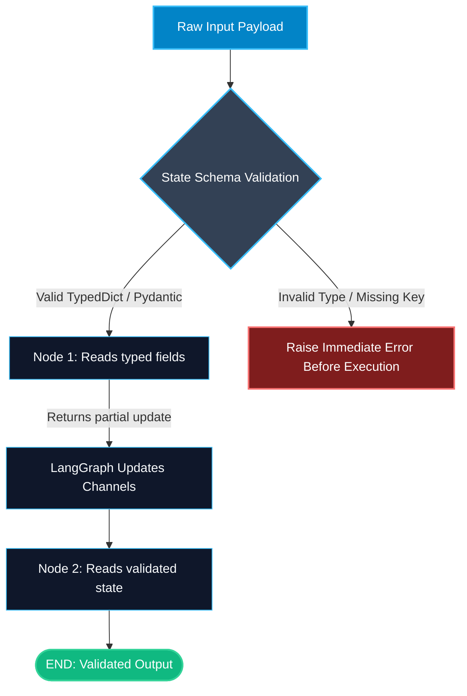

# State Schemas — TypedDict and Pydantic in LangGraph

> "Without a strict schema, functions trade mystery keys until a missing field crashes production. A typed schema turns state into a clear contract."

---

### Step 1: Why Do We Need This?

#### The Real Problem

In any multi-step system, data flows between different functions. If you pass a plain Python dictionary `state = {}`:
- Node 1 writes `state["user_input"]`.
- Node 2 expects `state["query"]`. It crashes with `KeyError: 'query'` at 2 AM.
- Node 3 expects a list of numbers, but gets a single string. It crashes when trying to loop over it.
- Your IDE and linter cannot help you because a generic dictionary has no type hints or autocomplete.

As an AI workflow grows to 5, 10, or 20 nodes, plain dictionaries become a nightmare to maintain.

#### Why LangGraph Solves It

LangGraph allows you to define the exact shape of your state using **TypedDict** or **Pydantic BaseModel**:
1. You get autocomplete and type-checking in your editor.
2. Every developer on your team knows exactly what data exists in the graph.
3. You can choose lightweight TypedDict for speed, or Pydantic if you need automatic data validation.

---

### Step 2: What Is It?

#### Simple Explanation

Think of the State Schema as a **pre-printed cargo manifest**:
- Before the truck leaves, the manifest lists every box allowed inside: `order_id` (string), `items` (list), `total_price` (float).
- If a worker tries to pack a box called `discount_code` when the manifest does not allow it, or packs a string where a number should be, the system catches the mistake immediately.

#### TypedDict vs Pydantic in LangGraph

| Feature | TypedDict | Pydantic BaseModel |
| :--- | :--- | :--- |
| **Primary Goal** | Fast, lightweight static type hinting. | Runtime validation and data coercion. |
| **Performance Overhead** | Zero runtime overhead (standard dict). | Small validation overhead per node transition. |
| **Access Syntax** | Dictionary style: `state["field"]` | Attribute style: `state.field` (or dict depending on config). |
| **Best Used For** | Most standard LangGraph workflows and message queues. | Input endpoints, strict API boundaries, complex nested types. |

---

### Step 3: Real-World Example

#### Financial Loan Application State

Imagine a loan approval workflow:
- **What it receives:** An applicant's credit score, annual income, requested loan amount, and employment history.
- **What decision it makes:**
  1. The schema ensures `credit_score` is an integer between 300 and 850.
  2. If the user submits a string like `"excellent"`, Pydantic flags the invalid type before running expensive LLM evaluations.
  3. Nodes update `risk_tier` and `approved_limit` with guaranteed type safety.
- **What it outputs:** A typed decision payload guaranteed to match your core banking API schema.

---

### Step 4: How Does It Work?

1. **Import typing primitives:** You import `TypedDict` from Python's standard `typing` module, or `BaseModel`, `Field` from `pydantic`.
2. **Declare channels (fields):** Define every piece of data your nodes will read or update.
3. **Pass schema to StateGraph:** Pass the class directly into `StateGraph(LoanState)`.
4. **LangGraph creates channels:** Each key in your schema becomes a managed channel.
5. **Node execution:** When a node finishes, LangGraph validates that updates match the registered channels and merges them into state.

---

### Step 5: Code Example

Here is a complete, runnable example comparing TypedDict and Pydantic schemas in LangGraph:

```python
from typing import TypedDict, Optional, List
from pydantic import BaseModel, Field
from langgraph.graph import StateGraph, START, END

# --- Approach 1: Lightweight TypedDict Schema (Recommended for core graphs) ---
class ResearchState(TypedDict):
    topic: str
    search_queries: List[str]
    collected_notes: List[str]
    summary: Optional[str]
    is_complete: bool

def generate_queries(state: ResearchState) -> dict:
    """Generates targeted search terms for the research topic."""
    topic = state["topic"]
    queries = [f"{topic} overview", f"{topic} latest benchmarks", f"{topic} production issues"]
    return {"search_queries": queries}

def compile_summary(state: ResearchState) -> dict:
    """Combines findings into a final summary string."""
    notes = state.get("collected_notes", [])
    count = len(notes)
    return {
        "summary": f"Research on '{state['topic']}' completed across {count} sources.",
        "is_complete": True
    }

# Build graph with TypedDict
builder = StateGraph(ResearchState)
builder.add_node("planner", generate_queries)
builder.add_node("writer", compile_summary)

builder.add_edge(START, "planner")
builder.add_edge("planner", "writer")
builder.add_edge("writer", END)

research_graph = builder.compile()

# --- Approach 2: Pydantic Schema with Runtime Validation ---
class StrictLoanState(BaseModel):
    applicant_id: str
    credit_score: int = Field(ge=300, le=850, description="FICO score 300-850")
    requested_amount: float = Field(gt=0)
    decision: Optional[str] = None

def evaluate_credit(state: StrictLoanState) -> dict:
    if state.credit_score >= 700:
        decision = "approved"
    else:
        decision = "manual_review"
    return {"decision": decision}

loan_builder = StateGraph(StrictLoanState)
loan_builder.add_node("evaluator", evaluate_credit)
loan_builder.add_edge(START, "evaluator")
loan_builder.add_edge("evaluator", END)
loan_graph = loan_builder.compile()

if __name__ == "__main__":
    # Test TypedDict graph
    output = research_graph.invoke({
        "topic": "LangGraph Reducers",
        "search_queries": [],
        "collected_notes": ["Reducer combines updates", "Annotated adds items"],
        "summary": None,
        "is_complete": False
    })
    print("TypedDict Summary:", output["summary"])

    # Test Pydantic graph
    loan_output = loan_graph.invoke({
        "applicant_id": "USER-8812",
        "credit_score": 745,
        "requested_amount": 25000.0
    })
    print("Loan Decision:", loan_output["decision"])
```

---

### Step 6: How Is It Used in Production?

#### Production Patterns & Edge Cases

| Scenario | Production Challenge | Recommended Solution |
| :--- | :--- | :--- |
| **Optional Keys** | A node tries to read a key before another node creates it. | Use `Optional[T]` and `state.get("key", default)` so nodes never raise `KeyError`. |
| **API Payload Ingestion** | Untrusted JSON from webhooks enters the graph. | Use Pydantic at the entry boundary to validate fields before passing into the graph. |
| **State Bloat** | Storing giant raw API JSON responses blows up memory. | Filter raw responses down to only the fields needed by downstream nodes. |
| **Immutable Defaults** | Using mutable default arguments like `tags: List[str] = []`. | In Pydantic use `Field(default_factory=list)` to avoid shared state bugs between runs. |

---

### Step 7: Quick Revision

- `TypedDict` provides compile-time type checking with zero runtime overhead.
- `Pydantic` provides runtime validation and automatic data coercion.
- Pass your schema directly into `StateGraph(YourStateClass)`.
- Use `Optional[T]` for keys that are populated later in the graph lifecycle.
- Keep state lean: store identifiers, URLs, and summaries rather than gigabytes of raw data.

---

### Step 8: Final Flow Diagram



---

### Step 9: Quiz

Try answering these questions to check your understanding:

1. What is the primary difference between `TypedDict` and `Pydantic BaseModel` in LangGraph?
   - A) TypedDict is for C++ while Pydantic is for Python
   - B) TypedDict provides static type hints with zero overhead; Pydantic enforces runtime data validation
   - C) TypedDict only works with numbers; Pydantic only works with text
   - D) TypedDict cannot be used in LangGraph

2. When should you mark a state key as `Optional[str]`?
   - A) Only when the key is never used
   - B) When the key is not present at the start of the graph and gets populated by a later node
   - C) When you want LangGraph to delete the key after every step
   - D) When the field stores sensitive passwords

3. What happens if you define a default list in Pydantic using `items: List[str] = []`?
   - A) It is the recommended best practice
   - B) Python shares the same list across multiple graph executions, causing state contamination bugs
   - C) Pydantic automatically converts it into a tuple
   - D) LangGraph will refuse to compile the graph

4. Why is keeping state lean an important production practice?
   - A) LangGraph only allows up to 100 bytes of total data
   - B) Every checkpoint and state update saves the state to disk/database; giant payloads cause latency and high storage bills
   - C) Large states make the LLM forget its system prompt
   - D) Lean states make Python run on GPUs automatically

*Submit your answers (e.g. 1-B, 2-B, 3-B, 4-B) to verify your score!*
