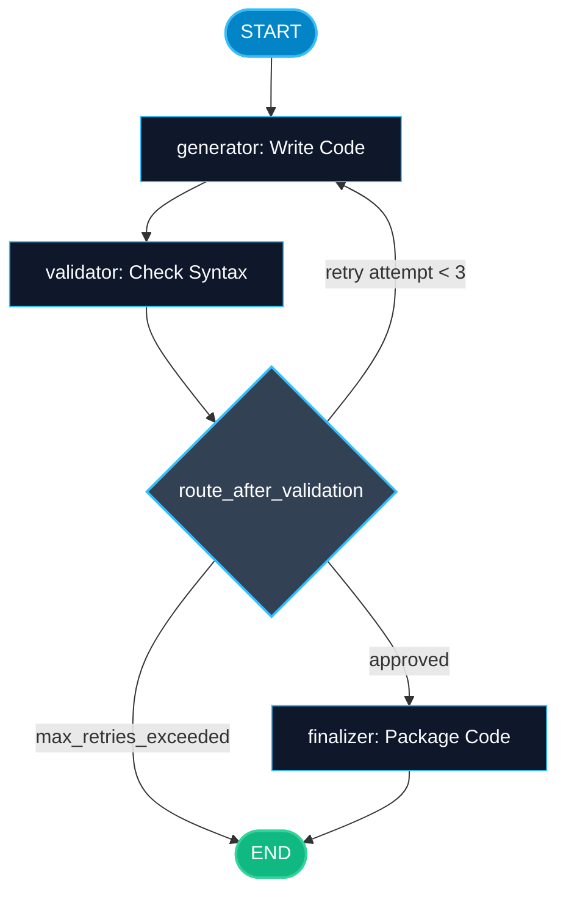

# Edges and Conditional Routing in LangGraph

> "A road without forks only goes one way. A conditional edge is the highway fork that lets an agent decide which path to take."

---

### Step 1: Why Do We Need This?

#### The Real Problem

In any real software application, you cannot execute the exact same steps for every user query:
- If a user says *"Hello"*, you do not want to run an expensive 10-second web search pipeline. You just want a fast conversational reply.
- If a user asks to *"Check server logs"*, you need to route to a DevOps tool node.
- If an agent generates Python code that fails unit tests, you need to loop back to the coder node to fix the syntax error, rather than blindly returning broken code to the customer.

Fixed chains cannot make dynamic routing decisions. You need **conditional edges**.

#### Why LangGraph Solves It

LangGraph separates:
1. **Normal Edges:** Always connect Node A directly to Node B.
2. **Conditional Edges:** Call a small routing function that inspects current state and returns the name of the next node to visit.
3. **Loops:** Conditional edges can point backwards to earlier nodes, creating controlled feedback loops.

---

### Step 2: What Is It?

#### Simple Explanation

Think of a **railroad track switch**:
- When the train arrives at Node A, it stops on the track.
- The **router function** checks the train's cargo: *Is there an error flag? Does the response have tool calls?*
- If tools are requested, the switch flips toward the **Tool Station**.
- If the answer is ready, the switch flips toward the **Final Destination (END)**.

#### Edge Types Comparison

| Edge Type | How You Define It | When To Use It |
| :--- | :--- | :--- |
| **Direct Edge** | `builder.add_edge("node_a", "node_b")` | Fixed sequence: step B must always run immediately after step A. |
| **Conditional Edge** | `builder.add_conditional_edges("source", router_fn, mapping_dict)` | Dynamic branching: choose between multiple next nodes based on state. |
| **Looping Edge** | Router returns `"node_a"` while at `"node_b"` | Iterative refinement: fix errors or execute multi-step tool calls. |

---

### Step 3: Real-World Example

#### Code Quality Guardrail Pipeline

Imagine an automated AI coding assistant:
- **What it receives:** A user prompt to write a Python function.
- **What decision it makes:**
  1. `coder_node` writes the Python function.
  2. The workflow reaches a conditional edge pointing to `check_test_results`.
  3. If unit tests pass -> route to `deploy_node` -> `END`.
  4. If unit tests fail and retries < 3 -> loop back to `coder_node` with error traceback.
  5. If retries >= 3 -> route to `escalate_human_node` -> `END`.
- **What it outputs:** Working, verified code without human intervention, or an escalation notice.

---

### Step 4: How Does It Work?

1. **Write the Source Node:** A node completes its work and updates state.
2. **Write a Router Function:** A lightweight function that takes `state` as input and returns a string (e.g. `"tools"`, `"end"`, or `"retry"`).
3. **Add Conditional Edge:**
   ```python
   builder.add_conditional_edges(
       source="agent",
       path=route_decision,
       path_map={"call_tool": "tools", "finish": END}
   )
   ```
4. **Graph Execution:** LangGraph finishes `source`, calls `route_decision(state)`, matches the returned key against `path_map`, and transitions to the selected node.

---

### Step 5: Code Example

Here is a complete, runnable LangGraph example with conditional routing and a retry loop:

```python
from typing import TypedDict, Optional
from langgraph.graph import StateGraph, START, END

# 1. State definition
class CodeGenState(TypedDict):
    task: str
    generated_code: Optional[str]
    syntax_valid: bool
    attempt_count: int
    final_output: Optional[str]

# 2. Node Functions
def generate_code_node(state: CodeGenState) -> dict:
    """Simulates code generation with an intentional initial error."""
    attempts = state.get("attempt_count", 0) + 1
    
    # Simulate a bug on attempt 1, clean code on attempt 2
    if attempts == 1:
        code = "def add(a, b) return a + b"  # Syntax error: missing colon
    else:
        code = "def add(a, b):\n    return a + b"
        
    return {
        "generated_code": code,
        "attempt_count": attempts
    }

def validate_syntax_node(state: CodeGenState) -> dict:
    """Checks if the generated code compiles cleanly."""
    code = state.get("generated_code", "")
    try:
        compile(code, "<string>", "exec")
        is_valid = True
    except SyntaxError:
        is_valid = False
        
    return {"syntax_valid": is_valid}

def finalize_node(state: CodeGenState) -> dict:
    return {
        "final_output": f"Success after {state['attempt_count']} attempt(s):\n{state['generated_code']}"
    }

# 3. Router Function (The Conditional Edge)
def route_after_validation(state: CodeGenState) -> str:
    """Decides whether to finish, retry, or give up."""
    if state["syntax_valid"]:
        return "approved"
    elif state["attempt_count"] < 3:
        return "retry"
    else:
        return "max_retries_exceeded"

# 4. Build the Graph
builder = StateGraph(CodeGenState)

builder.add_node("generator", generate_code_node)
builder.add_node("validator", validate_syntax_node)
builder.add_node("finalizer", finalize_node)

# Normal direct edges
builder.add_edge(START, "generator")
builder.add_edge("generator", "validator")

# Conditional edge with path mapping
builder.add_conditional_edges(
    source="validator",
    path=route_after_validation,
    path_map={
        "approved": "finalizer",
        "retry": "generator",      # Loops back!
        "max_retries_exceeded": END
    }
)

builder.add_edge("finalizer", END)

# Compile
code_graph = builder.compile()

if __name__ == "__main__":
    result = code_graph.invoke({
        "task": "Write an addition function",
        "generated_code": None,
        "syntax_valid": False,
        "attempt_count": 0,
        "final_output": None
    })
    
    print(result["final_output"])
```

---

### Step 6: How Is It Used in Production?

#### Production Patterns & Edge Cases

| Scenario | Production Challenge | Recommended Solution |
| :--- | :--- | :--- |
| **Infinite Loops** | A model repeatedly produces invalid tool calls, running forever. | Always enforce an `attempt_count` or recursion limit in state and the router function. |
| **Unmapped Router Key** | The router returns `"unknown_route"`, missing from `path_map`. | Use exhaustive typing or a fallback default route to prevent graph runtime errors. |
| **Heavy Router Functions** | Router functions making slow API calls block edge transitions. | Keep router functions fast and lightweight. Do heavy computations inside nodes, not in routers. |
| **Dynamic Routing** | Routing to different tools without hardcoding every tool edge. | Return node names directly or use LangGraph's prebuilt `tools_condition`. |

---

### Step 7: Quick Revision

- Direct edges connect nodes unconditionally using `builder.add_edge("a", "b")`.
- Conditional edges route based on state using `builder.add_conditional_edges()`.
- The router function inspects state and returns a string key.
- The `path_map` maps that string key to the destination node name.
- A router can point backward to a previous node to build safe, controlled loops.
- Always include an iteration limit to protect against infinite loops.

---

### Step 8: Final Flow Diagram



---

### Step 9: Quiz

Try answering these questions to check your understanding:

1. What does the router function in a conditional edge return?
   - A) A full HTML web page
   - B) A string key representing which path to take
   - C) A newly compiled StateGraph
   - D) A database password

2. What is the danger of creating a loop edge that routes back to an earlier node?
   - A) Python crashes immediately upon compilation
   - B) The agent could loop forever if the exit condition is never satisfied, burning money and compute
   - C) LangGraph only supports single-direction edges
   - D) It deletes all previous state

3. What is the role of `path_map` in `add_conditional_edges`?
   - A) It defines the geographic location of your cloud server
   - B) It maps the string returned by the router function to target node names (or END)
   - C) It compresses JPEG images
   - D) It converts Python code into SQL queries

4. What is a recommended production rule for router functions?
   - A) Run 10-second deep learning evaluations inside the router
   - B) Keep routers lightweight and fast, evaluating state that was already prepared by nodes
   - C) Never return END from a router
   - D) Always write routers in C++

*Submit your answers (e.g. 1-B, 2-B, 3-B, 4-B) to verify your score!*
