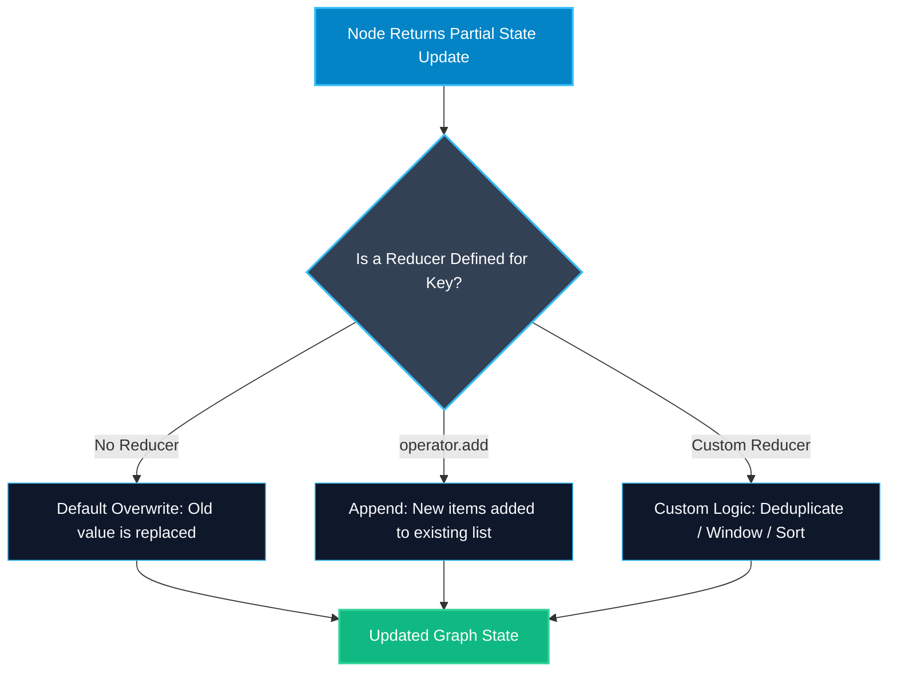

# Default Overwrite vs Custom Reducers in LangGraph

> "By default, writing to a key replaces what was there before. A reducer lets you decide how new updates merge with old data."

---

### Step 1: Why Do We Need This?

#### The Real Problem

By default in LangGraph, when a node returns `{"count": 5}`, LangGraph overwrites the old value of `count` with `5`.
This works great for simple values like status flags or current query strings.

However, consider an ongoing conversation or message log:
- Node 1 outputs `{"messages": [UserMessage("Hello")]}`.
- Node 2 outputs `{"messages": [AIMessage("Hi there! How can I help?")]}`.
- If LangGraph uses default overwrite, Node 2's return value **deletes** the user's message! The chat history shrinks to only the last reply.
- The LLM loses all context of what the user asked 5 seconds ago.

You need a way to tell LangGraph: *"Do not overwrite this list. Append new messages to the existing list instead."*

#### Why LangGraph Solves It

LangGraph uses **Reducers**:
- A reducer is a function that takes `(current_value, new_update)` and returns the merged result.
- You can use built-in reducers like `operator.add` to append lists.
- You can write custom reducers to deduplicate items, keep only the last N items, or combine dictionaries.

---

### Step 2: What Is It?

#### Simple Explanation

Think of a **shared physical ledger**:
- **Default Overwrite:** Erases the entire chalkboard every time a person enters the room and writes only their own sentence.
- **Append Reducer (`operator.add`):** Adds new bullet points below previous lines without erasing the past.
- **Custom Reducer:** An accountant who checks for duplicate receipts, sorts them by timestamp, and removes items older than 30 days before saving.

#### Reducer Behaviors Comparison

| Reducer Type | How It Behaves | Example Use Case |
| :--- | :--- | :--- |
| **Default (None)** | Overwrites old value with new value. | `status = "completed"`, `current_step = 3` |
| **List Append (`operator.add`)** | Concatenates new list to existing list. | Chat history, tool call logs, error traces |
| **Custom Reducer** | Custom logic: deduplication, max length window, sorting. | Unique user tags, rolling memory windows |

---

### Step 3: Real-World Example

#### Multi-Turn Support Chat History

Imagine a customer service chatbot:
- **What it receives:** The ongoing message history between user and assistant.
- **What decision it makes:**
  1. The user sends: *"Where is order #102?"*
  2. The agent calls a shipping tool, producing a tool message: *"Order #102 is in transit."*
  3. The agent node generates a final response: *"Your package is out for delivery today."*
  4. The append reducer keeps all three messages in order, giving the model full conversational memory for follow-up questions.
- **What it outputs:** A complete, preserved chronological conversation history.

---

### Step 4: How Does It Work?

1. **Import `Annotated`:** Import `Annotated` from `typing`.
2. **Assign the Reducer:** Attach the reducer function to the state field definition:
   ```python
   from typing import Annotated
   import operator

   class ChatState(TypedDict):
       messages: Annotated[list[str], operator.add]
   ```
3. **Node Return:** When a node returns `{"messages": ["new message"]}`, LangGraph calls:
   `state["messages"] = operator.add(state["messages"], ["new message"])`.
4. **Custom Reducer Contract:** A custom reducer takes two parameters:
   `def my_reducer(existing_val: T, new_val: T) -> T:` and returns the merged value.

---

### Step 5: Code Example

Here is a complete, runnable example demonstrating both default overwrite and custom reducers in LangGraph:

```python
from typing import TypedDict, Annotated, List
import operator
from langgraph.graph import StateGraph, START, END

# Custom reducer: Keeps only unique tags, sorted alphabetically
def merge_unique_tags(existing: List[str], new_items: List[str]) -> List[str]:
    combined = set(existing or [])
    combined.update(new_items)
    return sorted(list(combined))

# Custom reducer: Rolling window that keeps only the last 3 logs
def rolling_log_reducer(existing: List[str], new_logs: List[str]) -> List[str]:
    updated = (existing or []) + new_logs
    return updated[-3:]  # Keeps at most last 3 items to save RAM

# State definition
class AppState(TypedDict):
    # Default: Overwrites every step
    current_status: str
    
    # Built-in reducer: Appends all items
    raw_history: Annotated[List[str], operator.add]
    
    # Custom reducer: Deduplicates tags
    tags: Annotated[List[str], merge_unique_tags]
    
    # Custom reducer: Keeps only last 3 logs
    rolling_logs: Annotated[List[str], rolling_log_reducer]

# Node 1
def step_one(state: AppState) -> dict:
    return {
        "current_status": "Step 1 Finished",
        "raw_history": ["Started workflow"],
        "tags": ["python", "ai"],
        "rolling_logs": ["Log 1: Booted system", "Log 2: Loaded models"]
    }

# Node 2
def step_two(state: AppState) -> dict:
    return {
        "current_status": "Step 2 Finished",   # Overwrites Step 1 status!
        "raw_history": ["Executed second task"], # Appends to raw_history!
        "tags": ["python", "langgraph"],        # 'python' is deduplicated!
        "rolling_logs": ["Log 3: Ran node 2", "Log 4: Verification passed"]
    }

builder = StateGraph(AppState)
builder.add_node("node_1", step_one)
builder.add_node("node_2", step_two)

builder.add_edge(START, "node_1")
builder.add_edge("node_1", "node_2")
builder.add_edge("node_2", END)

graph = builder.compile()

if __name__ == "__main__":
    initial_state: AppState = {
        "current_status": "Initialized",
        "raw_history": [],
        "tags": [],
        "rolling_logs": []
    }
    
    output = graph.invoke(initial_state)
    
    print("1. Status (Default Overwrite):", output["current_status"])
    print("2. Raw History (operator.add):", output["raw_history"])
    print("3. Tags (Deduplicated):", output["tags"])
    print("4. Rolling Logs (Last 3 Only):", output["rolling_logs"])
```

---

### Step 6: How Is It Used in Production?

#### Production Patterns & Edge Cases

| Scenario | Production Challenge | Recommended Solution |
| :--- | :--- | :--- |
| **Unbounded Memory Growth** | `operator.add` grows infinitely over 50 conversation turns, exceeding token limits. | Use a rolling window reducer or LangChain's `add_messages` with message trimming. |
| **None Value on Cold Start** | First node execution passes `None` to `existing` parameter in custom reducer. | Always handle initial empty state: `existing = existing or []`. |
| **Parallel Branch Collisions** | Two parallel nodes return updates to the same key simultaneously. | Reducers resolve the conflict deterministically by running sequentially over updates. |
| **State Reset / Deletion** | You need to wipe state on logout or conversation reset. | Return a special sentinel value in your custom reducer that clears the channel. |

---

### Step 7: Quick Revision

- Default keys without reducers overwrite their old values on every update.
- `Annotated[List[T], operator.add]` appends new items to an existing list.
- A custom reducer is a function taking `(existing_val, new_val)` that returns the merged result.
- Always guard against empty cold-start state: `existing or []`.
- Use custom reducers for deduplication, sorting, or maintaining rolling memory windows.

---

### Step 8: Final Flow Diagram



---

### Step 9: Quiz

Try answering these questions to check your understanding:

1. What happens to a state key that has NO reducer when a node returns a new value for it?
   - A) The new value is appended to a list
   - B) The old value is completely overwritten by the new value
   - C) LangGraph throws a TypeError
   - D) The new value is discarded

2. Which standard library operator is commonly used with `Annotated` to append lists in LangGraph?
   - A) `operator.mul`
   - B) `operator.sub`
   - C) `operator.add`
   - D) `operator.mod`

3. What parameters does a custom reducer function accept?
   - A) Only the HTTP request headers
   - B) `(current_value, new_update)`
   - C) `(database_url, query_string)`
   - D) `(graph_id, thread_id)`

4. Why is using an unbounded `operator.add` on messages dangerous in long-running production chats?
   - A) LangGraph will delete the database
   - B) The message list grows forever, eventually blowing past LLM context window limits and inflating API costs
   - C) Python cannot store more than 10 strings in a list
   - D) It causes SSL certificate errors

*Submit your answers (e.g. 1-B, 2-C, 3-B, 4-B) to verify your score!*
