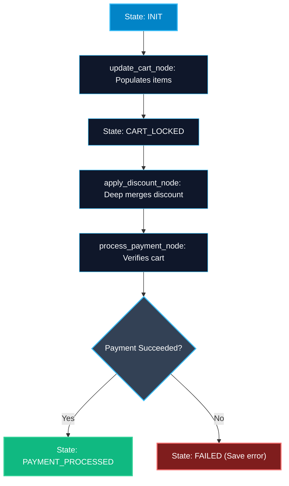

# Complex State Mutations and State Transitions in LangGraph

> "Real applications do not just append text. They manage nested JSON, transition between workflow states, and roll back bad decisions."

---

### Step 1: Why Do We Need This?

#### The Real Problem

In production AI systems, state is rarely a simple list of strings:
- You have nested dictionaries representing user profiles, shopping carts, or API headers.
- You have finite state machine (FSM) statuses like `draft -> pending_review -> approved -> rejected`.
- If an agent generates bad structured output, you must rollback the shopping cart to its previous state before trying again.

If your state management is naive:
1. Updating a nested dictionary like `state["user"]["preferences"]["theme"]` accidentally wipes out `state["user"]["email"]`.
2. Nodes transition into illegal states (e.g. jumping from `draft` directly to `shipped` without payment).
3. Debugging what node modified which nested key becomes impossible.

#### Why LangGraph Solves It

LangGraph provides deep channel control:
- You can write nested dictionary reducers that merge sub-keys deeply.
- You can enforce strict state transitions through guardrail nodes and conditional routing.
- Checkpointing creates immutable historical snapshots at every transition.

---

### Step 2: What Is It?

#### Simple Explanation

Think of a **digital document signing system**:
- A document cannot be marked `signed` until it has passed through `created -> sent_to_client -> verified`.
- If a client rejects the contract, the state transitions to `revision_requested`, not `completed`.
- When the client updates their phone number on page 2, the system updates only that specific field without erasing their name, address, and signature on page 1.

#### Deep Merge vs Shallow Overwrite

```python
# Shallow Overwrite (Bad for nested dicts):
existing = {"theme": "dark", "notifications": True}
update = {"theme": "light"}
# If replaced directly, "notifications" is lost!

# Deep Reducer (Good for nested dicts):
def deep_dict_reducer(existing: dict, update: dict) -> dict:
    merged = existing.copy()
    merged.update(update)
    return merged
```

---

### Step 3: Real-World Example

#### Multi-Step E-Commerce Checkout Graph

Imagine an automated shopping checkout agent:
- **What it receives:** An intent from the customer: *"Add 2 wireless mice to my cart and apply coupon SAVE20"*.
- **What decision it makes:**
  1. `cart_node` updates items without overwriting shipping address.
  2. `coupon_node` validates coupon with an external API and updates discount percentage.
  3. The status transitions from `browsing` -> `cart_updated` -> `payment_pending`.
  4. If payment fails, it transitions to `payment_failed` and returns a friendly prompt to update card details.
- **What it outputs:** A verified checkout session with preserved cart items, active discounts, and current transaction state.

---

### Step 4: How Does It Work?

1. **Structured Schema:** Define state with nested TypedDicts or Pydantic models for modular domains (e.g. `UserContext`, `OrderContext`).
2. **Custom Reducer for Nested Maps:** Use a dictionary merge reducer on specific channels so sub-keys merge rather than overwrite.
3. **State Transition Validation:** Inside nodes or conditional edges, verify that `current_state -> next_state` is a valid legal transition.
4. **LangGraph State Tracking:** Every transition generates a clean state delta, keeping an audit trail of changes.

---

### Step 5: Code Example

Here is a complete, runnable LangGraph example demonstrating deep dictionary merging and controlled state machine transitions:

```python
from typing import TypedDict, Annotated, Dict, Any, Optional
from langgraph.graph import StateGraph, START, END

# Custom reducer to perform deep dictionary updates
def merge_nested_dict(existing: Dict[str, Any], update: Dict[str, Any]) -> Dict[str, Any]:
    merged = (existing or {}).copy()
    for key, value in (update or {}).items():
        if isinstance(value, dict) and isinstance(merged.get(key), dict):
            merged[key] = merge_nested_dict(merged[key], value)
        else:
            merged[key] = value
    return merged

# State Definition
class CheckoutState(TypedDict):
    session_id: str
    status: str  # Allowed: "INIT", "CART_LOCKED", "PAYMENT_PROCESSED", "FAILED"
    cart: Annotated[Dict[str, Any], merge_nested_dict]
    error_message: Optional[str]

# Node 1: Add items to cart
def update_cart_node(state: CheckoutState) -> dict:
    # State transitions to CART_LOCKED
    return {
        "status": "CART_LOCKED",
        "cart": {
            "items": ["Laptop Stand", "USB-C Hub"],
            "currency": "USD"
        }
    }

# Node 2: Apply discount without erasing items
def apply_discount_node(state: CheckoutState) -> dict:
    # Deep merge will add 'discount_code' to cart without deleting 'items'
    return {
        "cart": {
            "discount_code": "DEV2026",
            "discount_percent": 15
        }
    }

# Node 3: Process transaction
def process_payment_node(state: CheckoutState) -> dict:
    # Simulate payment verification
    items = state["cart"].get("items", [])
    if len(items) > 0:
        return {"status": "PAYMENT_PROCESSED"}
    else:
        return {
            "status": "FAILED",
            "error_message": "Cannot process payment on an empty cart."
        }

# Build Graph
builder = StateGraph(CheckoutState)

builder.add_node("update_cart", update_cart_node)
builder.add_node("apply_discount", apply_discount_node)
builder.add_node("process_payment", process_payment_node)

builder.add_edge(START, "update_cart")
builder.add_edge("update_cart", "apply_discount")
builder.add_edge("apply_discount", "process_payment")
builder.add_edge("process_payment", END)

checkout_graph = builder.compile()

if __name__ == "__main__":
    initial_payload: CheckoutState = {
        "session_id": "SESS-9012",
        "status": "INIT",
        "cart": {"user_id": "USR-441"},
        "error_message": None
    }
    
    final_state = checkout_graph.invoke(initial_payload)
    print("Final Status:", final_state["status"])
    print("Final Cart Payload:")
    for k, v in final_state["cart"].items():
        print(f"  {k}: {v}")
```

---

### Step 6: How Is It Used in Production?

#### Production Patterns & Edge Cases

| Scenario | Production Challenge | Recommended Solution |
| :--- | :--- | :--- |
| **Accidental State Deletion** | A node returns `{}` expecting no change, but overwrites keys in naive implementations. | In LangGraph, returning an empty dict `{}` causes zero mutations to unmentioned keys. |
| **Illegal State Jumping** | A rogue model tool call sets status to `APPROVED` before running validation. | Validate state transitions in an edge router. If transition is invalid, route to an error handling node. |
| **Object Mutation in Memory** | Modifying `state["cart"]["items"].append("item")` in place bypasses reducers. | Never mutate state objects directly in place. Always return a new dictionary delta from your node. |

---

### Step 7: Quick Revision

- Never mutate incoming state in place; always return fresh dictionary deltas.
- Default dictionary updates are shallow; use a deep dictionary reducer when updating nested sub-keys.
- Use explicit status strings or Enums to track valid state transitions.
- Returning `{}` from a node safely leaves the rest of state untouched.

---

### Step 8: Final Flow Diagram



---

### Step 9: Quiz

Try answering these questions to check your understanding:

1. Why should you NEVER mutate state in place using `state["items"].append(x)` inside a node?
   - A) Python will crash with an out of memory error
   - B) In-place mutations bypass LangGraph's reducer and checkpointing engines, causing hard-to-trace bugs
   - C) It deletes your GitHub repository
   - D) It only works on Linux machines

2. What happens if a node returns `{}` in LangGraph?
   - A) The entire state is erased
   - B) All previous keys remain completely untouched and unmodified
   - C) The graph throws a CompilationError
   - D) The graph stops and exits immediately

3. When is a custom deep-merge reducer needed for a dictionary channel?
   - A) When sub-keys inside a nested dictionary must be updated without erasing other existing sub-keys
   - B) When storing integers only
   - C) When translating English text to French
   - D) Deep merge is never needed in Python

4. How do you protect against illegal state jumps (e.g. from `DRAFT` directly to `APPROVED`) in LangGraph?
   - A) By uninstalling LangGraph
   - B) By using conditional edges that validate whether the requested transition is legally allowed
   - C) By setting all timeouts to 0
   - D) By disabling Pydantic

*Submit your answers (e.g. 1-B, 2-B, 3-A, 4-B) to verify your score!*
