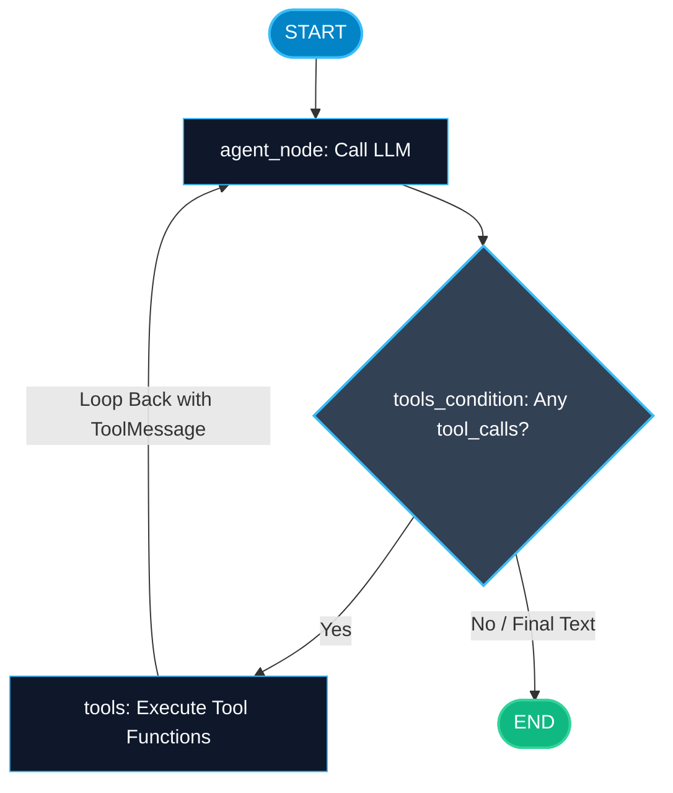

# The ReAct Agent Pattern in LangGraph

> "Thinking without acting makes an LLM helpless. Acting without thinking makes an LLM reckless. ReAct combines Reasoning and Acting into an intelligent feedback loop."

---


### Step 1: Why Do We Need This?

#### The Real Problem

When an LLM only receives a prompt and produces an immediate answer, it suffers from two major weaknesses:
1. **Knowledge Cutoffs & Hallucinations:** If you ask *"What is our company's revenue for Q3 2026?"*, the base model either guesses or says it does not know.
2. **One-Shot Failure:** If the LLM generates a tool call with a misspelled query or invalid date format, a single-pass chain crashes or returns empty data.

You need a pattern where the model can:
- **Reason:** Think about what information it is missing.
- **Act:** Call a tool (database query, calculator, API).
- **Observe:** Read the tool's output.
- **Loop:** Reason again using the new observations until it has enough facts to produce the final answer.

#### Why LangGraph Solves It

In legacy frameworks, the ReAct loop was hidden inside black-box executors (`AgentExecutor`) that were difficult to customize, debug, or interrupt.
LangGraph models ReAct as a clear, explicit 2-node graph with a conditional loop:
- **Agent Node:** Calls the model.
- **Tool Node:** Executes tools.
- **Conditional Edge:** Checks if the model output has `tool_calls`. If yes, routes to Tool Node; if no, routes to `END`.

---

### Step 2: What Is It?

#### Simple Explanation

Think of a **detective solving a case**:
1. **Thought (Reasoning):** *"I need to know what time the suspect left the office."*
2. **Action (Acting):** The detective asks security to pull badge swipe logs (calls a tool).
3. **Observation:** The badge log returns: *"Swiped out at 8:45 PM"*.
4. **Thought (Reasoning):** *"Now I know the time. Next, I need to check the traffic camera at that intersection."*
5. The detective repeats this cycle until the case is solved, then writes the final police report.

#### The Core ReAct Cycle in LangGraph

| Step | Node / Component | What Happens |
| :--- | :--- | :--- |
| **1. Agent Step** | `agent_node` | LLM receives message history. Decides whether to reply directly or call a tool. |
| **2. Router Step** | `tools_condition` | Inspects last message. If `tool_calls` present -> route to `tools`. Otherwise -> `END`. |
| **3. Tool Step** | `ToolNode` | Executes the requested tool functions, formats results as `ToolMessage`, appends to state. |
| **4. Loop Back** | Direct Edge | Routes from `tools` back to `agent_node` to let the model interpret results. |

---

### Step 3: Real-World Example

#### Technical Customer Support Troubleshooter

Imagine an automated DevOps assistant responding to an incident:
- **What it receives:** User prompt: *"Check why payment-service latency spiked at 14:00 UTC."*
- **What decision it makes:**
  1. **Turn 1 (Reason & Act):** Model decides to query Datadog metrics for `payment-service` at 14:00 UTC.
  2. **Turn 1 (Observation):** Tool returns: *"Database connection pool exhausted (100/100 active connections)."*
  3. **Turn 2 (Reason & Act):** Model decides to inspect Postgres slow query logs.
  4. **Turn 2 (Observation):** Tool returns: *"Unindexed query on orders table running for 45 seconds."*
  5. **Turn 3 (Final Answer):** Model reasons that the missing index on `orders` caused connection pool exhaustion, and writes remediation steps.
- **What it outputs:** A verified diagnosis with exact root cause and suggested SQL migration.

---

### Step 4: How Does It Work?

1. **Bind Tools to Model:** Attach your tools to the LLM using `model.bind_tools([tool_a, tool_b])`.
2. **Define State with `add_messages`:** Use `messages: Annotated[list[BaseMessage], add_messages]`.
3. **Build the Agent Node:** Invokes the bound model with current messages and returns the `AIMessage`.
4. **Build the Tool Node:** LangGraph's `ToolNode([tool_a, tool_b])` executes matching tools automatically.
5. **Add the Conditional Edge:** Use LangGraph's prebuilt `tools_condition` to route between `tools` and `END`.
6. **Close the Loop:** Add a direct edge from `tools` back to `agent`.

---

### Step 5: Code Example

Here is a complete, runnable LangGraph ReAct agent:

```python
from typing import TypedDict, Annotated, List
from langchain_core.messages import BaseMessage, HumanMessage, AIMessage, ToolMessage
from langgraph.graph import StateGraph, START, END, add_messages
from langgraph.prebuilt import ToolNode, tools_condition

# 1. Define a tool function
def query_weather(city: str) -> str:
    """Gets real-time weather information for a given city."""
    city_lower = city.lower()
    if "tokyo" in city_lower:
        return "Tokyo: Sunny, 18°C, light breeze."
    elif "london" in city_lower:
        return "London: Rainy, 11°C, high humidity."
    else:
        return f"{city}: Partly cloudy, 20°C."

# 2. State definition with add_messages reducer
class AgentState(TypedDict):
    messages: Annotated[List[BaseMessage], add_messages]

# 3. Mock Agent Node (Simulating LLM with tool calling capabilities)
class MockModel:
    def invoke(self, messages: List[BaseMessage]) -> AIMessage:
        last_msg = messages[-1]
        
        # If the last message was a tool response, produce the final answer
        if isinstance(last_msg, ToolMessage):
            return AIMessage(content=f"Based on our weather service: {last_msg.content}")
        
        # Otherwise, simulate issuing a tool call
        return AIMessage(
            content="",
            tool_calls=[{
                "name": "query_weather",
                "args": {"city": "Tokyo"},
                "id": "call_tokyo_weather_01"
            }]
        )

model = MockModel()

def call_agent_node(state: AgentState) -> dict:
    response = model.invoke(state["messages"])
    return {"messages": [response]}

# 4. Create prebuilt ToolNode
tools = [query_weather]
tool_node = ToolNode(tools)

# 5. Assemble Graph
builder = StateGraph(AgentState)

builder.add_node("agent", call_agent_node)
builder.add_node("tools", tool_node)

builder.add_edge(START, "agent")

# Conditional edge: does the message contain tool calls?
builder.add_conditional_edges(
    "agent",
    tools_condition,  # Built-in router: checks for tool_calls
    {"tools": "tools", END: END}
)

# Loop back: After tools finish, return to agent!
builder.add_edge("tools", "agent")

# Compile
react_graph = builder.compile()

if __name__ == "__main__":
    initial_state = {
        "messages": [HumanMessage(content="What is the weather like in Tokyo right now?")]
    }
    
    final_state = react_graph.invoke(initial_state)
    
    print("=== CONVERSATION AUDIT TRAIL ===")
    for msg in final_state["messages"]:
        sender = msg.__class__.__name__
        print(f"[{sender}]: {msg.content if msg.content else msg.tool_calls}")
```

---

### Step 6: How Is It Used in Production?

#### Production Patterns & Edge Cases

| Scenario | Production Challenge | Recommended Solution |
| :--- | :--- | :--- |
| **Endless Tool Loops** | The agent calls the same failing tool 20 times in a row. | Configure recursion limits (`{"recursion_limit": 10}`) and inject clear error messages back to the model. |
| **Hallucinated Tool Arguments** | Model supplies a string where a tool expects an integer. | Use Pydantic schemas in your tool definitions to reject bad parameters before execution. |
| **Token Window Exhaustion** | 10 tool iterations fill up context with giant JSON blobs. | Trim tool message content before sending back to the model, returning only essential fields. |
| **Parallel Tool Calls** | Model emits 3 tool calls in a single turn. | `ToolNode` automatically executes multiple tool calls concurrently for low latency. |

---

### Step 7: Quick Revision

- ReAct combines **Reasoning** (model planning) and **Acting** (tool execution) into a loop.
- LangGraph implements ReAct as two main nodes: `agent` and `tools`.
- `tools_condition` checks if the last message has `tool_calls`.
- If tools are present, it routes to `tools`; otherwise, it routes to `END`.
- The edge from `tools` points back to `agent`, completing the cyclic loop.
- Always set a recursion limit to prevent runaway API spending.

---

### Step 8: Final Flow Diagram



---

### Step 9: Quiz

Try answering these questions to check your understanding:

1. What does the ReAct pattern stand for?
   - A) React.js Web Framework
   - B) Reasoning and Acting
   - C) Recursive Activation
   - D) Relational Action Tracing

2. What does LangGraph's prebuilt `tools_condition` inspect to make its routing decision?
   - A) The user's IP address
   - B) Whether the last message in state contains `tool_calls`
   - C) The server's available RAM
   - D) The OpenAI billing balance

3. Where does the edge from the `tools` node lead in a standard ReAct graph?
   - A) Directly to `END`
   - B) Back to the `agent` node to allow the model to interpret the tool output
   - C) To an external database
   - D) Back to `START`

4. How does `ToolNode` handle a situation where the model emits 3 separate tool calls in a single response?
   - A) It drops the second and third calls
   - B) It executes all 3 calls and returns 3 corresponding ToolMessages
   - C) It crashes with an error
   - D) It asks the human to pick one

*Submit your answers (e.g. 1-B, 2-B, 3-B, 4-B) to verify your score!*
