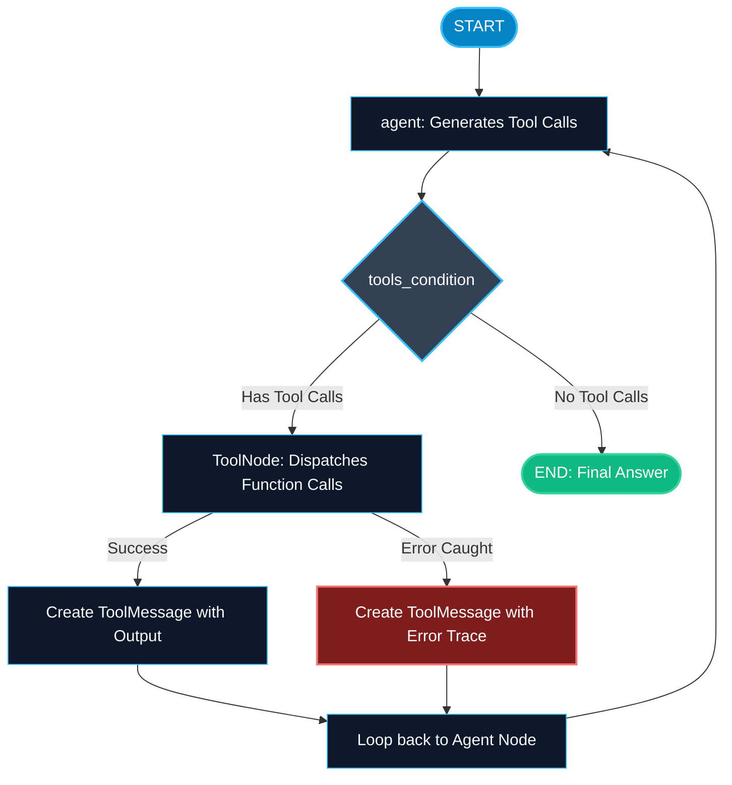

# ToolNode and Prebuilt Components in LangGraph

> "Writing boilerplate dispatchers to parse tool names and call Python functions is repetitive and error-prone. ToolNode handles validation, execution, and error capturing in one line."

---

### Step 1: Why Do We Need This?

#### The Real Problem

When a model requests a tool call like `{"name": "fetch_user", "args": {"id": 42}}`, you would normally have to write:
1. An `if/elif` block checking tool names.
2. Argument parsing and type casting.
3. Try/except error blocks so unexpected tool crashes do not kill your entire server.
4. Packaging the result into a properly formatted `ToolMessage` with the exact matching `tool_call_id`.

If you have 15 tools, writing and maintaining this dispatcher is tedious and prone to mismatched IDs or unhandled exceptions.

#### Why LangGraph Solves It

LangGraph provides `ToolNode`:
- Pass your list of functions or LangChain tools directly: `ToolNode([tool_1, tool_2])`.
- It matches model tool calls to the correct function by name automatically.
- It formats outputs into `ToolMessage` with the required `tool_call_id`.
- It captures exceptions cleanly and feeds error messages back to the model so the agent can self-correct.

---

### Step 2: What Is It?

#### Simple Explanation

Think of a **smart kitchen order carousel**:
- When the waiter (the LLM) writes order tickets: *1 Salad, 1 Steak*.
- The head chef does not manually rewrite every ticket. The order carousel (`ToolNode`) takes the tickets, routes the salad to the cold station and the steak to the grill simultaneously, collects the prepared dishes, and hands them back with matching order numbers.

#### Prebuilt Components Overview

| Component | What It Does In Simple English | Where To Import It |
| :--- | :--- | :--- |
| **`ToolNode`** | Automatically runs tools requested in the last `AIMessage`. | `from langgraph.prebuilt import ToolNode` |
| **`tools_condition`** | Router function that checks if `tool_calls` exist in state. | `from langgraph.prebuilt import tools_condition` |
| **`create_react_agent`** | High-level factory function that builds a complete ReAct graph in one line. | `from langgraph.prebuilt import create_react_agent` |

---

### Step 3: Real-World Example

#### SQL Query & Table Verification Agent

Imagine an internal enterprise data assistant:
- **What it receives:** An executive asks: *"What was our gross revenue last month?"*
- **What decision it makes:**
  1. The LLM produces a tool call: `run_sql_query(query="SELECT SUM(amount) FROM payments WHERE date >= '2026-09-01'")`.
  2. `ToolNode` intercepts the call, verifies the database connection, executes the query, and packages the result into a `ToolMessage`.
  3. If the table name was misspelled, `ToolNode` catches the database error and returns `ToolMessage(content="Table 'payments' does not exist. Did you mean 'transactions'?")`.
  4. The model reads the error and fixes its SQL query on the next loop.
- **What it outputs:** Accurate revenue numbers verified against your live database.

---

### Step 4: How Does It Work?

1. **Extract Tool Calls:** `ToolNode` looks at the last message in `state["messages"]`.
2. **Lookup Tool:** Matches `tool_call["name"]` against registered functions.
3. **Execute:** Calls the function with `tool_call["args"]`.
4. **Error Handling:** If the tool raises an exception and `handle_tool_errors=True`, `ToolNode` converts the Python traceback into a string `ToolMessage` instead of crashing.
5. **Output Delivery:** Returns `{"messages": [ToolMessage(...)]}`.

---

### Step 5: Code Example

Here is a complete, runnable example using `ToolNode` and demonstrating automatic error recovery:

```python
from typing import TypedDict, Annotated, List
from langchain_core.messages import BaseMessage, HumanMessage, AIMessage, ToolMessage
from langchain_core.tools import tool
from langgraph.graph import StateGraph, START, END, add_messages
from langgraph.prebuilt import ToolNode, tools_condition

# 1. Define tools using @tool decorator
@tool
def calculate_vat(amount: float, country_code: str) -> str:
    """Calculates VAT rate and total for a specific European country."""
    rates = {"DE": 0.19, "FR": 0.20, "UK": 0.20}
    code = country_code.upper()
    if code not in rates:
        raise ValueError(f"Country code '{country_code}' is not supported. Supported codes: DE, FR, UK.")
    
    vat = amount * rates[code]
    return f"VAT for {code} is €{vat:.2f}. Total with VAT: €{amount + vat:.2f}"

# 2. State definition
class AgentState(TypedDict):
    messages: Annotated[List[BaseMessage], add_messages]

# 3. Create ToolNode with built-in error handling
# When handle_tool_errors=True, tool exceptions are returned as ToolMessages
tool_node = ToolNode([calculate_vat], handle_tool_errors=True)

# 4. Mock agent node to show error handling loop
class MockTaxAssistant:
    def __init__(self):
        self.step = 0
        
    def __call__(self, state: AgentState) -> dict:
        self.step += 1
        messages = state["messages"]
        last_msg = messages[-1]
        
        # Turn 1: Model makes an intentional mistake (unsupported country)
        if self.step == 1:
            return {
                "messages": [AIMessage(
                    content="",
                    tool_calls=[{
                        "name": "calculate_vat",
                        "args": {"amount": 100.0, "country_code": "IT"},  # IT raises ValueError
                        "id": "call_calc_01"
                    }]
                )]
            }
            
        # Turn 2: Model reads the error from ToolNode and self-corrects to FR
        elif self.step == 2:
            return {
                "messages": [AIMessage(
                    content="",
                    tool_calls=[{
                        "name": "calculate_vat",
                        "args": {"amount": 100.0, "country_code": "FR"},  # Fixed!
                        "id": "call_calc_02"
                    }]
                )]
            }
            
        # Turn 3: Model has valid tool result and returns final answer
        else:
            return {
                "messages": [AIMessage(content="Final Answer: The VAT calculation for your invoice is complete.")]
            }

agent = MockTaxAssistant()

# 5. Build Graph
builder = StateGraph(AgentState)
builder.add_node("agent", agent)
builder.add_node("tools", tool_node)

builder.add_edge(START, "agent")
builder.add_conditional_edges("agent", tools_condition, {"tools": "tools", END: END})
builder.add_edge("tools", "agent")

tax_graph = builder.compile()

if __name__ == "__main__":
    result = tax_graph.invoke({
        "messages": [HumanMessage(content="Calculate VAT for 100 EUR in France.")]
    })
    
    print("=== WORKFLOW MESSAGES TRACE ===")
    for idx, msg in enumerate(result["messages"]):
        msg_type = msg.__class__.__name__
        content_preview = msg.content if msg.content else f"Tool Calls: {msg.tool_calls}"
        print(f"{idx+1}. [{msg_type}]: {content_preview}")
```

---

### Step 6: How Is It Used in Production?

#### Production Patterns & Edge Cases

| Scenario | Production Challenge | Recommended Solution |
| :--- | :--- | :--- |
| **Silent Tool Crashes** | A database or network error raises an unhandled Python exception, crashing the worker. | Set `handle_tool_errors=True` in `ToolNode` so errors return as message content. |
| **Async Tools** | Heavy tools make HTTP calls or database queries synchronously, freezing the thread. | Use async tools (`async def my_tool`) and invoke the graph with `await graph.ainvoke()`. |
| **Tool Execution Permissions** | Users prompt the model to call destructive tools like `drop_database()`. | Enforce permission checks inside the tool function or inject Human-in-the-Loop review. |

---

### Step 7: Quick Revision

- `ToolNode` automatically routes model tool calls to the matching Python functions.
- Every tool output is wrapped in a `ToolMessage` with the matching `tool_call_id`.
- Setting `handle_tool_errors=True` prevents server crashes and lets models self-correct.
- `tools_condition` checks if tool calls exist in the last message.
- Use `create_react_agent(model, tools)` for rapid prototyping.

---

### Step 8: Final Flow Diagram



---

### Step 9: Quiz

Try answering these questions to check your understanding:

1. What does `ToolNode` automatically match to execute the correct function?
   - A) The user's email address
   - B) The `name` field in the LLM's `tool_calls` payload
   - C) The timestamp of the message
   - D) The current Python version

2. What is the benefit of setting `handle_tool_errors=True` in `ToolNode`?
   - A) It prevents exceptions from crashing your process and allows the LLM to read the error and self-correct
   - B) It skips running the tools entirely
   - C) It makes the API calls 10x cheaper
   - D) It rewrites the tool in Rust

3. What type of message does `ToolNode` return into the graph state?
   - A) `HumanMessage`
   - B) `SystemMessage`
   - C) `ToolMessage` containing the result and the matching `tool_call_id`
   - D) A raw SQL string

4. If you want to create a standard ReAct agent in a single line of code, which helper function does LangGraph provide?
   - A) `build_fast_agent()`
   - B) `create_react_agent(model, tools)`
   - C) `make_agent()`
   - D) `auto_agent()`

*Submit your answers (e.g. 1-B, 2-A, 3-C, 4-B) to verify your score!*
