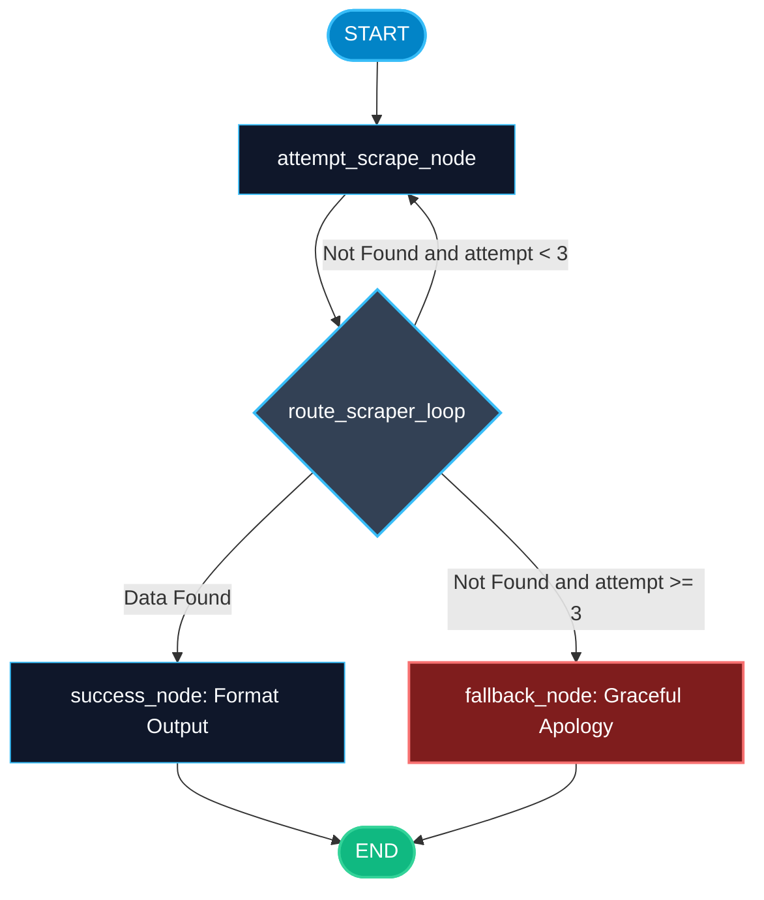

# Loop Control and Recursion Limits in LangGraph

> "An agent without a recursion limit is a credit card with no spending limit. A single stuck loop can burn through thousands of dollars in an hour."

---

### Step 1: Why Do We Need This?

#### The Real Problem

Because LangGraph allows cycles (nodes looping back to previous nodes), your system can get trapped in an **infinite loop**:
1. An LLM calls a web search tool with a query that returns 0 results.
2. The LLM gets confused and calls the exact same search again.
3. The tool returns 0 results again.
4. Without a stopping mechanism, this continues forever.

In production, runaway loops cause:
- **Massive API Bills:** Calling GPT-4 or Claude 500 times in 3 minutes costs serious money.
- **Worker Hangs:** The background task never completes, exhausting server threads.
- **User Frustration:** The user stares at a loading spinner indefinitely.

#### Why LangGraph Solves It

LangGraph provides built-in safety controls:
1. **Configurable Recursion Limit:** Halts graph execution if total node transitions exceed a threshold (default is 25).
2. **Explicit Loop Counters in State:** Tracks iteration counts inside nodes to implement graceful fallbacks.
3. **GraphRecursionError:** LangGraph raises a distinct exception that you can catch to return an apology or fallback message.

---

### Step 2: What Is It?

#### Simple Explanation

Think of an **arcade claw machine**:
- When you insert a coin, the machine gives you a timer of 60 seconds (the recursion limit).
- You can move the joystick back and forth as many times as you want (cyclic loop).
- But if the timer hits zero before you grab a prize, the game automatically stops and asks if you want to try again, rather than letting you play forever for free.

#### Loop Control Strategies Comparison

| Strategy | How It Works | Best For |
| :--- | :--- | :--- |
| **Global `recursion_limit`** | Hard stop enforced by LangGraph runtime. Raises `GraphRecursionError`. | Safety net against infinite loops across the entire graph. |
| **State Step Counter** | Custom `step_count` key in state, incremented each turn. | Graceful degradation: draft an answer with partial data before crashing. |
| **Edge Router Check** | Conditional edge checks `if state["retries"] > 3: return "fallback"`. | Controlled diversion to human review or simpler fallback models. |

---

### Step 3: Real-World Example

#### Autonomous Research Agent with Graceful Fallback

Imagine a market researcher agent collecting competitor data:
- **What it receives:** An obscure search query: *"Find 2026 pricing for StealthStartupX"*.
- **What decision it makes:**
  1. Turn 1: Searches Google -> No results.
  2. Turn 2: Searches LinkedIn -> No results.
  3. Turn 3: Searches GitHub -> No results.
  4. The loop counter in state reaches `attempt_count = 3`.
  5. The conditional edge detects that max retries were reached. Instead of calling Google again or crashing, it routes to `fallback_node`.
- **What it outputs:** A friendly response: *"I searched 3 sources but StealthStartupX has not published public pricing. Here is an overview of what is currently known."*

---

### Step 4: How Does It Work?

1. **Config Parameter:** When calling `graph.invoke(input, config={"recursion_limit": 10})`, LangGraph initializes an internal step counter.
2. **Step Increment:** Each time ANY node executes, the internal counter increases by 1.
3. **Threshold Check:** If counter > `recursion_limit`, LangGraph halts immediately and raises `langgraph.errors.GraphRecursionError`.
4. **State-Level Control:** Alternatively, maintain `attempt: int` in your state schema. Your router function checks `if state["attempt"] >= MAX: return "stop"`.

---

### Step 5: Code Example

Here is a complete, runnable LangGraph example showing both state-based loop control and catching `GraphRecursionError`:

```python
from typing import TypedDict, Optional
from langgraph.graph import StateGraph, START, END
from langgraph.errors import GraphRecursionError

# 1. State definition with loop counter
class ScraperState(TypedDict):
    url: str
    attempt_count: int
    data_found: bool
    final_message: Optional[str]

# 2. Node that simulates intermittent network failures
def attempt_scrape_node(state: ScraperState) -> dict:
    attempts = state.get("attempt_count", 0) + 1
    print(f"-> Executing attempt_scrape_node (Attempt #{attempts})")
    
    # Simulate data found only on attempt 5
    found = True if attempts >= 5 else False
    
    return {
        "attempt_count": attempts,
        "data_found": found
    }

# 3. Fallback node when retries are exhausted
def fallback_node(state: ScraperState) -> dict:
    return {
        "final_message": f"Unable to reach {state['url']} after {state['attempt_count']} retries. Saved to retry queue."
    }

# 4. Success node
def success_node(state: ScraperState) -> dict:
    return {
        "final_message": f"Successfully scraped {state['url']} on attempt {state['attempt_count']}!"
    }

# 5. Router with built-in loop limit
def route_scraper_loop(state: ScraperState) -> str:
    if state["data_found"]:
        return "success"
    elif state["attempt_count"] < 3:  # Hard limit of 3 loops
        return "retry"
    else:
        return "fallback"

# Build Graph
builder = StateGraph(ScraperState)
builder.add_node("scraper", attempt_scrape_node)
builder.add_node("success", success_node)
builder.add_node("fallback", fallback_node)

builder.add_edge(START, "scraper")

builder.add_conditional_edges(
    "scraper",
    route_scraper_loop,
    {
        "retry": "scraper",      # Loop back!
        "success": "success",
        "fallback": "fallback"
    }
)

builder.add_edge("success", END)
builder.add_edge("fallback", END)

scraper_graph = builder.compile()

if __name__ == "__main__":
    # Test 1: Graceful loop exit via state counter
    print("=== TEST 1: STATE-CONTROLLED RETRY LIMIT ===")
    result = scraper_graph.invoke({
        "url": "https://api.internal.service/data",
        "attempt_count": 0,
        "data_found": False,
        "final_message": None
    })
    print("Result:", result["final_message"])

    # Test 2: Runtime recursion_limit configuration
    print("\n=== TEST 2: GLOBAL RECURSION LIMIT ===")
    try:
        # Enforce an aggressive recursion limit of only 2 steps
        scraper_graph.invoke(
            {"url": "https://api.internal.service/data", "attempt_count": 0, "data_found": False, "final_message": None},
            config={"recursion_limit": 2}
        )
    except GraphRecursionError:
        print("Caught GraphRecursionError! LangGraph successfully halted the runaway loop.")
```

---

### Step 6: How Is It Used in Production?

#### Production Patterns & Edge Cases

| Scenario | Production Challenge | Recommended Solution |
| :--- | :--- | :--- |
| **Runaway Billing Spikes** | A rogue agent gets stuck in a 100-step loop during the night. | Always set an explicit `recursion_limit` (e.g. 15-25) in production invocations. |
| **Crashing on User Webhook** | `GraphRecursionError` bubbles up as an unhandled 500 server error to the user. | Wrap `graph.invoke()` or `graph.ainvoke()` in a try/except block catching `GraphRecursionError`. |
| **Degraded Partial Answers** | The model runs out of steps while researching. Crashing loses all previous research. | Design your router to divert to a `draft_partial_summary` node when attempts reach limit. |

---

### Step 7: Quick Revision

- Cycles in LangGraph can cause infinite loops if exit conditions are never met.
- Use `config={"recursion_limit": N}` to set a hard ceiling on total graph steps (default is 25).
- Exceeding the limit raises `langgraph.errors.GraphRecursionError`.
- For the best user experience, track `attempts` in state and route to a fallback node before the hard limit is hit.
- Always catch `GraphRecursionError` at your FastAPI / backend entry points.

---

### Step 8: Final Flow Diagram



---

### Step 9: Quiz

Try answering these questions to check your understanding:

1. What is the default `recursion_limit` in LangGraph if you do not specify one?
   - A) 1,000,000
   - B) 25
   - C) Unlimited
   - D) 3

2. What exception does LangGraph raise when the number of graph steps exceeds the limit?
   - A) `ValueError`
   - B) `OutOfMemoryError`
   - C) `GraphRecursionError`
   - D) `RecursionError` from the Python C-runtime

3. How do you configure a custom recursion limit when invoking a graph?
   - A) `graph.invoke(input, config={"recursion_limit": 10})`
   - B) `graph.set_max_loops(10)`
   - C) `import recursion_limit = 10`
   - D) Passing `--max-loops 10` in terminal

4. Why is routing to a `fallback_node` inside your router function better than letting `GraphRecursionError` raise?
   - A) It costs more money
   - B) It allows the agent to return a polite apology or partial draft to the user instead of an unexpected 500 error
   - C) Fallback nodes make the database run faster
   - D) Python does not allow catching exceptions

*Submit your answers (e.g. 1-B, 2-C, 3-A, 4-B) to verify your score!*
