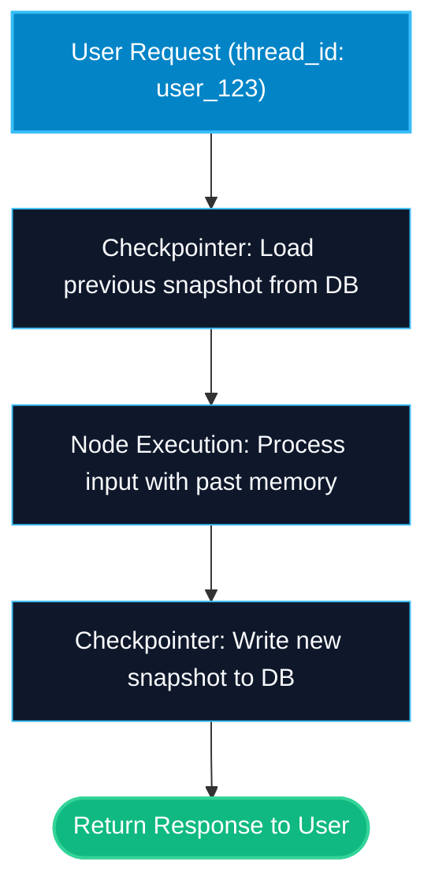

# State Checkpointers — Memory and SQLite in LangGraph

> "Without a checkpointer, an agent has amnesia the second a function returns. Checkpointers save a snapshot of state after every single step."

---


### Step 1: Why Do We Need This?

#### The Real Problem

By default, when you run `graph.invoke()`:
- State lives only in RAM during that single function call.
- As soon as the invocation finishes, all variables vanish.
- If the user sends a follow-up question 10 seconds later, the graph starts from scratch with zero memory of what was said before.
- If your server crashes or restarts halfway through a 10-step agent loop, all work is lost and the task fails.

You cannot build multi-turn chatbots, human approval workflows, or resilient enterprise agents without **state persistence**.

#### Why LangGraph Solves It

LangGraph has built-in **Checkpointers**:
- A checkpointer saves a snapshot of the entire graph state after *every single node execution*.
- It organizes snapshots by **Thread ID** (like conversation channels or user session IDs).
- When a user sends a new message on the same `thread_id`, LangGraph automatically reloads the exact previous state and continues from where it left off.

---

### Step 2: What Is It?

#### Simple Explanation

Think of a **video game save system**:
- As your character moves through a dungeon, the game creates an automatic checkpoint every time you enter a new room.
- If you shut down your console and turn it back on tomorrow, you load your save slot (the **Thread ID**) and start in the exact room with all your items and health intact.
- **MemorySaver** is a temporary save slot in RAM (wiped when game closes).
- **SqliteSaver** is a permanent save file written to your hard drive.

#### Checkpointer Implementations Comparison

| Checkpointer | Storage Target | Persistence Level | Best Used For |
| :--- | :--- | :--- | :--- |
| **`MemorySaver`** | In-memory Python dictionary | Ephemeral (Lost on process restart) | Unit tests, local quick prototyping, CI/CD pipelines |
| **`SqliteSaver`** | Local SQLite `.db` file | Durable on local disk | Local CLI tools, desktop apps, single-instance dev servers |
| **`AsyncPostgresSaver`** | Enterprise PostgreSQL DB | Distributed, scalable production storage | Production microservices, Kubernetes, multi-replica servers |

---

### Step 3: Real-World Example

#### Multi-Turn Customer Booking Assistant

Imagine a flight booking assistant:
- **Turn 1 (Monday 9 AM):**
  - User: *"Find flights from New York to London on Friday."*
  - Agent lists 3 options and saves state to `thread_id="user_session_441"`.
- **Turn 2 (Tuesday 2 PM - 29 hours later):**
  - The server restarted overnight for security updates.
  - User: *"Book the second one."*
  - LangGraph fetches `thread_id="user_session_441"` from SQLite.
  - The agent knows exactly what "the second one" refers to, re-hydrating the flight numbers, price, and passenger info instantly.
- **What it outputs:** Seamless multi-day conversational continuity.

---

### Step 4: How Does It Work?

1. **Instantiate Checkpointer:** Create an instance like `checkpointer = MemorySaver()`.
2. **Compile with Checkpointer:** Pass it during compilation: `graph = builder.compile(checkpointer=checkpointer)`.
3. **Invoke with Config:** Always supply a `configurable={"thread_id": "unique_id"}` in the config dictionary:
   ```python
   config = {"configurable": {"thread_id": "session_123"}}
   graph.invoke({"messages": [...]}, config=config)
   ```
4. **Automatic Snapshotting:** After Node A executes, LangGraph saves the updated state along with metadata (step number, timestamp) under that thread.
5. **State Inspection:** You can inspect past snapshots at any time using `graph.get_state(config)`.

---

### Step 5: Code Example

Here is a complete, runnable example comparing `MemorySaver` and persistent `SqliteSaver`:

```python
import sqlite3
from typing import TypedDict, Annotated, List
from langgraph.graph import StateGraph, START, END, add_messages
from langgraph.checkpoint.memory import MemorySaver
from langgraph.checkpoint.sqlite import SqliteSaver
from langchain_core.messages import BaseMessage, HumanMessage, AIMessage

# 1. State definition
class ChatState(TypedDict):
    messages: Annotated[List[BaseMessage], add_messages]

# 2. Simple conversational node
def echo_bot_node(state: ChatState) -> dict:
    last_user_msg = state["messages"][-1].content
    history_len = len(state["messages"])
    response = f"Echo: '{last_user_msg}' (Total messages in thread memory: {history_len})"
    return {"messages": [AIMessage(content=response)]}

# Build graph
builder = StateGraph(ChatState)
builder.add_node("bot", echo_bot_node)
builder.add_edge(START, "bot")
builder.add_edge("bot", END)

# --- Approach 1: Ephemeral MemorySaver ---
memory_checkpointer = MemorySaver()
memory_graph = builder.compile(checkpointer=memory_checkpointer)

# --- Approach 2: Durable SqliteSaver ---
# Connect to a local SQLite database (use ':memory:' for quick tests or 'chat.db' for disk)
conn = sqlite3.connect(":memory:", check_same_thread=False)
sqlite_checkpointer = SqliteSaver(conn)
sqlite_graph = builder.compile(checkpointer=sqlite_checkpointer)

if __name__ == "__main__":
    print("=== TESTING THREAD PERSISTENCE ===")
    
    # Thread Config for User A
    config_a = {"configurable": {"thread_id": "thread_user_alice"}}
    
    # Turn 1 for Alice
    out1 = sqlite_graph.invoke(
        {"messages": [HumanMessage(content="Hello! My name is Alice.")]},
        config=config_a
    )
    print("Alice Turn 1:", out1["messages"][-1].content)
    
    # Turn 2 for Alice (Sending follow-up without repeating name)
    out2 = sqlite_graph.invoke(
        {"messages": [HumanMessage(content="What did I just say my name was?")]},
        config=config_a
    )
    print("Alice Turn 2:", out2["messages"][-1].content)
    
    # Thread Config for User B (Separate conversation!)
    config_b = {"configurable": {"thread_id": "thread_user_bob"}}
    out_b = sqlite_graph.invoke(
        {"messages": [HumanMessage(content="Hi, Bob here.")]},
        config=config_b
    )
    print("Bob Turn 1 (Isolated State):", out_b["messages"][-1].content)
    
    # Inspecting state snapshots directly
    saved_state = sqlite_graph.get_state(config_a)
    print(f"\nAlice Thread Snapshot Step: {saved_state.metadata.get('step', 'N/A')}")
    print(f"Total Messages Saved in Alice's Database Thread: {len(saved_state.values['messages'])}")
```

---

### Step 6: How Is It Used in Production?

#### Production Patterns & Edge Cases

| Scenario | Production Challenge | Recommended Solution |
| :--- | :--- | :--- |
| **Missing `thread_id`** | Forgetting to pass `configurable={"thread_id": ...}` raises a `ValueError` at runtime. | Enforce thread ID generation in your API middleware (e.g. from session cookie or JWT). |
| **Memory Leaks with `MemorySaver`** | In a production server, `MemorySaver` keeps growing in RAM indefinitely until OOM crash. | Never use `MemorySaver` for public multi-user production. Always use PostgreSQL or Redis checkpointers. |
| **SQLite Concurrency Locks** | Multiple concurrent async workers lock SQLite database with `database is locked`. | SQLite does not support high concurrency. Migrate to `AsyncPostgresSaver` for web backends. |
| **State Versioning Migrations** | Changing your state schema breaks existing checkpoint records in database. | Store schema version numbers in state and write migration helpers for old snapshots. |

---

### Step 7: Quick Revision

- Checkpointers save snapshots of state after each node execution.
- Workflows are isolated and identified by unique `thread_id` keys in config.
- `MemorySaver` is ideal for unit tests and local experiments.
- `SqliteSaver` persists state across restarts for single-process apps.
- Use `graph.get_state(config)` to inspect the current state snapshot at any time.

---

### Step 8: Final Flow Diagram



---

### Step 9: Quiz

Try answering these questions to check your understanding:

1. What happens if you run a compiled graph WITHOUT a checkpointer?
   - A) It runs faster and saves state to your desktop automatically
   - B) State exists only in RAM for that single invocation and is lost as soon as the function returns
   - C) LangGraph throws an import error
   - D) The LLM refuses to answer

2. How does LangGraph know which conversation history belongs to which user?
   - A) By inspecting the user's MAC address
   - B) By matching the `thread_id` provided in `config={"configurable": {"thread_id": "..."}}`
   - C) By analyzing user voice frequency
   - D) By checking the git commit hash

3. Why should you avoid using `MemorySaver` in a multi-replica production web service?
   - A) It costs $50 per month
   - B) It only stores data in local RAM, so state is lost on restarts and cannot be shared across multiple server containers
   - C) It only works in Python 2.7
   - D) It deletes user passwords

4. Which method allows you to inspect the latest saved state snapshot of a thread without executing a new step?
   - A) `graph.inspect()`
   - B) `graph.get_state(config)`
   - C) `graph.read_memory()`
   - D) `graph.print_state()`

*Submit your answers (e.g. 1-B, 2-B, 3-B, 4-B) to verify your score!*
