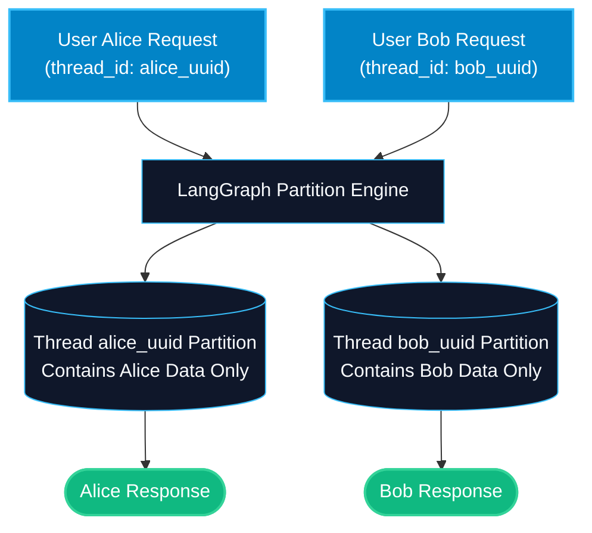

# Thread IDs and Session Isolation in LangGraph

> "Without thread isolation, one user's private credit card prompt could leak into another user's chat session. Thread IDs build strict walls between conversations."

---

### Step 1: Why Do We Need This?

#### The Real Problem

When hundreds of users chat with your AI assistant at the same time:
- User A is asking for medical advice.
- User B is asking for a recipe.
- If both share a global state, User A's symptoms and private health details leak directly into User B's conversation.
- If a user opens two different tabs (e.g. comparing two products), one tab's actions corrupt the other tab's cart if both share one session.

In multi-tenant production systems, **cross-session data contamination is a critical security vulnerability and privacy violation**.

#### Why LangGraph Solves It

LangGraph enforces session isolation using **Thread IDs**:
- Every checkpoint record is partitioned by `thread_id`.
- Graph invocations for `thread_101` cannot read, mutate, or access state stored under `thread_102`.
- You can fork threads, create sub-threads for background research, and maintain thousands of concurrent user conversations safely.

---

### Step 2: What Is It?

#### Simple Explanation

Think of a **hotel keycard system**:
- A hotel has 500 rooms.
- Guest Alice has keycard #201. Guest Bob has keycard #304.
- Guest Alice can only open room #201. Her luggage, conversations, and phone calls are completely isolated from Bob's room.
- In LangGraph, the **Hotel** is your compiled graph; the **Room Number** is the **Thread ID**; the **Luggage** is the state snapshot stored in the database.

#### Thread Lifecycle Overview

| Operation | LangGraph Command | What It Does |
| :--- | :--- | :--- |
| **New Thread** | `config={"configurable": {"thread_id": "new_uuid"}}` | Starts a fresh, clean conversation history. |
| **Continue Thread** | `config={"configurable": {"thread_id": "existing_uuid"}}` | Resumes conversation, re-hydrating all past messages. |
| **Inspect Thread** | `graph.get_state(config)` | Reads the latest snapshot of the thread without running nodes. |
| **Thread History** | `graph.get_state_history(config)` | Returns a chronological list of all past snapshots in that thread. |

---

### Step 3: Real-World Example

#### Multi-Tenant Healthcare Consultation Agent

Imagine an AI medical triage platform:
- **What it receives:** Inquiries from thousands of patients simultaneously.
- **What decision it makes:**
  1. Patient 1 (`thread_id="patient_alice_cardiology"`) discusses heart rate data.
  2. Patient 2 (`thread_id="patient_bob_pediatrics"`) asks about infant vaccination schedules.
  3. The checkpointer partitions their state records into separate database rows.
  4. Even if both patients hit the same load-balanced server at the exact same millisecond, their medical histories remain 100% isolated.
- **What it outputs:** Strict HIPAA/GDPR compliance with zero cross-tenant data leakage.

---

### Step 4: How Does It Work?

1. **Config Key Structure:** LangGraph looks for `config["configurable"]["thread_id"]`.
2. **Database Primary Key:** In SQLite or PostgreSQL checkpointers, database tables use a composite key: `(thread_id, checkpoint_ns, checkpoint_id)`.
3. **Namespace Isolation:** You can also pass `checkpoint_ns` (checkpoint namespace) to isolate sub-graphs inside the same thread.
4. **Historical Chain:** Each snapshot links to its `parent_checkpoint_id`, forming an immutable history log per thread.

---

### Step 5: Code Example

Here is a complete, runnable LangGraph example demonstrating strict thread isolation between concurrent user sessions:

```python
from typing import TypedDict, Annotated, List
from langchain_core.messages import BaseMessage, HumanMessage, AIMessage
from langgraph.graph import StateGraph, START, END, add_messages
from langgraph.checkpoint.memory import MemorySaver

# 1. State definition
class SupportState(TypedDict):
    customer_name: str
    messages: Annotated[List[BaseMessage], add_messages]

# 2. Conversational support node
def support_agent_node(state: SupportState) -> dict:
    name = state.get("customer_name", "Valued Customer")
    last_query = state["messages"][-1].content
    
    reply = f"Hello {name}, I received your message: '{last_query}'"
    return {"messages": [AIMessage(content=reply)]}

# 3. Assemble and compile graph with checkpointer
builder = StateGraph(SupportState)
builder.add_node("agent", support_agent_node)
builder.add_edge(START, "agent")
builder.add_edge("agent", END)

checkpointer = MemorySaver()
graph = builder.compile(checkpointer=checkpointer)

if __name__ == "__main__":
    # Session 1: Alice's Thread
    alice_config = {"configurable": {"thread_id": "session_alice_991"}}
    
    # Session 2: Bob's Thread
    bob_config = {"configurable": {"thread_id": "session_bob_992"}}
    
    print("--- 1. Alice Starts Conversation ---")
    res_a1 = graph.invoke({
        "customer_name": "Alice",
        "messages": [HumanMessage(content="I want to cancel my flight to Paris.")]
    }, config=alice_config)
    print("Alice Session:", res_a1["messages"][-1].content)
    
    print("\n--- 2. Bob Starts Conversation ---")
    res_b1 = graph.invoke({
        "customer_name": "Bob",
        "messages": [HumanMessage(content="How much is extra luggage for my trip to Tokyo?")]
    }, config=bob_config)
    print("Bob Session:", res_b1["messages"][-1].content)
    
    print("\n--- 3. Alice Sends Follow-Up ---")
    # Alice sends a message without re-supplying customer_name
    res_a2 = graph.invoke({
        "messages": [HumanMessage(content="Actually, can I change the date instead?")]
    }, config=alice_config)
    print("Alice Session:", res_a2["messages"][-1].content)
    
    print("\n--- 4. Verify Message Isolation ---")
    alice_saved = graph.get_state(alice_config)
    bob_saved = graph.get_state(bob_config)
    
    print(f"Total messages in Alice's thread: {len(alice_saved.values['messages'])} (Expected: 4)")
    print(f"Total messages in Bob's thread: {len(bob_saved.values['messages'])} (Expected: 2)")
    print("Did Alice's state leak to Bob?", any("Paris" in m.content for m in bob_saved.values['messages']))
```

---

### Step 6: How Is It Used in Production?

#### Production Patterns & Edge Cases

| Scenario | Production Challenge | Recommended Solution |
| :--- | :--- | :--- |
| **Guessable Thread IDs** | Using simple incrementing integers (`thread_id="1"`) lets attackers read other users' data. | Always use cryptographically secure UUIDv4 strings or signed JWT claims for thread IDs. |
| **Multiple Browser Tabs** | A user opening two tabs with the same `thread_id` overwrites each other's actions. | Append a tab or window UUID to the session ID: `f"user_{uid}_tab_{tab_id}"`. |
| **Old Thread Retention** | Storing millions of inactive threads permanently inflates database costs. | Implement automated TTL data retention policies in your Postgres checkpointer tables. |

---

### Step 7: Quick Revision

- `thread_id` partitions conversation state so different users never see each other's data.
- Pass `config={"configurable": {"thread_id": "unique_string"}}` on every invocation.
- Calling `invoke()` with the same `thread_id` resumes execution with full past memory.
- Always use unguessable UUIDs in public APIs to prevent unauthorized state access.
- `graph.get_state_history(config)` lets you audit every step in a thread.

---

### Step 8: Final Flow Diagram



---

### Step 9: Quiz

Try answering these questions to check your understanding:

1. What is the primary purpose of a `thread_id` in LangGraph?
   - A) To increase the CPU clock speed of the machine
   - B) To isolate conversation state so multiple users or sessions do not mix up data
   - C) To count the number of lines of code
   - D) To format Markdown tables

2. Where do you pass the `thread_id` when calling `graph.invoke()`?
   - A) In the system prompt text
   - B) In `config={"configurable": {"thread_id": "your_id"}}`
   - C) As a command line argument
   - D) In the `.env` file only

3. What happens if two different users invoke the graph using the exact same `thread_id`?
   - A) The second user sees and mutates the first user's conversation history
   - B) LangGraph reboots the operating system
   - C) The database locks permanently
   - D) The second user's request is automatically blocked

4. Why should you use UUIDv4 rather than sequential integers (1, 2, 3...) for thread IDs in production web apps?
   - A) Sequential numbers make Python slower
   - B) Sequential numbers can be easily guessed by attackers to view private chats of other users
   - C) UUIDs take less memory than integers
   - D) LangGraph will reject any thread ID shorter than 30 characters

*Submit your answers (e.g. 1-B, 2-B, 3-A, 4-B) to verify your score!*
