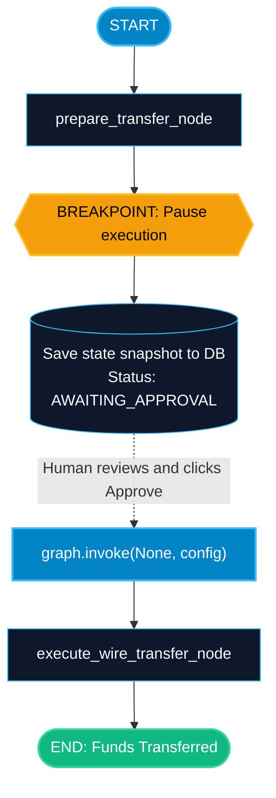

# Static and Dynamic Breakpoints in LangGraph

> "Giving an AI agent direct access to execute wire transfers or send emails without human review is dangerous. Breakpoints pause graph execution so a human can approve or reject the action."

---

### Step 1: Why Do We Need This?

#### The Real Problem

LLMs are probabilistic. They make mistakes, misunderstand subtle requests, and can be tricked by prompt injection:
- If an agent generates a SQL command to `DROP TABLE customers`, running it automatically destroys your database.
- If an agent drafts an email offering a 90% discount to an enterprise lead, sending it automatically causes serious financial loss.
- If an agent initiates a $5,000 credit card transaction, banking regulations require human verification.

You cannot let agents execute high-risk actions fully autonomously. You need a way to **pause the graph**, wait for human review, and only resume if approved.

#### Why LangGraph Solves It

LangGraph has native **Human-in-the-Loop (HITL)** support via **Breakpoints**:
1. **Static Breakpoints:** Pause automatically *before* or *after* a specific node executes (`interrupt_before=["send_email"]`).
2. **Dynamic Breakpoints:** Pause conditionally from *inside* a node function using `interrupt()` when specific risk conditions are met (e.g. transfer amount > $1,000).
3. The graph saves its snapshot into the database and exits cleanly. Days later, when the human clicks "Approve", the graph resumes right from the pause point.

---

### Step 2: What Is It?

#### Simple Explanation

Think of a **smart bank wire transfer**:
- If you transfer $10 to a friend, the app processes it immediately (autonomous execution).
- If you transfer $50,000, the app pauses the transaction and displays a screen: *"Manager approval required"*.
- The transaction enters a `WAITING_FOR_REVIEW` state.
- When the branch manager logs in and clicks *"Approve"*, the transaction resumes and the money moves.

#### Static vs Dynamic Breakpoints

| Feature | Static Breakpoint | Dynamic Breakpoint |
| :--- | :--- | :--- |
| **How It Is Configured** | When compiling: `interrupt_before=["node"]` | Inside node code: `interrupt("Reason")` |
| **When It Pauses** | Always pauses every time this node is reached. | Only pauses when specific conditions or thresholds trigger. |
| **Best Used For** | Critical nodes that always need sign-off (e.g. `delete_account`, `publish_post`). | Variable-risk nodes (e.g. transfers over $1,000, low confidence scores). |

---

### Step 3: Real-World Example

#### Financial Payment Processor with Fraud Guard

Imagine an automated corporate expense assistant:
- **What it receives:** An employee prompt: *"Pay invoice #5512 for $4,500 to CloudHost Corp"*.
- **What decision it makes:**
  1. `validate_invoice_node` extracts amount ($4,500) and vendor.
  2. Because $4,500 exceeds the $1,000 automatic limit, a dynamic breakpoint triggers: `interrupt({"amount": 4500, "vendor": "CloudHost Corp"})`.
  3. The graph saves state and returns to the FastAPI backend.
  4. The employee sees: *"Invoice flagged for manager approval. Manager notified via Slack."*
  5. 2 hours later, the finance manager clicks *"Approve"* in Slack.
  6. The backend calls `graph.invoke(None, config=config)`, and the payment node executes.
- **What it outputs:** Compliant, fraud-proof payment processing.

---

### Step 4: How Does It Work?

1. **Attach a Checkpointer:** Breakpoints require a checkpointer (`MemorySaver`, `SqliteSaver`, or `PostgresSaver`) to save the paused state.
2. **Define the Breakpoint:**
   - Static: `graph = builder.compile(checkpointer=checkpointer, interrupt_before=["execute_action"])`.
   - Dynamic: Call `from langgraph.types import interrupt; interrupt("Please approve")` inside the node.
3. **First Invocation:** `graph.invoke(input, config=config)` runs until the breakpoint, saves the snapshot, and exits.
4. **Inspect Paused State:** `graph.get_state(config).next` shows which node is waiting to run next.
5. **Resume Execution:** Call `graph.invoke(None, config=config)` (passing `None` as input) to resume from the checkpoint!

---

### Step 5: Code Example

Here is a complete, runnable example demonstrating both static breakpoints and resuming execution:

```python
from typing import TypedDict, Optional
from langgraph.graph import StateGraph, START, END
from langgraph.checkpoint.memory import MemorySaver

# 1. State definition
class WireTransferState(TypedDict):
    sender: str
    recipient: str
    amount: float
    status: str
    confirmation_code: Optional[str]

# 2. Node 1: Prepares the transaction
def prepare_transfer_node(state: WireTransferState) -> dict:
    print("-> 1. Validating account balance and preparing transfer...")
    return {
        "status": "AWAITING_HUMAN_APPROVAL"
    }

# 3. Node 2: High-risk action (must be approved before execution)
def execute_wire_transfer_node(state: WireTransferState) -> dict:
    print(f"-> 2. EXECUTING TRANSFER: ${state['amount']} from {state['sender']} to {state['recipient']}")
    return {
        "status": "FUNDS_TRANSFERRED",
        "confirmation_code": "TXN-998822"
    }

# 4. Assemble Graph
builder = StateGraph(WireTransferState)
builder.add_node("prepare", prepare_transfer_node)
builder.add_node("execute_transfer", execute_wire_transfer_node)

builder.add_edge(START, "prepare")
builder.add_edge("prepare", "execute_transfer")
builder.add_edge("execute_transfer", END)

# 5. Compile with Checkpointer and Static Breakpoint!
checkpointer = MemorySaver()
# This guarantees execution will ALWAYS pause BEFORE 'execute_transfer' runs
graph = builder.compile(
    checkpointer=checkpointer,
    interrupt_before=["execute_wire_transfer"]
)

if __name__ == "__main__":
    thread_config = {"configurable": {"thread_id": "transfer_thread_001"}}
    
    print("=== STEP 1: INITIATING HIGH-VALUE WIRE TRANSFER ===")
    initial_payload: WireTransferState = {
        "sender": "Alice Corp",
        "recipient": "Bob Logistics",
        "amount": 25000.0,
        "status": "INIT",
        "confirmation_code": None
    }
    
    # Run the graph until the breakpoint
    graph.invoke(initial_payload, config=thread_config)
    
    # Inspect the paused state
    current_snapshot = graph.get_state(thread_config)
    print("\n[PAUSED] Graph execution halted.")
    print("Current State Status:", current_snapshot.values["status"])
    print("Nodes waiting to run next:", current_snapshot.next)
    
    # Simulate a human reviewing the details in an admin dashboard
    print("\n=== STEP 2: HUMAN REVIEW IN DASHBOARD ===")
    print(f"Manager reviews transfer of ${current_snapshot.values['amount']} to {current_snapshot.values['recipient']}.")
    print("Manager clicks 'APPROVE' button.")
    
    # Resume execution by passing None as input with the same thread config
    print("\n=== STEP 3: RESUMING GRAPH EXECUTION ===")
    resumed_result = graph.invoke(None, config=thread_config)
    
    print("Final Status:", resumed_result["status"])
    print("Confirmation Code:", resumed_result["confirmation_code"])
```

---

### Step 6: How Is It Used in Production?

#### Production Patterns & Edge Cases

| Scenario | Production Challenge | Recommended Solution |
| :--- | :--- | :--- |
| **Long Approval Delays** | Humans take 48 hours to approve an email. In-memory state gets wiped. | Always use `PostgresSaver` in production so pending approvals survive weeks of downtime. |
| **Concurrent Resumptions** | Two managers click "Approve" at the exact same second. | Use database optimistic locking or LangGraph's checkpoint version check to reject duplicate resumes. |
| **Rejection Handling** | The human clicks "Reject" instead of "Approve". | Update the state with `graph.update_state()` to set `status="REJECTED"`, routing away from the dangerous node. |

---

### Step 7: Quick Revision

- Breakpoints pause graph execution safely before or after critical nodes.
- Static breakpoints are set with `interrupt_before` or `interrupt_after` during compile.
- Dynamic breakpoints trigger conditionally from inside nodes using `interrupt()`.
- A checkpointer is mandatory to save state while waiting for human input.
- Resume a paused graph by calling `graph.invoke(None, config=config)`.

---

### Step 8: Final Flow Diagram



---

### Step 9: Quiz

Try answering these questions to check your understanding:

1. What happens when a graph reaches a node specified in `interrupt_before`?
   - A) The computer shuts down
   - B) LangGraph executes the node, then crashes
   - C) LangGraph saves the state snapshot and pauses execution BEFORE that node runs
   - D) It skips the node entirely

2. How do you resume a graph that was paused at a breakpoint?
   - A) By creating a brand new graph
   - B) By calling `graph.invoke(None, config=thread_config)`
   - C) By restarting the Python kernel
   - D) By deleting the checkpoint database

3. Why is a persistent checkpointer (like PostgreSQL) mandatory when using breakpoints in production?
   - A) Because humans may take hours or days to review an item, and in-memory state will be lost on container restarts
   - B) To run unit tests faster
   - C) PostgreSQL is required by Python syntax
   - D) To translate responses into French

4. Which feature allows you to pause conditionally only when an expense amount is greater than $1,000?
   - A) Static breakpoint
   - B) Dynamic breakpoint using `interrupt()`
   - C) `time.sleep()`
   - D) Docker stop

*Submit your answers (e.g. 1-C, 2-B, 3-A, 4-B) to verify your score!*
