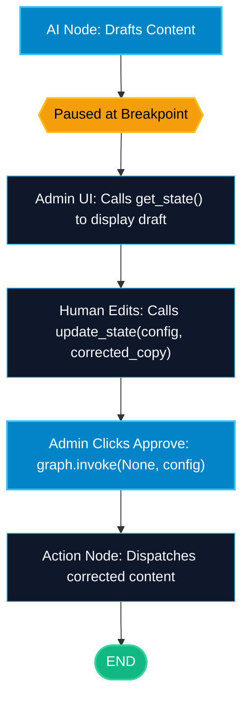

# State Inspection and Approval Flows in LangGraph

> "Pausing a workflow is only half the battle. A true human-in-the-loop system lets a reviewer inspect what the AI drafted, fix mistakes directly, and approve the corrected state."

---

### Step 1: Why Do We Need This?

#### The Real Problem

In many enterprise workflows, a human cannot just press a binary "Yes" or "No" button:
- An AI writes a 4-paragraph legal contract. The contract is 95% perfect, but paragraph 3 has a wrong expiration date.
- If the reviewer only has "Reject", the whole task is thrown away, wasting LLM tokens and time.
- If the reviewer has to "Approve" as-is, a legally incorrect document gets sent to the client.

You need an approval flow where the human reviewer can:
1. **Inspect:** Read the exact state snapshot currently waiting at the breakpoint.
2. **Edit:** Fix paragraph 3 directly using `graph.update_state()`.
3. **Approve:** Resume execution using the human's edited text.

#### Why LangGraph Solves It

LangGraph provides `graph.update_state()`:
- Allows external applications (web dashboards, Slack bots, admin panels) to inject state updates into a paused thread.
- Automatically creates a new state snapshot documenting the human edit in the audit history.
- Seamlessly transitions execution using the corrected data.

---

### Step 2: What Is It?

#### Simple Explanation

Think of a **newspaper editorial room**:
- A junior reporter (the AI) drafts an article on breaking tech news.
- The article lands on the senior editor's desk (**State Inspection**).
- The editor notices a typo in the headline and corrects it with a red pen (**`update_state`**).
- The editor stamps the article with *"Approved for Print"* and sends it to the printing press (**Resume Execution**).

#### Core Inspection & Edit Commands

| Command | What It Does In Simple English |
| :--- | :--- |
| **`graph.get_state(config)`** | Reads current state values, next node, and checkpoint ID. |
| **`graph.update_state(config, {"key": "corrected_val"})`** | Modifies state values as if a node or human edited them. |
| **`graph.update_state(config, values, as_node="editor")`** | Updates state while explicitly logging the authoring node name. |
| **`graph.invoke(None, config)`** | Resumes the workflow with the updated state values. |

---

### Step 3: Real-World Example

#### AI Customer Support Refund Approval

Imagine an e-commerce support agent:
- **What it receives:** Customer ticket: *"My package was damaged. I want a refund."*
- **What decision it makes:**
  1. The AI drafts a refund of $150 and an email: *"We processed a $150 refund to your card."*
  2. The workflow pauses before the `send_email_and_refund` node.
  3. The support manager inspects the state: checks the photo, and sees the item was only worth $50.
  4. The manager calls `graph.update_state(config, {"refund_amount": 50.0, "email_body": "We processed a $50 refund..."})`.
  5. The manager resumes the graph. The system charges $50 and dispatches the corrected email.
- **What it outputs:** Accurate financial execution combined with human judgment.

---

### Step 4: How Does It Work?

1. **Pause at Breakpoint:** Graph stops before a critical action node.
2. **Web API Calls `get_state()`:** Your backend endpoint queries `graph.get_state(config)` and returns state JSON to your frontend UI.
3. **Human Edits in UI:** The user edits fields in a web form and clicks "Save & Approve".
4. **Backend Calls `update_state()`:** Passes the edited payload into `graph.update_state(config, payload)`.
5. **Resume:** Backend calls `graph.invoke(None, config)`. LangGraph executes the downstream node using the newly injected values.

---

### Step 5: Code Example

Here is a complete, runnable example demonstrating state inspection, editing, and resumption:

```python
from typing import TypedDict, Optional
from langgraph.graph import StateGraph, START, END
from langgraph.checkpoint.memory import MemorySaver

# 1. State definition
class MarketingEmailState(TypedDict):
    campaign_name: str
    target_audience: str
    email_subject: str
    email_body: str
    is_sent: bool

# 2. Node 1: AI generates initial draft
def draft_email_node(state: MarketingEmailState) -> dict:
    print("-> 1. AI is drafting marketing campaign email...")
    return {
        "email_subject": "50% OFF EVERYTHING TODAY ONLY!",  # Too aggressive
        "email_body": "Hey, buy our stuff right now before midnight or miss out forever."
    }

# 3. Node 2: Critical action node
def dispatch_email_node(state: MarketingEmailState) -> dict:
    print("\n-> 2. DISPATCHING EMAIL TO CUSTOMERS:")
    print(f"   Subject: {state['email_subject']}")
    print(f"   Body:    {state['email_body']}")
    return {"is_sent": True}

# 4. Assemble Graph with Breakpoint
builder = StateGraph(MarketingEmailState)
builder.add_node("drafter", draft_email_node)
builder.add_node("dispatcher", dispatch_email_node)

builder.add_edge(START, "drafter")
builder.add_edge("drafter", "dispatcher")
builder.add_edge("dispatcher", END)

checkpointer = MemorySaver()
graph = builder.compile(
    checkpointer=checkpointer,
    interrupt_before=["dispatcher"]  # Halt before sending!
)

if __name__ == "__main__":
    thread_config = {"configurable": {"thread_id": "campaign_2026_q1"}}
    
    print("=== STEP 1: AI GENERATES CAMPAIGN ===")
    graph.invoke({
        "campaign_name": "Spring Launch",
        "target_audience": "Enterprise Leads",
        "email_subject": "",
        "email_body": "",
        "is_sent": False
    }, config=thread_config)
    
    # 2. Human Marketing Director inspects the drafted email
    print("\n=== STEP 2: HUMAN INSPECTS DRAFT ===")
    snapshot = graph.get_state(thread_config)
    print("AI Drafted Subject:", snapshot.values["email_subject"])
    print("AI Drafted Body:   ", snapshot.values["email_body"])
    print("Next Node Pending: ", snapshot.next)
    
    # 3. Marketing Director decides the tone is too spammy and rewrites it
    print("\n=== STEP 3: HUMAN EDITS STATE VIA update_state() ===")
    graph.update_state(
        thread_config,
        {
            "email_subject": "Exclusive Enterprise Spring Access: New Features Inside",
            "email_body": "Dear Partner, we are pleased to invite your team to explore our latest platform updates."
        }
    )
    print("✓ State updated with human-approved professional copy.")
    
    # 4. Resume execution with human-edited state
    print("\n=== STEP 4: RESUMING GRAPH TO DISPATCH ===")
    final_output = graph.invoke(None, config=thread_config)
    print("\nFinal State 'is_sent':", final_output["is_sent"])
```

---

### Step 6: How Is It Used in Production?

#### Production Patterns & Edge Cases

| Scenario | Production Challenge | Recommended Solution |
| :--- | :--- | :--- |
| **Audit Compliance Logging** | Knowing whether an action was AI-generated or human-edited. | Pass `as_node="human_reviewer"` to `update_state()` to log who made the change in the history. |
| **Stale Checkpoint Conflicts** | A manager edits state based on an outdated view while another edit was saved. | Check `snapshot.checkpoint_id` before calling `update_state()` to avoid race condition overwrites. |
| **Bypassing Validations** | A human editor accidentally enters an invalid email format into state. | Re-run Pydantic schema validation on incoming human edits before applying them to the graph. |

---

### Step 7: Quick Revision

- `graph.get_state(config)` lets you inspect what the AI drafted before it executes.
- `graph.update_state(config, updates)` modifies state values directly in the paused thread.
- Passing `as_node="reviewer"` records who authored the edit in the audit history.
- Resume execution with `graph.invoke(None, config)`.
- Downstream nodes execute using the human's corrected data seamlessly.

---

### Step 8: Final Flow Diagram



---

### Step 9: Quiz

Try answering these questions to check your understanding:

1. What function is used to modify the state of a paused thread before resuming it?
   - A) `graph.delete_state()`
   - B) `graph.update_state(config, values)`
   - C) `graph.restart()`
   - D) `graph.change()`

2. What does `graph.get_state(config).next` tell you?
   - A) The weather tomorrow
   - B) The tuple of node names that are scheduled to run next when the graph resumes
   - C) The user's password
   - D) The next available port number

3. Why is `graph.update_state()` better than simply rejecting a draft and restarting from scratch?
   - A) It allows human reviewers to fix small errors in seconds without discarding all previous work or re-paying LLM API costs
   - B) It deletes the database
   - C) It converts Python to TypeScript
   - D) It avoids using memory

4. What happens if you pass `as_node="human_manager"` into `graph.update_state()`?
   - A) It creates a Slack account
   - B) It logs the update in the checkpoint history as if it was authored by `human_manager`, providing a clear audit trail
   - C) It crashes the program
   - D) It emails the manager

*Submit your answers (e.g. 1-B, 2-B, 3-A, 4-B) to verify your score!*
