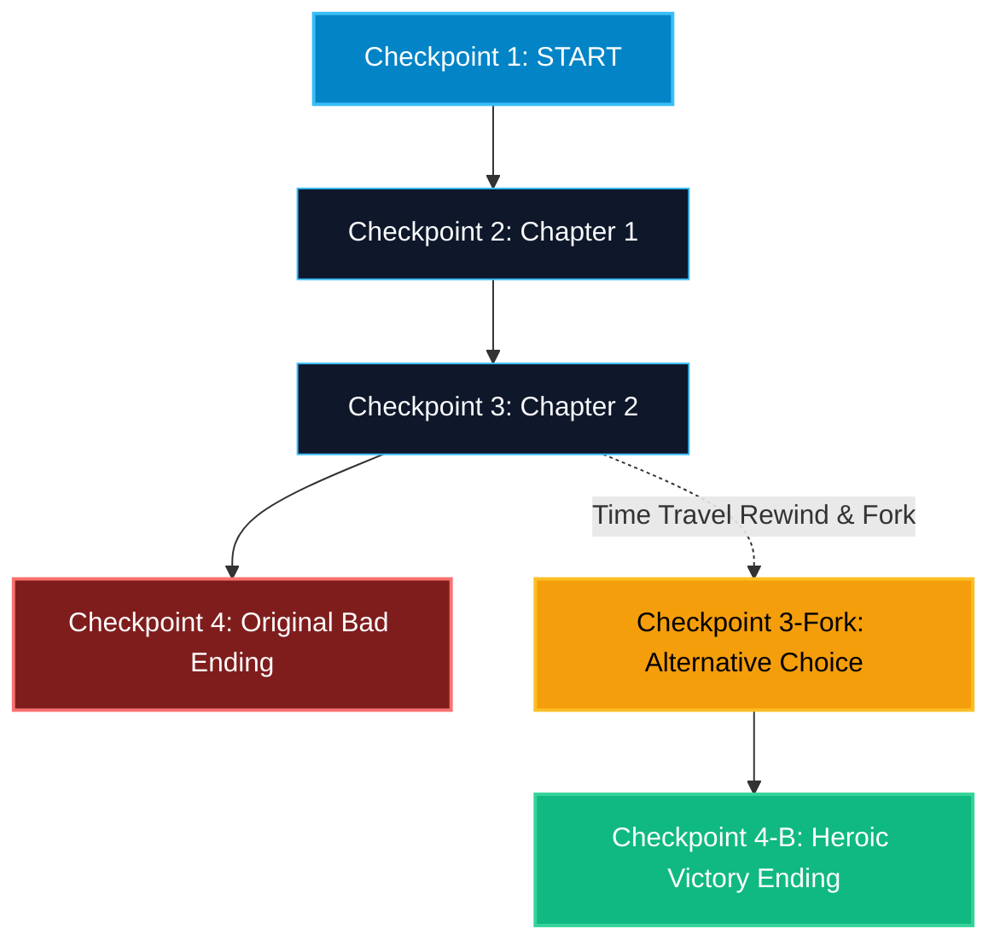

# Time Travel and State Rewind in LangGraph

> "In normal programs, the past is gone. In LangGraph, every step is a permanent historical checkpoint. You can travel back in time, fork history, and try different decisions."

---

### Step 1: Why Do We Need This?

#### The Real Problem

When developing or debugging an AI agent:
- Step 1 to Step 4 work brilliantly (retrieving documents, summarizing data, formatting output).
- On Step 5, the model makes an unfortunate hallucination and produces nonsense.
- In traditional code, your only option is to re-run the entire script from Step 1.
- Re-running from scratch is slow, wastes API tokens, and might not reproduce the bug because LLMs are non-deterministic.

You need a way to **rewind time** to Step 4, tweak the prompt or state, and resume execution from that exact historical checkpoint without re-running Steps 1 to 3.

#### Why LangGraph Solves It

Because checkpointers save immutable snapshots after every step:
1. Every state snapshot has a unique `checkpoint_id`.
2. You can query the thread's full timeline with `graph.get_state_history(config)`.
3. You can fork execution from any past checkpoint by passing `checkpoint_id` into config.
4. This creates a new timeline branch, exactly like Git branches!

---

### Step 2: What Is It?

#### Simple Explanation

Think of a **Git version control tree**:
- Commit 1 (START) -> Commit 2 (Retrieve) -> Commit 3 (Draft) -> Commit 4 (Bad Final Step).
- Instead of deleting your project, you run `git checkout Commit 3`.
- You create a new branch (`Commit 3 -> Commit 3-Fixed -> Commit 4-Success`).
- The original history is preserved, and the new branch proceeds with the corrected path.

#### Time Travel Primitives Comparison

| Method | What It Does |
| :--- | :--- |
| **`graph.get_state_history(config)`** | Returns an iterator of all past state snapshots in reverse chronological order. |
| **`snapshot.config`** | Contains the exact `checkpoint_id` required to target that historical moment. |
| **Forking History** | Calling `graph.update_state(past_config, updates)` forks execution from that past checkpoint. |
| **Resuming from Past** | Calling `graph.invoke(None, past_config)` continues execution along the new branch. |

---

### Step 3: Real-World Example

#### AI Customer Support Conversation Branching

Imagine an interactive tech support bot:
- **Turn 1:** User asks how to reset their router. Agent explains Step A.
- **Turn 2:** User asks how to change their Wi-Fi password. Agent explains Step B.
- **Turn 3:** User realizes they made a mistake: *"Wait, go back to when you were explaining the router reset. I entered the wrong IP."*
- **Time Travel in Action:**
  1. The bot rewinds state to the Turn 1 checkpoint.
  2. The agent forks the conversation from Turn 1 with the user's new router IP.
  3. The irrelevant Wi-Fi password discussion is cleanly branched away.
- **What it outputs:** Fluid conversational backtracking without confusing the agent.

---

### Step 4: How Does It Work?

1. **Iterate History:** Call `history = list(graph.get_state_history(config))`.
2. **Select Target Checkpoint:** Pick the historical snapshot you want to rewind to (e.g. `target_snapshot = history[2]`).
3. **Inspect Values:** Look at `target_snapshot.values` to verify what data existed at that second.
4. **Fork and Update:** Call `graph.update_state(target_snapshot.config, {"key": "new_direction"})`.
5. **Resume Branch:** Call `graph.invoke(None, target_snapshot.config)` to execute forward on the new branch.

---

### Step 5: Code Example

Here is a complete, runnable example demonstrating time travel and state rewinding in LangGraph:

```python
from typing import TypedDict, Annotated, List
from langchain_core.messages import BaseMessage, HumanMessage, AIMessage
from langgraph.graph import StateGraph, START, END, add_messages
from langgraph.checkpoint.memory import MemorySaver

# 1. State definition
class NarrativeState(TypedDict):
    step_number: int
    story: Annotated[List[str], add_messages]

# 2. Node that builds a multi-step story
def story_node_one(state: NarrativeState) -> dict:
    return {
        "step_number": 1,
        "story": [AIMessage(content="Chapter 1: The knight entered the dark enchanted forest.")]
    }

def story_node_two(state: NarrativeState) -> dict:
    return {
        "step_number": 2,
        "story": [AIMessage(content="Chapter 2: The knight found a glowing golden sword in a stone.")]
    }

def story_node_three_bad(state: NarrativeState) -> dict:
    return {
        "step_number": 3,
        "story": [AIMessage(content="Chapter 3: The knight slipped on a banana peel and lost the sword.")]
    }

# Build graph
builder = StateGraph(NarrativeState)
builder.add_node("chapter_1", story_node_one)
builder.add_node("chapter_2", story_node_two)
builder.add_node("chapter_3", story_node_three_bad)

builder.add_edge(START, "chapter_1")
builder.add_edge("chapter_1", "chapter_2")
builder.add_edge("chapter_2", "chapter_3")
builder.add_edge("chapter_3", END)

checkpointer = MemorySaver()
graph = builder.compile(checkpointer=checkpointer)

if __name__ == "__main__":
    thread_config = {"configurable": {"thread_id": "story_adventure_001"}}
    
    print("=== 1. INITIAL EXECUTION (RESULTING IN UNWANTED PLOT) ===")
    initial_result = graph.invoke({
        "step_number": 0,
        "story": [HumanMessage(content="Start the medieval adventure story.")]
    }, config=thread_config)
    
    for msg in initial_result["story"]:
        print(f"- {msg.content}")

    print("\n=== 2. RETRIEVING HISTORICAL CHECKPOINTS ===")
    # get_state_history returns snapshots from newest to oldest
    history = list(graph.get_state_history(thread_config))
    print(f"Total historical snapshots recorded: {len(history)}")
    
    # Let's find the snapshot right after Chapter 2 (before the banana peel!)
    target_snapshot = None
    for snapshot in history:
        messages = snapshot.values.get("story", [])
        if len(messages) == 3:  # Human prompt + Chap 1 + Chap 2
            target_snapshot = snapshot
            break
            
    print(f"Target Snapshot Found! Step: {target_snapshot.values['step_number']}")
    print(f"Last message in target snapshot: '{target_snapshot.values['story'][-1].content}'")
    
    print("\n=== 3. FORKING HISTORY FROM CHAPTER 2 ===")
    # Fork state from that checkpoint with an alternative Chapter 3!
    forked_config = graph.update_state(
        target_snapshot.config,
        {
            "step_number": 3,
            "story": [AIMessage(content="Chapter 3 (Alternate Branch): The knight used the golden sword to defeat the dragon!")]
        }
    )
    
    print("✓ Successfully forked historical timeline.")
    
    # 4. View the forked timeline
    forked_state = graph.get_state(forked_config)
    print("\n=== 4. FORKED STORY TIMELINE ===")
    for msg in forked_state.values["story"]:
        print(f"- {msg.content}")
```

---

### Step 6: How Is It Used in Production?

#### Production Patterns & Edge Cases

| Scenario | Production Challenge | Recommended Solution |
| :--- | :--- | :--- |
| **Interactive Developer Sandboxes** | Developers testing new prompts need to replay specific agent turns. | Build an admin UI that displays the `get_state_history()` timeline with a "Replay from here" button. |
| **Irreversible Side Effects** | Rewinding a step that already charged a credit card or sent an SMS. | Never put real-world external side effects before approval breakpoints. Keep rewound nodes idempotent. |
| **Branch Clutter** | Hundreds of user rewinds create large branching trees in the database. | Use checkpoint tags or thread namespace cleanup to archive unselected branches. |

---

### Step 7: Quick Revision

- Every step in a checkpointer is saved with an immutable `checkpoint_id`.
- `graph.get_state_history(config)` lets you traverse the chronological timeline.
- You can fork execution from any past checkpoint using `graph.update_state(past_config, ...)`.
- Time travel enables deterministic debugging, prompt experimentation, and user undo actions.
- Ensure nodes that execute external side effects (billing, email) are shielded behind review breakpoints.

---

### Step 8: Final Flow Diagram



---

### Step 9: Quiz

Try answering these questions to check your understanding:

1. What function returns all past state snapshots recorded for a thread?
   - A) `graph.get_all_data()`
   - B) `graph.get_state_history(config)`
   - C) `graph.dump_history()`
   - D) `graph.undo()`

2. What unique identifier is required in `config` to target a specific moment in the past?
   - A) `checkpoint_id`
   - B) `user_ip`
   - C) `python_version`
   - D) `git_commit`

3. What happens when you call `graph.update_state()` on an older historical checkpoint?
   - A) All future checkpoints in the old branch are permanently deleted
   - B) A new branch is created from that point in time, preserving the old history while letting you explore a new path
   - C) The database crashes
   - D) LangGraph resets to factory settings

4. Why must you be careful when rewinding time over nodes that execute external side-effects (like credit card charges)?
   - A) Because rewinding LangGraph state does not automatically undo real-world external HTTP actions that already executed
   - B) Because Python will not compile
   - C) Because SQLite will delete the tables
   - D) Because the user will be logged out

*Submit your answers (e.g. 1-B, 2-A, 3-B, 4-A) to verify your score!*
