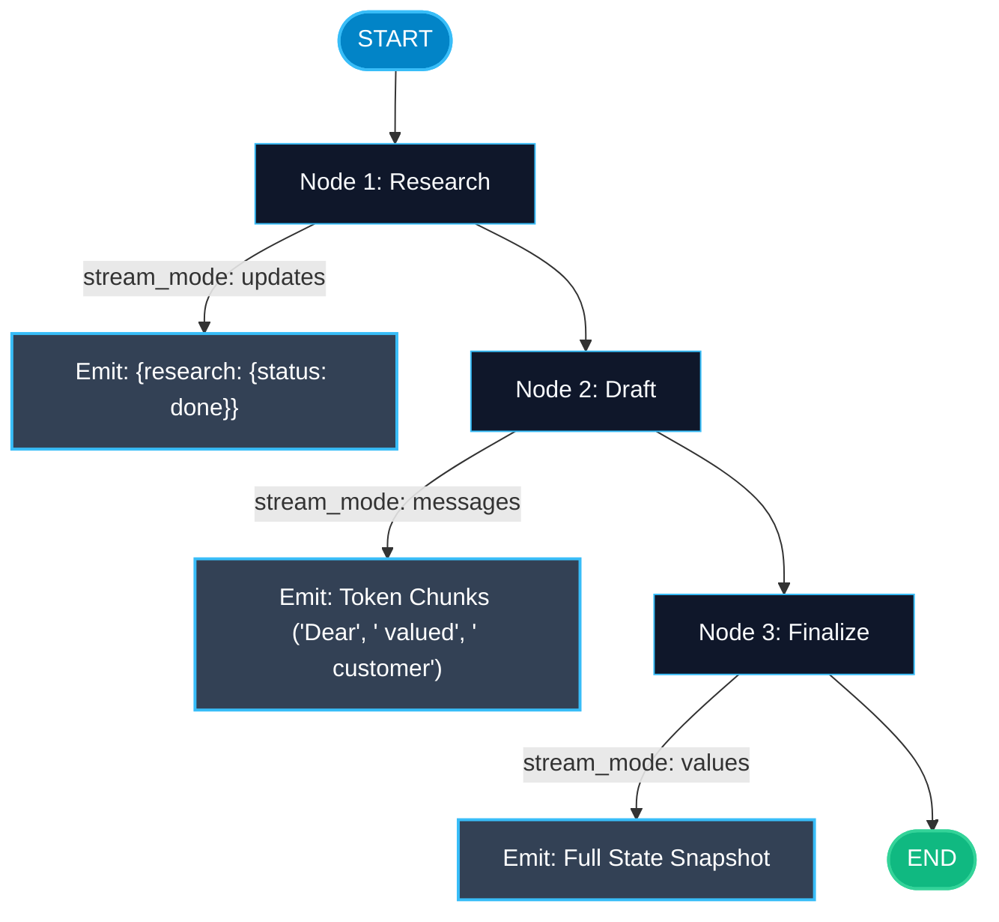

# Streaming Modes in LangGraph — Values, Updates, and Messages

> "Waiting 15 seconds for an agent to finish before showing anything feels broken to users. Streaming turns an opaque wait into a live, interactive experience."

---

### Step 1: Why Do We Need This?

#### The Real Problem

In complex agent workflows, execution takes time:
- Step 1: Triage question (1 sec).
- Step 2: Search web database (3 sec).
- Step 3: Run Python analysis script (2 sec).
- Step 4: Generate final 500-word report (7 sec).

If you use `graph.invoke()`, the client receives nothing for 13 seconds. The user assumes the app has crashed and refreshes the page.
To build engaging modern AI products, you need:
1. Real-time updates showing which node is running right now.
2. Token-by-token streaming of the LLM's response as words are generated.
3. Selective streaming that hides internal scratchpad data while exposing customer-facing thoughts.

#### Why LangGraph Solves It

LangGraph provides flexible, native streaming via `graph.stream()` and `graph.astream()` with 3 distinct modes:
- **`values`:** Emits the full state snapshot after every node completes.
- **`updates`:** Emits only the specific delta (changes) returned by the node that just finished.
- **`messages`:** Emits individual tokens and chat message chunks in real time as the LLM generates them.

---

### Step 2: What Is It?

#### Simple Explanation

Think of a **package delivery tracking app**:
- **`values` Mode (Full Status Report):** Every time the driver checks in, the app sends you the full package summary: *Location: Warehouse 4, Weight: 2kg, ETA: 3 PM*.
- **`updates` Mode (Delta Notifications):** The app sends you only the latest event: *Driver just scanned barcode at exit gate*.
- **`messages` Mode (Live CCTV Audio):** You listen to the driver talking over the radio word by word in real time.

#### Streaming Modes Comparison

| Mode | Parameter | What It Emits | Best For |
| :--- | :--- | :--- | :--- |
| **Values** | `stream_mode="values"` | The complete state dictionary after each step. | Real-time state synchronization, debugging, updating UI state stores. |
| **Updates** | `stream_mode="updates"` | A dictionary `{node_name: {updated_keys}}`. | Progress bars, step indicators ("Searching...", "Generating..."). |
| **Messages** | `stream_mode="messages"` | Raw `(AIMessageChunk, metadata)` tuples. | Typing / typewriter text streaming effect in chat boxes. |

---

### Step 3: Real-World Example

#### AI Research Assistant with Live Progress Cards

Imagine an AI report generator in a web browser:
- **What the user sees:**
  1. Second 1: A status pill appears: *"Planning research strategy..."* (`stream_mode="updates"`).
  2. Second 3: The status pill changes to: *"Reading 5 web sources..."*.
  3. Second 5: A card opens and the text starts streaming word-by-word like ChatGPT (`stream_mode="messages"`).
- **What it outputs:** Instant visual feedback that keeps the user engaged throughout the entire 15-second process.

---

### Step 4: How Does It Work?

1. **Call `graph.stream()`:** Pass the input payload and your chosen `stream_mode`.
   ```python
   for chunk in graph.stream(input_payload, stream_mode="updates"):
       print(chunk)
   ```
2. **Combine Modes:** You can pass multiple modes simultaneously: `stream_mode=["updates", "messages"]`.
3. **Async Streaming:** In web backends, use `async for chunk in graph.astream()` to avoid blocking the server event loop.

---

### Step 5: Code Example

Here is a complete, runnable example demonstrating `values` and `updates` streaming modes in LangGraph:

```python
from typing import TypedDict, Annotated, List
import operator
from langgraph.graph import StateGraph, START, END

# 1. State definition
class PipelineState(TypedDict):
    step_history: Annotated[List[str], operator.add]
    current_action: str
    output: str

# 2. Node definitions
def step_research(state: PipelineState) -> dict:
    return {
        "step_history": ["Completed Research"],
        "current_action": "Synthesizing Facts"
    }

def step_draft(state: PipelineState) -> dict:
    return {
        "step_history": ["Drafted Article"],
        "current_action": "Reviewing Guidelines"
    }

def step_finalize(state: PipelineState) -> dict:
    return {
        "step_history": ["Finalized"],
        "current_action": "Done",
        "output": "Executive summary is ready."
    }

# 3. Build Graph
builder = StateGraph(PipelineState)
builder.add_node("research", step_research)
builder.add_node("draft", step_draft)
builder.add_node("finalize", step_finalize)

builder.add_edge(START, "research")
builder.add_edge("research", "draft")
builder.add_edge("draft", "finalize")
builder.add_edge("finalize", END)

graph = builder.compile()

if __name__ == "__main__":
    initial_input: PipelineState = {
        "step_history": [],
        "current_action": "Starting",
        "output": ""
    }

    print("=== 1. STREAMING WITH stream_mode='updates' ===")
    # Updates mode emits only the delta returned by each node!
    for chunk in graph.stream(initial_input, stream_mode="updates"):
        node_name = list(chunk.keys())[0]
        updates = chunk[node_name]
        print(f"[NODE COMPLETED]: '{node_name}' -> Delta: {updates}")

    print("\n=== 2. STREAMING WITH stream_mode='values' ===")
    # Values mode emits the full state dictionary at every step!
    for step_num, full_state in enumerate(graph.stream(initial_input, stream_mode="values")):
        print(f"Step {step_num}: Action='{full_state.get('current_action')}' | History={full_state.get('step_history')}")
```

---

### Step 6: How Is It Used in Production?

#### Production Patterns & Edge Cases

| Scenario | Production Challenge | Recommended Solution |
| :--- | :--- | :--- |
| **Client Disconnects Mid-Stream** | A user closes their browser tab while the graph is streaming. | Use `asyncio.CancelledError` handlers to safely terminate background LLM requests. |
| **Internal Thoughts Leaking** | Emitting `stream_mode="messages"` reveals internal reasoning prompts to end-users. | Filter message chunks in your streaming generator, emitting only chunks where `node == "customer_facing_node"`. |
| **Large Payload Network Lag** | Emitting full `values` state over WebSockets every 100ms saturates user bandwidth. | Use `stream_mode="updates"` over network connections to transmit lightweight deltas only. |

---

### Step 7: Quick Revision

- `graph.stream()` emits real-time progress instead of waiting for full completion.
- `stream_mode="values"` emits the complete state snapshot after each node.
- `stream_mode="updates"` emits only the delta (new keys) produced by the finished node.
- `stream_mode="messages"` streams LLM tokens word-by-word.
- You can combine modes using a list: `stream_mode=["updates", "messages"]`.

---

### Step 8: Final Flow Diagram



---

### Step 9: Quiz

Try answering these questions to check your understanding:

1. Which streaming mode emits only the specific key updates produced by the node that just finished?
   - A) `stream_mode="values"`
   - B) `stream_mode="updates"`
   - C) `stream_mode="everything"`
   - D) `stream_mode="raw"`

2. Which streaming mode emits token chunks for a typewriter typing effect in a chat interface?
   - A) `stream_mode="messages"`
   - B) `stream_mode="tokens"`
   - C) `stream_mode="keys"`
   - D) `stream_mode="slow"`

3. Why is `stream_mode="updates"` usually preferred over `stream_mode="values"` when streaming to mobile devices?
   - A) Because values mode only works in Python 3.12
   - B) Because updates mode sends only small deltas, conserving mobile data and network bandwidth
   - C) Because mobile browsers cannot render dictionaries
   - D) Because updates mode is free

4. How do you stream updates asynchronously in a FastAPI backend?
   - A) `async for chunk in graph.astream(payload, stream_mode="updates"):`
   - B) `graph.stream_async()`
   - C) `time.sleep(1)`
   - D) `graph.fast_stream()`

*Submit your answers (e.g. 1-B, 2-A, 3-B, 4-A) to verify your score!*
