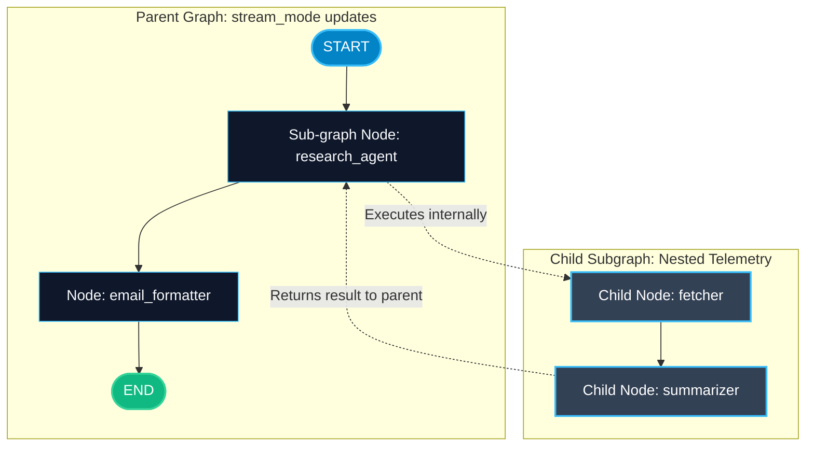

# Sub-Graph Streaming in LangGraph

> "When complex parent graphs invoke specialized child graphs, standard streaming only reports the parent. Sub-graph streaming lets you peek inside nested internal steps."

---

### Step 1: Why Do We Need This?

#### The Real Problem

In enterprise AI applications, you do not build one giant 50-node graph. You build modular **subgraphs**:
- A Parent Graph manages high-level routing: `Triage -> Research Subgraph -> Quality Review -> Output`.
- The `Research Subgraph` is itself a 5-step agent with its own web searches, scrapers, and evaluators.

If you stream only the parent graph:
- The UI sits on *"Research Subgraph"* for 20 seconds.
- You cannot see what the child nodes (`search_bing`, `parse_pdf`, `score_relevance`) are doing inside.
- If a sub-node gets stuck, you have no real-time visibility into which internal step failed.

#### Why LangGraph Solves It

LangGraph supports **Sub-Graph Streaming**:
- By passing `subgraphs=True` to `graph.stream()`, LangGraph streams events from both the top-level parent graph AND all nested child subgraphs.
- Each emitted chunk includes a namespace tuple showing the exact execution path (e.g. `("parent", "research_subgraph:node_3")`).
- Your UI can render nested progress trees with complete transparency.

---

### Step 2: What Is It?

#### Simple Explanation

Think of a **corporate project management hierarchy**:
- **Parent Only Streaming:** The CEO only tells the board: *"The marketing department is working on the campaign."* (Zero detail for 3 weeks).
- **Sub-Graph Streaming (`subgraphs=True`):** The CEO provides a live breakdown: *"Within Marketing, Sarah finished the graphics, Dave is drafting ad copy, and Lisa is negotiating TV slots."*

#### Namespace Structure

```text
Chunk 1: namespace = ()                           -> Top-level parent node
Chunk 2: namespace = ("research_team",)           -> Nested inside child subgraph
Chunk 3: namespace = ("research_team", "scraper") -> Deeply nested worker node
```

---

### Step 3: Real-World Example

#### Multi-Department Enterprise Audit Agent

Imagine a compliance verification agent:
- **What it receives:** An annual report to audit for tax compliance.
- **What decision it makes:**
  1. The parent graph calls the `tax_audit_subgraph`.
  2. With `subgraphs=True`, the frontend telemetry dashboard shows:
     - `Parent: Dispatched to Tax Department`
     - `Sub-Graph [tax_audit]: Node 'check_deductions' finished`
     - `Sub-Graph [tax_audit]: Node 'verify_receipts' running...`
     - `Parent: Review completed, preparing sign-off`
- **What it outputs:** A live multi-level dashboard showing both high-level milestones and fine-grained internal node progress.

---

### Step 4: How Does It Work?

1. **Define Child Graph:** Build and compile a standard `StateGraph` for the sub-task.
2. **Add Child to Parent:** In the parent graph, add the compiled child graph directly as a node:
   `parent_builder.add_node("research_team", child_graph)`.
3. **Stream with `subgraphs=True`:**
   ```python
   for namespace, chunk in graph.stream(input_data, stream_mode="updates", subgraphs=True):
       print("Current Layer:", namespace)
       print("Node Output:", chunk)
   ```
4. **Tuple Unpacking:** When `subgraphs=True`, each stream iteration yields `(namespace_tuple, chunk)` instead of just `chunk`.

---

### Step 5: Code Example

Here is a complete, runnable example demonstrating sub-graph streaming in LangGraph:

```python
from typing import TypedDict
from langgraph.graph import StateGraph, START, END

# --- 1. CHILD SUB-GRAPH DEFINITION ---
class ChildState(TypedDict):
    raw_query: str
    search_results: str
    summary: str

def fetch_search_results(state: ChildState) -> dict:
    return {"search_results": f"Found 3 articles about '{state['raw_query']}'"}

def summarize_results(state: ChildState) -> dict:
    return {"summary": f"Summary: Key insights extracted from {state['search_results']}"}

child_builder = StateGraph(ChildState)
child_builder.add_node("fetcher", fetch_search_results)
child_builder.add_node("summarizer", summarize_results)

child_builder.add_edge(START, "fetcher")
child_builder.add_edge("fetcher", "summarizer")
child_builder.add_edge("summarizer", END)

child_subgraph = child_builder.compile()

# --- 2. PARENT GRAPH DEFINITION ---
class ParentState(TypedDict):
    raw_query: str
    summary: str
    final_email: str

def format_email_node(state: ParentState) -> dict:
    return {"final_email": f"To Team: Here is your requested briefing:\n{state['summary']}"}

parent_builder = StateGraph(ParentState)

# Add child subgraph directly as a node in the parent graph!
parent_builder.add_node("research_agent", child_subgraph)
parent_builder.add_node("email_formatter", format_email_node)

parent_builder.add_edge(START, "research_agent")
parent_builder.add_edge("research_agent", "email_formatter")
parent_builder.add_edge("email_formatter", END)

parent_graph = parent_builder.compile()

if __name__ == "__main__":
    initial_input: ParentState = {
        "raw_query": "LangGraph Subgraphs",
        "summary": "",
        "final_email": ""
    }

    print("=== STREAMING WITH subgraphs=True ===")
    # When subgraphs=True, each item is a (namespace, chunk) pair!
    for namespace, chunk in parent_graph.stream(initial_input, stream_mode="updates", subgraphs=True):
        if not namespace:
            scope = "PARENT GRAPH"
        else:
            scope = f"SUB-GRAPH [{ ' > '.join(namespace) }]"
            
        print(f"[{scope}] -> {chunk}")
```

---

### Step 6: How Is It Used in Production?

#### Production Patterns & Edge Cases

| Scenario | Production Challenge | Recommended Solution |
| :--- | :--- | :--- |
| **Noise Overload** | Streaming hundreds of tiny child node updates overwhelms frontend WebSockets. | Filter `namespace` at the backend layer, forwarding only key child events to the client. |
| **State Schema Mismatch** | Child graph state has different keys than parent graph state. | Write an adapter node function that extracts parent keys, invokes the child, and maps outputs back. |
| **Separate Checkpointer Scopes** | Parent and child graphs updating the same database checkpoints simultaneously. | LangGraph's checkpointer engine uses `checkpoint_ns` to automatically isolate child graph checkpoints. |

---

### Step 7: Quick Revision

- Add compiled child graphs directly as nodes in parent graphs.
- Set `subgraphs=True` in `graph.stream()` to receive telemetry from nested child nodes.
- When `subgraphs=True` is enabled, stream yields `(namespace_tuple, chunk)` pairs.
- An empty namespace `()` indicates top-level parent graph execution.
- Sub-graph streaming provides complete real-time transparency for multi-team architectures.

---

### Step 8: Final Flow Diagram



---

### Step 9: Quiz

Try answering these questions to check your understanding:

1. What parameter must you pass to `graph.stream()` to observe internal steps of nested child graphs?
   - A) `deep_mode=True`
   - B) `subgraphs=True`
   - C) `verbose=10`
   - D) `debug=True`

2. What does an empty namespace tuple `()` indicate in the stream output?
   - A) An error occurred
   - B) The event was produced by the top-level parent graph
   - C) The graph finished executing
   - D) The database was disconnected

3. What does each item yielded by `graph.stream(..., subgraphs=True)` contain?
   - A) Only the raw text output
   - B) A tuple of `(namespace, chunk)`
   - C) A JSON schema
   - D) A HTTP status code

4. How do you attach a child graph into a parent graph?
   - A) By pasting the child code inside the parent function
   - B) By passing the compiled child graph directly to `parent_builder.add_node("name", child_graph)`
   - C) By importing it via Docker
   - D) LangGraph does not support nested graphs

*Submit your answers (e.g. 1-B, 2-B, 3-B, 4-B) to verify your score!*
