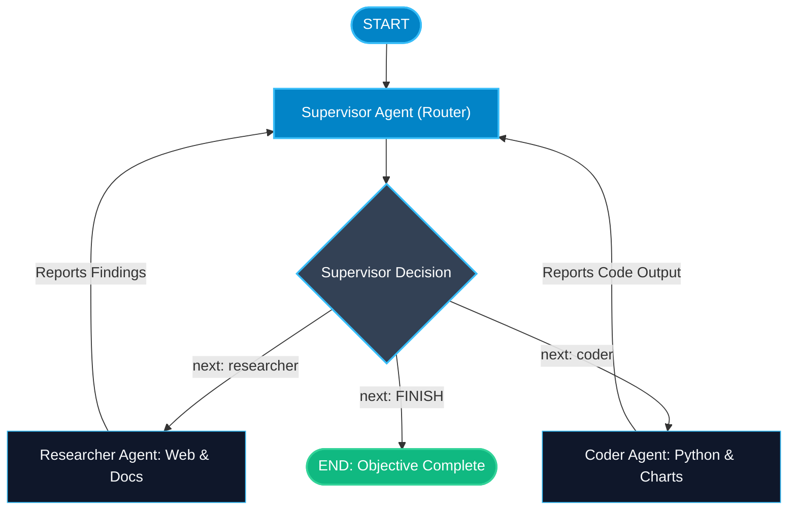

# Multi-Agent Supervisor Pattern in LangGraph

> "One monolithic agent given 40 tools gets confused and hallucinates. Splitting work across specialized agents coordinated by a Supervisor creates focus and accuracy."

---


### Step 1: Why Do We Need This?

#### The Real Problem

When building a sophisticated AI system (e.g. an automated research and software development team):
- If you give a single LLM 35 different tools (Git, Python, Web Search, SQL, Email, Slack, Bash):
  1. The prompt context is overwhelmed with tool schemas.
  2. The model frequently selects the wrong tool.
  3. Reasoning degrades, and system instructions conflict with each other.
- An agent tasked with writing code needs a very different system prompt and temperature than an agent tasked with researching competitors or auditing security.

Giving all responsibilities to one giant agent is the software equivalent of making one person the CEO, accountant, janitor, and frontend developer.

#### Why LangGraph Solves It

LangGraph implements the **Supervisor Pattern**:
- A central **Supervisor Node** acts as the project manager. It receives the user's objective and decides *which specialized worker agent* should act next.
- Each **Worker Agent** has narrow, dedicated tools and a focused system prompt (e.g. `CoderAgent`, `ResearcherAgent`).
- When a worker finishes its task, control loops back to the Supervisor to review the output and pick the next step or conclude with `FINISH`.

---

### Step 2: What Is It?

#### Simple Explanation

Think of an **orchestra conductor**:
- The conductor (Supervisor) does not play the violin, trumpet, or drums.
- The conductor points their baton at the violinist (Worker 1) to play a solo.
- When the solo finishes, the conductor signals the trumpeter (Worker 2) to join in.
- When the song is complete, the conductor bows to the audience (**`FINISH -> END`**).

#### Supervisor Architecture Components

| Component | Role in Simple English | Tools Access |
| :--- | :--- | :--- |
| **Supervisor Agent** | The router/planner. Inspects state and outputs the next worker name. | Routing schema only (e.g. `next: Literal["coder", "researcher", "FINISH"]`). |
| **Researcher Agent** | Gathers facts, browses the web, reads documents. | Web search, document loaders, vector stores. |
| **Coder Agent** | Writes, tests, and refactors Python/JS code. | Python REPL, terminal runner, syntax validator. |

---

### Step 3: Real-World Example

#### Autonomous Financial Research & Charting Team

Imagine an automated financial briefing team:
- **What it receives:** User prompt: *"Research Tesla Q3 2026 deliveries and generate a summary chart in Python."*
- **What decision it makes:**
  1. **Supervisor Turn 1:** Routes task to `ResearcherAgent`.
  2. **Researcher Action:** Searches financial news and extracts delivery numbers: 480,000 vehicles. Hands data back to state.
  3. **Supervisor Turn 2:** Reads data. Decides next worker is `CoderAgent`.
  4. **Coder Action:** Takes the delivery numbers and writes a Matplotlib script to save `tesla_q3.png`. Hands result to state.
  5. **Supervisor Turn 3:** Reviews chart and data. Decides task is complete: outputs `FINISH`.
- **What it outputs:** A verified briefing with text insights and an accompanying chart.

---

### Step 4: How Does It Work?

1. **Shared State:** A shared `messages` list where all agents append their work.
2. **Supervisor Output Schema:** The supervisor uses structured output with Pydantic:
   ```python
   class Router(BaseModel):
       next: Literal["researcher", "coder", "FINISH"]
   ```
3. **Register Workers:** Add each worker as a node in the graph (`builder.add_node("researcher", researcher_node)`).
4. **Conditional Routing:** A conditional edge routes from `supervisor` based on `state["next"]`.
5. **Return to Supervisor:** Every worker node has a direct edge pointing back to `supervisor`.

---

### Step 5: Code Example

Here is a complete, runnable LangGraph multi-agent supervisor system:

```python
from typing import TypedDict, Annotated, List, Literal
from pydantic import BaseModel
from langchain_core.messages import BaseMessage, HumanMessage, AIMessage
from langgraph.graph import StateGraph, START, END, add_messages

# 1. State definition shared by all agents
class TeamState(TypedDict):
    messages: Annotated[List[BaseMessage], add_messages]
    next: str

# 2. Worker 1: Dedicated Research Agent
def research_worker_node(state: TeamState) -> dict:
    print("-> [Researcher Agent]: Searching web databases...")
    return {
        "messages": [AIMessage(
            content="[Researcher]: Tesla produced 480,000 vehicles in Q3 2026, representing 12% YoY growth.",
            name="researcher"
        )]
    }

# 3. Worker 2: Dedicated Coder Agent
def coder_worker_node(state: TeamState) -> dict:
    print("-> [Coder Agent]: Writing visualization script...")
    return {
        "messages": [AIMessage(
            content="[Coder]: Matplotlib chart generated and saved to 'artifacts/tesla_q3.png'.",
            name="coder"
        )]
    }

# 4. Supervisor Node (Determines next worker or FINISH)
class SupervisorDecision(BaseModel):
    next: Literal["researcher", "coder", "FINISH"]

def supervisor_node(state: TeamState) -> dict:
    messages = state["messages"]
    last_msg = messages[-1]
    
    # Simple deterministic supervisor logic for demonstration:
    # 1. If starting -> route to researcher
    # 2. If researcher just finished -> route to coder
    # 3. If coder finished -> FINISH
    if getattr(last_msg, "name", None) == "researcher":
        chosen_worker = "coder"
    elif getattr(last_msg, "name", None) == "coder":
        chosen_worker = "FINISH"
    else:
        chosen_worker = "researcher"
        
    print(f"-> [Supervisor]: Reviewing progress. Routing next step to: '{chosen_worker}'")
    return {"next": chosen_worker}

# 5. Build Graph
builder = StateGraph(TeamState)

# Add nodes
builder.add_node("supervisor", supervisor_node)
builder.add_node("researcher", research_worker_node)
builder.add_node("coder", coder_worker_node)

# START connects directly to the supervisor
builder.add_edge(START, "supervisor")

# Conditional edges from supervisor to workers or END
builder.add_conditional_edges(
    "supervisor",
    lambda state: state["next"],
    {
        "researcher": "researcher",
        "coder": "coder",
        "FINISH": END
    }
)

# Every worker routes BACK to the supervisor for review!
builder.add_edge("researcher", "supervisor")
builder.add_edge("coder", "supervisor")

# Compile
team_graph = builder.compile()

if __name__ == "__main__":
    initial_input: TeamState = {
        "messages": [HumanMessage(content="Create a report with charts on Tesla Q3 performance.")],
        "next": ""
    }
    
    result = team_graph.invoke(initial_input)
    
    print("\n=== FINAL TEAM WORKFLOW LOG ===")
    for msg in result["messages"]:
        sender = getattr(msg, "name", "User")
        print(f"[{sender}]: {msg.content}")
```

---

### Step 6: How Is It Used in Production?

#### Production Patterns & Edge Cases

| Scenario | Production Challenge | Recommended Solution |
| :--- | :--- | :--- |
| **Worker Ping-Pong Loops** | Coder and Researcher keep passing the task back and forth without finishing. | Enforce a maximum supervisor loop count (e.g. 6 steps) before forcing `FINISH`. |
| **Context Window Bloat** | Sharing all intermediate scratchpad logs with the supervisor inflates tokens. | Have workers output clean summary messages instead of dumping 50KB raw logs into `messages`. |
| **Worker Identity Confusion** | LLM forgets which agent wrote which message. | Always set the `name` property on `AIMessage(content=..., name="researcher")`. |

---

### Step 7: Quick Revision

- The Supervisor pattern separates routing from execution.
- The Supervisor agent decides which worker acts next using structured output (`next`).
- Specialized worker agents have small, focused tool sets and custom system prompts.
- All workers route back to the Supervisor to report findings.
- When the objective is met, the Supervisor returns `FINISH`, routing the graph to `END`.

---

### Step 8: Final Flow Diagram



---

### Step 9: Quiz

Try answering these questions to check your understanding:

1. What is the primary role of the Supervisor in a multi-agent system?
   - A) To execute all database queries directly
   - B) To inspect current progress and route execution to the appropriate specialized worker
   - C) To compile Python code to machine code
   - D) To host the web frontend

2. Why is splitting a workflow into specialized workers better than using one monolithic agent with 40 tools?
   - A) It makes Python use fewer libraries
   - B) Monolithic agents get confused by large tool lists and hallucinate; specialized agents have high accuracy with focused tools
   - C) Monolithic agents cannot speak English
   - D) Single agents are illegal in production

3. What property on `AIMessage` helps differentiate which worker authored a message in the shared state?
   - A) `sender_ip`
   - B) `name`
   - C) `color`
   - D) `weight`

4. Where does the edge from each worker node lead in a standard Supervisor pattern?
   - A) Directly to `END`
   - B) Back to the `supervisor` node for progress evaluation
   - C) To the user's desktop
   - D) To a random node

*Submit your answers (e.g. 1-B, 2-B, 3-B, 4-B) to verify your score!*
