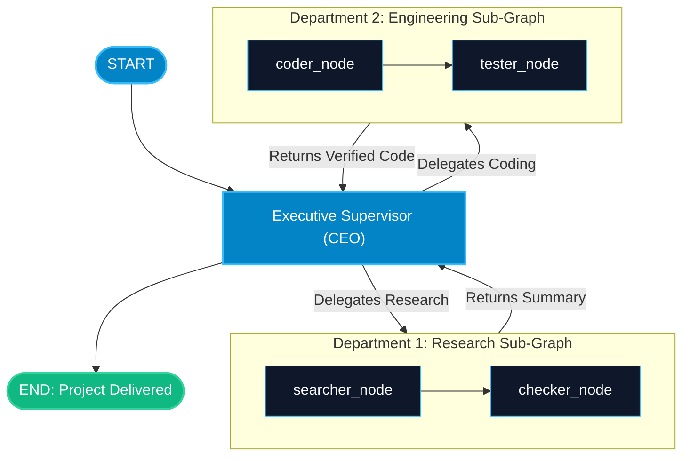

# Hierarchical Agent Teams in LangGraph

> "A flat team of 10 agents reporting to one boss creates a bottleneck. A company organizes into departments. Hierarchical agent teams organize into nested sub-graphs."

---

### Step 1: Why Do We Need This?

#### The Real Problem

In a flat supervisor system with 6 or 7 worker agents:
- The top-level supervisor must manage every micro-decision: *"Should the junior researcher search Bing or Google? Should the coder use pytest or unittest?"*
- The supervisor's prompt becomes bloated with operational guidelines for 7 different domains.
- A single failure in one minor sub-task can confuse the supervisor and derail the entire mission.

Human organizations do not work this way. A CEO does not supervise individual junior engineers. The CEO talks to the VP of Engineering, who supervises team leads, who direct individual developers.

#### Why LangGraph Solves It

LangGraph supports **Hierarchical Agent Teams**:
- **Top Supervisor (Executive):** High-level planning. Delegates entire projects to departmental teams (e.g. `ResearchTeam`, `DevTeam`).
- **Team Subgraphs (Department Leads):** Each team is its own compiled LangGraph with its own local supervisor and specialist workers.
- The top-level supervisor sees the team as a single node that consumes requirements and returns finished deliverables.

---

### Step 2: What Is It?

#### Simple Explanation

Think of a **movie production studio**:
- The **Director (Top Supervisor)** reviews the master script and decides: *"We need visual effects for Scene 4."*
- The Director calls the **VFX Department (Sub-Graph)**.
- Inside the VFX Department, the VFX Supervisor delegates tasks to 3D modelers, lighting artists, and texture painters.
- Once the scene is rendered, the VFX Department hands the finished video clip back to the Director. The Director never had to worry about 3D polygons or textures.

#### Flat vs Hierarchical Teams

| Architecture | Structure | Best For |
| :--- | :--- | :--- |
| **Flat Supervisor** | 1 Boss -> 3-4 Direct Workers | Simple 2-3 step tasks (e.g. Research + Write). |
| **Hierarchical Teams** | 1 Executive -> Department Subgraphs -> Specialized Workers | Enterprise software development, complex audits, multi-stage pipelines. |

---

### Step 3: Real-World Example

#### Autonomous Software Development Team

Imagine an end-to-end software building agent:
- **Top Executive:** Receives user request: *"Build a full-stack Next.js and FastAPI auth system"*.
- **Department 1: `Architecture_Team` (Sub-graph)**
  - Schema Lead + Security Specialist design API contracts and DB tables.
  - Hands approved design specs back to Executive.
- **Department 2: `Engineering_Team` (Sub-graph)**
  - Backend Lead routes to Python Coder + Unit Tester.
  - Generates code and confirms test pass rate is 100%.
  - Hands verified code repository back to Executive.
- **What it outputs:** High-quality, robust enterprise software built with zero context pollution between departments.

---

### Step 4: How Does It Work?

1. **Build Team Sub-Graphs:** Create and compile independent `StateGraph` workflows for each department (e.g. `research_team_graph`, `dev_team_graph`).
2. **Define Executive State:** Top-level state tracks master milestones, deliverables, and final customer outputs.
3. **Add Teams as Nodes:** Add the compiled team graphs directly as nodes in the executive graph:
   ```python
   exec_builder.add_node("research_team", research_team_graph)
   exec_builder.add_node("dev_team", dev_team_graph)
   ```
4. **Executive Router:** The executive evaluates high-level progress and routes between departments until the project is delivered.

---

### Step 5: Code Example

Here is a complete, runnable example of a 2-tier Hierarchical Agent Team in LangGraph:

```python
from typing import TypedDict, Annotated, List
from langchain_core.messages import BaseMessage, HumanMessage, AIMessage
from langgraph.graph import StateGraph, START, END, add_messages

# --- TIER 2: SPECIALIZED RESEARCH DEPARTMENT (SUB-GRAPH) ---
class ResearchTeamState(TypedDict):
    task: str
    raw_data: str
    verified_facts: List[str]

def web_searcher_node(state: ResearchTeamState) -> dict:
    return {"raw_data": f"Collected raw articles on: {state['task']}"}

def fact_checker_node(state: ResearchTeamState) -> dict:
    return {"verified_facts": [f"Fact 1: Verified source for {state['task']}", "Fact 2: Verified benchmark metrics."]}

research_builder = StateGraph(ResearchTeamState)
research_builder.add_node("searcher", web_searcher_node)
research_builder.add_node("checker", fact_checker_node)

research_builder.add_edge(START, "searcher")
research_builder.add_edge("searcher", "checker")
research_builder.add_edge("checker", END)

research_team_subgraph = research_builder.compile()

# --- TIER 1: EXECUTIVE SUPERVISOR GRAPH ---
class ExecutiveState(TypedDict):
    project_prompt: str
    research_summary: str
    final_article: str

# Adapter node to run research team and summarize
def run_research_department(state: ExecutiveState) -> dict:
    print("-> [Executive]: Delegating research phase to Research Department...")
    # Invoke the child sub-graph!
    child_result = research_team_subgraph.invoke({
        "task": state["project_prompt"],
        "raw_data": "",
        "verified_facts": []
    })
    facts_text = " | ".join(child_result["verified_facts"])
    return {"research_summary": facts_text}

def writer_department(state: ExecutiveState) -> dict:
    print("-> [Executive]: Delegating writing phase to Editorial Department...")
    article = f"# Publication: {state['project_prompt']}\n\nEvidence Base:\n{state['research_summary']}"
    return {"final_article": article}

# Assemble Top-Level Executive Graph
exec_builder = StateGraph(ExecutiveState)
exec_builder.add_node("research_dept", run_research_department)
exec_builder.add_node("writer_dept", writer_department)

exec_builder.add_edge(START, "research_dept")
exec_builder.add_edge("research_dept", "writer_dept")
exec_builder.add_edge("writer_dept", END)

executive_graph = exec_builder.compile()

if __name__ == "__main__":
    result = executive_graph.invoke({
        "project_prompt": "State of AI Agents in 2026",
        "research_summary": "",
        "final_article": ""
    })
    
    print("\n=== FINAL DELIVERABLE PRODUCED BY HIERARCHICAL SYSTEM ===")
    print(result["final_article"])
```

---

### Step 6: How Is It Used in Production?

#### Production Patterns & Edge Cases

| Scenario | Production Challenge | Recommended Solution |
| :--- | :--- | :--- |
| **Context Explosion** | A child sub-graph accumulates 50 chat messages, blowing past token limits if passed back. | Write an adapter node that summarizes child results into a concise 1-paragraph deliverable for the executive. |
| **Partial Failure in Sub-Team** | A junior agent in a sub-graph crashes. | Handle retries inside the sub-graph so minor hiccups do not bubble up and crash the executive graph. |
| **Debugging Complexity** | Tracking errors across 3 layers of nested graphs. | Enable LangSmith tracing. LangSmith automatically visualizes the full hierarchical tree with nested spans. |

---

### Step 7: Quick Revision

- Hierarchical architectures structure agents into executives, department leads, and specialist workers.
- Child sub-graphs encapsulate domain complexity, keeping the top supervisor prompt clean and focused.
- Intermediate scratchpad chatter stays inside the sub-graph; only finalized deliverables return to the executive.
- Sub-teams handle their own local error retries and tool routing.
- This pattern is the gold standard for large, multi-stage autonomous AI teams.

---

### Step 8: Final Flow Diagram



---

### Step 9: Quiz

Try answering these questions to check your understanding:

1. What is the primary benefit of a hierarchical agent architecture over a flat supervisor with 10 direct workers?
   - A) It eliminates the need for Python
   - B) It prevents the supervisor prompt from becoming overloaded with micro-details and isolates domain tasks
   - C) It guarantees 0ms latency
   - D) It bypasses LLM token fees

2. What does an adapter node typically do when calling a child sub-graph?
   - A) It extracts needed parameters from parent state, invokes the child graph, and summarizes results for the parent
   - B) It deletes the child graph
   - C) It translates code into C++
   - D) It closes the browser window

3. What should a child sub-graph return to the top-level executive graph?
   - A) 100 raw debug logs
   - B) A clean, validated deliverable or concise summary of findings
   - C) Nothing
   - D) An HTTP 404 status code

4. Which tool is recommended for visualizing nested execution trees in hierarchical agent teams?
   - A) Microsoft Excel
   - B) LangSmith (automatically tracks parent and child graph spans)
   - C) Notepad
   - D) A paper notebook

*Submit your answers (e.g. 1-B, 2-A, 3-B, 4-B) to verify your score!*
