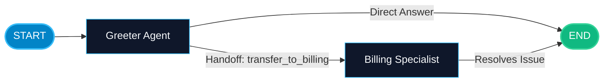

# Network and Swarm Collaboration in LangGraph

> "Not all teams need a central manager. In a swarm, peer agents collaborate directly by handing off control to each other like runners passing a baton."

---

### Step 1: Why Do We Need This?

#### The Real Problem

In supervisor-based multi-agent systems:
- Every single handoff must return to the central boss: `Agent A -> Boss -> Agent B -> Boss -> Agent C -> Boss`.
- If Agent A and Agent B need to have a quick 3-turn discussion to negotiate an API contract, routing through the boss each time adds unnecessary latency, extra LLM round-trips, and wasted tokens.
- The supervisor becomes a single point of failure and bottleneck.

Sometimes you need a **decentralized network** (or Swarm) where agents pass control directly to their peers when appropriate.

#### Why LangGraph Solves It

LangGraph natively supports decentralized agent networks using **Handoffs**:
- An agent can call a tool like `transfer_to_support_tier2(reason="Billing issue")`.
- The graph transitions control directly from `Tier1Agent` to `Tier2Agent` without stopping at a central supervisor.
- The conversational context travels smoothly with the handoff.

---

### Step 2: What Is It?

#### Simple Explanation

Think of a **customer calling phone support**:
- You talk to the frontline representative (Agent 1).
- When they realize your problem requires specialized network engineering, they say: *"One moment, I am transferring you directly to our Network Engineering team."*
- They press transfer (**Handoff Tool**). The network engineer picks up the line with your account details already open on their screen (**Transferred State**).
- No central company CEO had to intervene to approve the call transfer.

#### Supervisor vs Network / Swarm

| Feature | Supervisor Architecture | Network / Swarm Architecture |
| :--- | :--- | :--- |
| **Control Flow** | Centralized: all workers report back to one hub. | Decentralized: peer-to-peer handoffs between agents. |
| **Handoff Mechanism** | Supervisor chooses `next` worker via router. | Agents invoke handoff tools directly: `transfer_to_b()`. |
| **Latency** | Higher: 2 LLM calls per worker transition. | Lower: direct transition to the next specialist. |
| **Best For** | Strict corporate workflows, compliance audits. | Dynamic customer service triage, peer brainstorming. |

---

### Step 3: Real-World Example

#### Omnichannel E-Commerce Triage Swarm

Imagine an enterprise customer service team:
- **What it receives:** User message: *"My order #401 arrived with a broken screen. I want a refund."*
- **What decision it makes:**
  1. `TriageAgent` reviews message, identifies two needs: Hardware Damage + Refund.
  2. `TriageAgent` calls handoff tool: `transfer_to_returns_specialist`.
  3. Control shifts directly to `ReturnsAgent`.
  4. `ReturnsAgent` verifies warranty, initiates shipping label, and calls `transfer_to_billing_specialist`.
  5. `BillingAgent` processes the $120 refund and issues the final confirmation to the user.
- **What it outputs:** Fast, natural multi-department problem resolution.

---

### Step 4: How Does It Work?

1. **Define Handoff Tools:** Create tools whose sole purpose is to signal a transition to another agent:
   ```python
   def transfer_to_billing() -> str:
       return "Transferred to Billing Specialist."
   ```
2. **Conditional Routing on Handoffs:** Write a router function on each agent node that inspects tool calls. If `transfer_to_billing` was called, route directly to `billing_node`.
3. **Shared History:** All agents append to `messages: Annotated[list, add_messages]`, ensuring context is preserved across transfers.

---

### Step 5: Code Example

Here is a complete, runnable LangGraph example of decentralized peer-to-peer handoffs:

```python
from typing import TypedDict, Annotated, List, Optional
from langchain_core.messages import BaseMessage, HumanMessage, AIMessage, ToolMessage
from langgraph.graph import StateGraph, START, END, add_messages

# 1. Shared State Definition
class SwarmState(TypedDict):
    messages: Annotated[List[BaseMessage], add_messages]
    active_agent: str

# 2. Agent 1: Frontline Greeter
def greeter_node(state: SwarmState) -> dict:
    print("-> [Greeter Agent]: Assessing user request...")
    user_msg = state["messages"][-1].content.lower()
    
    if "refund" in user_msg or "billing" in user_msg:
        # Greeter decides to hand off directly to Billing!
        return {
            "active_agent": "billing",
            "messages": [AIMessage(
                content="I am transferring you directly to our Billing Specialist to resolve this.",
                name="greeter"
            )]
        }
    else:
        return {
            "active_agent": "complete",
            "messages": [AIMessage(content="Hello! How can I assist you today?", name="greeter")]
        }

# 3. Agent 2: Billing Specialist
def billing_node(state: SwarmState) -> dict:
    print("-> [Billing Specialist]: Processing invoice review...")
    return {
        "active_agent": "complete",
        "messages": [AIMessage(
            content="[Billing]: I reviewed your account and successfully initiated your refund.",
            name="billing_specialist"
        )]
    }

# 4. Swarm Router Function
def route_swarm(state: SwarmState) -> str:
    agent = state.get("active_agent")
    if agent == "billing":
        return "billing"
    else:
        return END

# 5. Build Graph
builder = StateGraph(SwarmState)
builder.add_node("greeter", greeter_node)
builder.add_node("billing", billing_node)

builder.add_edge(START, "greeter")

# Direct handoff edge: Greeter can hand off to Billing OR finish!
builder.add_conditional_edges(
    "greeter",
    route_swarm,
    {
        "billing": "billing",
        END: END
    }
)

# Billing finishes the conversation
builder.add_edge("billing", END)

swarm_graph = builder.compile()

if __name__ == "__main__":
    initial_input: SwarmState = {
        "messages": [HumanMessage(content="I was overcharged on my subscription and need a refund.")],
        "active_agent": "greeter"
    }
    
    result = swarm_graph.invoke(initial_input)
    
    print("\n=== SWARM CONVERSATION TRANSCRIPT ===")
    for msg in result["messages"]:
        sender = getattr(msg, "name", "User")
        print(f"[{sender}]: {msg.content}")
```

---

### Step 6: How Is It Used in Production?

#### Production Patterns & Edge Cases

| Scenario | Production Challenge | Recommended Solution |
| :--- | :--- | :--- |
| **Circular Handoff Loops** | Agent A hands off to Agent B, who hands off back to Agent A forever. | Track a `handoff_count` in state. If count > 4, force a route to a human representative. |
| **Context Overload in Long Swarms** | Passing 30 messages across 4 handoffs causes high latency. | Each agent generates a 1-sentence handoff summary when calling the transfer tool. |
| **Security Boundaries** | A user tricks Greeter into transferring directly to an Admin tool node. | Validate user authorization and roles before permitting privileged agent handoffs. |

---

### Step 7: Quick Revision

- Network/Swarm architectures use decentralized peer-to-peer handoffs.
- Agents hand off control directly without returning to a central supervisor each time.
- Handoffs reduce latency and token usage by removing intermediate supervisor reasoning steps.
- Always enforce a maximum handoff limit to prevent circular transfer loops between agents.
- Context and conversation history flow seamlessly with the handoff.

---

### Step 8: Final Flow Diagram



---

### Step 9: Quiz

Try answering these questions to check your understanding:

1. What distinguishes a Swarm / Network multi-agent system from a Supervisor system?
   - A) Swarms do not use Python
   - B) In a swarm, peer agents hand off control directly to each other without needing a central supervisor for every step
   - C) Swarms only work with open-source models
   - D) Supervisor systems cannot save checkpoints

2. What is a "handoff" in LangGraph multi-agent systems?
   - A) When a server crashes
   - B) A mechanism where one agent transfers control and conversation state directly to a peer agent
   - C) Exporting data to a CSV file
   - D) Disconnecting the Wi-Fi

3. What danger must you guard against in decentralized multi-agent handoffs?
   - A) Circular handoff loops where Agent A and Agent B pass tasks back and forth indefinitely
   - B) Running out of disk space in 1 second
   - C) Python deleting global variables
   - D) Keyboard disconnection

4. How do you prevent circular handoff loops in production?
   - A) By deleting the agents
   - B) By tracking a handoff counter in state and routing to a human or default fallback if it exceeds a limit (e.g. 4)
   - C) By setting model temperature to 2.0
   - D) By disabling all tools

*Submit your answers (e.g. 1-B, 2-B, 3-A, 4-B) to verify your score!*
