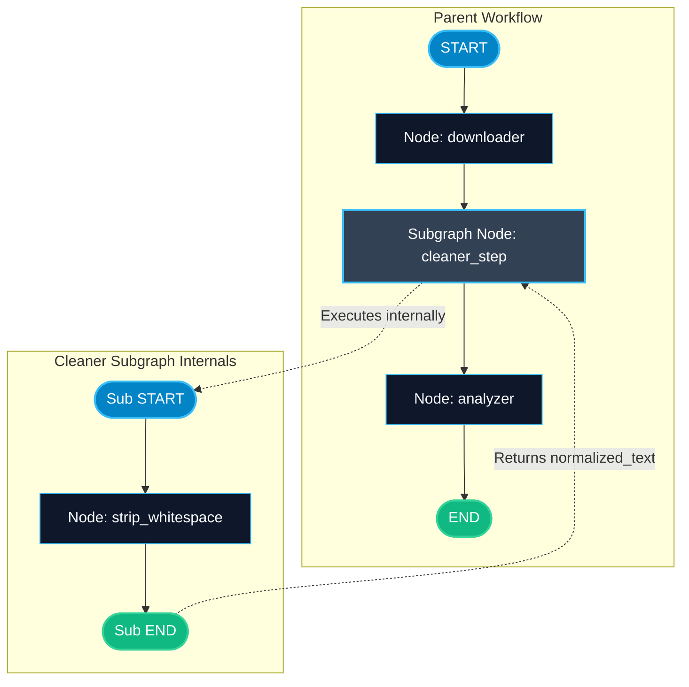

# Subgraphs as Nodes in LangGraph

> "Trying to build an entire operating system in a single Python file creates unmaintainable chaos. Subgraphs let you encapsulate complex workflows as reusable, testable black-box nodes."

---

### Step 1: Why Do We Need This?

#### The Real Problem

As your AI application expands from a simple prototype into an enterprise solution:
- Your graph grows to 30 nodes with dozens of edge connections.
- Your state schema becomes an enormous dictionary with 40 keys, making it hard to reason about which node modifies which key.
- Team collaboration breaks down: 5 engineers editing the same graph file causes continuous git merge conflicts.
- Testing is painful: to test the PDF parser, you have to run the entire 30-node graph.

Monolithic graphs violate core software engineering principles: encapsulation, modularity, and separation of concerns.

#### Why LangGraph Solves It

LangGraph treats any compiled graph as a **Node**:
- You can build, test, and version a complete 5-node sub-graph independently.
- You can drop that compiled graph directly into a parent graph: `parent_builder.add_node("subgraph_name", compiled_subgraph)`.
- The child graph can have its own clean, private state schema, keeping the parent state lean and tidy.

---

### Step 2: What Is It?

#### Simple Explanation

Think of a **computer motherboard and a graphics card (GPU)**:
- The motherboard (Parent Graph) manages system power, CPU, and memory bus.
- It does not contain millions of tiny shader transistors directly on its surface.
- Instead, it has a PCIe slot where you plug in a complete graphics card (Subgraph).
- The graphics card has its own cooling fans, memory, and internal circuits (Private State & Nodes). The motherboard just sends raw 3D data and receives rendered frames.

#### Monolithic Graph vs Modular Subgraphs

| Metric | Monolithic Graph | Modular Subgraphs |
| :--- | :--- | :--- |
| **State Scope** | 1 giant global schema with 40 keys. | Isolated local schemas per sub-graph + small parent schema. |
| **Team Workflow** | Merge conflicts on one shared graph file. | Independent teams own and test their own subgraphs. |
| **Testability** | Hard: must invoke the full graph. | Easy: unit-test each subgraph in isolation with mock inputs. |
| **Reusability** | Zero: graph logic is tightly coupled. | High: drop the same `rag_subgraph` into 5 different parent apps. |

---

### Step 3: Real-World Example

#### Enterprise Document Processing Pipeline

Imagine an insurance claim processing pipeline:
- **Parent Graph:** `Intake -> OCR & Extraction Subgraph -> Fraud Analysis Subgraph -> Payout Node -> END`.
- **`OCR_Extraction_Subgraph` (Internal Details):**
  - Node A: Split PDF pages.
  - Node B: Run vision model on damage photos.
  - Node C: Parse invoice line items into JSON.
- The parent graph never worries about image DPI, bounding boxes, or PDF page counts. It simply feeds a PDF URL and receives a structured claim object.
- **What it outputs:** Clean modularity and instant maintainability.

---

### Step 4: How Does It Work?

1. **Design Child State & Logic:** Create `ChildState` with fields needed strictly for that sub-task.
2. **Compile Child Graph:** Assemble nodes and call `child_graph = child_builder.compile()`.
3. **Plug into Parent:** Add `child_graph` to the parent graph just like any normal node function:
   `parent_builder.add_node("child_step", child_graph)`.
4. **State Mapping:**
   - If parent and child share keys, LangGraph passes them automatically.
   - If schemas differ, write a simple adapter function to map between parent and child schemas.

---

### Step 5: Code Example

Here is a complete, runnable example demonstrating subgraphs as nodes with isolated state schemas:

```python
from typing import TypedDict
from langgraph.graph import StateGraph, START, END

# --- 1. CHILD SUBGRAPH: TEXT CLEANER & TRANSLATOR ---
class CleanerState(TypedDict):
    raw_text: str
    normalized_text: str

def remove_whitespace_node(state: CleanerState) -> dict:
    cleaned = " ".join(state["raw_text"].strip().split())
    return {"normalized_text": cleaned}

cleaner_builder = StateGraph(CleanerState)
cleaner_builder.add_node("strip_whitespace", remove_whitespace_node)
cleaner_builder.add_edge(START, "strip_whitespace")
cleaner_builder.add_edge("strip_whitespace", END)

# Compile child subgraph
cleaner_subgraph = cleaner_builder.compile()

# --- 2. PARENT GRAPH: INGESTION PIPELINE ---
class ParentIngestState(TypedDict):
    source_url: str
    raw_text: str
    normalized_text: str
    word_count: int

def fetch_document_node(state: ParentIngestState) -> dict:
    # Simulate downloading messy document content
    messy_text = "   LangGraph   subgraphs   enable     modular   AI   engineering.   "
    return {"raw_text": messy_text}

def analyze_document_node(state: ParentIngestState) -> dict:
    words = len(state["normalized_text"].split())
    return {"word_count": words}

parent_builder = StateGraph(ParentIngestState)

# Add parent nodes
parent_builder.add_node("downloader", fetch_document_node)

# Add the compiled child subgraph directly as a node!
parent_builder.add_node("cleaner_step", cleaner_subgraph)

parent_builder.add_node("analyzer", analyze_document_node)

# Connect pipeline
parent_builder.add_edge(START, "downloader")
parent_builder.add_edge("downloader", "cleaner_step")
parent_builder.add_edge("cleaner_step", "analyzer")
parent_builder.add_edge("analyzer", END)

parent_graph = parent_builder.compile()

if __name__ == "__main__":
    result = parent_graph.invoke({
        "source_url": "https://docs.langchain.com/guide.pdf",
        "raw_text": "",
        "normalized_text": "",
        "word_count": 0
    })
    
    print("=== PARENT PIPELINE RESULTS ===")
    print("1. Raw Text:       ", repr(result["raw_text"]))
    print("2. Cleaned Text:   ", repr(result["normalized_text"]))
    print("3. Final Word Count:", result["word_count"])
```

---

### Step 6: How Is It Used in Production?

#### Production Patterns & Edge Cases

| Scenario | Production Challenge | Recommended Solution |
| :--- | :--- | :--- |
| **Mismatched Schema Keys** | Parent state uses `user_prompt` while child subgraph expects `query`. | Write a lightweight wrapper function that maps `{"query": state["user_prompt"]}` before calling the child. |
| **Independent Checkpointing** | Child subgraph needs to resume from its own internal breakpoints. | LangGraph manages namespaced checkpointing automatically so parent and child snapshots co-exist cleanly. |
| **Unit Testing** | Testing the full parent graph takes 30 seconds per test in CI/CD. | Write fast pytest unit tests for each child subgraph independently with mock inputs. |

---

### Step 7: Quick Revision

- Any compiled `StateGraph` can be registered as a node in another graph.
- Subgraphs encapsulate complexity, making large AI systems modular and readable.
- Child graphs can have their own private state schemas.
- Common shared keys pass between parent and child automatically.
- Subgraphs enable team scalability: different teams can develop, test, and deploy their own subgraphs.

---

### Step 8: Final Flow Diagram



---

### Step 9: Quiz

Try answering these questions to check your understanding:

1. How do you register a compiled child subgraph into a parent graph?
   - A) By copying the child's Python code into `main.py`
   - B) By passing the compiled child graph directly into `parent_builder.add_node("name", child_graph)`
   - C) Subgraphs cannot be used as nodes
   - D) By exporting the child graph to JSON

2. What is the primary architectural advantage of using subgraphs?
   - A) It makes Python run on mobile devices
   - B) It encapsulates domain logic, isolates state schemas, and allows independent testing and team ownership
   - C) It guarantees zero token usage
   - D) It prevents database backups

3. What happens if the child subgraph state and parent graph state share identical key names (e.g. `raw_text`)?
   - A) LangGraph crashes with a key conflict
   - B) LangGraph automatically passes the value from parent into child and updates the parent with the child's result
   - C) Both keys are deleted
   - D) Python reboots

4. If a child subgraph needs a key called `query` but the parent state stores it as `user_input`, how should you handle it?
   - A) Rename all database tables
   - B) Write a small adapter node function that maps `{"query": state["user_input"]}` before invoking the child graph
   - C) Delete the child graph
   - D) It is impossible to connect them

*Submit your answers (e.g. 1-B, 2-B, 3-B, 4-B) to verify your score!*
