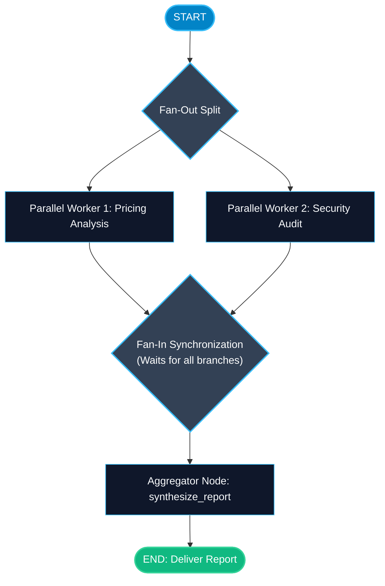

# Parallel Branch Execution and Fan-Out in LangGraph

> "Running independent tasks one after another in a straight line is a waste of time. Fan-out runs parallel tasks at the same time, cutting latency from seconds to milliseconds."

---

### Step 1: Why Do We Need This?

#### The Real Problem

Consider a comprehensive research query: *"Analyze our competitor across 3 dimensions: Pricing, Security, and Customer Reviews"*.
If you execute sequentially:
- Task 1 (Pricing search): Takes 3 seconds.
- Task 2 (Security scan): Takes 4 seconds.
- Task 3 (Review scrape): Takes 3 seconds.
- Total wait time: **10 seconds**.

None of these tasks depend on each other. Running them sequentially forces your users to wait unnecessarily and wastes available CPU and network capacity.

#### Why LangGraph Solves It

LangGraph has native **Fan-Out** and **Fan-In**:
- **Fan-Out:** Connect one source node to multiple destination nodes (`add_edge(source, branch_1)` and `add_edge(source, branch_2)`).
- LangGraph runs both branches **concurrently** in parallel threads or async tasks.
- **Fan-In:** Both parallel branches connect to a common aggregator node. The aggregator automatically waits until *both* branches finish before executing.
- Total wait time drops from 10 seconds to 4 seconds (the duration of the single slowest task).

---

### Step 2: What Is It?

#### Simple Explanation

Think of a **fast-food drive-thru**:
- When you order a burger, fries, and a drink:
- The restaurant does not make the burger, wait until it is packaged, then start cooking fries, and then pour the drink.
- Three cooks work in parallel: Cook A grills the burger, Cook B drops the fries, and Cook C fills the drink cup (**Fan-Out**).
- The expediter waits until all 3 items land on the counter, puts them in one bag, and hands them to you (**Fan-In**).

#### Sequential vs Parallel Execution

```text
Sequential (10s total):
  Start ──▶ Task A (3s) ──▶ Task B (4s) ──▶ Task C (3s) ──▶ Aggregator

Parallel Fan-Out (4s total):
            ┌──▶ Task A (3s) ──┐
  Start ────┼──▶ Task B (4s) ──┼──▶ Aggregator (Waits for all) ──▶ Finish
            └──▶ Task C (3s) ──┘
```

---

### Step 3: Real-World Example

#### Pre-Deployment Security and Compliance Audit

Imagine a CI/CD code deployment assistant:
- **What it receives:** A Pull Request git commit to audit before deploying.
- **What decision it makes:**
  1. The graph fans out into 3 parallel scanners simultaneously:
     - `dependency_scanner`: Checks for known CVEs.
     - `secret_detector`: Scans for leaked AWS keys or passwords.
     - `unit_test_runner`: Executes the test suite.
  2. All three complete their checks in parallel.
  3. `Fan-In` aggregator collects findings into `findings: Annotated[list, operator.add]`.
  4. If any scanner logged a critical flag, the deployment halts.
- **What it outputs:** Comprehensive security validation in one-third of the time.

---

### Step 4: How Does It Work?

1. **Add Edges from One Source to Multiple Nodes:**
   ```python
   builder.add_edge(START, "branch_a")
   builder.add_edge(START, "branch_b")
   ```
2. **Channel Reducers:** The state channels that branches write to must have reducers (like `operator.add`) so concurrent updates merge cleanly without overwriting.
3. **Connect to Collector (Fan-In):**
   ```python
   builder.add_edge("branch_a", "aggregator")
   builder.add_edge("branch_b", "aggregator")
   ```
4. **LangGraph Barrier Synchronization:** LangGraph automatically guarantees that `aggregator` will NOT run until both `branch_a` and `branch_b` have finished their work.

---

### Step 5: Code Example

Here is a complete, runnable example demonstrating parallel fan-out and fan-in synchronization:

```python
import time
from typing import TypedDict, Annotated, List
import operator
from langgraph.graph import StateGraph, START, END

# 1. State definition with append reducer
class CompetitorReportState(TypedDict):
    competitor_name: str
    insights: Annotated[List[str], operator.add]
    final_briefing: str

# 2. Parallel Branch 1: Pricing Analysis
def analyze_pricing_node(state: CompetitorReportState) -> dict:
    name = state["competitor_name"]
    print(f"-> [Branch 1]: Scraping pricing plans for {name}...")
    time.sleep(0.3)  # Simulate network latency
    return {
        "insights": [f"[{name} Pricing]: Base tier starts at $29/mo; Enterprise is custom."]
    }

# 3. Parallel Branch 2: Security & Compliance Analysis
def analyze_security_node(state: CompetitorReportState) -> dict:
    name = state["competitor_name"]
    print(f"-> [Branch 2]: Scanning SOC2 and ISO compliance for {name}...")
    time.sleep(0.3)  # Simulate network latency
    return {
        "insights": [f"[{name} Security]: Certified SOC2 Type II, GDPR compliant, AWS hosted."]
    }

# 4. Aggregator Node (Fan-In)
def synthesize_report_node(state: CompetitorReportState) -> dict:
    print("-> [Aggregator]: Both parallel branches finished! Compiling report...")
    all_insights = state["insights"]
    summary = "=== COMPETITOR INTELLIGENCE BRIEF ===\n" + "\n".join(f"- {i}" for i in all_insights)
    return {"final_briefing": summary}

# 5. Assemble Graph with Fan-Out and Fan-In
builder = StateGraph(CompetitorReportState)

builder.add_node("pricing_worker", analyze_pricing_node)
builder.add_node("security_worker", analyze_security_node)
builder.add_node("synthesizer", synthesize_report_node)

# FAN-OUT: START connects to BOTH workers simultaneously
builder.add_edge(START, "pricing_worker")
builder.add_edge(START, "security_worker")

# FAN-IN: BOTH workers connect to the synthesizer
builder.add_edge("pricing_worker", "synthesizer")
builder.add_edge("security_worker", "synthesizer")

builder.add_edge("synthesizer", END)

parallel_graph = builder.compile()

if __name__ == "__main__":
    start_time = time.time()
    
    result = parallel_graph.invoke({
        "competitor_name": "Datadog",
        "insights": [],
        "final_briefing": ""
    })
    
    elapsed = time.time() - start_time
    print(f"\nExecution finished in {elapsed:.2f} seconds.")
    print(result["final_briefing"])
```

---

### Step 6: How Is It Used in Production?

#### Production Patterns & Edge Cases

| Scenario | Production Challenge | Recommended Solution |
| :--- | :--- | :--- |
| **Channel Write Clashes** | Parallel branches write to a plain string key without a reducer. LangGraph crashes or overwrites. | Always use `Annotated[list, operator.add]` or a custom merge reducer for keys written by parallel nodes. |
| **One Branch Fails** | Branch 1 succeeds in 1 second, but Branch 2 crashes with a timeout. | Wrap branch execution in try/except blocks inside the node so the aggregator still receives partial results. |
| **Rate Limit Throttling** | Fanning out to 10 parallel LLM calls triggers provider 429 rate limit errors. | Limit parallel branch count or use an async semaphore to throttle outbound requests. |

---

### Step 7: Quick Revision

- Fan-Out runs multiple independent nodes concurrently from a single upstream node.
- Fan-In automatically synchronizes branches, waiting until all parallel tasks finish before executing the aggregator.
- Channels written by parallel nodes must have reducers (e.g. `operator.add`) to safely merge updates.
- Parallel execution drastically slashes latency for multi-source retrieval and independent evaluations.
- Handle individual branch errors gracefully so one failing branch does not cancel the entire pipeline.

---

### Step 8: Final Flow Diagram



---

### Step 9: Quiz

Try answering these questions to check your understanding:

1. What is "Fan-Out" in LangGraph?
   - A) Blowing air on the server CPU
   - B) Connecting one node to multiple destination nodes so they execute concurrently in parallel
   - C) Deleting branches
   - D) Translating Python to C++

2. What requirement must be met for a state key that multiple parallel branches write to simultaneously?
   - A) The key must be a float
   - B) The key must have a reducer defined (such as `Annotated[list, operator.add]`) so updates merge without collision
   - C) The key must be named `temp`
   - D) No reducer is ever needed

3. What does "Fan-In" guarantee?
   - A) That the downstream aggregator node will only run after ALL incoming parallel branches have finished executing
   - B) That the first branch to finish kills all other branches
   - C) That memory is wiped
   - D) That costs are doubled

4. If Branch A takes 2 seconds and Branch B takes 3 seconds, what is the approximate execution time when run with fan-out?
   - A) 5 seconds
   - B) Approximately 3 seconds (the duration of the single slowest task)
   - C) 0 seconds
   - D) 10 seconds

*Submit your answers (e.g. 1-B, 2-B, 3-A, 4-B) to verify your score!*
