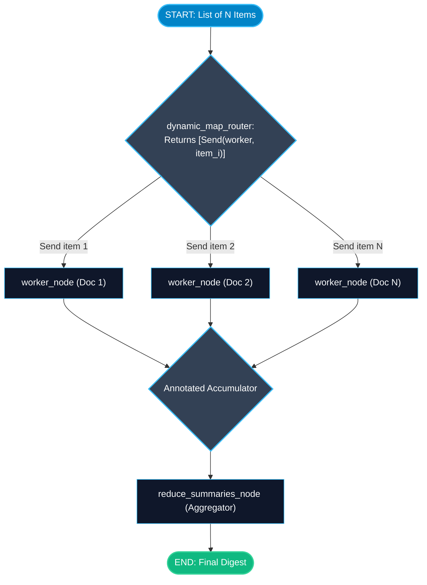

# Map-Reduce Workflows with the Send API in LangGraph

> "Standard fan-out requires you to know how many branches you have ahead of time. The Send API lets an agent spawn 5, 20, or 100 parallel workers dynamically based on runtime data."

---

### Step 1: Why Do We Need This?

#### The Real Problem

In lesson 2, we learned standard Fan-Out: you connect Node A to Node B and Node C using static edges.
This works when you know the branch count ahead of time (e.g. exactly 2 branches: Pricing & Security).

Now consider this real-world task:
- A user uploads a 50-page PDF document.
- You want to summarize each page or section in parallel and combine them into a final book summary.
- Today the PDF has 4 pages (4 parallel workers needed).
- Tomorrow another user uploads a PDF with 42 pages (42 parallel workers needed).

You cannot hardcode 42 static nodes and edges in Python ahead of time. You need a way to **dynamically map** over a runtime list of items and **reduce** the results into one output.

#### Why LangGraph Solves It

LangGraph provides the **`Send` API**:
- Inside a conditional edge router, you can return a list of `Send("node_name", individual_item_payload)`.
- LangGraph spawns a parallel execution of that node for every `Send` object in the list.
- All mapped workers execute concurrently.
- Their outputs flow into a reducer channel, where an aggregator node performs the final **Reduce** step.

---

### Step 2: What Is It?

#### Simple Explanation

Think of a **teacher grading exam papers for 30 students**:
- **Sequential (Bad):** One teacher grades student 1, then student 2, all the way to student 30 (takes 5 hours).
- **Static Fan-Out:** Hardcoding 3 specific teacher assistants. Fails if you suddenly have 300 students.
- **Dynamic Map-Reduce (`Send` API):**
  - **Map Step:** The principal takes the stack of 30 papers and creates 30 assignments (`Send("grade_paper", paper_1)`, `Send("grade_paper", paper_2)`...).
  - 30 graders process their assigned exam simultaneously.
  - **Reduce Step:** The school recorder collects all 30 grades, calculates the class average, and publishes the final report.

#### Map-Reduce Architecture with `Send`

```text
[Input: List of N Items]
          │
    (Router with Send API)
   ┌──────┼──────┬──────┐
   ▼      ▼      ▼      ▼
 [Task 1] [Task 2] ... [Task N]  (All execute in parallel!)
   │      │      │      │
   └──────┴──────┼──────┘
                 ▼
          (Reduce Step)
     [Aggregator Combines Output]
```

---

### Step 3: Real-World Example

#### Multi-Document Translation & Sentiment Analysis

Imagine a global customer sentiment monitor:
- **What it receives:** A batch of 8 customer reviews written in French, German, Spanish, and Japanese.
- **What decision it makes:**
  1. `batch_ingest_node` reads the batch of 8 reviews.
  2. The router function loops over each review and returns 8 `Send("translate_and_score", review)` objects.
  3. LangGraph spawns 8 parallel worker nodes simultaneously.
  4. Each worker translates its assigned review to English and scores its sentiment (-1.0 to +1.0).
  5. The outputs collect into `scores: Annotated[list, operator.add]`.
  6. The `reduce_node` calculates the overall average sentiment and drafts a summary.
- **What it outputs:** High-speed parallel batch processing in the time it takes to process a single review.

---

### Step 4: How Does It Work?

1. **Import `Send`:** `from langgraph.constants import Send` (or `from langgraph.graph import Send`).
2. **Define Worker State:** The target node receives a small state schema representing its single assigned task.
3. **Write the Dynamic Router:**
   ```python
   def map_over_items(state: MasterState):
       return [Send("worker_node", {"item": item}) for item in state["items"]]
   ```
4. **Attach with `add_conditional_edges`:** Connect the source node to the dynamic router function.
5. **Connect Workers to Aggregator:** Direct edges from `worker_node` route into the final reducer node.

---

### Step 5: Code Example

Here is a complete, runnable example using LangGraph's `Send` API to dynamically map and reduce:

```python
from typing import TypedDict, Annotated, List
import operator
from langgraph.graph import StateGraph, START, END, Send

# 1. State for the Master Graph
class DocumentBatchState(TypedDict):
    documents: List[str]
    # Reducer accumulates results from all dynamically spawned workers!
    summaries: Annotated[List[str], operator.add]
    final_digest: str

# 2. State for an Individual Worker Node
class WorkerTaskState(TypedDict):
    doc_text: str

# 3. Worker Node: Processes a single document
def process_single_doc_node(state: WorkerTaskState) -> dict:
    text = state["doc_text"]
    words = len(text.split())
    # Return output to be accumulated in the master 'summaries' channel
    return {
        "summaries": [f"Document ({words} words): '{text[:30]}...' processed successfully."]
    }

# 4. Aggregator Node: The Reduce Step
def reduce_summaries_node(state: DocumentBatchState) -> dict:
    all_summaries = state["summaries"]
    digest = "=== BATCH PROCESSING REPORT ===\n" + "\n".join(f"- {s}" for s in all_summaries)
    return {"final_digest": digest}

# 5. Dynamic Router: Emits Send objects based on runtime data!
def dynamic_map_router(state: DocumentBatchState):
    docs = state.get("documents", [])
    # Dynamically spawn one worker for every document in the list!
    return [Send("worker", {"doc_text": doc}) for doc in docs]

# Build Graph
builder = StateGraph(DocumentBatchState)

builder.add_node("worker", process_single_doc_node)
builder.add_node("reducer", reduce_summaries_node)

# Dynamic conditional edge from START using the Send API!
builder.add_conditional_edges(START, dynamic_map_router, ["worker"])

# Route all finished workers into the reducer
builder.add_edge("worker", "reducer")
builder.add_edge("reducer", END)

map_reduce_graph = builder.compile()

if __name__ == "__main__":
    # Test batch with 4 runtime documents
    batch_input: DocumentBatchState = {
        "documents": [
            "Quarterly earnings for Q1 showed 15% ARR expansion across European sectors.",
            "Kubernetes migration completed with zero recorded downtime for customer traffic.",
            "Security vulnerability patched in third-party authentication dependency.",
            "Customer NPS score rose to 68 following platform UI redesign."
        ],
        "summaries": [],
        "final_digest": ""
    }
    
    result = map_reduce_graph.invoke(batch_input)
    print(f"Total Items Processed in Parallel: {len(result['summaries'])}")
    print(result["final_digest"])
```

---

### Step 6: How Is It Used in Production?

#### Production Patterns & Edge Cases

| Scenario | Production Challenge | Recommended Solution |
| :--- | :--- | :--- |
| **Massive Batch Throttling** | Mapping over 500 documents triggers rate limits or exhausts system memory. | Chunk large batches into groups of 10-20 items, or use an async semaphore inside the worker. |
| **Partial Worker Failure** | 1 out of 50 workers crashes due to an invalid character encoding. | Catch exceptions inside the worker node and return an error summary string so the reduce step still succeeds. |
| **Different State Schemas** | The worker node takes a different state schema than the master graph. | `Send("node_name", custom_payload)` allows you to pass a custom dictionary matching the worker's schema. |

---

### Step 7: Quick Revision

- The `Send` API enables dynamic Map-Reduce workflows in LangGraph.
- Inside a router, return a list of `Send("node_name", payload)` to spawn parallel executions dynamically.
- You do not need to know the number of parallel tasks ahead of time.
- Use `Annotated[list, operator.add]` on the parent state to collect outputs from all mapped workers.
- The downstream reduce node waits for all mapped tasks to finish before executing.

---

### Step 8: Final Flow Diagram



---

### Step 9: Quiz

Try answering these questions to check your understanding:

1. What is the primary advantage of the `Send` API over standard static fan-out edges?
   - A) It makes Python use fewer CPU cores
   - B) It allows you to dynamically spawn an arbitrary number of parallel workers at runtime based on the data in state
   - C) It eliminates the need for functions
   - D) It only works on Wednesdays

2. Where do you return `Send` objects in a LangGraph application?
   - A) Inside a conditional edge router function
   - B) Inside the `.env` file
   - C) Inside the database connection string
   - D) In the HTML frontend

3. What parameters does the `Send` constructor take?
   - A) `(username, password)`
   - B) `(destination_node_name, item_payload_dictionary)`
   - C) `(ip_address, port_number)`
   - D) `(start_time, end_time)`

4. What happens when multiple dynamically spawned `Send` workers finish their tasks?
   - A) Their outputs are merged into the target reducer channel, and the downstream reducer node executes once all workers finish
   - B) Only the fastest worker's output is kept and the rest are deleted
   - C) LangGraph resets the computer
   - D) The program exits without executing the reducer

*Submit your answers (e.g. 1-B, 2-A, 3-B, 4-A) to verify your score!*
